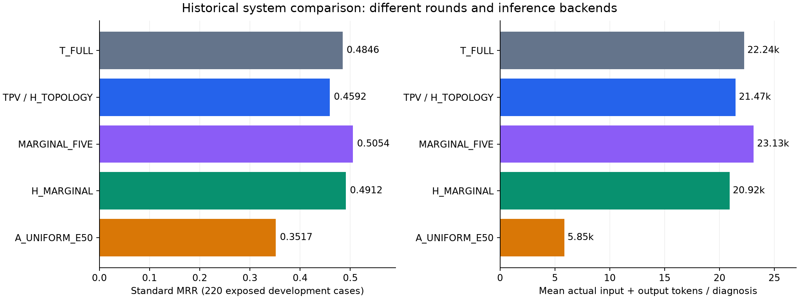
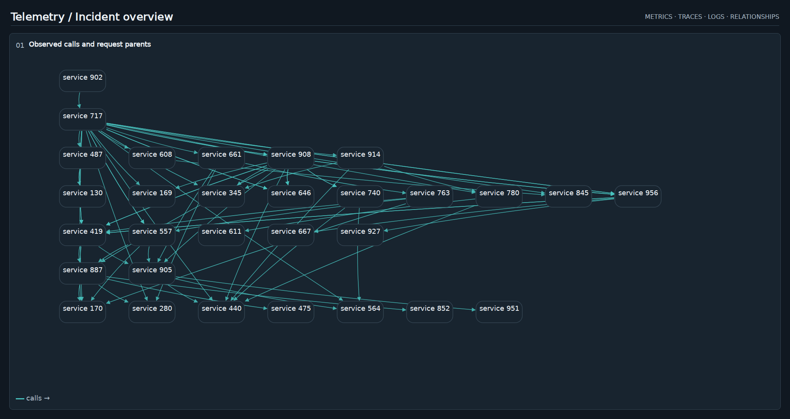
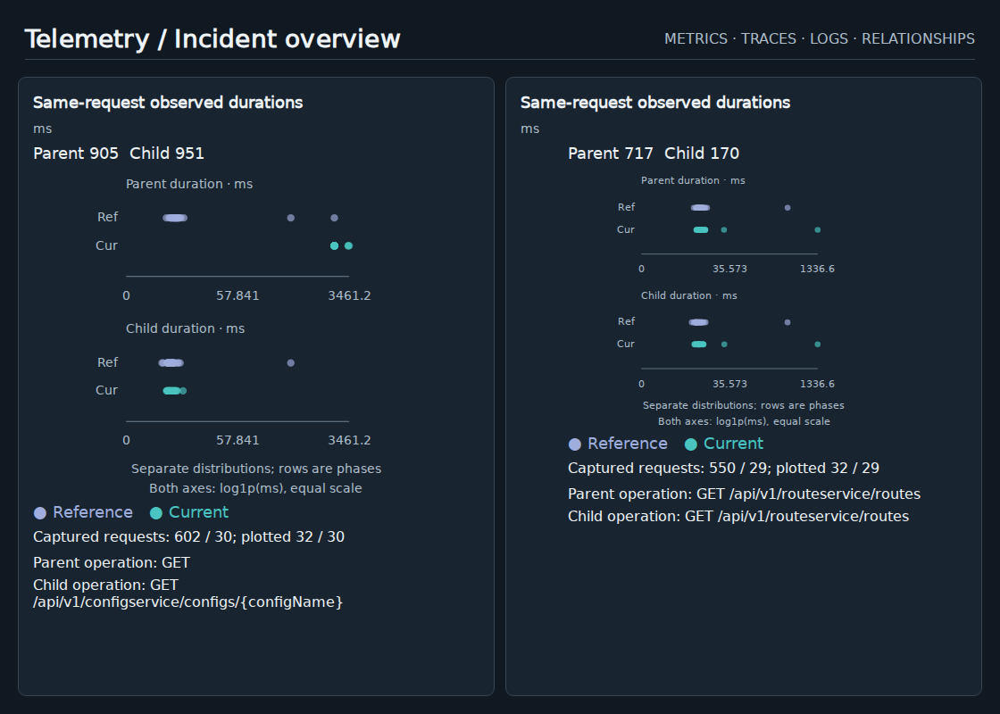
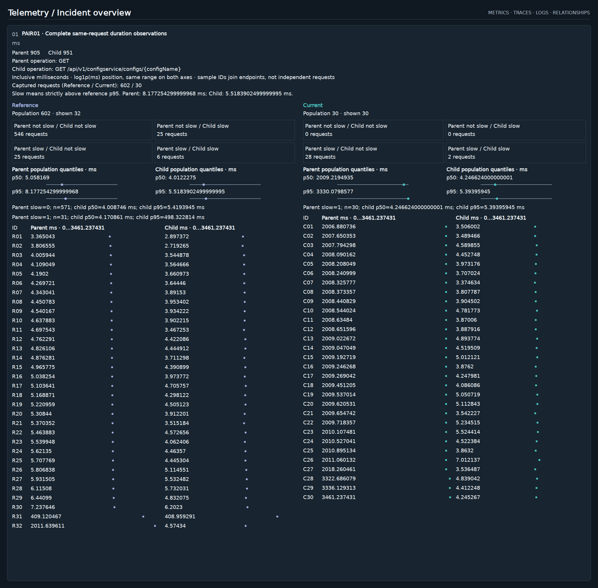

# CanvasRCA 组会说明：强文本、拓扑视觉化、耗时边际图与 Uniform 剪枝

日期：2026-10-21。读者：了解 RCA，但没有参与 CanvasRCA 开发的研究者。

本报告介绍四类代表方法，并用实际输入说明它们如何工作。边际图有两个重要版本，因此结果表中有五个具体 arm。**Arm 指实验中的一个方法条件**，例如使用同一套证据，但改变某部分证据的呈现方式。

**[打开配套 HTML：真实 dashboard、独立展示的 prompt 与文本证据、模型原回答](methods_brief_2026-10-21_assets/index.html)**

HTML 可直接在浏览器打开，不依赖服务器或网络。每个 arm 使用同一个病例作示例，便于横向理解。每份请求保留原文与原图，展示层把说明和证据分开；完整输入顺序也可以展开查看。这里没有重新生成模型回答，没有重画实验 dashboard，没有改写历史评分。

本次补充：各方法章节末尾提供可点击的源码入口；第10节解释论文启发及设计来源；第11节集中介绍反直觉发现。源码链接打开仓库内的实现文件，旁边列出应查看的函数。历史结果的实际输入仍以配套 HTML 中的冻结请求为准，不能用后来修改过的工作区源码替代历史版本。

## 1. 先理解我们究竟在比较什么

CanvasRCA 的问题是：面对同一个故障，模型需要综合多种遥测证据，给出可能根因的排序。我们希望知道，哪些证据适合用文字表达，哪些适合用图形表达，以及图像是否能在节省输入的同时帮助诊断。

本报告沿用四类证据的项目缩写：

| 缩写 | 指什么 | 一般包含什么 |
|---|---|---|
| M | Metrics，指标 | CPU、内存、磁盘等指标的时间序列、基线和窗口统计 |
| R | Traces，请求链路记录 | 操作的调用次数、错误、耗时，以及父子调用的观测 |
| L | Logs，日志 | 模板、错误率、出现次数及保留的诊断字段 |
| G | Graph relationships，关系 | 谁调用谁、服务对应哪些 pod、pod 位于哪个 node |

这里的 R 是项目对 Trace 证据的记号。service、pod、node 在输入中使用病例内的匿名数字 ID。三个层级都可能成为根因候选；输出字段虽然叫 `services`，实际也允许 pod 和 node。

几种方法都使用冻结的本地 Qwen3.8-27B，采用 BF16 精度，并在**一次模型调用**中给出五个不同候选及简短理由。图形来自统一 renderer，即项目共用的绘图组件与操作库。它们没有训练新的模型。

这些方法的差别可以先用下面这张表理解：

| 方法条件 | 模型在文字中看到什么 | 模型在图像中看到什么 | 这项设计主要改变什么 |
|---|---|---|---|
| **T_FULL** | 完整的冻结诊断文本、候选及说明 | 无 | 强文本参照 |
| **H_TOPOLOGY，本文的新 TPV** | 指标、Trace、日志、配对及其余证据 | 调用与部署拓扑 | 把关系记录从文字移入图像 |
| **MARGINAL_FIVE** | 完整诊断文本，包含配对样本和统计 | 最多两组父子耗时的边际分布 | 用图像再次呈现部分已有文字事实 |
| **H_MARGINAL** | 配对来源以外的诊断证据 | 配对样本、统计及边际图 | 将整组配对事实独占地交给图像 |
| **A_UNIFORM_E50，简称 U** | 公共任务、读图和输出说明 | 全部诊断证据与候选目录 | 完整图像编码后，选择较少视觉 token 给语言模型 |

**Hybrid 指诊断证据由文字和图像共同承载。** 这不一定意味着重复：MARGINAL_FIVE 有跨模态重复，H_TOPOLOGY 和 H_MARGINAL 则按来源分工。U 是纯视觉诊断证据，但图外仍有必要的任务说明。

“完整”只指该实验继承的冻结证据集合，并不意味着模型读到了原始监控系统中的每一条遥测记录。上游已经做过证据选择，这一点对文字和图像方法都成立。

## 2. 结果口径与一页总览

### 2.1 数据与分数怎么读

五个具体 arm 均有同一批 220 例的完整主结果：AIOPS-2022 为 60 例，AIOPS-2025 为 60 例，AegisLab 为 100 例。它们是反复用于方法开发的已暴露病例，不能称为独立确认集。

MRR 是每例首次命中可接受根因的倒数排名，再求平均。例如根因在第 1、2、5 位，分别贡献 1、0.5、0.2；没有命中贡献 0。单个病例的这个分数叫 RR，多个病例的平均才叫 MRR。AC@1、AC@3、AC@5 表示根因是否进入前 1、3、5 名。

总体 MRR 按 220 例加权，AegisLab 因此占 100/220。三个数据集等权的宏平均另列。标准评分保留模型无效回答的零分。宽容评分只用于识别格式或候选输出问题，不能替换标准主结果。

### 2.2 总体表现

| Arm | 实验 | 标准 MRR | AC@1 | AC@3 | AC@5 | 每例总 token | 相对 T_FULL 的 MRR 差 | 相对 T_FULL 的 token 变化 |
|---|---|---:|---:|---:|---:|---:|---:|---:|
| T_FULL | RQ4.1 | 0.4846 | 39.09% | 56.82% | 64.09% | 22,243.9 | — | — |
| H_TOPOLOGY | RQ4.5 | 0.4592 | 35.45% | 54.55% | 63.18% | 21,469.8 | −0.0255 | −3.48% |
| MARGINAL_FIVE | RQ3.16 | **0.5054** | 40.91% | 58.18% | 66.82% | 23,127.6 | +0.0208 | +3.97% |
| H_MARGINAL | RQ4.5 | 0.4912 | 40.00% | 55.00% | 66.36% | 20,915.9 | +0.0066 | −5.97% |
| A_UNIFORM_E50 | RQ4.1 | 0.3517 | 24.09% | 44.55% | 56.36% | **5,850.7** | −0.1329 | **−73.70%** |



这张表说明了三种不同的价值。MARGINAL_FIVE 在这里有最高排名点估计，但略增 token。H_MARGINAL 保持接近强文本的排名，并减少约 6% token。U 的 token 节省最大，但仍有明显排名损失。因此不能用“最好”一个词把它们合在一起：要先说明是在比较准确率，还是成本。

**这是跨实验的工程比较。** T_FULL 与 U 来自 RQ4.1 的同一 HF 后端；MARGINAL_FIVE 来自 RQ3.16；两种独占 hybrid 来自 RQ4.5 的 vLLM 后端。静态提示、解码实现和运行时期也有差异。跨轮分数差不能全部归因于某一种图形。

这里的 HF 指 Hugging Face/PyTorch 模型执行实现；vLLM 是另一种模型推理服务。它们是运行同一模型的不同软件路径，不是不同的 RCA 方法。BF16 则是实验使用的 16 位浮点数精度。

### 2.3 分数据集表现

| Arm | AIOPS-2022，60例 | AIOPS-2025，60例 | AegisLab，100例 | 三集等权宏平均 |
|---|---:|---:|---:|---:|
| T_FULL | 0.3650 | **0.4039** | 0.6048 | 0.4579 |
| H_TOPOLOGY | 0.3783 | 0.3594 | 0.5675 | 0.4351 |
| MARGINAL_FIVE | **0.4286** | 0.3708 | 0.6322 | **0.4772** |
| H_MARGINAL | 0.3461 | 0.3764 | **0.6472** | 0.4566 |
| A_UNIFORM_E50 | 0.3050 | 0.2811 | 0.4222 | 0.3361 |

例如，H_MARGINAL 的总体略高于 T_FULL，但宏平均略低。原因是它在两个 AIOPS 数据集退化，在病例更多的 AegisLab 上改善。组会上应同时讲这两个事实。

## 3. 强文本基线 T_FULL：模型实际拿到了什么

### 3.1 这个 arm 的设计

第一步，系统把已选遥测整理成可追踪的公共记录。每条记录具有实体、指标或操作名称、单位和事实编号。例如 `MET01` 表示一条指标证据，`TRC02` 表示一条 Trace 证据。编号用来引用来源，不是重要性排名。

第二步，把记录按 M→R→L→G 的结构写成文本。核心指标包含 64 个相对时间桶的序列，Trace 包含调用数量和耗时等信息，日志保留模板及诊断字段，关系以明确的端点和方向表达。

第三步，在基础记录之外，保留历史实验逐渐加入的有效信息：全窗口首末值、极值及位置，额外资源指标，主机和实例观测，以及真实请求的父子耗时样本和统计。全文还带有完整候选列表。

有些重复序列值使用 `length/value_positions` 编码。例如一个值在多个位置相同，可以列出该值及其位置范围。这里是保留所有桶的紧凑记录，不是把时序截成几个点。它也不同于 RQ3.21 另外测试的 PACK 方法；不能因为文本里有这种编码，就把 T_FULL 叫作那个压缩实验臂。

第四步，模型收到阅读规则和诊断任务。规则要求它区分单位、耗时口径、关系方向和因果推断，再在同一次调用中检查首选候选，最后输出五个不同 ID。

因此，**T_FULL 是经过证据工程与任务设计的强文本系统，不是把原始日志直接粘给模型。** 提示中的 `SIRCL*` 指本项目继承并适配的证据检查纪律，不表示这就是外部 SIRCL 仓库的原始系统成绩。

### 3.2 Prompt 在做什么

它首先定义诊断目标：找到起因，而不是最大的下游症状。然后说明 M/R/L/G 的含义。接着要求模型形成初步判断，用两项可由证据回答的检查进行验证，其中至少一项考虑矛盾或其他起因。

这些检查都发生在**一次调用内部**。它没有先发出 QA 调用，再把 QA 答案交给第二个 RCA 调用。

下面是实际 prompt 的关键原文节选；[完整说明](methods_brief_2026-10-21_assets/examples/T_FULL/instructions.txt)和[完整文本证据](methods_brief_2026-10-21_assets/examples/T_FULL/evidence.txt)分别提供：

```text
A fault has occurred in the system. Identify the component where the fault originated, not the loudest downstream or co-located symptom.

Use the selected SIRCL* diagnostic discipline in M -> R -> L -> G order:

VERIFY: test top-1 with exactly two questions answerable from the supplied M/R/L/G evidence, including one possible contradiction or alternative origin.

Output cardinality for this request: return exactly five distinct IDs from the supplied candidate list, ranked by plausibility. Additional ranks are alternatives, not claims of five simultaneous causes. Keep the same services, reason, and confidence JSON fields.
```

全文还有单位、独立分位数不能相减、缺失不等于零等规则。末尾的“五个不同 ID”要求补充了早期任务块中的“最多五个”，导出文件忠实保留了历史原文。

### 3.3 它的表现与适用边界

T_FULL 的总体 MRR 为 0.4846，220 份主回答均满足登记输出要求，平均总 token 为 22,243.9。它的主要优点是精确数字、长操作名及完整列表直接可读，不必先从缩小后的图中识别字符。

它仍然会推断错误。文本明确写着关系方向，并不保证模型能区分根因和受害者；有完整数值，也不保证它不会偏向异常最大的服务。

本次离线分层中，T_FULL 在 AegisLab 的 JVM 内存压力 14 例上 MRR 为 0.8929，在 ContainerKill 8 例上为 1.0000；在 AIOPS-2025 的 pod failure 11 例上只有 0.0485。这是具体的已测差异，不能推广为对所有同名故障的保证。

**没有 dashboard 例图，因为这个 arm 实际不发送图片。** HTML 展示它的真实文字请求，避免把事后生成的文字截图误当作实验输入。

### 3.4 不同历史“强文本”不要混称

RQ3.16 的同事实文字控制叫 `PAIR_FIVE`，MRR 为 **0.4436**。本报告用于跨轮工程参照的 T_FULL 是 RQ4.1 的 **0.4846**，继承完整强文本事实，但处于后续任务接口和推理配方下。

所以，MARGINAL_FIVE 对同期 PAIR_FIVE 的差是 **+0.0617**；对后续 T_FULL 的差是 **+0.0208**。两项回答的问题不同。RQ4.1 另有相同文字输入的原生后端控制 `T_NATIVE`，MRR 为 0.4861；这里使用项目后续一直沿用的 T_FULL，不临时换成分数稍高的版本。

### 3.5 对应代码与原始 prompt

- [RQ4.1 文本条件构造](../RQs/RQ4_1/src/exps.py)：查看 `text_conditions`。T_FULL 直接保留冻结的 `public['texts']['RAW_TEXT']`；同文件中的 T_LEDGER/T_DEP 是其他实验条件，不能混成 T_FULL。
- [全窗口摘要的构造](../RQs/RQ3_14/src/exps.py)：查看 `observations`、`compile_public`；[连续配对事实的构造](../RQs/RQ3_15/src/exps.py)：查看 `extract`、`compile_public`。它们帮助解释强文本中的摘要和配对信息从哪里来。
- [这次展示病例实际收到的任务说明](methods_brief_2026-10-21_assets/examples/T_FULL/instructions.txt)与[文字证据](methods_brief_2026-10-21_assets/examples/T_FULL/evidence.txt)分别保存；查看 prompt 时优先使用这两份实际输入。

## 4. TPV：只把拓扑交给图像

### 4.1 名称与版本

本文把 TPV 用作“拓扑视觉化，其余诊断证据保留文字”的方法简称。早期实验中有直接叫 TPV 的 arm；**新版 unified renderer 上最直接的对应实现是 RQ4.5 的 H_TOPOLOGY。** 它不是早期 TPV 的原样重跑。

早期 RQ1.1 的主三数据集 300 例中，TPV 为 0.3819、文字 T 为 0.3093，曾有明确正向结果。但那一轮的病例集合、证据和基线都不同，不能把这个差值搬到目前的 220 例上。[历史总览及来源](../important_docs/CanvasRCA_Project_Review_and_Research_Roadmap_2026-10-12.md)

### 4.2 H_TOPOLOGY 怎样构造一次请求

第一步，从冻结公共证据中取出完整调用和部署关系。这里包括 caller→callee、node→pod，以及 service→pod。它们是观测关系，不是模型推测出的因果边。

第二步，用已有“实体节点＋有向箭头”组件分别画调用图和部署图。图中的标签说明节点身份，箭头说明关系方向。分开绘制是为了避免把调用和部署混成同一种联系。

第三步，从文本中移除被移交的关系记录。其余指标、Trace 数值、日志和父子耗时配对仍留在文字中。实体 ID 可以作为关联标签同时出现；同一条被移交的拓扑边不再在文字中重复。

第四步，把图像与剩余文字放进一次诊断请求。模型可以用图确定“谁与谁相连”，再用精确文本判断“这些实体发生了什么变化”。

该 hybrid 保留图像中全部登记锚点与证据支持，即 A∪E；它没有再使用 U 的 E50 选择。完整图像依然先经过视觉编码，之后才收集登记支持对应的特征。

这个设计的直觉是：箭头可以把关系直接摆在空间中，减少阅读长边列表的负担。但如果图里交叉边很多，精确追踪端点反而可能更难。因此拓扑图并不是天然优于文字关系表。

### 4.3 Prompt 与例图

它使用与同轮其他 hybrid 共有的诊断说明，再补充图像/文字分工规则。实际原文包括：

```text
Identify the original faulty component, not the largest downstream or co-located symptom.

Evidence ownership: the images and text are complementary, not repeated evidence.

Directed arrows are observed calls or deployment, not causal proof.
```

完整原文还包含通用边际图说明；这个说明是同轮 hybrid 共用的，并不代表 H_TOPOLOGY 实际发送了边际图。

历史请求中另残留一句“relations ... remain in text”的旧泛化说明，与实际拓扑移交不一致。**按真实输入，它仍然是 topology 在图中的 hybrid。** 本报告不修正旧请求，也不把这个措辞问题认定为排名下降的原因；其影响没有被单独测量。



同一次请求还有[部署关系图](methods_brief_2026-10-21_assets/examples/H_TOPOLOGY/dashboard_2.png)。这是一个病例的一份请求、两张真实图片；不是两个案例。[Prompt](methods_brief_2026-10-21_assets/examples/H_TOPOLOGY/instructions.txt) · [剩余文本证据](methods_brief_2026-10-21_assets/examples/H_TOPOLOGY/evidence.txt)

### 4.4 它什么时候好，什么时候不好

总体 MRR 为 **0.4592**，比历史 T_FULL 低 0.0255；平均总 token 为 **21,469.8**，减少 3.48%。220 例中相对 T_FULL 有 28 例 RR 改善、38 例变差、154 例不变。

分数据集看，AIOPS-2022 为正向差 +0.0133；AIOPS-2025 和 AegisLab 分别为 −0.0444、−0.0373。它没有形成三个数据集一致的排名收益。

按可接受根因层级看，pod-only 的 23 例中，它达到 0.4312，高于 T_FULL 的 0.2638；service-only 的 152 例中，它为 0.5087，低于 T_FULL 的 0.5648。这个结果说明，**总体退化与特定层级上的帮助可以同时存在**。不过 pod-only 这组全部来自 AIOPS-2022，数据集与层级混在一起，不能直接认定“拓扑图专门改善 pod 故障”。

实际示例 `INC-058FC5DD18AD` 中，T_FULL 把可接受根因 905 放第一，H_TOPOLOGY 改把 661 放第一、905 放第二。后者理由声称 905 是 caller，因此不是起因；但“是 caller”本身不能排除其为根因。这个例子显示了关系被用于错误排除的风险，并不能证明错误必然由绘图造成。

### 4.5 对应代码

- [RQ4.5 模态分工与拓扑构造](../RQs/RQ4_5/src/exps.py)：依次查看 `ownership`、`residual_text`、`topology_cards`。前三步分别决定哪些来源进入图像、从文字中移除它们、生成调用及部署关系卡片。
- [unified renderer 的节点—箭头组件](../src/renderer/web/components/RelationshipGraph.tsx)：这是实际图形表达入口；[拓扑来源处理](../src/renderer/topology.py)用于理解公共关系的组织。
- [实际 H_TOPOLOGY 任务说明](methods_brief_2026-10-21_assets/examples/H_TOPOLOGY/instructions.txt)保留历史措辞，包括前文说明过的旧提示冲突。本报告不通过改写这份文件来修饰历史输入。

## 5. Marginal graph：把父子耗时的变化摆在一起

### 5.1 “边际”是什么意思

先考虑一条真实请求：父调用耗时 100ms，直接子调用耗时 80ms。多条请求就会得到很多这样的数值对。

边际图把这些数值拆成两个视图：一个看父调用耗时如何分布，另一个看子调用耗时如何分布。每个视图又区分 reference 和 current 两个公共阶段。reference 是参考窗口，current 是当前窗口；它们不等同于私有故障注入时间。

模型可以比较：父子是否一起变慢，是否只有一端明显变化，或者是否只是少量极端请求拉长了尾部。p50 表示中位数，p95 表示第 95 百分位数。

**它不是按时间顺序绘制的传播图。** 点的位置主要表示耗时，不表示事件发生先后。父调用较慢而子调用较快，也不能单独证明父调用自身就是根因；这里只比较同请求中分别记录的 inclusive duration，即包含子调用的跨度耗时。不能把两端差值直接叫作本地执行时间。

### 5.2 原始卡片如何选择

每个关系只连接同一 trace 中身份明确的父 span 与直接子 span。一个 span 是一次调用的记录；trace 是包含这些调用的同一请求链路。

同一请求、同一父操作出现多次时，先选耗时最长的父调用，再选对应子操作中最长的直接子调用。缺少子调用时不把它补成零。

关系的 reference/current 阶段都至少需要 20 个有效请求。候选关系按父调用两阶段 `log1p(p95_ms)` 变化绝对值排序，最多展示两个。`log1p(x)` 是对 `1+x` 取自然对数，允许零值，并压缩长尾范围。

每阶段最多选 32 个真实配对：按父耗时排序，再等距取秩位置，包含两端，不插值。因此图中是确定性子样本，不是全部请求的概率密度图。最终排序较靠前也不代表该关系一定包含根因。

### 5.3 MARGINAL_FIVE：图像是额外呈现

这个 arm 首先保留完整 `PAIR_FIVE` 文本。文字已经包含 M/R/L/G、配对数值及统计。然后额外加入一张 1120×800 的原生边际图，通常有两个关系卡片。每张关系卡分别绘制父、子的 reference/current 耗时点。

最后要求模型输出恰好五个不同候选。名字中的 **FIVE 指五个输出候选，不是五张边际图，也不是五个采样点**。

它测试的是：把已有事实再次组织成容易比较的图，能否帮助模型排序。它没有通过删除文本配对证据来降低成本。



[Prompt 与读图说明](methods_brief_2026-10-21_assets/examples/MARGINAL_FIVE/instructions.txt) · [完整文本证据，包括配对样本](methods_brief_2026-10-21_assets/examples/MARGINAL_FIVE/evidence.txt)

其 prompt 主体沿用第 3 节的诊断纪律，另外说明父子 duration 的单位和配对选择。实际原文包括：

```text
Observed request pairs: all durations below are milliseconds, inclusive span durations.

Output cardinality for this request: return exactly five distinct IDs from the supplied candidate list, ranked by plausibility.
```

这两个片段之间还有完整读法及实际样本，均保存在 HTML 和原始请求 JSON 中。

### 5.4 MARGINAL_FIVE 的收益来自哪里

完整结果为 MRR **0.5054**。对同轮、同事实文本 PAIR_FIVE 的 0.4436，点估计提高 **0.0617**；52 例 RR 改善、43 例变差、125 例相同。

但同轮还有一个关键控制 `MARKLESS_FIVE`：保留同样的文本、图像布局、轴、标签和范围，只去掉耗时数据点。它仍达到 **0.4963**。完整图对去点图仅高 **0.0091**，209/220 例 RR 不变。

因此，我们可以说这套“完整文本＋边际图＋固定五候选”的方案有较高成绩；不能说已经证明“耗时点的形状就是主要收益来源”。标签、操作名、范围或重复突出信息也可能参与，现有对照没有把这些原因全部区分开。

RQ3.16 原登记的四项主要比较经过 Holm 多重校正后没有通过。对 PAIR_FIVE 的病例层校正 p 为 0.5326，事件组层为 0.8824。这限制了统计归因，但不改变实际测得的正点估计。该轮另有固定五候选相对灵活候选数量的正向证据，不能把输出规则收益全部归给图。

相对后来 T_FULL，它提高 0.0208，token 增加 3.97%。这个差值可作工程参照，不能替代同轮对照。

### 5.5 H_MARGINAL：图像独占配对事实

这个后续版本先把整组配对来源移出文本，包括样本和相应统计。为了不遗漏原图没有直接呈现的事实，它改用 `trace_joint.complete_marginals` 组件。

新组件保留父子分布，并显示对应样本编号或对齐样本行、精确数值、总体与采样数量、阈值、联合计数、分位数和条件统计。这样模型可以在图中找到原来由文字承担的配对信息。它不只是把旧文本截图放上画布。

其余指标、日志、Trace 和拓扑继续留在文字中。实体、单位和阶段标签可以重复以帮助对应，但配对诊断数值及统计不再跨模态重复。



同例的[第二张配对图](methods_brief_2026-10-21_assets/examples/H_MARGINAL/dashboard_2.png)也属于该请求。[Prompt](methods_brief_2026-10-21_assets/examples/H_MARGINAL/instructions.txt) · [配对移交后的文本](methods_brief_2026-10-21_assets/examples/H_MARGINAL/evidence.txt)

它达到 **0.4912 MRR**，总 token **20,915.9**。相对历史 T_FULL，MRR +0.0066、token −5.97%；相对 MARGINAL_FIVE，MRR −0.0142、token 约 −9.56%。这是较好的成本折中，但没有证明删除跨模态重复一定无损。

RQ4.5 还统一整理了重复任务说明，每例减少 522 个 token。这部分收益来自提示精简，不能全部记为图像压缩功劳。

### 5.6 两种边际图的适用边界

MARGINAL_FIVE 在 AIOPS-2022 改善较大，尤其是一些容器 CPU 和内存病例。对同期 PAIR_FIVE，pod-only 23 例从 0.2500 提高到 0.4630。但在 AIOPS-2025，同事实文字的 AC@5 为 50%，图像臂只有 46.67%；AegisLab 也从 85% 降到 82%。**MRR 更高不代表候选覆盖全面改善。**

H_MARGINAL 的整体优势主要来自 AegisLab：MRR 0.6472，对历史 T_FULL 增加 0.0423，AC@5 从 80% 到 87%。两个 AIOPS 数据集的 MRR 则均下降。node-only 的 28 例从 T_FULL 的 0.3690 降到 0.2607，是值得注意的弱项。

这些图选的是耗时变化明显的关系。它们适合提供调用比较的线索，却不能替代全部资源、协议、代码或日志证据。RQ3.16 中，选中关系的端点在评分粒度上覆盖可接受根因的病例仅为 24/60、18/60、41/100；“有图可画”与“画到了根因”不是同一件事。

此外，9/220 例没有合格配对。RQ3.16 的 MARGINAL_FIVE 回退相应完整文本；RQ4.5 的 H_MARGINAL 按其登记使用 H_TOPOLOGY 输入，其中 4 例连可转移拓扑也没有，实际为零图像。所有病例仍在分母中。因此 H_MARGINAL 的整体分数也包含这个已登记回退策略。

### 5.7 两种边际方法的代码入口

- **配对数据怎么来：**[RQ3.15 配对与统计](../RQs/RQ3_15/src/exps.py)中的 `extract`、`sampled_indices`、`compile_public`，对应真实父子调用配对、确定性抽样和文字事实。
- **MARGINAL_FIVE 怎样把文字与图片一起发送：**[RQ3.16 条件构造](../RQs/RQ3_16/src/exps.py)中的 `compile_public`、`schema_for`、`parts_for`。这里可以直接看到固定五候选要求，以及图像追加到完整文字输入的行为。
- **原生边际图怎么画：**[RequestPairMarginals.tsx](../src/renderer/web/components/RequestPairMarginals.tsx)进入[共享 RequestPairPlot.tsx](../src/renderer/web/components/RequestPairPlot.tsx)，以 `joint=false` 绘制两个边际分布。去点对照通过 `marks` 开关实现。
- **H_MARGINAL 怎样独占承载：**[RQ4.5 编译代码](../RQs/RQ4_5/src/exps.py)中的 `ownership`、`residual_text`、`pair_cards`，以及[CompleteMarginals.tsx](../src/renderer/web/components/CompleteMarginals.tsx)。它们对应整组移交和完整样本／统计显示，不是直接复用旧边际图就声称事实完整。

## 6. A_UNIFORM_E50：保护读图信息，再做空间覆盖

### 6.1 为什么它与“删卡片”不同

U 接收的是一张完整诊断 dashboard。核心指标、Trace、日志、关系、窗口摘要、配对和候选目录都在图中。图外只有静态说明。

模型先对**完整图片**做视觉编码，把像素转换成很多特征向量。每个向量称为一个视觉 token，具有原始位置。因为视觉编码过程已经融合上下文，这个向量不一定只包含所在小块的信息。

U 在这之后才删除部分向量，让后续语言模型读取较短的序列。因此它没有先把卡片擦掉，也没有随机裁掉图片的一半。RQ4.8 的卡片删除发生在编码前，是另外一种干预，不能认为自然继承 U 的收益。

### 6.2 两个集合决定哪些位置可以删

先定义 **A，必须保护的锚点集合**。它包括候选和实体身份、单位、阶段、坐标、方向以及必要日志文字等读图支持。只要一个 token 与这些支持相交，它就整体保留；它也可能同时携带一部分数值。

再定义 **E，可选证据支持集合**。它来自已登记数值或图形的实际前景位置，并排除 A。E 不是整张画布减去 A，也不是所有看起来不重要的像素。

E50 的总预算是：

\[
K=|A|+\lceil |E|/2\rceil
\]

这意味着全部 A 加上一半 E。**50% 的分母是 E，不是整张图。**

220 例平均有 16,251.6 个原始视觉 token，其中 A 约 4,614.0 个，E 约 1,217.5 个。最终保留约 5,223.0 个，相当于原始序列的 32.14%。强制保护的 A 占最终保留集合约 88%。

### 6.3 “Uniform”怎样挑选这一半 E

第一步，把所有 A 放进保留集合。

第二步，对每个尚未保留的 E 位置，计算它与最近已保留位置的空间距离。

第三步，选出距离最大的那个位置。直观地说，先填当前最远的空间缺口。

第四步，更新距离，重复上述过程，直到选够预算。并列时按固定索引处理，保证结果确定。

最后按原 token 顺序收集真实特征，保留对应位置编码，再交给语言模型。它不使用随机抽样，不保证每个服务恰好分到一半，也没有根据真实根因或历史正确答案选位置。

这个规则利用了 renderer 提供的支持信息。它有三个部分：保护身份和读图锚点；限制可选范围；在范围内覆盖空间。不能把整套方法的收益简化成“均匀随机删一半就变好”。

### 6.4 Prompt 与真实例图


**[打开可缩放、可切换颜色层的标注图](methods_brief_2026-10-21_assets/examples/A_UNIFORM_E50/anchor_optional_viewer.html)**。蓝框表示 **A：4,851个，全部保留**；橙框表示 **实际保留的 E：608个**。全部 E 为1,215个，其中另外607个未保留，可在查看器中打开灰色虚线层检查。最终保留5,459个视觉 token，原始视觉序列为16,192个。

因此，**橙框确实只标保留下来的 E，但底图不是“只剩保留内容的 dashboard”**。模型先编码[这张未标注的完整 PNG](methods_brief_2026-10-21_assets/examples/A_UNIFORM_E50/dashboard_1.png)，再删除部分特征向量；没有生成一张删掉对应像素的新图。框外仍看得到文字、图形和背景，不代表对应 token 被保留。

这些框按真实 processor 的92×176合并 token 网格反投影到原图，不是人工估计的卡片边界。相邻同类网格合并画框；一个 A token 可能同时覆盖标签和部分数字，不能把蓝框内的每个像素都当作纯标签。编码过程也会融合上下文，所以框表示 token 的空间位置，不是它所携带信息的完整范围。

标注是汇报用的分析层，**没有发送给模型**，原始图片和请求保持不变。[实际保留索引](methods_brief_2026-10-21_assets/examples/A_UNIFORM_E50/retained_token_indices.json)、[A／保留E／未保留E的精确映射及来源哈希](methods_brief_2026-10-21_assets/examples/A_UNIFORM_E50/anchor_optional_mapping.json)、[标注生成代码](methods_brief_2026-10-21_assets/annotate_uniform.py)均可打开检查。建议在查看器中使用“原始像素”放大阅读。

实际任务说明的开头是：

```text
Diagnose the initiating component using the complete telemetry dashboard. All incident observations and the exhaustive candidate IDs are in the image. Use only its candidate inventory and return exactly five distinct IDs ranked by plausibility; alternatives do not imply simultaneous causes.
```

后续依次解释实体/单位/阶段绑定、不能相减独立分位数、关系不自动证明因果，然后要求检查两个证据，并准确复制候选 ID。特别说明卡片号、坐标刻度和操作名中的数字不能当作候选。[完整 Prompt](methods_brief_2026-10-21_assets/examples/A_UNIFORM_E50/instructions.txt)

**这个 arm 没有图外文字诊断证据。** 因此 HTML 的“证据文本”栏明确显示为空，而不是省略了一大段未展示的安全网。

### 6.5 它的实际优势

同轮完整视觉 `V_FULL` 使用同一张图但保留所有视觉 token，MRR 为 **0.2209**。U 提高到 **0.3517**，增加 0.1308；76 例 RR 改善、33 例变差、111 例相同。AC@5 从 44.09% 提高到 56.36%。

这说明，在这个模型和密集 dashboard 上，向语言模型发送更多视觉 token 并不自动提高诊断。U 是一个真实有用的纯视觉底座。

不过，它相对 T_FULL 仍低 0.1329。宽容评分为 0.3692，依然低于文本的 0.4846；所以缺口不能只归因于格式检查严格。14/220 份 U 回答包含登记的候选或重复问题，这些模型失败保留在标准分母中。

它的平均总 token 只有 5,850.7，比文本低 73.70%。但同 HF、batch=1 下，在线时间只是从约 22.13 秒降低到 20.83 秒，约快 5.87%。完整视觉编码仍然发生；选择、数据搬运及生成也要时间。因此“token 大幅下降”不是“推理时间同比下降”。

### 6.6 什么时候有帮助，什么时候失效

相对 T_FULL，U 在 pod-only 的 23 例上从 0.2638 提高到 0.4123。但在 node-only 的 28 例上从 0.3690 降到 0.1500；service-only 的 152 例也从 0.5648 降到 0.3834。其整体损失不是所有病例均匀下降，而是有明显结构。

一个有帮助的实例是 AIOPS-2022 `INC-CCE2A7ACCA59`：T_FULL 更关注主机资源变化，没有把可接受 pod 排入前五；U 将 pod 81654 放第一。可是 U 的理由又声称一条指标降为零，历史源审核确认该序列并未降零。**排名修复是真实的，理由可靠性并没有随之得到保证。**

一个失败实例是 AegisLab `INC-13F29FFC8DE6`：U 把 MET01 归到实体 119，并引用 1137.8 作为峰值。原报告核对到这张卡属于 744，1137.8 是轴刻度，实际最大值为 1054。它最终未命中根因。这说明保住 token 支持不等于模型正确区分了刻度、观测与实体。

Uniform 的空间缺口较小，是解释其相对其他剪枝方法表现较好的线索。但我们尚未证明这是唯一原因。更复杂的方法有时覆盖更多登记角色，排名仍更差；U 本身也会漏支持或错归属。现有结果不支持把某个几何指标直接当作诊断能力。

### 6.7 对应代码

- [RQ4.1 token 预算与选择器](../RQs/RQ4_1/src/utils.py)：先看 `evidence_budget` 的 `optional_support_v3` 分支，再看 `select_registered_condition` 如何把 `A_UNIFORM_E50` 分派到 `UNIFORM`，最后看 `select_tokens` 内的 `spatial_next`。这个阅读顺序能避免误把 E50 理解成“原图所有 token 的一半”。同文件的 `uniform_indices` 是另一辅助函数，不是这里的主选择器。
- [RQ4.1 来源与图元绑定](../RQs/RQ4_1/src/exps.py)：查看 `compile_case`、`comparison_provenance`；[运行接入与资格代码](../RQs/RQ4_1/src/gates.py)记录选择结果如何进入实际模型路径。
- [示例请求真正保留的 token 索引](methods_brief_2026-10-21_assets/examples/A_UNIFORM_E50/retained_token_indices.json)可以与[原请求](methods_brief_2026-10-21_assets/examples/A_UNIFORM_E50/request.original.json)一起查看。这份索引是已执行结果，不是根据方法名称推测的保留集合。

## 7. 把“什么情况下好”放到同一张表里

下表使用共同 220 病例的评分标签，仅作离线描述性分层。`pod,service` 表示该病例的登记评分允许这些层级中的可接受实体，不表示模型必须同时报两种根因。

| 可接受根因粒度 | 例数 | T_FULL | H_TOPOLOGY | MARGINAL_FIVE | H_MARGINAL | U |
|---|---:|---:|---:|---:|---:|---:|
| node | 28 | **0.3690** | 0.3393 | 0.3661 | 0.2607 | 0.1500 |
| pod | 23 | 0.2638 | 0.4312 | **0.4630** | 0.3623 | 0.4123 |
| pod,service | 17 | 0.2569 | 0.2520 | 0.2353 | 0.2520 | **0.3186** |
| service | 152 | 0.5648 | 0.5087 | 0.5677 | **0.5799** | 0.3834 |

这张表给出值得继续追踪的异质性：视觉方法在部分 pod 病例有帮助，而纯视觉在 node 及大量 service 病例仍弱。**这里的分组使用真实标签，不能在部署时先知道根因层级再选方法。** 数据集、故障类型与层级也相互关联，不能直接当作已识别的机制。

更细的故障分层中，下面选取每组至少 6 例的正负例子。它们是事后描述，未作新增显著性主张。完整分层已导出，避免只展示有利组。

| 方法 | 相对 T_FULL 的较好组 | 相对 T_FULL 的较差组 |
|---|---|---|
| H_TOPOLOGY | A22 容器 CPU 负载，n=6：0.6389，Δ+0.1944 | Aegis HTTPRequestReplaceMethod，n=15：0.4167，Δ−0.1389 |
| MARGINAL_FIVE | A22 容器 CPU 负载，n=6：0.8056，Δ+0.3611 | A25 cpu stress，n=6：0.5833，Δ−0.2500 |
| H_MARGINAL | Aegis HTTPResponseReplaceCode，n=13：0.5179，Δ+0.2436 | A22 容器网络资源包损坏，n=6：0.3333，Δ−0.2000 |
| U | A25 pod failure，n=11：0.2273，Δ+0.1788 | Aegis JVMMemoryStress，n=14：0.3476，Δ−0.5452 |

这里的“较好”指相对基线。例如 U 在 pod failure 上改善了，但绝对 MRR 仍只有 0.2273，不能把它称作已经解决该类故障。

总体修复与破坏也应同时看：

| 方法，相对 T_FULL | RR 改善 / 变差 / 相同 | Top-1 修复 / 破坏 | Top-5 修复 / 破坏 |
|---|---:|---:|---:|
| H_TOPOLOGY | 28 / 38 / 154 | 15 / 23 | 11 / 13 |
| MARGINAL_FIVE | 45 / 39 / 136 | 24 / 20 | 17 / 11 |
| H_MARGINAL | 35 / 29 / 156 | 17 / 15 | 15 / 10 |
| U | 46 / 80 / 94 | 20 / 53 | 24 / 41 |

RR 改善包含从第五到第二等名次变化，不等于 Top-1 修复。同样，总体弱的方法仍可能修复一批文本失败病例；这些互补案例可以指导研究，但其成功并集不是一个可部署方法的准确率。

## 8. 成本要分开讲：输入、输出与时间

本报告的 token 成本是实际送入语言模型的输入，加实际生成输出。图像原始编码长度和最终送入语言模型的保留长度另行区分，不把同一图像 token 重复加两遍。

| Arm | 文本及边界输入 token | 送入语言模型的图像 token | 总输入 | 输出 | 输入＋输出 |
|---|---:|---:|---:|---:|---:|
| T_FULL | 22,057.5 | 0.0 | 22,057.5 | 186.4 | 22,243.9 |
| H_TOPOLOGY | 19,445.4 | 1,826.4 | 21,271.8 | 197.9 | 21,469.8 |
| MARGINAL_FIVE | 22,068.5 | 841.1 | 22,909.6 | 218.0 | 23,127.6 |
| H_MARGINAL | 18,941.5 | 1,772.3 | 20,713.8 | 202.1 | 20,915.9 |
| U | 421.0 | 5,223.0 | 5,644.0 | 206.7 | 5,850.7 |

H_MARGINAL 比原 MARGINAL_FIVE 的图像部分更贵，因为新图必须独立承载完整配对事实。它通过移除相应文字，使整个请求仍然更便宜。只比较两张图各自的 token，会错过这种取舍。

| Arm | AIOPS-2022 总token（相对T_FULL） | AIOPS-2025 | AegisLab |
|---|---:|---:|---:|
| T_FULL | 22,673.7（基准） | 19,323.1（基准） | 23,738.5（基准） |
| H_TOPOLOGY | 20,842.0（−8.08%） | 18,657.2（−3.45%） | 23,534.0（−0.86%） |
| MARGINAL_FIVE | 23,600.0（+4.09%） | 20,177.3（+4.42%） | 24,614.5（+3.69%） |
| H_MARGINAL | 21,639.9（−4.56%） | 18,179.2（−5.92%） | 22,123.6（−6.80%） |
| U | 5,975.7（−73.64%） | 5,431.3（−71.89%） | 6,027.4（−74.61%） |

Token 不是已测美元价格，也不是电量或完整 GPU 时间。历史 RQ3.16 请求墙钟约两百秒，RQ4.1 HF 单请求约二十秒，RQ4.5 并发请求又采用不同的等待与计时范围。不能用这些数字直接声称某种图形让模型快十倍。本报告只对同轮同后端的 U/T_FULL 时间作直接描述。

## 9. 如何在组会上展示真实输入

建议先打开 [HTML 展示页](methods_brief_2026-10-21_assets/index.html)，按 T_FULL→TPV→两种边际图→U 的顺序讲。

所有示例统一使用 AegisLab `INC-058FC5DD18AD`，这是历史报告已经讨论过的服务延迟病例。选它是为了方便解释输入和回答差异，不是为了估计成功率，也不是随机抽样结论。

| 本例方法 | 实际候选排名 | RR |
|---|---|---:|
| T_FULL | 905, 661, 419, 557, 717 | 1.0 |
| H_TOPOLOGY | 661, 905, 557, 419, 717 | 0.5 |
| MARGINAL_FIVE | 905, 419, 661, 557, 717 | 1.0 |
| H_MARGINAL | 905, 661, 419, 557, 717 | 1.0 |
| U | 905, 951, 717, 170, 661 | 1.0 |

这个例子适合说明：同样命中第一名，也可能使用不同理由。U 的原回答包含数值和归属风险；边际图回答中也有把父子 inclusive 比较过度解释为本地起因的语句。**展示原回答的目的，是让读者看清模型实际说了什么，不是把它当作已核验的故障因果证明。**

HTML 中，每个 arm 有四层内容：

1. 实际发送的 dashboard。拓扑和独占边际图可能在一个请求中包含两张 PNG，两张都保留。
2. 系统 prompt、任务说明、读图规则和输出要求。
3. 该病例的文字证据、候选及观察窗口。U 的这一栏为空，T_FULL 的图片栏为空。
4. 原始完整请求顺序、原回答及下载链接。

Prompt 与证据拆分采用原文本的字符区间，逐段拼回必须与原文一致。为了便于阅读才分别展示，历史模型并不是按 HTML 左右栏接受输入。原始请求 JSON、完整文本及图像哈希都保留。

## 10. 这些方法的灵感来自哪些论文

先区分三个层次。**直接设计依据**是当时计划明确引用并用于约束实现的工作；**后续启发**影响的是后来版本；**相关工作对照**帮助解释我们的设计，但不代表我们当时从该论文复制了算法。下面不把这三种关系混写，也不为每个内部工程选择强行找一篇“来源论文”。

| 本报告方法 | 论文与来源关系 | 实际借鉴的部分 | 不能据此声称什么 |
|---|---|---|---|
| T_FULL | 直接继承项目的 SIRCL* 提示及 RQ3 的证据整理；CoVe 是概念上的相关工作 | 先形成判断，再用已有证据检验、修正 | T_FULL 不是 CoVe 的完整复现，也不是某个外部训练系统的原始成绩 |
| TPV / H_TOPOLOGY | 早期 TPV 来自项目的模态消融；SeeRepo 是 RQ4.5 的明确后续启发 | 将结构关系交给视觉，将其他精确内容保留为文字 | SeeRepo 不是早期 TPV 的原始来源，也没有替我们证明单次 RCA 降本 |
| MARGINAL_FIVE | RQ3.15 明确引用 CRISP 与图表感知瓶颈研究；边际控制在后续内部实验中表现较好 | 按真实请求关系组织耗时；谨慎区分耗时与因果归因；分开评价读取和诊断 | 边际图不是 CRISP 的关键路径算法，“最多两张、32样本”也不是论文给出的最优设置 |
| H_MARGINAL | 继承上述边际表示，再结合 SeeRepo 的载体分工启发 | 整组配对事实转移到图像，其他来源留在文字 | 不能把 MARGINAL_FIVE 的重复补充成绩直接当成独占承载成绩 |
| A_UNIFORM_E50 | 直接来自 RQ4.1 的空间覆盖对照设计；FEATHER 是重要的剪枝相关工作和后续解释参照 | 保留重要读图支持，同时避免空间覆盖出现大缺口 | U 不是 FEATHER、SCOPE 或随机采样的换名版本 |

### 10.1 强文本：验证思路相关，但完整基线是项目积累的结果

T_FULL 的实际提示先按 M→R→L→G 检查证据，再形成初步排序，用两个证据问题检查首选，其中一个问题要寻找矛盾或其他起因。它继承的是项目标为 **SIRCL*** 的提示配方。当前材料没有提供足以把这个标签认定为某篇已发表论文方法名的证据，因此本报告不替它补写会议归属。

与这个思路相关的正式论文是 **Dhuliawala 等人的 Chain-of-Verification Reduces Hallucination in Large Language Models，Findings of ACL 2024**。CoVe 把初稿、验证问题、独立回答和最终修正区分开来。它提供了“不要未经检查就接受初步答案”的研究背景，但我们的核验发生在一次 RCA 调用内，没有复现其独立验证流程。这里是**概念对照，不是已核实的直接移植关系**。[CoVe 论文](https://aclanthology.org/2024.findings-acl.212/)

全窗口摘要、明确单位、候选集合以及配对统计，则来自 CanvasRCA 自己多轮实验的积累。解释强文本为什么强时，应先讲这些实际输入，而不是把它概括成一句“使用了某种高级 prompt”。

### 10.2 拓扑与 Hybrid：SeeRepo 支持分工思路，不等于替我们证明收益

**Ma 等人的 LLM Agents Can See Code Repositories，ASE 2026**，研究代码仓库结构如何提供给模型。它发现纯视觉仓库上下文并不自动更好，而视觉结构配合文字接口可以在其代码任务中减少探索开销。对我们最具体的启发是：**关系的整体形状和精确内容不必争用同一种表达方式。**[SeeRepo 会议论文页](https://conf.researchr.org/details/ase-2026/ase-2026-research-track/33/LLM-Agents-Can-See-Code-Repositories)

我们把这个思路用于 RQ4.5：H_TOPOLOGY 把调用／部署关系放进图像，其他诊断事实仍在文字中；H_MARGINAL 把完整配对来源放进图像。来源归属核验和跨模态不重复，是我们本轮增加的实验约束，并不是 SeeRepo 已经验证的 RCA 方案。[RQ4.5 设计记录](experiment_plans/RQ4_5_Exclusive_Modality_Spatial_Pruning_Plan_2026-10-18.md)

时间顺序也要讲清楚：TPV 和原生边际图的早期实验先于这次 SeeRepo 驱动的修订。因此，可以说“SeeRepo 加强了继续研究结构／内容分工的理由”，不能说“我们早期 TPV 的成绩是复现 SeeRepo 得到的”。代码代理的多轮工具成本与我们的单调用 token 成本也不是同一个指标。

### 10.3 边际图：借鉴 Trace 语义约束，画法来自内部受控比较

**Zhang 等人的 CRISP: Critical Path Analysis of Large-Scale Microservice Architectures，USENIX ATC 2022**，强调调用上下文对于耗时归因的重要性，并专门处理跨机器时钟漂移导致的错误归因。RQ3.15 据此明确：使用真实父子 span 身份连接，比较各自记录的耗时，不把跨主机时间差直接说成等待或本地执行时间。[CRISP 论文与全文](https://www.usenix.org/conference/atc22/presentation/zhang-zhizhou)

我们的具体实验先比较同请求连续配对的二维散点与两端各自的边际分布。边际图后来表现较好，才成为 RQ3.16 的重点。因此，**“按真实调用关系组织数据”有明确文献依据，“最终采用两张边际卡片”来自本项目的实验路径**。边际图没有计算 CRISP 的关键路径，不能把它介绍成关键路径图。[RQ3.15 原计划](experiment_plans/RQ3_15_Request_Joint_Plan_2026-10-02.md)

另一项设计依据是 **Liu 等人的 On the Perception Bottleneck of VLMs for Chart Understanding，Findings of EMNLP 2025**。该研究区分视觉编码没有充分保留信息与语言模型没有正确提取信息。它帮助我们把“读出数值”和“用它做出正确排名”分开测量；没有证明边际图能提高 RCA，也没有提供我们固定两张卡片的选择规则。[图表感知论文](https://aclanthology.org/2025.findings-emnlp.573/)

### 10.4 Uniform：空间覆盖有文献支持，U 的具体实现需要单独说明

**Endo 等人的 Feather the Throttle: Revisiting Visual Token Pruning for Vision-Language Model Acceleration，ICCV 2025**，发现某些剪枝方案在普通任务分数上看似有效，却严重损害定位；其 FEATHER 方法包含早期均匀采样，以维持广泛的图像覆盖。这为我们重视空间缺口、标签和局部数值之间的支持关系提供了相关证据。[FEATHER 正式论文](https://openaccess.thecvf.com/content/ICCV2025/papers/Endo_Feather_the_Throttle_Revisiting_Visual_Token_Pruning_for_Vision-Language_Model_ICCV_2025_paper.pdf)

U 的直接实现依据仍是 [RQ4.1 登记协议](../RQs/RQ4_1/descriptions/RQ4_1_experiments.md)：保护 A，在登记证据域 E 中做确定性最远点选择，保留一半 E。它不是 FEATHER 的多阶段剪枝，也没有复制其完整评价设置。我们后来发现简单 U 比复杂覆盖方法更强，是 CanvasRCA 的实验结果，不能反过来据此声称 FEATHER 在 RCA 上已经被复现。

这几种方法的共同研究问题是：**如何让任务需要的结构、数值和来源关系在有限输入预算内仍可被使用。** 论文帮助提出问题及设置边界；当前排名、成本和适用范围，仍必须由我们的实际实验来回答。

## 11. 值得在组会上讲的反直觉发现

这里选八项幅度较大或能够改变研究判断的发现。“反直觉”不自动等于“统计显著”，更不等于已经找到原因。下面分别交代实验、观察和可以得出的结论；`pH` 指原分析中经过 Holm 多重比较校正的 p 值，不是在本报告重新选择比较后计算的数值。

### 11.1 删掉大量视觉 token，反而比完整视觉输入更准

直觉上，完整图像应该提供最充分的信息。但 RQ4.1 的同批220例中，完整视觉 V_FULL 的标准 MRR 为 **0.2209**，U 为 **0.3517**，提高 **0.1308**。U 先编码完整图像，再选择进入语言模型的视觉 token；因此这不是原始图像变清晰，也不是新增遥测。

后来的完整剪枝回顾中，U 对 V_FULL 的事件组 Pratt 敏感性检验在136项回顾性比较族校正后为 **pH=0.0003517**；同表沿用原登记 v11 检验的结果未通过。这是事后敏感性支持，不改写 RQ4.1 原预注册判定。现象支持“输入更多不保证诊断更好”；它没有单独证明原因是去掉背景、减轻干扰或消除了 attention sink。[剪枝报告第9节与第13节](../important_docs/CanvasRCA_Visual_Token_Pruning_Review_2026-10-18.md)

### 11.2 覆盖指标几乎满分，诊断却不如简单空间覆盖

RQ4.1 的 CVC 是尝试同时保住比较所需多个操作数的选择器。它与 UNARY 的登记特征覆盖目标都达到约 **0.9986**，比较各端触及率为 **100%**；U 的对应数值只有 **0.7454、78.48%**。然而三者 MRR 分别为 **CVC 0.3332、UNARY 0.2902、U 0.3517**。

这组结果是对代理指标的直接反例：**算法优化得分更高，不代表模型更能正确利用证据。** U 的空间缺口更小是一个已测量差异，但“所以它更准”仍是机制假设。尤其不能把“某来源至少保留一个 token”当成该来源已经完整可读，也不能把这些均值差全部称为统计显著。[实际覆盖与空间缺口表](../important_docs/CanvasRCA_Visual_Token_Pruning_Review_2026-10-18.md)

### 11.3 完整文字没有删，再加同证据图像仍可能损害诊断

RQ3.8 专门比较完整文字 TEXT 与额外附加 dashboard 的 FULL。已暴露 test 批次的342个配对病例中，三数据集等权宏平均 MRR 从 **0.4110 降至0.3339**；病例／事件组原校正值为 **pH=0.00111／0.000679**。原360例中有图形不可执行或配对结果缺失，因此342不是全部注册分母。

这说明“文字还在，模型至少可以忽略图片”并不是可靠保证。图像可能改变证据取舍。但该条件同时增加了图片、阅读说明和上下文长度，尚不能把退化唯一归因于重复、视觉干扰或标题 attention。它也不意味着所有加图方案都有害：MARGINAL_FIVE 就呈现不同的整体结果。[RQ3.8 原分析](experiment_reports/RQ3_7C_RQ3_8_Qwen_Analysis_2026-09-30.md)

### 11.4 边际图去掉耗时点后，大部分高分仍然保留

RQ3.16 同事实固定五候选文本为 **0.4436**，MARGINAL_FIVE 为 **0.5054**。但保留布局、坐标、标签而去掉耗时数据点的 MARKLESS_FIVE 也有 **0.4963**。完整图与去点图的220例中，**209例 RR 相同**；数据点的增量只有 **0.0091**，未建立校正后的独立收益。

因此，较高的混合方法成绩是真的，但不能顺势说“模型看懂了耗时分布形状，所以提分”。去点图仍有标签、范围和其他信息，不是一张空白图片。这项消融也没有证明数据点完全无用；它限制的是我们对收益来源的解释。[RQ3.16 图元消融](experiment_reports/RQ3_16_Qwen_Analysis_2026-10-03.md)

### 11.5 事实没变，写法或 token 顺序却会显著改变首选

两个实验从不同角度发现了这种敏感性，不能把它们混成同一次干预。

- **RQ3.7-B 改数值写法。** 在84个共同有效病例中，数值改为等价科学计数法后，T_MATCH 首选翻转 **12次**，原输入独立重复只翻转 **1次**；LOCAL_LINK 为 **10次对0次**。原探索翻转家族校正值分别为 **0.00586、0.00977**。
- **RQ4.3 改视觉 token 顺序。** P_LOCAL_BI 在60例上保持 PNG、提示和保留 token 集合不变，仅改变登记序列顺序。首选翻转 **39/60**，普通独立重复为 **5/60**；固定机制族 **pH=1.747×10⁻⁷**。同后端子集的方向也保持。

它们说明：同一份语义证据不一定产生稳定决策，且扰动幅度可以超过普通重复噪声。但首选改变可能变好、变坏或从一种错误变成另一种错误，**翻转显著不等于 MRR 下降显著**。第二项也不是“完整模型计算完全相同”，因为输入序列确实变了。[RQ3.7 报告](experiment_reports/RQ3_7_Results_Analysis_2026-09-28.md)、[RQ4.3 第11节](experiment_reports/RQ4_3_Qwen_Analysis_2026-10-12.md)

### 11.6 能回答局部问题，不保证把证据用到正确根因上

早期 RQ1.1/RQ2.1 的三个主数据集293个有效病例中，视觉 QA 与 RCA 的 Spearman 相关为 **ρ=0.0212**；视觉相对文字的 QA 改变量与 RR 改变量相关为 **ρ=0.0511**。这些是特定历史测验下的弱关联，不是“读图能力与诊断无关”的证明。[早期 QA—RCA 分析](experiment_reports/RQ1_1_RQ2_1_findings/findings.md)

更具体的证据来自实际回答。RQ4.3 的 `INC-B84269FDA98E` 中，三个条件都答对局部数字127、5及大小比较，却把目标实体570绑定到65901；真正根因570只在U排第4，另两个条件漏出前五。`INC-F162EC56F576` 中，两个条件都答对count4283及比较，诊断理由却分别声称实体564变慢、接近参考，并给出不同首选。局部读数、来源归属与诊断权衡确实是不同环节。[36组实际回答审核](experiment_reports/RQ4_3_Qwen_Analysis_2026-10-12_assets/qa_manual_review.md)

必须同时说明后来的测量审计：RQ4.1—RQ4.7 出现过提示冲突、不可定位目标、隐藏答案词、空 oracle、显示精度及格式评分错误。**旧 QA 的联合全零不能作为模型理解能力全零，更不能拿常数分数证明 QA 与 RCA 脱节。** 对这条发现，最稳妥的表述是“已有具体案例显示读取、绑定和使用可以分离；它们在可靠测量下有多强的总体关联仍需分别验证”。[QA 问题审计](../important_docs/qa_issues_constraints.md)

### 11.7 不承载故障数值的标题带，可以得到更高 attention 密度

RQ1.1 的历史视觉条件中，最后一个提示词查询对顶部标题带的平均每像素 attention 密度，是 M/R/L/G 证据区平均密度的 **6.16倍**；登记答案字段查询的对应值为 **2.08倍**。这里的标题带是顶部区域，不只是标题字形。它反驳的是“热图越亮，就一定越有诊断价值”的直观解释。[原区域统计](experiment_reports/RQ1_1_RQ2_1_findings/assets/rq11_attention_all_arms.csv)

该测量仅覆盖登记的一层、跨头平均及特定查询，不能写成模型全程“只看标题”。后续 RQ4 的轻量记录通常只有最后 prompt query 和第一个 decode query，而且“标题”桶还可能包含卡片标题，不能与早期页眉定义直接合并。

类似现象已有 **Kang 等人的 See What You Are Told: Visual Attention Sink in Large Multimodal Models，ICLR 2025**。这提供了可检验的解释背景，但本地标题热点是否属于同一机制、是否有害，以及 U 是否因此获益，都没有被现有观测单独证明。[Visual Attention Sink 论文](https://proceedings.iclr.cc/paper_files/paper/2025/hash/da8a39bc39ae1c89dd6ebb1e3bcbb3f3-Abstract-Conference.html)

### 11.8 不增加诊断事实，仅改变输入组织，也能带来约0.10的MRR差

RQ3.6-A 在97个全条件共同有效病例上，比较原生文本接口与重新组织后的共同接口。配对平均 **ΔMRR=+0.1017**；病例／81事件组的原两项校准族 **pH=0.00277／0.00486**。RR 改善、下降、不变分别为 **27、8、62例**。

这不是只改一个标点，而是提示封装、证据分块及答案形成条件的整包变化。它说明接口组织值得认真设计，也说明视觉研究必须保留强文本对照：如果同时改好了文字组织，不能把全部收益归给图片。原注册120例与共同97例也必须区分。[RQ3.6-A 报告](experiment_reports/RQ3_6_Stage_A_Analysis_2026-09-26.md)

**把这些发现放在一起，最有价值的主线是“证据被提供，不等于证据被正确使用”。** 提供更多输入、提高覆盖代理、读对局部数字、获得更亮的 attention，都不能各自替代最终诊断验证。我们已有一些显著的表示敏感性证据和较好的混合方法，但尚未证明这些现象来自同一个内部原因。跨轮从约0.4到约0.5的进步可以如实展示；病例、接口及基线变化时，不能把跨轮差值当作一次受控比较的显著累计收益。

## 12. 可以直接用于汇报的结论

1. **强文本已经包含大量有用的证据工程。** 我们比较的是强系统，不是只有原始日志的弱基线。
2. **新版单独 TPV 已经测过。** 它总体为 0.4592，略省 token；部分 pod 病例有帮助，但整体没有超过强文本。
3. **原生边际图的高分版本保留了完整文本。** MARGINAL_FIVE 的 0.5054 是混合结果，且图像重复部分文字事实。
4. **独占边际图证明了一个实际可用的折中。** H_MARGINAL 达到 0.4912、总 token 降约 6%，但收益集中在 AegisLab，不能说所有数据集都无损。
5. **U 是保护锚点后的确定性空间剪枝。** 它保持完整图像先编码，再缩短语言模型读到的视觉序列；不是随机删卡片。
6. **U 明显改善完整视觉，却尚未追平强文本。** 相对 V_FULL，MRR +0.1308；相对 T_FULL，MRR −0.1329、token −73.70%。两面都要讲。
7. **证据更少有时帮助，也可能删除判别所需支持。** Token 选择、整卡删除和图文移交是不同干预，不能因为都叫“压缩”就预期相同效果。
8. **排名、读取、归属和解释可信度需要分别测量。** 现有案例能证明错绑和矛盾确实发生，但旧 QA 还有定位、单位和评分问题，不能用旧联合低分宣称模型完全不理解图。

从这组材料最适合提出的研究问题是：怎样保留足够的实体与判别证据，同时减少不必要的输入负担。当前结果已经给出性能—成本差异与失败类型，但还没有证明一套纯视觉方案能普遍超过强文本。

## 13. 来源、附件与核验范围

本次重新聚合了 RQ4.1、RQ3.16、RQ4.5 的已审计逐病例表。五个主条件各 220 例，共 1,100 个方法位置；另读取 V_FULL、PAIR_FIVE、MARKLESS_FIVE 作为解释控制，附件共 1,760 行。没有把这些行当作独立病例数。

三轮完成标记已核对。12 组历史汇总的 MRR/input/output/total 与本次聚合一致；五份示例请求与结果按来源哈希复制，六张实际 PNG 按原请求中的 SHA-256 核验。Prompt 拆分经过逐字符回拼检查。本次没有新增人工看图额度，没有重新运行 renderer、processor、评分器或模型；案例图像内容的定性判断引用已有审查，不声称本次重新逐图目检。

- [结果与成本 CSV](methods_brief_2026-10-21_assets/summary.csv)
- [完整逐病例表](methods_brief_2026-10-21_assets/per_case.csv)
- [分粒度与故障类型表](methods_brief_2026-10-21_assets/strata.csv)
- [修复／破坏表](methods_brief_2026-10-21_assets/paired_changes.csv)
- [输入与来源核验清单](methods_brief_2026-10-21_assets/provenance.json)
- [交付链接、原文回拼与文件哈希核验](methods_brief_2026-10-21_assets/delivery_verification.json)
- [可重复生成展示材料的脚本](methods_brief_2026-10-21_assets/build_materials.py)
- [RQ3.16 完整报告](experiment_reports/RQ3_16_Qwen_Analysis_2026-10-03.md)
- [RQ4.1 完整报告](experiment_reports/RQ4_1_Qwen_Analysis_2026-10-09.md)
- [RQ4.5 完整报告](experiment_reports/RQ4_5_Qwen_Analysis_2026-10-19.md)
- [全部视觉 token 剪枝的综合报告](../important_docs/CanvasRCA_Visual_Token_Pruning_Review_2026-10-18.md)
- [QA 历史问题及测量约束](../important_docs/qa_issues_constraints.md)

本报告不新增统计显著性结论，不报告置信区间。分层、跨轮差异和案例选择均是明确标注的回顾分析，保留原实验的注册结论与限制。

第10节论文信息核对了会议录／官方论文页面及对应历史设计记录；明确标为“相关工作对照”的论文不充当未经证实的历史灵感来源。第11节引用既有统计和实际回答审查，没有新增模型调用、重评分或人工看图。

如需继续检查实现，[统一 RCA 评分器](../src/scorer/core.py)包含 `RCAScorer.score` 与 `score_bound_response`，[实体归一化与粒度匹配](../src/scorer/matching.py)说明服务／pod 等名称如何匹配。这里提供的是当前统一入口；历史分数仍以原版本及本报告引用的已审计表为准。
