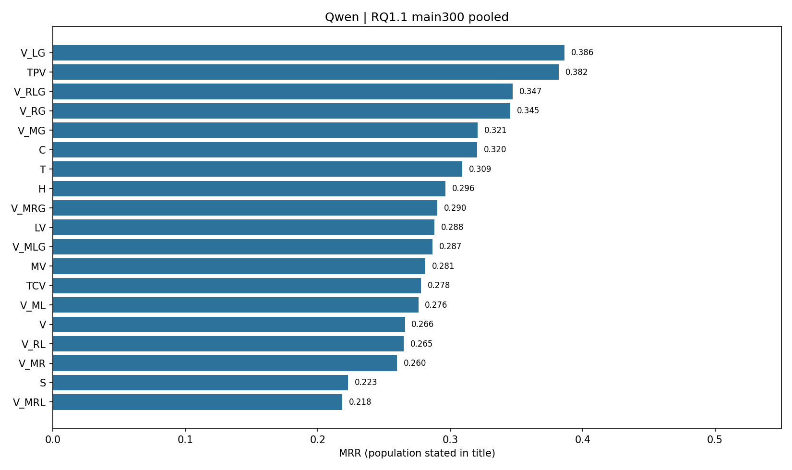
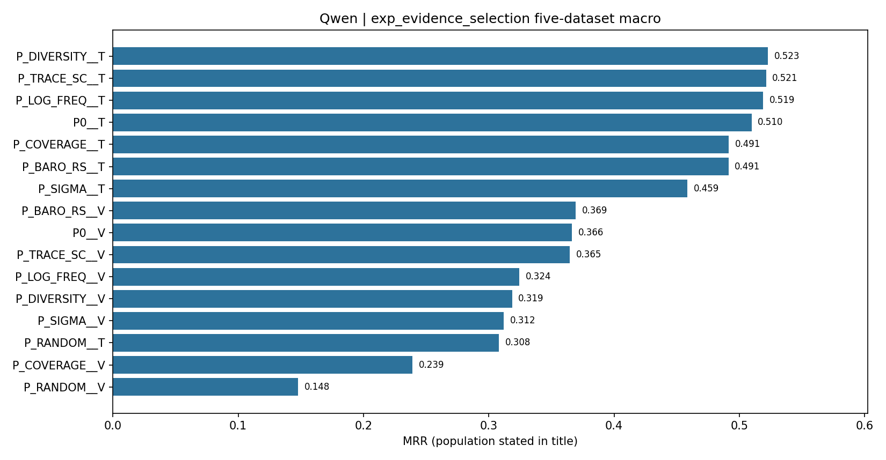
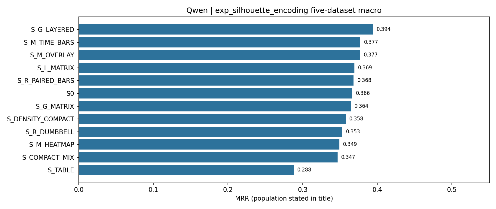
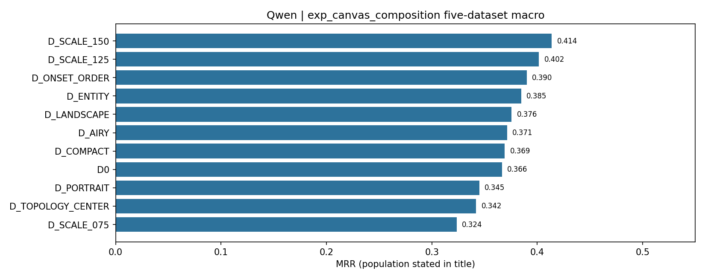

# RQ1.1 / RQ2.1：表示、证据选择与视觉设计

Qwen-only 修订版：2026-09-30。原文件日期标识所分析的历史批次，并非新增实验日期。

本报告仅讨论 Qwen3.8-27B；结论由其自身病例和结果决定，不要求跨模型成立，也不推广为所有模型的性质。原始输出、分数、输入与实验状态未改；本轮新增推理调用为 0。

统计按 Qwen-only 范围重新分析：保留原科学问题的全部正负比较、病例掩码及失败处理，重新计算 Holm；有逐病例记录或差值的主比较重新复算配对检验与 dz。原始 p 在样本未变时本来就不依赖其他模型。CSV 数值往返影响浮点并列时，保留原数值并列口径，另存重算敏感性。附表 `raw_statistic_source` 明确区分重新配对计算与沿用同一 Qwen 样本的原始统计。没有把事后分析改称预注册发现。

## 研究范围与条件

RQ1.1 在冻结的 480 cases 上比较表示；三个主数据集各 100 例是主分析，两个 RE2 各 90 例单列。T 为原自然语言文本，C 为结构化文本，S 为 T 原文截图，V 为真实全视觉 dashboard，H 为冗余图文。MV/TCV/LV/TPV 分别仅将 M/R/L/G 视觉化；其余组合覆盖四区域的 16-cell 析因矩阵。TPV 保留 M/R/L 文本，G 使用图像。

RQ2.1 分别固定其余变量，测试证据选择、组件内部编码、空间编排和分辨率。其主均值是五数据集等权 macro，配对检验中的 480-case pooled 差值不能当作同一个量。QA 使用已经核验的语义评分 V2；不能重新退回早期严格字符串匹配。

## Qwen 的主要发现

1. 主数据集 TPV MRR=0.3819，T=0.3093，V=0.2658，S=0.2228。TPV−T=+0.0727，在五个主表示对照的 Qwen family 内成立；相对 V 的 +0.1162 也成立。这里支持选择性视觉化，而不是全视觉替换。
2. 16-cell 中 G 的平均效应为 +0.0561；M/R/L 分别为 −0.0503/−0.0325/−0.0166。M×G 交互为负。不能将“G 有用”扩展成“所有区域画成图都有用”。完整主效应及交互表在附件中重新校正。
3. 选择同预算随机证据明显损害文本 RCA；增加实体覆盖、采用原生异常工具并不保证保住诊断机制。P_TRACE_SC 与 P_DIVERSITY 的 Text 点估计略高，仍不足以确认其优于 P0。视觉版本还受容量和读取负担影响。
4. S_G_LAYERED 的五数据集 macro 从 0.3664 到 0.3943，是值得保留的 Qwen 候选；但其 480-case 检验仍经校正后未达显著。S_TABLE 显著退化。整齐的像素表格不等于有效的图形编码。
5. 分辨率增加是 Qwen 中有统计依据的视觉方向：D_SCALE_150 相对 D0 pooled ΔMRR=+0.0459；输入由约 4,820 到 7,484 tokens。它未达到 +0.05 的原实质增益线，且收益在 RE2-TT 较大、AIOPS-2022 几乎不变。D_SCALE_125、实体排列、onset 排列可作为方向性线索，不能因点估计正向都写成已证实改善。

## 读取、排序和覆盖：三个不同瓶颈

三个主数据集中，44 例没有根因直接关联的已展示 M/R/L；T/V 在其中均为 0，TPV 仅命中 1 例。其余 256 例 T/V/TPV MRR 为 0.3624/0.3115/0.4437。根因在候选列表、根因在图中、根因机制被呈现是三回事。

TPV 相对 T 的 Top-1 修复/破坏为 54/27。AIOPS-2025 改善约 +0.1330；AIOPS-2022 仅约 +0.0225，其中 pod 从 0.0877 到 0.2171，node 从 0.3678 到 0.3276。这是需要机制解释的异质性，不是按数据集或真实标签部署路由的依据。

QA V2 在主数据集 P1–P4 的 T 全对率依次为 67.24%、56.25%、34.62%、21.75%；V 为 45.73%、40.97%、18.88%、8.07%。P4 的文本步骤准确率仍为 73.95%，图像为 58.25%。逐步读取与整题全对必须分开。Qwen 共有 8,412 条有效 V2 回答；V2 正确 2,824 条，相比 V1 的 2,766 条是评分修正，不是新推理收益。

一般 QA 正确率与同 case RCA 的相关较弱；不能用一个读图测验替代真实 RCA。定向视觉反事实能改变排名、空白化会损害诊断，说明视觉被利用，但不保证利用方式正确。公开 reason 和 attention 只作辅助观察，不作为隐藏推理的证明。

## 成本与有效性边界

全视觉相对文本输入约降低 59.9%，输出均值反而约增加 8.4%。TPV 输出均值 163.5 低于 T 的 170.8，但多数病例的输出并未变短；均值受少数长回答影响。不能把输入压缩写成全面推理加速。

历史 RQ2.1 的不可执行设计采用原始零分效用口径，相关数值保留为历史端点；附件同时保留可执行子集。后续实验的排除规则不能被静默追溯套用。若讨论纯表示效应，应优先检查相同可执行病例：即便如此，Coverage/Diversity 的 Vision 仍低于 Text。未发请求造成的低 tokens 不算效率收益。

## 后续可用结论

Qwen 已经支持“选择性拓扑视觉有价值”“分辨率可能影响有效视觉预算”“同预算信息选择重要”。尚不能支持“任意视觉布局都有益”“结构化表格优于真实图表”“QA 分数可直接预测 RCA”。保留这些正负结果，比将研究概括为视觉总体无效更准确。

## 完整主结果表

### RQ1.1 main300 pooled

| arm | n | mrr | ac@1 | ac@3 | ac@5 | avg@3 | avg@5 | input_tokens | output_tokens |
|---|---|---|---|---|---|---|---|---|---|
| C | 300 | 0.3202 | 0.2300 | 0.4367 | 0.4500 | 0.3356 | 0.3800 | 12928.1700 | 179.0667 |
| H | 300 | 0.2964 | 0.2000 | 0.4133 | 0.4367 | 0.3100 | 0.3607 | 15857.4300 | 153.3500 |
| LV | 300 | 0.2881 | 0.1967 | 0.3900 | 0.4267 | 0.2967 | 0.3487 | 15339.7467 | 160.1400 |
| MV | 300 | 0.2811 | 0.1800 | 0.3933 | 0.4233 | 0.2967 | 0.3460 | 7822.4100 | 193.1200 |
| S | 300 | 0.2228 | 0.1600 | 0.3167 | 0.3167 | 0.2333 | 0.2667 | 13615.4200 | 149.4800 |
| T | 300 | 0.3093 | 0.2100 | 0.4300 | 0.4500 | 0.3256 | 0.3747 | 12947.6233 | 170.7833 |
| TCV | 300 | 0.2779 | 0.2000 | 0.3633 | 0.3933 | 0.2867 | 0.3287 | 15015.3733 | 158.7167 |
| TPV | 300 | 0.3819 | 0.3000 | 0.4767 | 0.4867 | 0.4000 | 0.4347 | 14599.9867 | 163.5000 |
| V | 300 | 0.2658 | 0.1833 | 0.3600 | 0.3800 | 0.2800 | 0.3187 | 5190.2267 | 185.0633 |
| V_LG | 300 | 0.3863 | 0.3100 | 0.4700 | 0.4900 | 0.4000 | 0.4347 | 14084.3033 | 172.3933 |
| V_MG | 300 | 0.3206 | 0.2367 | 0.4133 | 0.4267 | 0.3389 | 0.3740 | 6566.9667 | 174.3500 |
| V_ML | 300 | 0.2759 | 0.1833 | 0.3867 | 0.4133 | 0.2878 | 0.3373 | 7306.7267 | 164.5300 |
| V_MLG | 300 | 0.2867 | 0.2033 | 0.3833 | 0.4033 | 0.3000 | 0.3413 | 6051.2833 | 186.1600 |
| V_MR | 300 | 0.2598 | 0.1767 | 0.3533 | 0.3800 | 0.2711 | 0.3140 | 6982.3533 | 164.6300 |
| V_MRG | 300 | 0.2904 | 0.2033 | 0.4033 | 0.4100 | 0.3078 | 0.3480 | 5726.9100 | 176.9333 |
| V_MRL | 300 | 0.2184 | 0.1400 | 0.3067 | 0.3367 | 0.2267 | 0.2700 | 6466.6700 | 175.8600 |
| V_RG | 300 | 0.3453 | 0.2467 | 0.4600 | 0.4700 | 0.3678 | 0.4087 | 13759.9300 | 167.1600 |
| V_RL | 300 | 0.2647 | 0.1833 | 0.3667 | 0.3833 | 0.2767 | 0.3193 | 14499.6900 | 161.0867 |
| V_RLG | 300 | 0.3473 | 0.2633 | 0.4400 | 0.4567 | 0.3644 | 0.4007 | 13244.2467 | 169.6600 |

### exp_evidence_selection five-dataset macro

| arm | n | mrr | ac@1 | ac@3 | ac@5 | avg@3 | avg@5 | input_tokens | output_tokens |
|---|---|---|---|---|---|---|---|---|---|
| P0__T | 480 | 0.5097 | 0.4107 | 0.6307 | 0.6513 | 0.5256 | 0.5747 | 13538.4124 | 164.6480 |
| P0__V | 480 | 0.3664 | 0.2518 | 0.5116 | 0.5218 | 0.3896 | 0.4420 | 4819.7338 | 185.6304 |
| P_SIGMA__T | 480 | 0.4586 | 0.3796 | 0.5591 | 0.5678 | 0.4737 | 0.5109 | 14077.8842 | 164.8820 |
| P_SIGMA__V | 480 | 0.3118 | 0.2269 | 0.4211 | 0.4251 | 0.3299 | 0.3680 | 4819.7338 | 186.4656 |
| P_BARO_RS__T | 480 | 0.4912 | 0.3896 | 0.6211 | 0.6376 | 0.5079 | 0.5589 | 14053.2393 | 170.6220 |
| P_BARO_RS__V | 480 | 0.3692 | 0.2609 | 0.4998 | 0.5058 | 0.3948 | 0.4392 | 4819.7338 | 190.6060 |
| P_TRACE_SC__T | 480 | 0.5212 | 0.4249 | 0.6449 | 0.6573 | 0.5387 | 0.5849 | 13521.5647 | 161.6371 |
| P_TRACE_SC__V | 480 | 0.3646 | 0.2424 | 0.5233 | 0.5273 | 0.3911 | 0.4456 | 4819.7338 | 187.6842 |
| P_LOG_FREQ__T | 480 | 0.5190 | 0.4324 | 0.6271 | 0.6458 | 0.5320 | 0.5763 | 13517.8249 | 167.9049 |
| P_LOG_FREQ__V | 480 | 0.3244 | 0.2296 | 0.4458 | 0.4538 | 0.3434 | 0.3872 | 4270.3271 | 162.5556 |
| P_COVERAGE__T | 480 | 0.4913 | 0.3960 | 0.6067 | 0.6187 | 0.5112 | 0.5526 | 13276.9876 | 170.0751 |
| P_COVERAGE__V | 480 | 0.2392 | 0.1400 | 0.3671 | 0.3691 | 0.2618 | 0.3047 | 4157.0322 | 158.8858 |
| P_DIVERSITY__T | 480 | 0.5226 | 0.4313 | 0.6333 | 0.6376 | 0.5448 | 0.5811 | 13436.7971 | 181.4280 |
| P_DIVERSITY__V | 480 | 0.3186 | 0.2169 | 0.4409 | 0.4449 | 0.3436 | 0.3841 | 4210.3256 | 163.0047 |
| P_RANDOM__T | 480 | 0.3081 | 0.2287 | 0.4149 | 0.4191 | 0.3233 | 0.3616 | 12864.5278 | 185.8711 |
| P_RANDOM__V | 480 | 0.1479 | 0.1004 | 0.2140 | 0.2140 | 0.1575 | 0.1801 | 3941.7516 | 153.9902 |

### exp_silhouette_encoding five-dataset macro

| arm | n | mrr | ac@1 | ac@3 | ac@5 | avg@3 | avg@5 | input_tokens | output_tokens |
|---|---|---|---|---|---|---|---|---|---|
| S0 | 480 | 0.3664 | 0.2518 | 0.5116 | 0.5218 | 0.3896 | 0.4420 | 4819.7338 | 185.6304 |
| S_M_HEATMAP | 480 | 0.3491 | 0.2422 | 0.4787 | 0.4827 | 0.3752 | 0.4182 | 4819.7338 | 190.5293 |
| S_M_TIME_BARS | 480 | 0.3772 | 0.2580 | 0.5156 | 0.5258 | 0.4056 | 0.4532 | 4819.7338 | 188.0504 |
| S_M_OVERLAY | 480 | 0.3767 | 0.2724 | 0.5020 | 0.5100 | 0.4007 | 0.4440 | 4819.7338 | 189.5364 |
| S_R_PAIRED_BARS | 480 | 0.3683 | 0.2504 | 0.5200 | 0.5242 | 0.3941 | 0.4462 | 4819.7338 | 186.2247 |
| S_R_DUMBBELL | 480 | 0.3529 | 0.2422 | 0.4911 | 0.4951 | 0.3786 | 0.4252 | 4819.7338 | 185.2060 |
| S_L_MATRIX | 480 | 0.3692 | 0.2556 | 0.5160 | 0.5200 | 0.3941 | 0.4444 | 4819.7338 | 190.4982 |
| S_G_MATRIX | 480 | 0.3644 | 0.2456 | 0.5102 | 0.5122 | 0.3940 | 0.4413 | 4819.7338 | 187.7740 |
| S_G_LAYERED | 480 | 0.3943 | 0.2753 | 0.5416 | 0.5476 | 0.4217 | 0.4716 | 4819.7338 | 187.5173 |
| S_TABLE | 480 | 0.2880 | 0.1882 | 0.4196 | 0.4216 | 0.3099 | 0.3541 | 4819.7338 | 188.3113 |
| S_COMPACT_MIX | 480 | 0.3468 | 0.2369 | 0.4916 | 0.4936 | 0.3707 | 0.4199 | 4819.7338 | 187.7362 |
| S_DENSITY_COMPACT | 480 | 0.3575 | 0.2376 | 0.5082 | 0.5224 | 0.3804 | 0.4368 | 4819.7338 | 186.2853 |

### exp_canvas_composition five-dataset macro

| arm | n | mrr | ac@1 | ac@3 | ac@5 | avg@3 | avg@5 | input_tokens | output_tokens |
|---|---|---|---|---|---|---|---|---|---|
| D0 | 480 | 0.3664 | 0.2518 | 0.5116 | 0.5218 | 0.3896 | 0.4420 | 4819.7338 | 185.6304 |
| D_COMPACT | 480 | 0.3691 | 0.2564 | 0.5067 | 0.5147 | 0.3943 | 0.4424 | 4819.7338 | 188.2913 |
| D_AIRY | 480 | 0.3714 | 0.2549 | 0.5127 | 0.5187 | 0.3992 | 0.4466 | 4742.8378 | 183.4689 |
| D_ENTITY | 480 | 0.3847 | 0.2620 | 0.5347 | 0.5367 | 0.4155 | 0.4640 | 4819.7338 | 190.3540 |
| D_TOPOLOGY_CENTER | 480 | 0.3420 | 0.2336 | 0.4809 | 0.4849 | 0.3663 | 0.4133 | 4819.7338 | 186.8947 |
| D_ONSET_ORDER | 480 | 0.3900 | 0.2838 | 0.5116 | 0.5238 | 0.4144 | 0.4577 | 4819.7338 | 190.3320 |
| D_LANDSCAPE | 480 | 0.3756 | 0.2484 | 0.5289 | 0.5371 | 0.4051 | 0.4579 | 4825.7940 | 191.0233 |
| D_PORTRAIT | 480 | 0.3451 | 0.2340 | 0.4822 | 0.4882 | 0.3704 | 0.4175 | 4826.0516 | 187.4976 |
| D_SCALE_075 | 480 | 0.3236 | 0.2093 | 0.4742 | 0.4802 | 0.3465 | 0.4000 | 3908.1253 | 185.3762 |
| D_SCALE_125 | 480 | 0.4015 | 0.2831 | 0.5438 | 0.5518 | 0.4290 | 0.4781 | 5974.5491 | 183.6647 |
| D_SCALE_150 | 480 | 0.4137 | 0.2929 | 0.5687 | 0.5707 | 0.4416 | 0.4932 | 7483.9204 | 184.2889 |

## Qwen-only 配对统计

以下保留指定范围的全部比较，不只保留显著项；其他数据集、层级、故障和敏感性分析见附件。Pratt-Wilcoxon 双侧及 paired dz 沿用原方法；分类、相关性和组间检验不改称 Wilcoxon。不报告置信区间。

### rq11_rq1_registered_primary.csv

| arm | baseline | n | delta | p | dz | p_holm |
|---|---|---|---|---|---|---|
| LV | T | 300 | -0.0212 | 0.2404 | -0.0568 | 0.4760 |
| MV | T | 300 | -0.0282 | 0.2380 | -0.0737 | 0.4760 |
| TCV | T | 300 | -0.0314 | 0.0186 | -0.0876 | 0.0743 |
| TPV | T | 300 | 0.0727 | 0.0055 | 0.1656 | 0.0276 |
| V | T | 300 | -0.0435 | 0.0856 | -0.0988 | 0.2568 |

### rq11_factorial_effects.csv

| region | n | delta | p | dz | p_holm |
|---|---|---|---|---|---|
| M | 300 | -0.0503 | 4.95e-05 | -0.2747 | 0.0002 |
| R | 300 | -0.0325 | 0.0014 | -0.1893 | 0.0028 |
| L | 300 | -0.0166 | 0.0062 | -0.1739 | 0.0062 |
| G | 300 | 0.0561 | 0.0004 | 0.1882 | 0.0011 |
| MR | 300 | 0.0002 | 0.7329 | 0.0007 | 1.0000 |
| ML | 300 | -0.0193 | 0.1941 | -0.0991 | 0.9704 |
| MG | 300 | -0.0482 | 0.0037 | -0.1860 | 0.0220 |
| RL | 300 | -0.0053 | 0.9678 | -0.0263 | 1.0000 |
| RG | 300 | 0.0017 | 0.3869 | 0.0064 | 1.0000 |
| LG | 300 | 0.0072 | 0.9588 | 0.0357 | 1.0000 |

### extra_paired_contrasts.csv

| family | arm | baseline | n | delta | p | dz | p_holm |
|---|---|---|---|---|---|---|---|
| posthoc_rq11_cross_representation | TPV | T | 300 | 0.0727 | 0.0055 | 0.1656 | 0.0331 |
| posthoc_rq11_cross_representation | TPV | V | 300 | 0.1162 | 1.65e-06 | 0.3147 | 1.16e-05 |
| posthoc_rq11_cross_representation | V | S | 300 | 0.0430 | 0.0959 | 0.0964 | 0.3424 |
| posthoc_rq11_cross_representation | H | V | 300 | 0.0306 | 0.0631 | 0.0781 | 0.3156 |
| posthoc_rq11_cross_representation | H | T | 300 | -0.0129 | 0.5001 | -0.0321 | 1.0000 |
| posthoc_rq11_cross_representation | C | T | 300 | 0.0109 | 0.9317 | 0.0456 | 1.0000 |
| posthoc_rq11_cross_representation | V | T | 300 | -0.0435 | 0.0856 | -0.0988 | 0.3424 |

### rq21_paired_comparisons.csv

| experiment | family | arm | baseline | n | delta | p | paired_dz | p_adjusted |
|---|---|---|---|---|---|---|---|---|
| exp_canvas_composition | exp_canvas_composition:all:pooled_descriptive | D_AIRY | D0 | 480 | 0.0059 | 0.6346 | 0.0196 | 1.0000 |
| exp_canvas_composition | exp_canvas_composition:all:pooled_descriptive | D_COMPACT | D0 | 480 | 0.0027 | 0.8474 | 0.0089 | 1.0000 |
| exp_canvas_composition | exp_canvas_composition:all:pooled_descriptive | D_ENTITY | D0 | 480 | 0.0182 | 0.1491 | 0.0491 | 0.8946 |
| exp_canvas_composition | exp_canvas_composition:all:pooled_descriptive | D_LANDSCAPE | D0 | 480 | 0.0103 | 0.2758 | 0.0298 | 1.0000 |
| exp_canvas_composition | exp_canvas_composition:all:pooled_descriptive | D_ONSET_ORDER | D0 | 480 | 0.0231 | 0.1184 | 0.0656 | 0.8291 |
| exp_canvas_composition | exp_canvas_composition:all:pooled_descriptive | D_PORTRAIT | D0 | 480 | -0.0218 | 0.2791 | -0.0568 | 1.0000 |
| exp_canvas_composition | exp_canvas_composition:all:pooled_descriptive | D_SCALE_075 | D0 | 480 | -0.0416 | 0.0157 | -0.1259 | 0.1410 |
| exp_canvas_composition | exp_canvas_composition:all:pooled_descriptive | D_SCALE_125 | D0 | 480 | 0.0347 | 0.0429 | 0.1212 | 0.3435 |
| exp_canvas_composition | exp_canvas_composition:all:pooled_descriptive | D_SCALE_150 | D0 | 480 | 0.0459 | 0.0007 | 0.1467 | 0.0068 |
| exp_canvas_composition | exp_canvas_composition:all:pooled_descriptive | D_TOPOLOGY_CENTER | D0 | 480 | -0.0248 | 0.1977 | -0.0677 | 0.9883 |
| exp_evidence_selection | exp_evidence_selection:all:pooled_descriptive | P_BARO_RS__T | P0__T | 480 | -0.0186 | 0.3364 | -0.0652 | 1.0000 |
| exp_evidence_selection | exp_evidence_selection:all:pooled_descriptive | P_BARO_RS__V | P0__V | 480 | 0.0008 | 0.9097 | 0.0022 | 1.0000 |
| exp_evidence_selection | exp_evidence_selection:all:pooled_descriptive | P_COVERAGE__T | P0__T | 480 | -0.0189 | 0.4433 | -0.0455 | 1.0000 |
| exp_evidence_selection | exp_evidence_selection:all:pooled_descriptive | P_COVERAGE__V | P0__V | 480 | -0.1252 | 9.12e-10 | -0.3140 | 1.09e-08 |
| exp_evidence_selection | exp_evidence_selection:all:pooled_descriptive | P_DIVERSITY__T | P0__T | 480 | 0.0126 | 0.3301 | 0.0344 | 1.0000 |
| exp_evidence_selection | exp_evidence_selection:all:pooled_descriptive | P_DIVERSITY__V | P0__V | 480 | -0.0473 | 0.0056 | -0.1292 | 0.0449 |
| exp_evidence_selection | exp_evidence_selection:all:pooled_descriptive | P_LOG_FREQ__T | P0__T | 480 | 0.0085 | 0.3095 | 0.0409 | 1.0000 |
| exp_evidence_selection | exp_evidence_selection:all:pooled_descriptive | P_LOG_FREQ__V | P0__V | 480 | -0.0398 | 0.0010 | -0.1260 | 0.0100 |
| exp_evidence_selection | exp_evidence_selection:all:pooled_descriptive | P_RANDOM__T | P0__T | 480 | -0.1962 | 1.33e-15 | -0.4090 | 1.73e-14 |
| exp_evidence_selection | exp_evidence_selection:all:pooled_descriptive | P_RANDOM__V | P0__V | 480 | -0.2160 | 3.46e-23 | -0.4839 | 4.85e-22 |
| exp_evidence_selection | exp_evidence_selection:all:pooled_descriptive | P_SIGMA__T | P0__T | 480 | -0.0519 | 0.0002 | -0.1639 | 0.0025 |
| exp_evidence_selection | exp_evidence_selection:all:pooled_descriptive | P_SIGMA__V | P0__V | 480 | -0.0577 | 0.0046 | -0.1450 | 0.0416 |
| exp_evidence_selection | exp_evidence_selection:all:pooled_descriptive | P_TRACE_SC__T | P0__T | 480 | 0.0118 | 0.1212 | 0.0518 | 0.8483 |
| exp_evidence_selection | exp_evidence_selection:all:pooled_descriptive | P_TRACE_SC__V | P0__V | 480 | -0.0011 | 0.6202 | -0.0037 | 1.0000 |
| exp_silhouette_encoding | exp_silhouette_encoding:all:pooled_descriptive | S_COMPACT_MIX | S0 | 480 | -0.0190 | 0.2911 | -0.0582 | 1.0000 |
| exp_silhouette_encoding | exp_silhouette_encoding:all:pooled_descriptive | S_DENSITY_COMPACT | S0 | 480 | -0.0073 | 0.5214 | -0.0232 | 1.0000 |
| exp_silhouette_encoding | exp_silhouette_encoding:all:pooled_descriptive | S_G_LAYERED | S0 | 480 | 0.0281 | 0.0419 | 0.0909 | 0.4190 |
| exp_silhouette_encoding | exp_silhouette_encoding:all:pooled_descriptive | S_G_MATRIX | S0 | 480 | -0.0016 | 0.8809 | -0.0049 | 1.0000 |
| exp_silhouette_encoding | exp_silhouette_encoding:all:pooled_descriptive | S_L_MATRIX | S0 | 480 | 0.0037 | 0.6942 | 0.0133 | 1.0000 |
| exp_silhouette_encoding | exp_silhouette_encoding:all:pooled_descriptive | S_M_HEATMAP | S0 | 480 | -0.0181 | 0.3776 | -0.0569 | 1.0000 |
| exp_silhouette_encoding | exp_silhouette_encoding:all:pooled_descriptive | S_M_OVERLAY | S0 | 480 | 0.0109 | 0.3254 | 0.0332 | 1.0000 |
| exp_silhouette_encoding | exp_silhouette_encoding:all:pooled_descriptive | S_M_TIME_BARS | S0 | 480 | 0.0108 | 0.3100 | 0.0318 | 1.0000 |
| exp_silhouette_encoding | exp_silhouette_encoding:all:pooled_descriptive | S_R_DUMBBELL | S0 | 480 | -0.0122 | 0.5843 | -0.0390 | 1.0000 |
| exp_silhouette_encoding | exp_silhouette_encoding:all:pooled_descriptive | S_R_PAIRED_BARS | S0 | 480 | 0.0034 | 0.6819 | 0.0105 | 1.0000 |
| exp_silhouette_encoding | exp_silhouette_encoding:all:pooled_descriptive | S_TABLE | S0 | 480 | -0.0747 | 0.0001 | -0.1877 | 0.0013 |
| exp_evidence_selection | same_policy_representation:all:pooled_descriptive | P0__V | P0__T | 480 | -0.1371 | 5e-10 | -0.2940 | 9.99e-10 |
| exp_evidence_selection | same_policy_representation:all:pooled_descriptive | P_BARO_RS__V | P_BARO_RS__T | 480 | -0.1177 | 3.44e-08 | -0.2542 | 3.44e-08 |
| exp_evidence_selection | same_policy_representation:all:pooled_descriptive | P_COVERAGE__V | P_COVERAGE__T | 480 | -0.2435 | 1.19e-23 | -0.5110 | 9.52e-23 |
| exp_evidence_selection | same_policy_representation:all:pooled_descriptive | P_DIVERSITY__V | P_DIVERSITY__T | 480 | -0.1970 | 4.03e-16 | -0.3986 | 2.82e-15 |
| exp_evidence_selection | same_policy_representation:all:pooled_descriptive | P_LOG_FREQ__V | P_LOG_FREQ__T | 480 | -0.1854 | 1.62e-13 | -0.3673 | 8.08e-13 |
| exp_evidence_selection | same_policy_representation:all:pooled_descriptive | P_RANDOM__V | P_RANDOM__T | 480 | -0.1569 | 2.82e-15 | -0.3750 | 1.69e-14 |
| exp_evidence_selection | same_policy_representation:all:pooled_descriptive | P_SIGMA__V | P_SIGMA__T | 480 | -0.1430 | 2.06e-10 | -0.3220 | 6.19e-10 |
| exp_evidence_selection | same_policy_representation:all:pooled_descriptive | P_TRACE_SC__V | P_TRACE_SC__T | 480 | -0.1500 | 2.85e-11 | -0.3172 | 1.14e-10 |

## 分层、案例和复现附件

所有保留的表均仅含 Qwen 结果或公共数据/CPU 基线。大型表用于完整审计，不能把其中最优分组当作预注册确认。

- [extra_paired_contrasts](assets/extra_paired_contrasts.csv)
- [extra_rank_depth_and_output_distribution](assets/extra_rank_depth_and_output_distribution.csv)
- [extra_root_coverage_outcomes](assets/extra_root_coverage_outcomes.csv)
- [extra_selection_paired_executable_twins](assets/extra_selection_paired_executable_twins.csv)
- [extra_topology_conditional_effects](assets/extra_topology_conditional_effects.csv)
- [extra_tpv_output_paired_direction](assets/extra_tpv_output_paired_direction.csv)
- [per_record](assets/per_record.csv)
- [qa_semantic_v2_by_fault](assets/qa_semantic_v2_by_fault.csv)
- [qa_semantic_v2_by_level_condition](assets/qa_semantic_v2_by_level_condition.csv)
- [qa_semantic_v2_by_reasoning](assets/qa_semantic_v2_by_reasoning.csv)
- [qa_semantic_v2_by_region](assets/qa_semantic_v2_by_region.csv)
- [qa_semantic_v2_paired_effects](assets/qa_semantic_v2_paired_effects.csv)
- [qa_semantic_v2_per_record](assets/qa_semantic_v2_per_record.csv)
- [qa_semantic_v2_qa_rca_correlations](assets/qa_semantic_v2_qa_rca_correlations.csv)
- [qa_semantic_v2_root_connected_correlations](assets/qa_semantic_v2_root_connected_correlations.csv)
- [qa_semantic_v2_root_connected_pairs](assets/qa_semantic_v2_root_connected_pairs.csv)
- [qa_semantic_v2_v1_v2_totals](assets/qa_semantic_v2_v1_v2_totals.csv)
- [qwen_headline_metrics](assets/qwen_headline_metrics.csv)
- [rq11_attention_all_arms](assets/rq11_attention_all_arms.csv)
- [rq11_attention_rr_correlations](assets/rq11_attention_rr_correlations.csv)
- [rq11_counterfactual_visual_influence](assets/rq11_counterfactual_visual_influence.csv)
- [rq11_factorial_effects](assets/rq11_factorial_effects.csv)
- [rq11_fault_breakdown](assets/rq11_fault_breakdown.csv)
- [rq11_granularity_breakdown](assets/rq11_granularity_breakdown.csv)
- [rq11_perception_rca_correlations](assets/rq11_perception_rca_correlations.csv)
- [rq11_performance_cost_runtime_all_arms_datasets](assets/rq11_performance_cost_runtime_all_arms_datasets.csv)
- [rq11_qa_format_sensitivity_headline](assets/rq11_qa_format_sensitivity_headline.csv)
- [rq11_qa_headline_level_accuracy](assets/rq11_qa_headline_level_accuracy.csv)
- [rq11_qa_perception_reasoning_accuracy](assets/rq11_qa_perception_reasoning_accuracy.csv)
- [rq11_repair_break_cost](assets/rq11_repair_break_cost.csv)
- [rq11_root_connected_qa_rca](assets/rq11_root_connected_qa_rca.csv)
- [rq11_root_evidence_availability_outcomes](assets/rq11_root_evidence_availability_outcomes.csv)
- [rq11_rq1_registered_primary](assets/rq11_rq1_registered_primary.csv)
- [rq11_runtime_completeness](assets/rq11_runtime_completeness.csv)
- [rq11_shapley_contributions](assets/rq11_shapley_contributions.csv)
- [rq21_aggregates](assets/rq21_aggregates.csv)
- [rq21_attention_by_region](assets/rq21_attention_by_region.csv)
- [rq21_attention_correlations_exploratory](assets/rq21_attention_correlations_exploratory.csv)
- [rq21_attention_coverage](assets/rq21_attention_coverage.csv)
- [rq21_bridge_comparisons](assets/rq21_bridge_comparisons.csv)
- [rq21_dataset_macros](assets/rq21_dataset_macros.csv)
- [rq21_event_group_sensitivity](assets/rq21_event_group_sensitivity.csv)
- [rq21_feasible_only](assets/rq21_feasible_only.csv)
- [rq21_paired_comparisons](assets/rq21_paired_comparisons.csv)
- [rq21_selection_manipulation](assets/rq21_selection_manipulation.csv)
- [rq21_strata](assets/rq21_strata.csv)
- [runtime_counts](assets/runtime_counts.csv)
- [selection_request_equality_without_audit_metadata](assets/selection_request_equality_without_audit_metadata.csv)
- [status_counts](assets/status_counts.csv)

分析口径、备份与复算说明见 [重分析说明](../_qwen_only_reanalysis/README.md)。历史原始结果保持在对应 `RQs/` 下，本次没有调整实验队列、模型或评分器。
