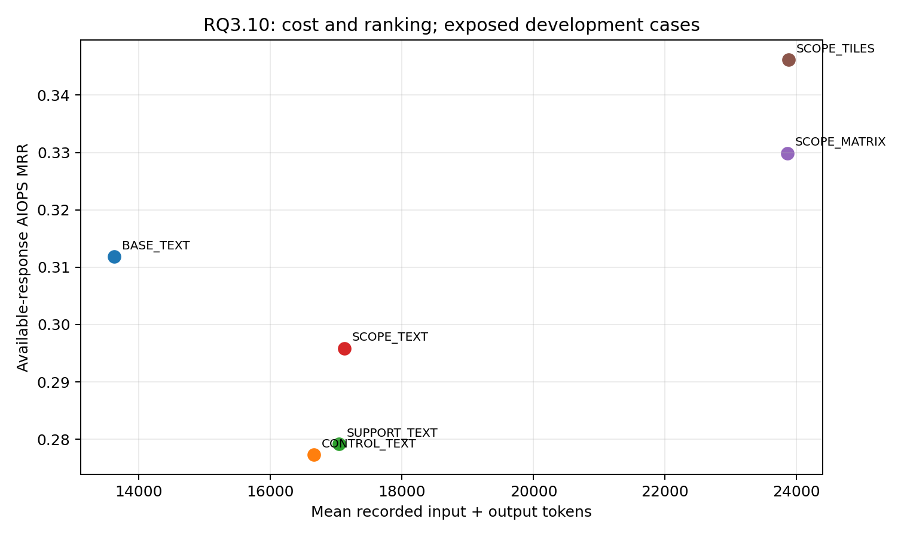

# RQ3.10 v2：范围比较、负面证据与视觉机制完整分析

2026-10-01。状态：全量执行结束，最终输入/输出/评分审计通过。作者：单一主 agent；统计与学术审查均由主 agent 完成。140 个已暴露 eval 开发案例（AIOPS-2022 60、AIOPS-2025 60、AegisLab 20），不是独立测试，也不是新测试集证据。只运行本地 Qwen3.8-27B BF16，未训练、未采集 attention。

## 结论与决策

当前结果不足以采用 SCOPE_MATRIX 作为部署方法。AIOPS 配对 MATRIX−BASE 的 MRR 增量为 +0.0181，Holm p=0.8626；MATRIX−同信息 SCOPE_TEXT 为 +0.0340，Holm p=1.0000；MATRIX−打散 SCOPE_TILES 为 −0.0078，Holm p=1.0000。所有预注册主要与次要比较均不显著。不能据此声称视觉共享坐标、负面证据或范围竞争提升 RCA。

MATRIX 平均总 token 为 23,857，BASE 为 13,628，增加约 75.1%；相对 SCOPE_TEXT 的 17,125 增加约 39.3%。CPU 范围规则并非不可实现，但可检验范围对照高度集中于 AIOPS-2022，难以解释跨数据集的部署收益。保留所有结果，不降低资格阈值，不删除低适用性案例，不按得分改选下一批案例。

下一步转向预注册的诊断算子保护压缩：同一批基础证据，将指标曲线编码为低精度视觉曲线，使用精确数值补丁保护有限诊断算子；同时比较强无损压缩文本、同编码信息的文本和无补丁视觉。编译器保证的算子一致性不等于 VLM 读图正确，更不等于正确因果推断。下一轮仍需实际成本、配对 RCA 分数和机制对照共同检验。

## 执行、完整性与分母

正式 840 个逻辑位置，751 次实际请求，89 个精确输入相同的引用位置。747 次独立请求完成、4 次请求超时；836 个逻辑位置完成、4 个缺失。全量 supervisor 正常结束，耗时 4,124.60 秒（含启动），GPU 服务已退出。Smoke 使用独立目录，16 次实际请求、18 个位置，180.25 秒（含启动）；不纳入正式指标。历史 v1 没有 GPU 请求。

最终离线审计逐一检查了 747 份独立完成响应及全部 836 个完成位置：提交输入、PNG 哈希、conversation、trajectory、完成标记、token 守恒以及原评分复现；84 个冻结源文件的归档内容通过核对，没有未解释缺项。所有完成响应 finish_reason=stop，未发现截断。835 个位置评分 complete，1 个 BASE_TEXT 输出含重复 ID，被原评分器保留为 model_failure 零分。已有评分没有被修正。

四个超时：CONTROL_TEXT 的 INC-D87134FF9ACF，以及 SCOPE_TILES 的 INC-28E6F5E88478、INC-335A9F3A663E、INC-9C225C04C814。将其记录为未知结果；按每个比较自己的完整配对交集统计，并报告所有注册案例的最坏/最好缺失界限。未将基础设施缺失填成零分，也未为提高分数重试。

正式已知 input=14,124,001（text=12,258,927，image=1,865,074），output=128,201；四次超时的 usage 未知，因此成本总和是下界。已完成请求 wall_time 合计 140,220.09 秒，是并发重叠请求时间，不能称为独占 GPU 时长。每臂成本包含引用位置的部署成本；实际消耗按独立请求去重。正式服务墙钟和请求 wall_time 分开报告。

完整审计：[verification.json](../../RQs/RQ3_10/results/scope_v2/analysis_reviewed_v1/verification.json)。冻结正式源码：`RQs/RQ3_10/results/scope_v2/qualification/frozen_formal_source.tar.gz`，SHA256 `5f417056831fcc8c1b32116590ee81cf4a11debc8ce432cdfe3ce6d241117548`。运行后新增的是离线报告入口，不能用当前工作源码冒充原运行源码。

## 分数

下表是每臂可用响应的 AIOPS 合并指标；CONTROL、TILES 分母不同，不能直接用两行相减代替配对比较。AVG@K 沿用原项目评分器定义。

| 臂 | n | MRR | AC@1 | AC@3 | AC@5 | AVG@3 | AVG@5 |
|---|---:|---:|---:|---:|---:|---:|---:|
| BASE_TEXT |120|0.3118|0.2333|0.4083|0.4167|0.3278|0.3633|
| CONTROL_TEXT |119|0.2773|0.2017|0.3697|0.3697|0.2969|0.3261|
| SUPPORT_TEXT |120|0.2792|0.2083|0.3750|0.3750|0.2944|0.3267|
| SCOPE_TEXT |120|0.2958|0.2167|0.4000|0.4000|0.3139|0.3483|
| SCOPE_MATRIX |120|0.3299|0.2750|0.4000|0.4083|0.3389|0.3667|
| SCOPE_TILES |117|0.3462|0.2906|0.4103|0.4274|0.3533|0.3829|

| 臂 | AIOPS-2022 MRR | AIOPS-2025 MRR | AegisLab MRR | 三数据集合并 MRR | 三数据集 macro MRR |
|---|---:|---:|---:|---:|---:|
| BASE_TEXT |0.3361|0.2875|0.4667|0.3339|0.3634|
| CONTROL_TEXT |0.2611|0.2938|0.5167|0.3118|0.3572|
| SUPPORT_TEXT |0.2306|0.3278|0.5583|0.3190|0.3722|
| SCOPE_TEXT |0.2722|0.3194|0.5583|0.3333|0.3833|
| SCOPE_MATRIX |0.3375|0.3222|0.4417|0.3458|0.3671|
| SCOPE_TILES |0.3460|0.3463|0.4333|0.3589|0.3752|

合并 MRR 是按实际案例数加权，macro 是三个数据集均权平均；AegisLab 是辅助解释层，不进入 AIOPS 主要统计族。所有六臂共同完成的 AIOPS 116 例中，六臂 MRR 依次为 0.3226、0.2845、0.2802、0.2974、0.3412、0.3491；排序趋势仍不能建立视觉机制。

全数据集/分母/AC/AVG：[arm_metrics.csv](through_RQ3_15_preserved/assets/RQs/RQ3_10/results/scope_v2/analysis_reviewed_v1/arm_metrics.csv)；全六臂共同交集：[common_all_six.csv](through_RQ3_15_preserved/assets/RQs/RQ3_10/results/scope_v2/analysis_reviewed_v1/common_all_six.csv)；故障与根因粒度：[breakdowns.csv](through_RQ3_15_preserved/assets/RQs/RQ3_10/results/scope_v2/analysis_reviewed_v1/breakdowns.csv)。小粒度层只作探索，不在结果后新增显著性结论。

## 配对统计

使用预注册 Pratt Wilcoxon（差值先 round 到 12 位）和配对 Cohen's dz。四个主要比较与三个次要比较分别 Holm 校正；没有置信区间。repair/break 指 top-1 从错误变正确/从正确变错误，不是全部排名改善/恶化。MRR 缺失界限是注册全体 AIOPS 120 例的最坏/最好值，不是置信区间。

| 族；左−右 | n | ΔMRR | 原始 p | Holm p | dz | repair/break | 未知对数；Δ界限 |
|---|---:|---:|---:|---:|---:|---:|---|
|主要 SCOPE_TEXT−CONTROL_TEXT|119|+0.0126|0.4375|1.0000|0.0630|3/2|1；[+0.0042,+0.0208]|
|主要 MATRIX−SCOPE_TEXT|120|+0.0340|0.3839|1.0000|0.0953|12/5|0；[+0.0340,+0.0340]|
|主要 MATRIX−TILES|117|−0.0078|0.8105|1.0000|−0.0434|2/3|3；[−0.0326,+0.0174]|
|主要 MATRIX−BASE_TEXT|120|+0.0181|0.2157|0.8626|0.0662|7/2|0；[+0.0181,+0.0181]|
|次要 CONTROL_TEXT−BASE_TEXT|119|−0.0371|0.3320|0.6639|−0.1161|6/10|1；[−0.0451,−0.0285]|
|次要 SCOPE_TEXT−SUPPORT_TEXT|120|+0.0167|0.2130|0.6390|0.0866|4/3|0；[+0.0167,+0.0167]|
|次要 SUPPORT_TEXT−CONTROL_TEXT|119|−0.0042|0.8155|0.8155|−0.0189|4/4|1；[−0.0125,+0.0042]|

事件组等权敏感性：MATRIX−SCOPE_TEXT 93 组 Δ=+0.0196，Holm p=1；MATRIX−BASE 93 组 Δ=+0.0245，Holm p=0.8038；MATRIX−TILES 90 组 Δ=−0.0134，Holm p=1。组权重改变没有使主要机制成立。完整逐比较数据：[registered_contrasts.csv](through_RQ3_15_preserved/assets/RQs/RQ3_10/results/scope_v2/analysis_reviewed_v1/registered_contrasts.csv)。适用性层、其他模式比较：[exploratory_patterns.csv](through_RQ3_15_preserved/assets/RQs/RQ3_10/results/scope_v2/analysis_reviewed_v1/exploratory_patterns.csv)，只作探索。

## 范围机制为何仍未识别

原始采样时钟资格、两阶段各 80% 覆盖、有观测活动、同字段同单位的规则没有放宽。AIOPS-2022 23/60 例有可检验范围，327 个 stable-active 观测，23 例共享范围稳定对照冲突；AIOPS-2025 只有 1/60 例有正支持，没有 qualified stable/negative 对照；AegisLab 没有 instance 对照，49 个 service stable 观测不足以形成实例级范围竞争。

因此，整体的 MATRIX−TEXT 比较并不等于“负面证据有效”的因果检验。大量观测仍是 activity_unknown、zero_reference_scale 或 intermediate；这些状态明确不代表健康或故障。适用的 24 例中 MATRIX−TEXT Δ=+0.0764，SCOPE−SUPPORT Δ=+0.0903，但均 Holm p=1，小层趋势不足以改变主要结论。数据源资格原始审计见 `qualification/eligibility_audit.json` 和 `qualification/cpu.json`。

CPU 原离线分析把 `confidence` 写为数字 0.0，违反冻结 schema 的字符串枚举，导致原分析中的 CPU 对照被统一判 model_failure。这是离线对照适配错误，未影响任何 VLM 响应/评分。保留原 `formal/analysis.json`；只在新的 reviewed 分析使用合法的 `confidence="low"`，原规则排名不变。修正后的 CPU AIOPS-2022 MRR=0.2322，AIOPS-2025=0.1456；适用的 23 例 AIOPS-2022 MRR=0.4036，AIOPS-2025 单例=0。AegisLab 无适用范围，hash tie 排序 MRR=0，不表示统计方法得到有效范围信息。见 [cpu_baseline.csv](through_RQ3_15_preserved/assets/RQs/RQ3_10/results/scope_v2/analysis_reviewed_v1/cpu_baseline.csv)。

## 响应可信度与实际案例

全部完成输出的 literal screen 检出 64/836 个实体类型文字冲突、135/836 个包含健康/排除措辞的响应；595 high、235 medium、6 low。这些是自动筛查，不是人工裁定的幻觉率，也不是校准曲线。高 confidence 不能当作正确原因的证据。

从 96 个预先构造的 repair/break/unchanged 审核条目中，按每个比较和变化类型取前两条，人工阅读 24 个配对条目的完整响应与范围字段；重复案例保留为配对审核，不能当成 24 个独立案例。直接查看四个实际提交 MATRIX PNG 的顶部截图，原完整 PNG 的哈希已通过全量审计。截图没有替换模型输入。其余审核队列仍是候选，不宣称已经逐条人工裁定。

* INC-123B5115D9C1：SCOPE 排到实际服务对应 pod 44211，恢复 top-1；原字段确有 cache 与 working-set 变化。但“排除所有宿主原因”超过有限对照的证据边界。
* INC-316B59616EA8：全部 scope unknown。SCOPE 把正确服务 548 放到第二名，但仍先选 node 9380。排名改善没有建立正确的范围解释。
* INC-7FCA48559A2E：MATRIX 与 TILES 均恢复服务 832，而补充范围面板只有 service 258/686 的 unknown。回答依靠旧 trace/log，不能把成功归因于共享坐标；部分回答还把 log2_fold 当成直接倍数。
* INC-5D92F3402F88：多个臂选错共址实体。MATRIX 用 CPU 下降及 MemAvailable 上升解释资源压力；unknown 对照被写作 stable，节点被推广成原因。原图的负号和 unknown 可见，故不能单纯归咎于未渲染。
* INC-0060628741E9：多个臂均未将正确服务 786 放入 top-5。零尺度明确 unknown；有回答声称 +29m 早于 +20m，或从 transient 跳到故障判断。缺原始根因证据与推理失误同时存在。
* INC-392EE028390B：MATRIX 将正确服务 614 纳入第二名，理由却重点解释另一个实体。MRR 修复不能证明理由与根因绑定正确。
* INC-3948C7715B49：原 BASE/SCOPE 能纳入正确服务，MATRIX 追随 page-fault 极值而丢失正确根因；部分回答还反转 caller/callee 和时序。
* INC-3D79B00A900E：真实 pod 99916 的巨大 memory/cache 变化在 PNG 中清晰可见。MATRIX 排 service 288 在前、pod 在后；TILES 理由提到 pod 来源，却输出服务优先。保留原粒度评分，不事后替换合法输出。
* INC-17615889CDA7：TILES 在理由中说某 pod 缺少确认依据，却把它排第一；按项目 service/pod 容错可得正确分。说明“正确名次”与“证据充分的解释”必须分开。

离线标签只用于审计分层，从未进入编译器或模型输入。完整逐位置清单：[case_inventory.csv](through_RQ3_15_preserved/assets/RQs/RQ3_10/results/scope_v2/analysis_reviewed_v1/case_inventory.csv)；精确根因资源覆盖：[root_coverage.csv](through_RQ3_15_preserved/assets/RQs/RQ3_10/results/scope_v2/analysis_reviewed_v1/root_coverage.csv)；原始筛查：[response_screens.csv](through_RQ3_15_preserved/assets/RQs/RQ3_10/results/scope_v2/analysis_reviewed_v1/response_screens.csv)。

## 成本与既有证据链

图中为可用响应趋势；严谨结论使用上述配对统计和 [costs.csv](through_RQ3_15_preserved/assets/RQs/RQ3_10/results/scope_v2/analysis_reviewed_v1/costs.csv)。不同并发队列下请求 wall_time 不是各臂独占 GPU 计量，不把其小差异解释为吞吐收益。

这与既有结果一致：RQ3.6 的宿主/peer 添加没有可靠增益；RQ3.3 第二调用没有证明抵偿成本；RQ3.4 格式及核验改善不能直接转成 RCA 改善；RQ3.7C 的局部链接有部分效果，但相对最强文本以及位置机制证据有限；RQ3.8 全文本再叠全图造成性能下降与成本上升。历史结果的案例、输入和统计族不同，不能将这些数值和当前 140 例混合检验。

证据来源：[RQ3.6 分析](RQ3_6_Mechanisms_Analysis_2026-09-28.md)、[RQ3.7C/RQ3.8 分析](RQ3_7C_RQ3_8_Qwen_Analysis_2026-09-30.md)、[项目对话](../../conversation_oct_01.md)。本轮结论支持下一步改变压缩/保护问题，不支持继续放大当前低适用性范围矩阵，更不支持宣称达到论文部署指标。

## 学术审查与可发表边界

有效性：完整执行、冻结输入、同信息矩阵/图块、原评分复现和成本记录成立。限制：开发案例已暴露；只有 Qwen；有效负面范围对照不足；随机采样差异缺独立重复臂；没有真实干预；标签粒度和 service/pod 容错使正确分数可能伴随解释失配。四次 timeout 造成机制比较的缺失范围，必须保留。

裁定：接受为完整、负结果和机制未识别的开发实验；拒绝“视觉提升性能并降低成本”“范围负面证据已验证”“正确分数代表正确因果解释”三种过度结论。下一轮的强文本、同编码文本、补丁消融和重复调用须事先冻结，不能在分数出来后选择最好压缩预算。完整数值与源码核查载于 [analysis_reviewed_v1](../../RQs/RQ3_10/results/scope_v2/analysis_reviewed_v1/analysis.json)。
