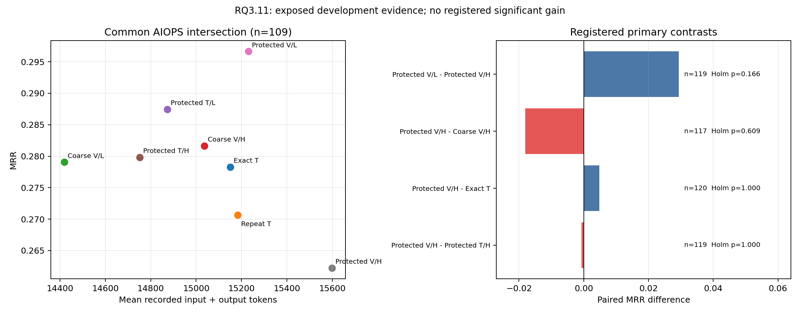

# RQ3.11 v2：诊断算子保护视觉压缩的完整结果分析

2026-10-01。实验版本 `rq311_protected_compression_v2`。状态：注册队列全部结束，最终离线完整性审计与统计复核通过；12 个请求超时保留为未知结果。研究性质：已暴露 eval 上的方法开发，不是独立确认实验。作者与审核者：单一主 agent，没有独立评审者或多评审者一致性测量。

## 1. 主要结论

**当前证据不支持部署预选的 PROTECTED_VISUAL_HIGH，也不支持“视觉压缩同时提高准确率、降低成本、增强解释可信度”的声明。**

在主要 AIOPS 120 例中，预选 HIGH 视觉的 MRR 为 0.2840，无损紧凑文本为 0.2792。配对增量仅 +0.0049，Holm p=1.0000，效应量 dz=0.0146；平均输入加输出 token 从 15,230.91 增至 15,703.53，增加 **3.10%**。预设的“总 token 至少减少 20%”目标没有达到。显著性不足也不能解释成已证明准确率没有损失。

同编码信息的 HIGH 文本对照尤其关键：HIGH 视觉相对它的配对 ΔMRR 为 −0.0007，Holm p=1.0000，而总 token 增加 **5.70%**。保留已完成一侧的分数后，即使将唯一缺失文本结果赋予任意合法 MRR，注册全体 120 例的平均差也只能落在 [−0.0090, −0.0007]。因此，这批样本的视觉平均收益不能由该超时补齐后转正；这不是总体分布上的显著劣势证明。

数值保护在工程层面成功：全部 3,360 条预算化曲线的保护签名都与原始 64-bin 曲线一致。**但数值签名保留没有转化为可靠的 RCA 收益。** HIGH 补丁相对无补丁视觉的 ΔMRR 为 −0.0181，Holm p=0.6091，总 token 增加 3.77%；已知一侧分数约束下的全体平均差范围也完全为负。

LOW 视觉相对 HIGH 有正向开发信号：ΔMRR=+0.0294，原始 p=0.0414，但主要族 Holm p=0.1656，事件组敏感性 Holm p=0.3893。LOW 不是预选部署方案，不能在看到结果后将它替换成预选方法，也不能只报告原始 p。

解释审核发现明确的单位、时序、实体绑定和归因错误；正确排序有时伴随错误解释。本轮没有证明解释可信度提升，也没有对全部解释给出人工裁定的错误率。

## 2. 设计、数据和比较对象

冻结设计见 [实验计划](../experiment_plans/CanvasRCA_RQ3_11_Protected_Compression_Plan.md)与 [注册配置](../../RQs/RQ3_11/configs/protected_compression_v2.json)。沿用 RQ3.10 的 140 个开发案例：AIOPS-2022 60、AIOPS-2025 60、AegisLab 20。AIOPS 120 例属于主要比较范围；AegisLab 只作辅助探索。本轮没有调用新的 test、Gemma、训练或 attention。

每例保留既有 12 条指标、64 个相对时间 bin、缺失信息、指标元数据与汇总、R/L/G 事实、候选列表和求解规则。改变指标向量的编码与传输，不依据根因选择曲线或补丁。

| 臂；报告简称 | 含义 |
|---|---|
| EXACT_TEXT；ET | 保留原数值字符串与缺失位置的无损紧凑文本 |
| EXACT_REPEAT；ER | ET 的相同输入、相同配方、独立实际请求；不能择优或去重 |
| COARSE_VISUAL_LOW/HIGH；CVL/CVH | 粗量化曲线图及精确范围、元数据，无精确补丁 |
| PROTECTED_TEXT_LOW/HIGH；PTL/PTH | 文本中的量化整数、精确范围、缺失与补丁 |
| PROTECTED_VISUAL_LOW/HIGH；PVL/PVH | 图中的同一量化曲线、文本中的同一范围、缺失与补丁 |

LOW 固定为 8 个量化级、800×1940 画布；HIGH 固定为 32 个量化级、1120×1940 画布。两组都使用单张 2 列×6 行 PNG。级数与画布宽度同时变化，因此预算对照不能独立识别“分辨率”或“量化级数”的因果效果。

PT/PV 在编译器层面使用相同的 q、范围、缺失和精确补丁，适合检验表示与视觉传输的增量价值。它们与 ET 不保留全部相同的原数值，PVH−ET 是实际有损压缩的效用比较。CV/PV 的 PNG 字节相同，补丁消融改变邻接文本中的精确值。已有指标汇总继续存在，能为模型提供部分诊断特征，限制了对“曲线保护本身”的归因。

保护签名仅包括：样本与缺失集合、两阶段样本数、最早极大/极小 bin、中位数变化的方向及稳健阈值状态、当前阶段首次超阈值 bin、持续比例是否达到 0.5。它不是原 MET-Z 分析器的完整复制，也不覆盖全部 RCA 相关信息或因果识别条件。

## 3. 执行完成度与有效性

正式注册 140×8=**1,120 个位置**。其中 17 个无补丁/保护输入精确相同的位置合法引用同一完成响应；140 个 ET 重复位置仍全部作为独立请求发起。正式实际发起 **1,103 次**，完成 **1,091 次**，超时 **12 次**，没有重试。位置层面为 1,108 个已落盘结果、12 个缺失，响应覆盖率 98.93%；“队列结束”不表示每次请求都成功。

| 臂 | 已有结果位置 | 请求超时 |
|---|---:|---:|
| ET | 140 | 0 |
| ER | 138 | 2 |
| CVL | 137 | 3 |
| CVH | 137 | 3 |
| PTL | 139 | 1 |
| PTH | 138 | 2 |
| PVL | 139 | 1 |
| PVH | 140 | 0 |

所有完成输出 finish_reason=stop，没有发现截断。两份 CVL/CVH 回答在同一案例 INC-2A292B511B14 输出重复的 `783`，原评分器将它们判为 model_failure，并保留零分；没有修正其列表再计分。其余 1,106 个完成位置评分状态为 complete。JSON 能解析不等于满足无重复候选的输出契约。

最终审计完成了以下核验：

- 1,091 份独立调用及 1,108 个结果位置的 atomic marker、输入、PNG、输出、trajectory、conversation、流式 checkpoint、usage 与原始评分一致。
- 140 例公开编译结果离线复现，280 张已资格通过的 PNG、renderer 来源以及 PT/PV 编码事实对应关系一致。
- 85 个冻结归档文件与源码哈希一致；三份全局配置、有效本地模型适配、评分器与推理配方相符。
- 模型的 18 个权重分片及 config/index 共 20 文件通过历史 SHA256 清单；另 8 个 tokenizer/processor/模板文件通过下载修订与 blob 哈希，并保存当前 SHA256。
- 注册名单、来源名单哈希、140 个 eval 身份与原资格记录一致，没有未解释缺项，也没有标签进入公开编译器。

验证结果见 [verification.json](../../RQs/RQ3_11/results/protected_v2/analysis_reviewed_v1/verification.json)、[模型文件核验](../../RQs/RQ3_11/results/protected_v2/analysis_reviewed_v1/checkpoint_verification.json)与 [逐位置清单](through_RQ3_15_preserved/assets/RQs/RQ3_11/results/protected_v2/analysis_reviewed_v1/case_inventory.csv)。冻结归档 SHA256 为 `8cd66de375ff4f2cede5474d95bd8aedb6acf8cfac20d2fb9d27993d4f77fb7b`。运行基于 Git `4760c7f5559137bfcbb17b74ea55849785e7d568` 的脏工作树，精确归档而非提交号单独确定运行来源。

本次新增的是离线 report 入口与报告素材，源码差异仅在 RQ3.11 main/gates；没有改原模型输入、回答、排名或评分。原 GPU 资格对应冻结归档，不能用更新后的报告源码冒充原资格版本。

## 4. 准确率、覆盖与预算趋势

下表为各臂可用响应的 AIOPS 合并指标。分母不同，不能直接用两行均值相减代替后文的配对检验。模型输出错误的零分仍包含在分母中。

| 臂 | n | MRR | AC@1 | AC@3 | AC@5 | AVG@3 | AVG@5 |
|---|---:|---:|---:|---:|---:|---:|---:|
| ET |120|0.2792|0.1917|0.3917|0.4250|0.2833|0.3400|
| ER |118|0.2684|0.1780|0.3814|0.4153|0.2740|0.3305|
| CVL |117|0.2899|0.2222|0.3761|0.3846|0.3020|0.3350|
| CVH |117|0.2966|0.2564|0.3504|0.3590|0.3020|0.3231|
| PTL |119|0.2857|0.2101|0.3866|0.4034|0.2941|0.3378|
| PTH |119|0.2871|0.2017|0.3866|0.4034|0.3025|0.3429|
| PVL |119|0.3158|0.2353|0.4118|0.4370|0.3249|0.3697|
| PVH |120|0.2840|0.2250|0.3583|0.3667|0.2944|0.3233|

AVG@K 沿用冻结评分器：AC@1 至 AC@K 的平均，不是 MRR 或 AC@K。评分保持原 service/pod 容错与 node 粒度规则，没有因解释或案例难度事后调整。

PVH−ET 的 120 例配对中，MRR 改善 18、恶化 21、持平 81。top-1 修复 9、破坏 5，因而 AC@1 增加 0.0333；但正确根因新进入 top-5 的有 11 例、退出的有 18 例，AC@5 减少 0.0583。**更高的 top-1 点估计与更低的候选覆盖同时存在**，不能用 top-1 的小幅上升概括整体可靠性。这些附加指标是描述统计，不构成新增加的显著性检验族。

| 臂 | AIOPS-2022 MRR（n） | AIOPS-2025 MRR（n） | AegisLab MRR（n） | 三数据集合并 MRR |
|---|---:|---:|---:|---:|
| ET |0.3042（60）|0.2542（60）|0.3583（20）|0.2905|
| ER |0.2888（58）|0.2486（60）|0.3417（20）|0.2790|
| CVL |0.2768（59）|0.3032（58）|0.3083（20）|0.2926|
| CVH |0.2690（57）|0.3228（60）|0.3000（20）|0.2971|
| PTL |0.2764（60）|0.2952（59）|0.5417（20）|0.3225|
| PTH |0.2924（59）|0.2819（60）|0.3860（19）|0.3007|
| PVL |0.3136（59）|0.3181（60）|0.3083（20）|0.3147|
| PVH |0.2736（60）|0.2944（60）|0.3750（20）|0.2970|

合并 MRR 按可用案例数加权，不是三个数据集均权 macro。PVH−ET 在 AIOPS-2022 为 −0.0306，在 AIOPS-2025 为 +0.0403，方向不一致，均不能提供独立显著性结论。PTL 的合并均值最高主要受 AegisLab 0.5417 影响；不能把辅助集上的事后最大值升级为预选方法。

所有八臂共同完成交集为 128 例，其中 AIOPS-2022 52、AIOPS-2025 57、AegisLab 19。共同 AIOPS 109 例的 MRR 依次为 ET 0.2783、ER 0.2706、CVL 0.2791、CVH 0.2817、PTL 0.2875、PTH 0.2798、PVL 0.2966、PVH 0.2622。统一分母后，PVH 并没有保留可用响应表中的轻微优势。这个更小交集本身受其他臂超时影响，只是敏感性视角；主要结论仍使用各注册比较自己的配对交集。

完整指标：[arm_metrics.csv](through_RQ3_15_preserved/assets/RQs/RQ3_11/results/protected_v2/analysis_reviewed_v1/arm_metrics.csv)；共同交集：[common_all_eight.csv](through_RQ3_15_preserved/assets/RQs/RQ3_11/results/protected_v2/analysis_reviewed_v1/common_all_eight.csv)；覆盖变化：[metric_transitions.csv](through_RQ3_15_preserved/assets/RQs/RQ3_11/results/protected_v2/analysis_reviewed_v1/metric_transitions.csv)。

## 5. 注册配对统计

按原协议使用双侧 Pratt Wilcoxon，逐例 MRR 差先四舍五入至 12 位；配对效应量为 Cohen's dz。四个主要比较、三个次要比较分别进行 Holm 校正。事件组内先平均逐例差，再对事件组等权进行同族敏感性检验。所有主要/次要比较都没有通过校正后的 0.05 门槛。没有报告置信区间。

| 族；左−右 | n | ΔMRR | 原始 p | Holm p | dz | MRR 改善/恶化/持平 | top-1 修复/破坏 |
|---|---:|---:|---:|---:|---:|---:|---:|
| 主要 PVH−PTH |119|−0.0007|0.6222|1.0000|−0.0018|18/22/79|11/8|
| 主要 PVH−ET |120|+0.0049|0.7181|1.0000|0.0146|18/21/81|9/5|
| 主要 PVH−CVH |117|−0.0181|0.2030|0.6091|−0.1223|3/7/107|0/4|
| 主要 PVL−PVH |119|+0.0294|0.0414|0.1656|0.1667|14/5/100|2/1|
| 次要 PVL−PTL |118|+0.0219|0.6234|0.6234|0.0577|24/21/73|11/9|
| 次要 PVL−CVL |116|+0.0144|0.2593|0.5186|0.0971|8/4/104|1/1|
| 次要 ER−ET |118|−0.0071|0.1573|0.4719|−0.1282|0/2/116|0/1|

| 比较 | 完成事件组数 | 事件组等权 ΔMRR | 事件组 Holm p |
|---|---:|---:|---:|
| PVH−PTH |93|−0.0038|1.0000|
| PVH−ET |93|+0.0186|1.0000|
| PVH−CVH |92|−0.0189|0.6223|
| PVL−PVH |93|+0.0235|0.3893|
| PVL−PTL |92|+0.0085|0.9758|
| PVL−CVL |91|+0.0133|0.7283|
| ER−ET |93|−0.0054|0.4719|

原分数配对、Pratt p 值和 Holm 公式已另行复核，见 [statistics_verification.json](../../RQs/RQ3_11/results/protected_v2/analysis_reviewed_v1/statistics_verification.json)。注册比较的完整字段保存在 [registered_contrasts.csv](through_RQ3_15_preserved/assets/RQs/RQ3_11/results/protected_v2/analysis_reviewed_v1/registered_contrasts.csv)。

## 6. 超时如何影响结论

12 个超时在日志中都属于 request_timeout；共享 ledger 将它们记为 infrastructure_failure，不代表出现了另外 12 个未知基础设施故障。每次留下 1–122 字符的未完成流式文本，usage 为空；不修补局部 JSON，不对它们计分，也不当作零分。AIOPS-2022 8 次、AIOPS-2025 3 次、AegisLab 1 次。

注册分析原有的保守界限将缺失差值约束在 [−1,1]。本报告另给更紧的确定性界限：已完成一侧保留真实 MRR，仅让缺失一侧取 [0,1]。这是固定样本上未知结果的代数范围，不是置信区间或显著性检验；没有假定超时随机发生。

| 比较 | 缺失配对数 | 注册全体 AIOPS 120 例平均 ΔMRR 的紧界限 |
|---|---:|---:|
| PVH−PTH |1|[−0.00903, −0.00069]|
| PVH−ET |0|[+0.00486, +0.00486]|
| PVH−CVH |3|[−0.03014, −0.00514]|
| PVL−PVH |1|[+0.02917, +0.03750]|
| PVL−PTL |2|[+0.02153, +0.03819]|
| PVL−CVL |4|[+0.00556, +0.03889]|
| ER−ET |2|[−0.01528, +0.00139]|

这使 HIGH 视觉/补丁的非正向均值更稳健，也保留 LOW 的正向均值信号；两者都不能替代注册的统计结论。超时 usage 未知还意味着实验实际成本不能由已知 token 总和完全覆盖。完整超时 ID 与臂见 [timeouts.csv](through_RQ3_15_preserved/assets/RQs/RQ3_11/results/protected_v2/analysis_reviewed_v1/timeouts.csv)，界限见 [missing_bounds.csv](through_RQ3_15_preserved/assets/RQs/RQ3_11/results/protected_v2/analysis_reviewed_v1/missing_bounds.csv)。

## 7. 实际 token 与系统成本

统计 token 来自实际 vLLM usage 与冻结客户端的 tokenizer 预检。input 包含图像；text 是同请求移除图像后的预检 token，image=input−text，因此 image 是本后端的增量计数，包含相关提示封装影响，不是图片字节数。表内 total=input+output。没有采用图像面积直接估算成本，也没有把字符数当作 token。

| 臂 | AIOPS 可用 n | 平均 input | 平均 output | 平均 total | 图像增量 token |
|---|---:|---:|---:|---:|---:|
| ET |120|15,039.3|191.6|15,230.9|0|
| ER |118|15,012.4|229.9|15,242.2|0|
| CVL |117|14,297.9|207.1|14,505.0|1,527|
| CVH |117|14,877.3|205.8|15,083.1|2,137|
| PTL |119|14,800.9|159.6|14,960.6|0|
| PTH |119|14,686.8|158.2|14,845.0|0|
| PVL |119|15,105.2|203.2|15,308.4|1,527|
| PVH |120|15,495.7|207.8|15,703.5|2,137|

| 严格同案例成本比较 | n | 左侧平均 total | 右侧平均 total | 变化 |
|---|---:|---:|---:|---:|
| PVH−ET |120|15,703.53|15,230.91|+3.10%|
| PVH−PTH |119|15,691.69|14,845.00|+5.70%|
| PVH−CVH |117|15,652.27|15,083.09|+3.77%|
| PVL−PVH |119|15,308.36|15,690.90|−2.44%|
| PVL−PTL |118|15,301.32|14,949.36|+2.35%|
| PVL−CVL |116|15,320.81|14,491.15|+5.73%|

PTH 相对 ET 的额外描述性同案例成本比较为 −2.46%（119 例），PTL 为 −1.80%（119 例），也远未达到 20%。它们没有被注册为新的胜出方法。全 140 例 PVH/ET 都有结果，总 token 分别为 15,765.19/15,330.25，PVH 增加 2.84%；主要 AIOPS 的 3.10% 与这个辅助汇总口径不同。

本轮仅压缩 12 条 M 曲线，其他文本保持原样。将数字向量从文本移除所省下的 token，被 1,527/2,137 个图像 token、精确补丁、绑定范围与读取指引部分或全部抵消。HIGH 图像比 LOW 多 610 个增量 token；更多量化级并没有在本轮配方中换来更好的实际效用。结论限于当前固定证据、编码与画布，不外推到所有视觉表示。

正式独立请求的已知 input 总量为 **16,341,524**，其中 text=15,359,572、image=981,952；output=211,248，已知 total=16,552,772。12 次超时的上述 usage 未知，所以这是下界。Smoke 另发起并完成 18 次，input=277,108、output=3,464，不纳入正式评分。合计新发起 1,121 次，在本轮 1,180 上限以内；RQ3.10 的历史 767 次消耗单独保留，没有重置。

正式 supervisor 用时 **4,548.56 秒（75 分 48.56 秒）**，含启动，10 月 1 日多伦多时间 16:12:18 结束；服务自动关闭。Smoke 用时 170.24 秒。正式完成请求的 wall_time 合计 152,962.13 秒，是并发重叠时间，不能称为 42.49 小时的独占 GPU 消耗。没有完整 GPU 利用率积分或功耗记录，也没有独立按臂排队的运行，不能从平均请求时延的小差异推导 GPU 吞吐、能源或货币成本收益。

逐数据集与配对成本：[costs.csv](through_RQ3_15_preserved/assets/RQs/RQ3_11/results/protected_v2/analysis_reviewed_v1/costs.csv)、[paired_costs.csv](through_RQ3_15_preserved/assets/RQs/RQ3_11/results/protected_v2/analysis_reviewed_v1/paired_costs.csv)。



左图统一使用八臂共同 AIOPS 109 例；右图使用各注册比较自己的交集。图中的点排序只是描述，不能据图挑选新方法。[SVG 导出](through_RQ3_15_preserved/assets/RQs/RQ3_11/results/protected_v2/analysis_reviewed_v1/cost_and_contrasts.svg)。

## 8. 编译器究竟保护了什么

| 预算 | 曲线数 | 无补丁签名改变 | 精确补丁点 | 有限原始点 | 补丁点比例 | 每例补丁中位数 | 每例最大补丁 |
|---|---:|---:|---:|---:|---:|---:|---:|
| LOW |1,680|844（50.24%）|11,824|60,486|19.55%|73.5|273|
| HIGH |1,680|690（41.07%）|8,297|60,486|13.72%|53.0|212|

LOW 有 8 例不需补丁，HIGH 有 9 例；对应 17 个精确输入相同的视觉引用位置。v1 在首次 GPU 调用前只有 CPU 结果，公开成本反馈促使加入冗余补丁移除，使补丁由 37,906 降到 20,121，减少约 46.92%。v1 没有 GPU 结果，不能给它补造性能对照。

按每条曲线自身范围归一化后的平均绝对误差，LOW 从 1.051% 降至 0.721%，HIGH 从 0.317% 降至 0.250%。这是逐曲线均值，不是所有物理量共同单位的误差；常量/全缺失曲线按零归一化误差记录。所有保护签名复现率为 100%，但并非原数值全部恢复。

无补丁时，最常改变的是最早极值 bin：LOW 799 条、HIGH 642 条；两阶段中位数阈值状态分别改变 143/117 条，首次超阈值 bin 改变 254/209 条，持续状态改变 163/157 条。这些类别可重叠。样本数和缺失没有改变。大量保护需求来自极值时间的精确保持；这为后续重新审视保护算子的成本/诊断重要性提供线索，却没有证明极值保护是本轮失败的原因。

三个关键限制：第一，签名在已显示 64-bin 数据上计算，不能恢复原始遥测中已被选择或分箱丢掉的信息。第二，它不保留原 MET-Z 的全部均值/标准差判定，也没有建立因果图和干预分布。第三，离线解码器应用补丁后保持签名，不意味着 VLM 能从栅格图准确读取各 bin 并正确应用文本补丁。本轮没有单独测量逐 bin 视觉译码准确率。

数值明细与改变的算子字段：[numeric_codec.csv](through_RQ3_15_preserved/assets/RQs/RQ3_11/results/protected_v2/analysis_reviewed_v1/numeric_codec.csv)。

## 9. 根因粒度、证据覆盖与故障类型

PVH−ET 的主要 120 例均有结果，以下可以直接逐例配对。各层属于探索，不是四个新的确认性实验。

| 根因标签粒度 | n | ET MRR | PVH MRR | ΔMRR |
|---|---:|---:|---:|---:|
| node |28|0.2679|0.3512|+0.0833|
| pod |23|0.2645|0.1812|−0.0833|
| pod/service 混合接受标签 |17|0.2451|0.1765|−0.0686|
| service |52|0.3029|0.3285|+0.0256|

这表明结果变化不是所有粒度上的一致增益。按故障原标签，CPU stress（AIOPS-2025，n=6）Δ=−0.2917，容器网络资源包损坏（AIOPS-2022，n=6）Δ=−0.2500；network corrupt（AIOPS-2025，n=5）Δ=+0.3667，node 磁盘写 IO 消耗（AIOPS-2022，n=5）Δ=+0.4000。小层波动很大，不能据此筛掉坏类型、选择赢家或宣称特定故障机制已建立。原分析中 1,493 个探索层比较经共同 Holm 校正后的最小 p 为 1.0000。

固定 12 条 M 曲线中，包含至少一个精确接受根因资源的案例为 AIOPS-2022 22/60、AIOPS-2025 19/60、AegisLab 13/20。这个计数只衡量字面精确资源覆盖，服务的 pod 代理、R/L/G 中的根因证据都没有替代计入；不能将其余案例称为没有根因证据，也不能将其当作性能上限。例如 INC-0060628741E9 没有根因指标，但两条 R 已明确显示正确服务 786 的操作，模型仍全部错过。

本轮保留原选择，因此压缩器无法弥补未选入 M 的资源和机制。另一方面，当前错误也并非都来自证据缺失：不少明确单位、onset 或关系已经在输入中，模型依然错误解释。完整故障、粒度与数据集分层见 [breakdowns.csv](through_RQ3_15_preserved/assets/RQs/RQ3_11/results/protected_v2/analysis_reviewed_v1/breakdowns.csv)；根因资源覆盖见 [root_coverage.csv](through_RQ3_15_preserved/assets/RQs/RQ3_11/results/protected_v2/analysis_reviewed_v1/root_coverage.csv)。这些是标签关联的离线评价文件，不能成为模型输入。

## 10. 独立文本重复与运行波动

ER/ET 的 138 个全数据集完成配对中，完整响应字符串相同 42 例（30.43%），排序列表相同 131 例（94.93%），top-1 相同 134 例（97.10%），MRR 相同 135 例（97.83%）。AIOPS 的 118 例中，MRR 有 2 次恶化、没有改善，Δ=−0.0071，Holm p=0.4719。

因此，“同输入同配方”不保证逐字重复，解释措辞的波动明显大于最终排名。本地配方没有启用 batch-invariant；这份重复对照记录了当前系统的实际重复性，但没有分离采样、批处理或其他运行因素各自的贡献，也没有给每一个视觉臂提供多次重复。不得取 ET/ER 的最佳结果充当基线，或将不同解释自动视为不同根因能力。

[repeat_consistency.csv](through_RQ3_15_preserved/assets/RQs/RQ3_11/results/protected_v2/analysis_reviewed_v1/repeat_consistency.csv) 保存逐例两次调用身份与一致性。

## 11. 解释可信度与实际案例

逐位置文字筛查发现 112/1,108 份解释出现 service/pod/node 的字面类型冲突，308 份使用 verified、proves、rules out 等证明性措辞。这里包含复用位置，且正则筛查不是语义裁定，不能称为全量幻觉率。

ET 的 125 个 high-confidence 回答有 97 个 top-1 错误，PTH 的 130 个 high 有 101 个错误，PVH 的 36 个 high 有 24 个错误。PVH 更多使用 medium，不能因此称为已校准或更可信。confidence 是类别，不是概率；排序是否正确也不能替代对单位、关系和因果论证的核验。详见 [confidence.csv](through_RQ3_15_preserved/assets/RQs/RQ3_11/results/protected_v2/analysis_reviewed_v1/confidence.csv) 与 [response_screens.csv](through_RQ3_15_preserved/assets/RQs/RQ3_11/results/protected_v2/analysis_reviewed_v1/response_screens.csv)。

从 91 个按原审核规则生成的配对条目中，对每个主要比较和 MRR 改善/恶化/持平层取前两条，阅读 **24 个配对条目、12 个独立案例**的完整回答与相应证据字段。直接查看四张完整实际 PNG（两 LOW、两 HIGH），绑定 ID、实体类型和曲线均可见，没有裁剪或遮挡；其余 67 个队列条目没有人工式语义裁定。该样本按结果变化分层选择，并包含 Aegis，不能推算总体错误比例。

| 案例 | 可核对的发现 | 对结论的含义 |
|---|---|---|
| INC-7FCA48559A2E | 真根因 832 从文本第 3 名提升到视觉第 2 名，但视觉仍先选 980；把 832 的 96,056,648.58 µs exclusive p95 写成约 96.06 ms，onset 980 的 +7.8m 写成 +4.0m | MRR 修复仍可能配有错误首因、1000 倍单位错误和错误时序 |
| INC-392EE028390B | 真根因 614 在视觉第 2 名，首选另一个 +15m 实体 137；称 block_cache_size fluctuating，但原字段为 false、零参考尺度；文本把 +21m 称为最早 | 原因定位与指标强度、可用尺度、时间顺序没有可靠绑定 |
| INC-123B5115D9C1 | 真服务 995 拥有 pod 13934/33864/44211；文本保护首选 44211 得 1，视觉首选属于 745 的 37858；ET/PVH 的根因分别第 3/4 名 | 视觉保留形状后仍会混淆 caller、实例和真实服务；改善/恶化条目不一定是 top-1 变化 |
| INC-5D92F3402F88 | 文本保护选中根因 647 的实例 48358，但把约 59,992,401 µs 写成 60 ms，并将 387 的操作归于它；视觉偏好最早但缺少对应连接的 345 | 正确候选匹配分数不能认证解释，最早异常也不自动成为起因 |
| INC-0060628741E9 | 八臂都漏掉正确 786；R01/R06 明确是 786/ListRecommendations，HIGH 却说全部是 915/ListProducts，并把约 481,280 µs 写成 481 µs | 有明确 trace 证据仍读错；不能把失败统一归因于压缩选择丢失 |
| INC-E74124445490 | 所有排序 top-1 正确；PTH 把 log2 fold 7.95 写成 7.95 倍，PVH 称没有前置 caller，输入却有 317→307 | 正确排名与可信解释是两个独立评价维度 |
| INC-316B59616EA8 | 真服务 548 在 ET 第 4 名，视觉漏掉；node 2394 的 +22m 是真观测，但“最早所以排除后来的服务起因”超出证据 | 是归因失败，不能靠保持最早 bin 自动修复 |
| INC-B8CEA35848D0 | HIGH 补丁将真 262 纳入第 3 名；无补丁回答否认输入中确有的 219→463，补丁回答依然先选稳态 exclusive 的 463 | 部分关系纠正与候选召回有价值，但没有修复首因 |
| INC-39682657768A | 真服务 615 的 restart pod 36285 被保护视觉置首，从无补丁第 2 名提升到第 1；无补丁由“同宿主只有一个 pod 重启”推到 host 3656 | 正向实例绑定案例；不足以证明整体补丁机制或宿主因果推断 |
| INC-ED816B330F5D | 无补丁 HIGH 首选真 817，补丁 HIGH 改先 node 7494；该 node onset 是 +32m，却被称为约 +19m 的最早起因 | 精确补丁加入后仍可能强化错误归因；无需假设图未渲染 |
| INC-83BCD48B2886 | 真 node 3376 在 LOW 第 2 名，HIGH 未纳入；HIGH 称 pod 54870 hosts service 941，实际为 941 has_instance 54870 | 类型/实例方向读错；LOW 的改善仍未恢复正确 top-1 |
| INC-3948C7715B49 | HIGH 保留真 423 第 3 名，LOW 丢掉；347→468→423→916 路径存在，但 347 onset 实为 +7.0m，理由写约 +4.8m | 一段正确路径不能认证整个传播与起因故事 |

对这 12 个案例的主要说明问题分类为 perception 4、reasoning 6、victim-confusion 2；这是审核样本的分类，不是完整实验的故障频率，也不是独立人工标注数据集。来源与逐条注释见 [manual_review.json](../../RQs/RQ3_11/results/protected_v2/analysis_reviewed_v1/manual_review.json)、[审核选择记录](../../RQs/RQ3_11/results/protected_v2/analysis_reviewed_v1/manual_review_selection.json)。报告没有声称完成了 VLM 因果解释的自动真值验证。

## 12. 对项目证据链的意义与后续建议

[RQ3.10 报告](RQ3_10_Qwen_Analysis_2026-10-01.md)已经显示范围矩阵的注册收益不显著、成本增加约 75.1%。本轮把研究对象改为更集中的曲线压缩，并加入强无损文本、同编码文本、补丁消融和真实重复调用。这些对照提高了结论的可解释性：当前瓶颈不是只缺一张更大的图，而是数值保护、视觉读取、证据利用、实例绑定和归因之间仍有断点。

两轮的文本输入与指引不同，虽然案例身份相同，也不能把 RQ3.10 BASE 的 0.3118 与本轮 ET 的 0.2792 简单解释成量化或视觉的因果效应。历史跨 RQ 分数不合并检验。当前结果保留为合格的开发负向证据，不能升级为新 test 或独立验证。

建议以三个具体边界结束本轮：

1. **暂不采用 PVH 作为论文或部署的推荐方法。** 它未达到成本目标，未证明相对强文本或同编码文本的性能收益；LOW 的点估计不构成事后替换依据。
2. **保留编译器的有限数值保护与审计功能，但将其视为工程保证。** 原始单位、缺失、时间范围、实例关系与算子定义都应继续可追溯；不能把解码一致称为模型决策或因果解释一致。
3. **后续先做公开数据与 token 层面的预算可行性分析，再注册新的方法。** 当前固定文本与补丁占比高，首先应明确可减少的实际 token、要保护的诊断操作和文本对照；若研究视觉译码或关系归因，需单独固定事实、定义可核对任务及对照。新算子、选择器或表示需要新版本，不能用本轮答案回调后声称当前结果已修复。

这些是基于结果的建议，本次没有启动新实验、补打超时或训练，也没有将建议实现为新的候选方法。新的评估仍需遵守已暴露 eval 的角色、方法冻结和独立 test 的原约束。

## 13. 可复现入口与交付文件

原统计：`RQs/RQ3_11/results/protected_v2/formal/analysis.json`。已审核分析与 CSV/图形位于 [analysis_reviewed_v1](../../RQs/RQ3_11/results/protected_v2/analysis_reviewed_v1/analysis.json)。原始 formal/smoke/preparation 与冻结源码均保留。后台提交 receipt 是提交时的历史快照；当前完成状态以 formal/phase.json 与 supervisor.json 为准。

只读结果、重新生成统计及最终审核表的入口如下，不启动模型服务：

```bash
bash RQs/RQ3_11/scripts/local.sh status
bash RQs/RQ3_11/scripts/local.sh analyze
bash RQs/RQ3_11/scripts/local.sh report
```

report 使用已落盘的 checkpoint 核验记录与原冻结归档，允许的运行后源码差异仅为离线报告入口；任何其他来源漂移会失败。统计生成不会把手工审核升级为全量裁定。当前执行状态是队列完整结束、12 次响应缺失明确、报告完成，GPU 服务关闭。
