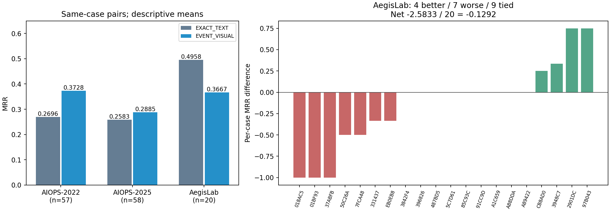

# RQ3.13：观测包络时间画布的完整结果、AegisLab 退化与后续设计

日期：2026-10-02，America/Toronto。版本 `rq313_observed_excursion_v1`；预选方法 `EVENT_VISUAL`；模型为本地 Qwen3.8-27B BF16。分析与审核由同一个主 agent 完成。本文替代本实验的完成状态简报，保留独立的运行资格报告、原始请求、回答、失败、评分和冻结归档。本次仅作离线分析与下一轮设计，新增模型调用为 **0**。

## 1. 结论与当前决定

**本轮有 AIOPS-2022 的正向开发信号，但不采用当前时间图作为部署方法。** AIOPS 主要范围内，时间图相对原始强文本的配对 ΔMRR 为 **+0.0664**，Holm p=**0.4549**；相对同状态文本为 +0.0579，pH=0.4549；相对同状态文字截图仅 **+0.0014**，pH=0.8015。对应事件组检验也未通过。平均配对 input+output 比原文增加 **8.80%**，没有降本。点估计超过实质收益门槛，不能替代显著性和机制门槛。

AIOPS-2022 的同病例配对增量为 **+0.1032（57 对）**，AIOPS-2025 为 +0.0302（58 对）；AegisLab 的 20 对则从 MRR **0.4958 降至 0.3667，Δ=−0.1292**，AC@1 从 40% 降至 25%，AC@5 从 70% 降至 55%。AegisLab 是原登记的辅助分析层，20 例不足以确认总体分布上的退化；其原始 p=0.2789，新增的完整 18 项数据集探索族校正后 pH=1。下降仍是必须处理的实际开发失败，不能因为未显著便忽略。

退化的证据链有四部分：**高显著度资源症状压过操作级 Trace；参考期包含瞬态变化而状态摘要将其压平；原证据与新增表存在双重指标编号；理由仍错误使用单位、时间顺序、部署关系和缺失证据。** 文字截图和真实重复保留了大部分损失，说明不能只归咎于时间图画法。尚未通过独立干预确认各因素的因果贡献，更不能宣称已经找到一个必然提分的修复。

下一步设计 RQ3.14：统一事实编号，分开检验解释规则、全窗口变化摘要及视觉承载，把 AegisLab 纳入正式采用门槛。详见[下一轮计划](../experiment_plans/RQ3_14_Observed_Binding_Plan_2026-10-02.md)。

## 2. 本轮实际比较什么

数据为沿用 RQ3.10 的 140 个已暴露 eval 开发病例：AIOPS-2022/2025 各 60，AegisLab 20。不是独立测试集，也不是从未暴露的数据。没有新 test、Gemma、attention 或训练。

| arm | 实际输入与比较意义 |
|---|---|
| EXACT_TEXT | RQ3.12 v4 的精确紧凑基础文本，含原 12 条 M、R/L/G、候选及最多 6 条参考操作数，加共同的字面读取/引用说明 |
| EXACT_REPEAT | EXACT_TEXT 的真实独立请求；同配方 seed，不选择较好的回答 |
| EVENT_TEXT | 同基础文本，追加包络绑定与 64 字符状态行 |
| EVENT_VISUAL | 同基础文本与包络绑定，状态行改由一张真实时间条带 PNG 承载 |
| EVENT_PIXEL_TEXT | 与 EVENT_VISUAL 完全相同的邻接文本，PNG 为 EVENT_TEXT 状态行的原样截图 |
| EVENT_VISUAL_REPEAT | EVENT_VISUAL 的真实独立请求，同 PNG 与输入，单列分析 |

派生计算仅使用原 12 条 M。每条序列要求真实采样支持、参考至少 12 个有限样本、当前至少 3 个、两阶段各至少 60% 采样槽覆盖。参考包络为 `[min(ref)−3IQR,max(ref)+3IQR]`，线性分位数；零常量参考合法，不加 epsilon。公共 split 不等于故障注入时间。跨 split 的 bin 排除；不插值。`+/-` 表示当前值在包络外的方向，`.` 表示包络内，空格为不可用；合格参考样本按定义画为 `.`。它不表达健康、故障概率或故障责任。

原始事实仍完整保留在文本。空派生表的 7 例回退 EXACT_TEXT，三个非重复派生臂合法引用其原响应；两个 repeat 仍为真实独立调用。故本轮是追加表示的效用实验，并非纯视觉 RCA 或信息压缩实验。输入保留不意味着模型一定保留原有证据权重。

## 3. 执行状态、完整性与失败分母

正式 840 个位置 = 819 次实际请求 + 21 个精确输入引用。808 次真实请求保存响应，11 次 request timeout；逻辑结果为 829 个完成位置、11 个已解释缺失。实际完成响应中 802 个满足评分契约、6 个模型输出失败；原零分保留。所有完成响应 finish_reason=stop，无发现截断。正式墙钟 4,117.58 秒（68.63 分钟，含启动），12:51:02 多伦多时间结束；所启动 GPU 服务已退出。

18 次 smoke 另计。合计发起 837 次，在本版本 900 次 allocation 内；未重试，剩余 allocation 不构成补打或新实验权限。历史 RQ3.12 调用继续单独保留。

已完成的[完整性核验](../../RQs/RQ3_13/results/observed_excursion_v1/analysis_reviewed_v1/artifact_verification.json)覆盖 808 个 atomic completion 图谱、实际 transport、829 份原评分复现、140 例公共编译重放、266 个 PNG 哈希、两份 129 文件源归档及 checkpoint/tokenizer/processor 身份。token 守恒成立，原输出与分数没有改写。本次报告沿用该已完成核验，不把查看旧结果称为重新认证 GPU 环境。

资格 source contract SHA256：`3c8e5d6472095cd58b148eae59ac4b8da865a28379b24ce5515d7dce620c3140`；有效正式运行 contract：`3bc7a242fb690ebae2298d1790a689c0f142a373b7b61f1ef5e87a6a2d979304`。后者仅为授权门禁激活，非门禁函数 AST 与冻结科学输入保持一致。原 archive SHA256 为 `10de257957c8307ab9665ec54cc18e3c3ca3fa4725cc598b196bcfc81b45a3fc`，有效 archive 为 `a4f1f285588e93e6cb2c40ad659c12c03d28c3c2b2b545b0192dc7ada9f2a86f`。运行来源是这些精确归档，不能仅以脏工作树提交号代替。

三个非法 ID 86465 输出均在 A22 的 INC-B646C4677B96（EXACT_TEXT/REPEAT/EVENT_TEXT）；A25 INC-EDDC755A08F5 的 EXACT_TEXT/REPEAT 重复 207；A25 INC-7E5014ED408C 的截图臂重复 208。这些是模型结果，不能修列表后救分。基础设施超时作为未知结果，每个比较使用自己的完整配对交集；没有按错答处理，也没有删掉其已完成一侧来改全臂均值。

## 4. 完整准确率结果

下表为每臂自身可用结果的均值；n 包含模型无效零分，排除基础设施无响应。不能直接相减不同 n 的两行来替代正式配对。AVG@K 沿用评分器：AC@1 至 AC@K 的平均；保留 service/pod 容错与 node 粒度规则。所有比例以百分比列示。

| 范围 | arm | n/注册 | MRR | AC@1 | AC@3 | AC@5 | AVG@3 | AVG@5 | 超时 | 模型无效 |
|---|---|---:|---:|---:|---:|---:|---:|---:|---:|---:|
| AIOPS120 | EXACT_TEXT | 118/120 | 0.2614 | 15.25% | 37.29% | 42.37% | 27.40% | 32.88% | 2 | 2 |
| AIOPS120 | EXACT_REPEAT | 118/120 | 0.2619 | 15.25% | 38.14% | 41.53% | 27.97% | 33.05% | 2 | 2 |
| AIOPS120 | EVENT_TEXT | 119/120 | 0.2754 | 17.65% | 37.82% | 42.02% | 28.85% | 33.61% | 1 | 1 |
| AIOPS120 | EVENT_VISUAL | 117/120 | 0.3332 | 24.79% | 41.88% | 46.15% | 34.19% | 38.63% | 3 | 0 |
| AIOPS120 | EVENT_PIXEL_TEXT | 118/120 | 0.3374 | 26.27% | 40.68% | 44.92% | 34.46% | 38.31% | 2 | 1 |
| AIOPS120 | EVENT_VISUAL_REPEAT | 120/120 | 0.3332 | 25.00% | 41.67% | 45.83% | 34.17% | 38.50% | 0 | 0 |
| AIOPS-2022 | EXACT_TEXT | 59/60 | 0.2689 | 15.25% | 37.29% | 42.37% | 28.81% | 33.90% | 1 | 1 |
| AIOPS-2022 | EXACT_REPEAT | 58/60 | 0.2658 | 15.52% | 37.93% | 39.66% | 29.31% | 33.45% | 2 | 1 |
| AIOPS-2022 | EVENT_TEXT | 59/60 | 0.2689 | 15.25% | 38.98% | 40.68% | 29.94% | 33.90% | 1 | 1 |
| AIOPS-2022 | EVENT_VISUAL | 58/60 | 0.3664 | 27.59% | 46.55% | 48.28% | 38.51% | 42.41% | 2 | 0 |
| AIOPS-2022 | EVENT_PIXEL_TEXT | 60/60 | 0.3394 | 26.67% | 40.00% | 45.00% | 34.44% | 38.33% | 0 | 0 |
| AIOPS-2022 | EVENT_VISUAL_REPEAT | 60/60 | 0.3708 | 28.33% | 46.67% | 48.33% | 38.89% | 42.67% | 0 | 0 |
| AIOPS-2025 | EXACT_TEXT | 59/60 | 0.2540 | 15.25% | 37.29% | 42.37% | 25.99% | 31.86% | 1 | 1 |
| AIOPS-2025 | EXACT_REPEAT | 60/60 | 0.2581 | 15.00% | 38.33% | 43.33% | 26.67% | 32.67% | 0 | 1 |
| AIOPS-2025 | EVENT_TEXT | 60/60 | 0.2817 | 20.00% | 36.67% | 43.33% | 27.78% | 33.33% | 0 | 0 |
| AIOPS-2025 | EVENT_VISUAL | 59/60 | 0.3006 | 22.03% | 37.29% | 44.07% | 29.94% | 34.92% | 1 | 0 |
| AIOPS-2025 | EVENT_PIXEL_TEXT | 58/60 | 0.3353 | 25.86% | 41.38% | 44.83% | 34.48% | 38.28% | 2 | 1 |
| AIOPS-2025 | EVENT_VISUAL_REPEAT | 60/60 | 0.2956 | 21.67% | 36.67% | 43.33% | 29.44% | 34.33% | 0 | 0 |
| AegisLab | EXACT_TEXT | 20/20 | 0.4958 | 40.00% | 55.00% | 70.00% | 46.67% | 56.00% | 0 | 0 |
| AegisLab | EXACT_REPEAT | 20/20 | 0.5208 | 40.00% | 60.00% | 75.00% | 50.00% | 60.00% | 0 | 0 |
| AegisLab | EVENT_TEXT | 19/20 | 0.4693 | 36.84% | 57.89% | 63.16% | 47.37% | 53.68% | 1 | 0 |
| AegisLab | EVENT_VISUAL | 20/20 | 0.3667 | 25.00% | 45.00% | 55.00% | 36.67% | 44.00% | 0 | 0 |
| AegisLab | EVENT_PIXEL_TEXT | 20/20 | 0.3833 | 30.00% | 45.00% | 55.00% | 36.67% | 44.00% | 0 | 0 |
| AegisLab | EVENT_VISUAL_REPEAT | 20/20 | 0.3792 | 30.00% | 45.00% | 50.00% | 38.33% | 43.00% | 0 | 0 |
| 全部140 | EXACT_TEXT | 138/140 | 0.2954 | 18.84% | 39.86% | 46.38% | 30.19% | 36.23% | 2 | 2 |
| 全部140 | EXACT_REPEAT | 138/140 | 0.2994 | 18.84% | 41.30% | 46.38% | 31.16% | 36.96% | 2 | 2 |
| 全部140 | EVENT_TEXT | 138/140 | 0.3021 | 20.29% | 40.58% | 44.93% | 31.40% | 36.38% | 2 | 1 |
| 全部140 | EVENT_VISUAL | 137/140 | 0.3381 | 24.82% | 42.34% | 47.45% | 34.55% | 39.42% | 3 | 0 |
| 全部140 | EVENT_PIXEL_TEXT | 138/140 | 0.3441 | 26.81% | 41.30% | 46.38% | 34.78% | 39.13% | 2 | 1 |
| 全部140 | EVENT_VISUAL_REPEAT | 140/140 | 0.3398 | 25.71% | 42.14% | 46.43% | 34.76% | 39.14% | 0 | 0 |

六臂共同完成的主要 AIOPS 交集为 110 例（A22 54、A25 56），MRR 依次为 .2759/.2733/.2842/.3453/.3438/.3453。这仍是时间图与截图几乎持平，不能靠换共同掩码建立独立的时间图收益。

图左为每个数据集 EVENT_VISUAL−EXACT_TEXT 自身的共同病例；图右包含全部 20 个 AegisLab 病例，无超时缺失。没有误差棒或置信区间。可导出的 [SVG](through_RQ3_15_preserved/assets/RQs/RQ3_13/results/observed_excursion_v1/analysis_detailed_v1/paired_mrr_and_aegis_changes.svg)与全部数表已落盘。

## 5. 注册统计、重复与成本

主指标 MRR；双侧 paired Pratt-Wilcoxon，差值 round12，paired Cohen dz。三项主要与三项次要对照分别 Holm；事件组先组内平均再组等权检验，单独校正。不报告 CI，不将 pooled 与 macro 混为同一端点。

| 族 | 对比 | n | ΔMRR | dz | case pH | 改善/恶化/持平 | group n | group Δ | group pH |
|---|---|---:|---:|---:|---:|---|---:|---:|---:|
| primary | EVENT_VISUAL−EVENT_TEXT | 116 | +0.0579 | 0.1544 | 0.4549 | 27/18/71 | 91 | +0.0413 | 0.8337 |
| primary | EVENT_VISUAL−EVENT_PIXEL_TEXT | 115 | +0.0014 | 0.0084 | 0.8015 | 9/8/98 | 89 | -0.0129 | 0.9536 |
| primary | EVENT_VISUAL−EXACT_TEXT | 115 | +0.0664 | 0.1847 | 0.4549 | 26/18/71 | 90 | +0.0556 | 0.8337 |
| secondary | EVENT_TEXT−EXACT_TEXT | 117 | +0.0078 | 0.0353 | 1.0000 | 7/11/99 | 92 | +0.0167 | 1.0000 |
| secondary | EXACT_REPEAT−EXACT_TEXT | 116 | -0.0024 | -0.0728 | 1.0000 | 1/2/113 | 92 | -0.0017 | 1.0000 |
| secondary | EVENT_VISUAL_REPEAT−EVENT_VISUAL | 117 | +0.0000 | — | 1.0000 | 0/0/117 | 91 | +0.0000 | 1.0000 |

主要比较的原始 p 分别为 .1516/.8015/.1526。部署收益、相对状态文本的实质增益、各 AIOPS 正方向及总 token≤1.20 的点估计门槛通过；病例与事件组显著性失败，因此采用状态仍为 false。报告完成解释审核也不会改变这些统计结论。

保留已观测一侧、只让缺失一侧 MRR∈[0,1] 时，完整注册 120 例的平均差范围为：EV−EVENT_TEXT `[+.04347,+.07681]`；EV−PIXEL `[−.02361,+.01806]`；EV−EXACT `[+.05111,+.09278]`。这是有限样本的代数界限，非总体 CI。它支持对原文/状态文本的正均值方向，却仍不能证明图形胜过截图。

真实重复：主要 AIOPS 的 EXACT 两次 116 对中，113 对 MRR 相同、104 对排名相同、25 对响应逐字相同；视觉 117 对全部 MRR 相同，但仅 100 对完整排名相同、23 对逐字相同。AegisLab 视觉 20 对中 MRR 相同 18、排名相同 17；7FCA 从 .5 到 1，CB8AD 从 .25 到 0，合计变化 +.25，平均 +.0125。不能说所有解释稳定，也不能选择较好 repeat。

主要同病例总 token 比值：EV/EXACT **1.08797**，EV/EVENT_TEXT **1.01569**，EV/PIXEL **0.99967**。图像非常小，却仍没有净降本；大量基础事实和绑定文字仍在。

| 范围 | arm | n | text | image | input | output | total | 请求秒 | TTFT秒 |
|---|---|---:|---:|---:|---:|---:|---:|---:|---:|
| AIOPS120 | EXACT_TEXT | 118 | 17,017.7 | 0.0 | 17,017.7 | 189.7 | 17,207.4 | 166.3 | 127.0 |
| AIOPS120 | EXACT_REPEAT | 118 | 16,984.1 | 0.0 | 16,984.1 | 197.7 | 17,181.8 | 167.8 | 127.2 |
| AIOPS120 | EVENT_TEXT | 119 | 18,220.2 | 0.0 | 18,220.2 | 196.2 | 18,416.4 | 168.4 | 128.1 |
| AIOPS120 | EVENT_VISUAL | 117 | 17,784.4 | 699.1 | 18,483.5 | 222.0 | 18,705.5 | 172.9 | 127.7 |
| AIOPS120 | EVENT_PIXEL_TEXT | 118 | 17,829.1 | 699.2 | 18,528.3 | 227.0 | 18,755.4 | 173.5 | 126.3 |
| AIOPS120 | EVENT_VISUAL_REPEAT | 120 | 17,804.1 | 699.5 | 18,503.5 | 228.4 | 18,731.9 | 175.1 | 128.7 |
| AIOPS-2022 | EXACT_TEXT | 59 | 18,685.1 | 0.0 | 18,685.1 | 189.0 | 18,874.1 | 164.9 | 125.6 |
| AIOPS-2022 | EXACT_REPEAT | 58 | 18,663.3 | 0.0 | 18,663.3 | 193.2 | 18,856.4 | 166.2 | 126.2 |
| AIOPS-2022 | EVENT_TEXT | 59 | 19,937.9 | 0.0 | 19,937.9 | 202.6 | 20,140.5 | 168.8 | 127.4 |
| AIOPS-2022 | EVENT_VISUAL | 58 | 19,535.2 | 715.0 | 20,250.2 | 225.4 | 20,475.6 | 173.4 | 128.3 |
| AIOPS-2022 | EVENT_PIXEL_TEXT | 60 | 19,532.9 | 715.0 | 20,247.9 | 226.7 | 20,474.6 | 174.0 | 126.7 |
| AIOPS-2022 | EVENT_VISUAL_REPEAT | 60 | 19,532.9 | 715.0 | 20,247.9 | 234.7 | 20,482.6 | 175.7 | 128.6 |
| AIOPS-2025 | EXACT_TEXT | 59 | 15,350.3 | 0.0 | 15,350.3 | 190.5 | 15,540.7 | 167.8 | 128.4 |
| AIOPS-2025 | EXACT_REPEAT | 60 | 15,360.9 | 0.0 | 15,360.9 | 202.1 | 15,563.0 | 169.3 | 128.1 |
| AIOPS-2025 | EVENT_TEXT | 60 | 16,531.1 | 0.0 | 16,531.1 | 190.0 | 16,721.1 | 168.0 | 128.8 |
| AIOPS-2025 | EVENT_VISUAL | 59 | 16,063.3 | 683.4 | 16,746.7 | 218.6 | 16,965.3 | 172.5 | 127.1 |
| AIOPS-2025 | EVENT_PIXEL_TEXT | 58 | 16,066.7 | 682.9 | 16,749.5 | 227.3 | 16,976.8 | 173.0 | 125.9 |
| AIOPS-2025 | EVENT_VISUAL_REPEAT | 60 | 16,075.2 | 683.9 | 16,759.2 | 222.1 | 16,981.2 | 174.4 | 128.7 |
| AegisLab | EXACT_TEXT | 20 | 18,225.2 | 0.0 | 18,225.2 | 177.1 | 18,402.3 | 161.8 | 124.9 |
| AegisLab | EXACT_REPEAT | 20 | 18,225.2 | 0.0 | 18,225.2 | 205.2 | 18,430.4 | 167.8 | 125.1 |
| AegisLab | EVENT_TEXT | 19 | 19,247.2 | 0.0 | 19,247.2 | 178.4 | 19,425.6 | 166.6 | 130.5 |
| AegisLab | EVENT_VISUAL | 20 | 18,940.8 | 536.2 | 19,477.0 | 216.6 | 19,693.7 | 172.4 | 127.7 |
| AegisLab | EVENT_PIXEL_TEXT | 20 | 18,940.8 | 536.2 | 19,477.0 | 196.4 | 19,673.5 | 163.3 | 123.2 |
| AegisLab | EVENT_VISUAL_REPEAT | 20 | 18,940.8 | 536.2 | 19,477.0 | 224.9 | 19,702.0 | 176.1 | 130.0 |
| 全部140 | EXACT_TEXT | 138 | 17,192.7 | 0.0 | 17,192.7 | 187.9 | 17,380.6 | 165.7 | 126.7 |
| 全部140 | EXACT_REPEAT | 138 | 17,164.0 | 0.0 | 17,164.0 | 198.8 | 17,362.8 | 167.8 | 126.9 |
| 全部140 | EVENT_TEXT | 138 | 18,361.6 | 0.0 | 18,361.6 | 193.8 | 18,555.3 | 168.1 | 128.4 |
| 全部140 | EVENT_VISUAL | 137 | 17,953.2 | 675.3 | 18,628.5 | 221.2 | 18,849.7 | 172.8 | 127.7 |
| 全部140 | EVENT_PIXEL_TEXT | 138 | 17,990.3 | 675.6 | 18,665.8 | 222.6 | 18,888.4 | 172.0 | 125.8 |
| 全部140 | EVENT_VISUAL_REPEAT | 140 | 17,966.5 | 676.1 | 18,642.6 | 227.9 | 18,870.5 | 175.2 | 128.9 |

正式实际请求已知 input=14,691,654（text=14,411,246，image=280,408），output=169,180，total=14,860,834。11 个超时 usage 全未知，合计仅为已记录下界。Smoke 已知 input=340,414、output=3,557；实际支出按 call 身份去重，不能把带引用的六臂部署成本直接相加。正式完成请求 wall_time 合计 137,694.24 秒为并发重叠时间，不能称为独占 GPU 小时；没有完整功率积分或各臂独立吞吐测量，不推算能源或金额。

## 6. AegisLab：损失具体在哪里

### 6.1 全部病例，而非只挑失败故事

| case | fault | EXACT | REPEAT | EVENT_TEXT | VISUAL | PIXEL | VIS_REPEAT | ΔEV−EXACT |
|---|---|---:|---:|---:|---:|---:|---:|---:|
| INC-018AC5D486B5 | NetworkCorrupt | 1.0000 | 1.0000 | 1.0000 | 0.0000 | 0.0000 | 0.0000 | -1.0000 |
| INC-01BF937825D4 | HTTPRequestAbort | 1.0000 | 1.0000 | 1.0000 | 0.0000 | 0.0000 | 0.0000 | -1.0000 |
| INC-2901DC0C5EA7 | JVMMemoryStress | 0.2500 | 0.2500 | 1.0000 | 1.0000 | 1.0000 | 1.0000 | +0.7500 |
| INC-331437929E47 | NetworkCorrupt | 0.3333 | 0.3333 | 超时 | 0.0000 | 0.0000 | 0.0000 | -0.3333 |
| INC-37ABFB78A80E | HTTPRequestReplaceMethod | 1.0000 | 1.0000 | 0.0000 | 0.0000 | 0.0000 | 0.0000 | -1.0000 |
| INC-3842F45DAA9C | HTTPResponseReplaceCode | 0.5000 | 0.5000 | 0.5000 | 0.5000 | 0.0000 | 0.5000 | +0.0000 |
| INC-3948C7715B49 | HTTPRequestReplaceMethod | 0.0000 | 0.5000 | 0.0000 | 0.3333 | 0.3333 | 0.3333 | +0.3333 |
| INC-39682657768A | JVMMemoryStress | 1.0000 | 1.0000 | 1.0000 | 1.0000 | 1.0000 | 1.0000 | +0.0000 |
| INC-487BD5BF5D73 | HTTPResponseReplaceCode | 1.0000 | 1.0000 | 1.0000 | 1.0000 | 1.0000 | 1.0000 | +0.0000 |
| INC-50C26A55D214 | PodKill | 1.0000 | 1.0000 | 1.0000 | 0.5000 | 0.5000 | 0.5000 | -0.5000 |
| INC-5C7D6186CEC1 | HTTPResponseAbort | 0.0000 | 0.0000 | 0.0000 | 0.0000 | 0.2500 | 0.0000 | +0.0000 |
| INC-7FCA48559A2E | NetworkCorrupt | 1.0000 | 1.0000 | 0.3333 | 0.5000 | 1.0000 | 1.0000 | -0.5000 |
| INC-85C93CE3CB89 | HTTPRequestReplaceMethod | 0.2500 | 0.2500 | 0.2500 | 0.2500 | 0.2500 | 0.2500 | +0.0000 |
| INC-91CC9D691CA8 | HTTPRequestDelay | 0.0000 | 0.0000 | 0.0000 | 0.0000 | 0.0000 | 0.0000 | +0.0000 |
| INC-97B043342751 | HTTPRequestReplaceMethod | 0.2500 | 0.2500 | 0.5000 | 1.0000 | 1.0000 | 1.0000 | +0.7500 |
| INC-A1C6591B0184 | HTTPRequestReplacePath | 0.0000 | 0.0000 | 0.0000 | 0.0000 | 0.3333 | 0.0000 | +0.0000 |
| INC-A88DDA849391 | JVMMemoryStress | 1.0000 | 1.0000 | 1.0000 | 1.0000 | 1.0000 | 1.0000 | +0.0000 |
| INC-A89422C045DE | HTTPResponseReplaceCode | 0.0000 | 0.0000 | 0.0000 | 0.0000 | 0.0000 | 0.0000 | +0.0000 |
| INC-CB8AD006EA8A | JVMReturn | 0.0000 | 0.0000 | 0.0000 | 0.2500 | 0.0000 | 0.0000 | +0.2500 |
| INC-EB0EB86F831D | HTTPRequestReplaceMethod | 0.3333 | 0.3333 | 0.3333 | 0.0000 | 0.0000 | 0.0000 | -0.3333 |

EV 相对 EXACT 共 4 改善、7 恶化、9 持平；Top-1 修复/破坏 2/5；前五新增/丢失 2/5。下降总量为 4.6667，改善总量为 2.0833，净值 −2.5833/20=−.1292。018AC、01BF、37AB 三例均从 1→0，损失 3 个 reciprocal-rank 单位，超过最终净下降；其余有得有失。三例在截图臂同样 1→0；视觉 repeat 也均为 0。

全部七个下降病例中，除 7FCA 外，其余六例在视觉 repeat 相对原文仍下降。故损失不只是一次随机回答的偶然翻转。不过每个输入只有一次真实 repeat，不能估计稳定错误概率。

按原 fault 标签：NetworkCorrupt 三例 .7778→.1667；JVMMemoryStress 三例 .7500→1；PodKill 单例 1→.5；HTTPRequestReplaceMethod 五例 .3667→.3167。不能将本轮概括为“所有 Aegis/JVM 或所有 HTTP 都下降”，也不能将这些小层用于线上 gold 路由。[42 个故障配对描述层](through_RQ3_15_preserved/assets/RQs/RQ3_13/results/observed_excursion_v1/analysis_detailed_v1/fault_paired_descriptive.csv)完整保留两个 AIOPS 和 Aegis，不挑最高子组。

### 6.2 高显著度症状取代局部操作证据

INC-018AC5D486B5：原文首选 702；R 的 702/GET exclusive p95 为 **130,282,538.25µs≈130.28秒**、rank_score=15.95。视觉/截图都改选 877，把 702 移出前五，公开理由强调 CPU 的 71σ、多条共现和更早 onset。实际 877 的四条超包络 CPU 行只在 bin40/42 出现，另有一条未超包络；五行属于同一服务、相近 CPU 观测，不能当作五份独立因果支持。原 G 的 877 onset 为 +5.2m，理由却写 +4.0m；截图还将 510 的 13.69 称为最高，漏过 702 的 15.95。

这张[实际时间图](through_RQ3_15_preserved/assets/RQs/RQ3_13/preparation/observed_excursion_v1/renders/INC-018AC5D486B5/EVENT_VISUAL/dashboard.png)清楚保留实体、稀疏采样与短时脉冲；[实际截图](through_RQ3_15_preserved/assets/RQs/RQ3_13/preparation/observed_excursion_v1/renders/INC-018AC5D486B5/EVENT_PIXEL_TEXT/dashboard.png)也有同状态。两者均失败，支持“强调指标状态后，候选证据优先级改变”的路径；不证明视觉完全没被读，也不证明 CPU 本身是错误观测。

INC-01BF937825D4：原文和派生文本均命中 732，两个图像臂均丢掉 732/927，改追 349/165/779 的指标时间。故至少这例的问题发生在图像承载及其伴随位置/权重变化，不能仅归因于计算了新状态。Metric 的 HTTP duration quantile 在部分解释中被叫作 exclusive latency，扩大了它本来没有的归因语义。

INC-37ABFB78A80E：原文命中 495，派生文本、图、截图都改选 364，丢掉接受的 495/819。这里文本追加也会破坏；不是图像独有。视觉将 364 的 **2,149,479.97µs** 写为 **2.149ms**，差 1000 倍；截图把 +5.0m 称为最早，但 G 有 803 +4.0m、495 +4.2m。原文虽然正确，也存在指标引用问题，不能将其理由全部认证为可靠真值。

### 6.3 包络正确，瞬态仍可能被摘要压平

INC-50C26A55D214 是 PodKill。公共窗口 480s、split=285s。762 的 pod memory usage 在 bin34（255–262.5s）降至约 **93.97M**，后续恢复；这次骤降已位于参考阶段。参考 min/max 将其包含，所有十二条派生状态都没有 `+/-`，参考阶段又按定义一律为 `.`。因此[实际图](through_RQ3_15_preserved/assets/RQs/RQ3_13/preparation/observed_excursion_v1/renders/INC-50C26A55D214/EVENT_VISUAL/dashboard.png)看起来全平，尽管原始文本仍保存骤降。

原文首选 762；两个图像臂均提升 871、将 762 放第二。871 的已显示 MET-Z deviation_sigma 为 1074.4G，但 regular_std≈2.5e−20，打印曲线约为常量 .000694。理由将 762 的骤降与恢复解释为非故障资源回收，并拿极端 σ 与没有上游边论证 871 的来源地位；截图还说 +5.2 先于 +4.9，并将不同宿主的服务称为共址。871 的实例位于 3083，762 实例位于 4490。

**这不是包络计算错误，也不是缺失填零。** 问题是该算子只总结 split 后的新范围偏离，不能表达参考期内的诊断性瞬态；有限观测内“没有新偏离”又被公开理由升级为健康/非根因。输入说明已明确禁止这种推论，仍未阻止误用。下一版须检验全窗口瞬态保留，不能简单放宽包络阈值或删掉不合格病例。

反向例 INC-CB8AD006EA8A：全部十二条也没有 excursion，EV 却称“M10 的 406 在 bin33 越界”。M10 的实际实体是 404，406 是 M04；更关键的是整张状态表根本没有任何越界。此例 MRR 0→.25，repeat 又变为 0。正分变化同样不能用来认证读图与机制正确。

### 6.4 可复现的编号歧义

原始 Metric 事实保留 `panel_id=M1..M12`，来自旧异常面板顺序；派生表使用冻结 card 的 `M01..M12`，来自另一顺序。两串在字面上不同，但数字后缀很容易被同一引用方式合并。018AC 的旧 M1 是 877/container.cpu.usage，新 M01 是 125/jvm.system.cpu.load_1m；37AB 的旧 M3 是 364/p95，而新 M03 是 495/p90。

来源编号映射的全 140 例都有至少一个这种数字后缀不对齐（只有133例实际显示非空派生表；空表病例没有新增图中编号）：A22 655/720 行、A25 678/720 行、Aegis 218/240 行，合计 **1,551/1,680（92.32%）**。计数是两个命名空间数值后缀的比较，不是 1,551 个 literal-ID 冲突，也不是模型错误数。不同后缀有时仍指同一实体的其他指标；部分旧 M1 引用是合法旧编号，不能一概裁成新 M01 绑定错误。

因此此前资格报告中的部分 M 引用反例须附加这一解释边界。CPU 对事实—图元的绑定正确，与模型可见的引用命名空间清晰是两个不同问题。旧实验不回写、不追溯救分；新实验统一命名并保留独立格式对照。[逐条编号/实体/原事实 ID/包络状态清单](through_RQ3_15_preserved/assets/RQs/RQ3_13/results/observed_excursion_v1/analysis_detailed_v1/metric_identity_and_states.csv)支持复核。

### 6.5 为什么 AIOPS 有收益，而 Aegis 有损失

当前最有支持的解释是：同一个显著度与时序强调算子，有时把注意力移回真实局部资源对象，有时移向 CPU、duration quantile、累计计数或共址症状。A22 INC-A140F0C90613 中，原文漏掉实际 pod30206，图与截图均恢复首位；其内存/cache/资源变化从 bin32 后在多条曲线持续，实际图可见。A25 INC-BD14EEDA08FA 中，真实 node6017 由第五升至第一，公开 node memory median 59.99→68.66 提供了资源支持。A22 INC-EF0D5C71C864 中，图和截图转向 598 的强本地 Trace 耗时，而原文追逐另一操作。

这些恢复并未证明形状读取是唯一原因，回答仍有无依据的健康 peer 排除、调用/实例归属与因果证明。A22 57 对 EV−EXACT 的 MRR 改善/恶化为18/11，top1修复/破坏10/3；A25 58 对为8/7、5/2。不能隐去 AIOPS 内部破坏，如 BA41A：正确 pod 被宿主取代，1→.5，图和截图均如此。

Aegis 有派生表的 15/20，两个“有表却无任何 excursion”的病例；A22 为60/60且没有这种空变化表，A25 为58/60且1例。原12条 M 的精确接受根因实体覆盖却是 Aegis 13/20、A22 22/60、A25 19/60，所以不是“Aegis 根因总没入 M”。五个 Aegis 空表回退病例对非重复图像效果为严格 no-op，不负责解释下降。Aegis 基线更高、可破坏空间更多，故障组成和采样/时钟也不同；这些关联不能独立识别数据集身份的因果作用。

## 7. 解释审核的实际深度与边界

按登记每数据集12例的 outcome-blind hash 选择36例、216位置；读取213个完整响应，另3个超时原位保留。配置固定seed42与hash选择，但未指定hash salt，本次离线具体实现 `sha256(canonical_json([42,"rq313_reason_review_v1",opaque_id]))`，明确登记在[选择清单](../../RQs/RQ3_13/results/observed_excursion_v1/analysis_detailed_v1/reason_review_selection.json)，不假称这一实现细节事前已经冻结。

此外读取其余8个Aegis病例，全审核并集44例264位置、260个可用响应。对七个Aegis损失、AIOPS代表恢复/破坏等定向回查事实与关系；直接查看四张本轮真实PNG。全部响应与来源保存在[44例附录](../../RQs/RQ3_13/results/observed_excursion_v1/analysis_detailed_v1/reviewed_responses_44.md)。阅读完整响应不等于认证每条因果主张。

登记五轴为单位/数值、时序、实体绑定、excursion当根因、无依据因果断言。定向核对保存14条claim：13条明确的算术/源事实矛盾、1条没有充分来源支持的因果次序断言。其余轴/主张仍为 not_certified；不提供全量幻觉率、双评审一致率或已校准可信度。尤其将双编号歧义单列，避免把接口缺陷全部算到模型头上。[审核记录](../../RQs/RQ3_13/results/observed_excursion_v1/analysis_detailed_v1/manual_reason_review.json)、[具体claim](../../RQs/RQ3_13/results/observed_excursion_v1/analysis_detailed_v1/source_checked_claims.json)。

高/medium/low仅是模型输出类别，[置信类别与错排计数](through_RQ3_15_preserved/assets/RQs/RQ3_13/results/observed_excursion_v1/analysis_detailed_v1/confidence_descriptive.csv)按臂/数据集完整保存。更高MRR、更低自报信心、响应符合JSON，均不自动等于解释更可信。公开reason是可核验输出，不用于推断隐藏思考。

## 8. 历史报告的综合分析

本轮回读项目报告索引中的全部历史正式分析正文、有效性限制及主结果，并核对用于本次判断的数表；跨实验画像/汇总是二级综合资料，独立报告优先。17份历史来源的文件SHA与阅读范围见[历史清单](../../RQs/RQ3_13/results/observed_excursion_v1/analysis_detailed_v1/history_report_manifest.json)。不将附录全部逐claim标注，也不把重读当作重算历史每次请求。

| 历史报告 | 值得继承的证据及边界 | 对下一轮的约束 |
|---|---|---|
| [RQ1.1/2.1](RQ1_1_RQ2_1_findings/findings.md) | TPV相对文本有+0.0727主集收益；M/R/L全面视觉化不普遍有益，全视觉有输入节省但准确率代价 | 保留强文本与同信息截图；只检验具体视觉操作 |
| [Tournament](Tournament_Analysis_2026-09-15.md) | 394/480是多轮union；86未top1中70曾入前五；后期selector收益低 | 研究竞争排序，拒绝best-of和无限换选择器 |
| [RQ3.1](RQ3_1_Results_Analysis_2026-09-19.md) | X补线索却损失大量node资源；图边覆盖不能替代直接观测 | 保留原证据与资源单侧观测 |
| [RQ3.2](RQ3_2_Results_Analysis_2026-09-22.md) | SC恢复实体覆盖仍未恢复机制；时间说明错界限/no-op限制机制结论 | 编号、时钟与实际输入变化先审计 |
| [RQ3.3](RQ3_3_Results_Analysis_2026-09-24.md) | W_G有正方向但未超过扩量门槛；host既修复node也误伤pod；二调用未证明抵偿成本 | 一次Solver，不能用宿主压力自动归因 |
| [RQ3.4](RQ3_4_Results_Analysis_2026-09-25.md) | K/规则核验不保证排序改善；源头可晚于症状 | 一致性审计不升格为因果认证；guard需独立对照 |
| [RQ3.5](RQ3_5_Screen_Analysis_2026-09-26.md) | J只有28/60真正变化，联合比例不等于因果 | 新摘要须有可操作、非no-op统计 |
| [RQ3.6-A](RQ3_6_Stage_A_Analysis_2026-09-26.md) | 文本接口校准有可靠收益；S替换使Aegis .6539→.4639 | 数据集分开验收；实体/字段机制都要保护 |
| [跨实验画像](Cross_Experiment_Method_Profile_2026-09-26.md) | network与memory/node能力取舍；hop与来源混杂 | 不用dataset/gold fault路由；不要跨批次排冠军 |
| [RQ3.6-B](RQ3_6_Mechanisms_Analysis_2026-09-28.md) | 去重HP的Graph收益在B2族成立，在更宽17族未成立；onset去除方向依赖事后gold对齐 | 统一公开去冗余/事实绑定，不按gold对齐挑摘要 |
| [RQ3.7-A/B](RQ3_7_Results_Analysis_2026-09-28.md) | LOCAL_LINK相对TPV有正证据；数字等价写法仍敏感，node受损 | 单位原生、层级明晰；不默认连线解决绑定 |
| [RQ3.7-C/3.8](RQ3_7C_RQ3_8_Qwen_Analysis_2026-09-30.md) | 融合扩大后收益缩小；全图test退化−.0771，已有root-M也被破坏；图形干预未超repeat | 不加整张大图；正确召回与正确解释分开 |
| RQ3.9 | 当前[3.12报告](RQ3_12_Qwen_Analysis_2026-10-02.md)记录用户暂停且正式不完整；没有完整正式效果报告 | 不补造零效果，不自动续跑 |
| [RQ3.10](RQ3_10_Qwen_Analysis_2026-10-01.md) | 低范围适用性；矩阵未显著且token约+75% | 没有观测的诊断内容直接省略，不画unknown墙 |
| [RQ3.11](RQ3_11_Qwen_Analysis_2026-10-01.md) | 数值签名100%保护≠RCA收益；HIGH+3.1%成本；解释单位/时序错误 | 保护真正信息而非只认证CPU算子，预算看实际processor |
| [RQ3.12](RQ3_12_Qwen_Analysis_2026-10-02.md) | 104/120预测可计算，但精确root目标0；参考预测不保证诊断适用性 | 不继续参考预测扩搜，原始观测是新摘要的唯一来源 |
| [本轮资格](RQ3_13_Qualification_2026-10-02.md) | CPU/18call smoke通过，仅证明运输/渲染/评分可执行；历史当时formal0 | 与后续全量完成状态分开；补充编号歧义限制，不改历史记录 |

同一个018AC在RQ3.7已出现CPU症状压过702；37AB在RQ3.8已有364显著簇把495挤出前五。本轮是这些暴露病例上的重复失败路径，不是两批独立样本的复制显著性；它有助于选干预方向，但不能扩大有效N。

综合判断：项目已反复验证“更多覆盖、更精确数字、更大画布、更多验证措辞”不自动带来性能、成本和信任收益。最值得继续的方向是**既有事实如何被绑定和赋予诊断角色**。当前结果支持小型、有分开对照的修复；不支持宣称视觉总体失效或已经填补论文gap。

## 9. 下一步与学术审查裁定

RQ3.14的预选方案使用全窗口的可追溯变化摘要，保留瞬态而不把参考阶段压成健康；把请求duration分位数、本地exclusive耗时、计数、restart、资源状态分别标识，统一MET/TRC/LOG/REL引用。重复指标明确共享实体/观测，显示来源但不累加成因果票数。图中保留语义和单位，不让M-only副图承担全模态根因排序。

必须分别保留原文、编号修复文本、规则文本、旧状态图、同新摘要文本、图形、原样截图、真实文本及图形重复等对照。Aegis扩到完整100例eval，两个AIOPS仍固定各60；全部已暴露，不能称未见测试。预选单方法、预定统计族与每数据集方向门槛，不从部分结果调参，不取最好repeat，不按gold类型删除病例。

学术裁定：接受本轮为完整执行、统计复核与失败路径可追溯的开发实验；拒绝“时间图已证明提升MRR”“已降低成本”“可信度已提升”和“编号歧义就是全部下降原因”。13条确认矛盾不是全量grounding分数；20例Aegis的下降不是已确认总体因果效应。新实验的测量目标是两个AIOPS进一步改善并使Aegis正向改善，不能预先承诺。

当前交付停在报告与设计；下一轮代码、CPU/GPU资格和正式推理尚未启动。

## 10. 文件与复核入口

- [原定量核验与全部30行指标](../../RQs/RQ3_13/results/observed_excursion_v1/analysis_reviewed_v1/quantitative_review.json)、[正式原统计](../../RQs/RQ3_13/results/observed_excursion_v1/formal/analysis.json)：保持原状。
- [新详细分析目录](../../RQs/RQ3_13/results/observed_excursion_v1/analysis_detailed_v1)：140例逐例结果、1680行身份/状态、完整数据集探索对比、故障分层、44例响应、36例审核、具体源核对、历史清单与图表；含离线标签/评分，禁止进入下一轮compiler或模型输入。
- [本实验findings](../../RQs/RQ3_13/findings/exp_observed_excursion_findings.md)、[下一轮设计](../experiment_plans/RQ3_14_Observed_Binding_Plan_2026-10-02.md)：新的状态入口。
- [报告核对与简报删除审计](../../RQs/RQ3_13/results/observed_excursion_v1/analysis_detailed_v1/report_verification.json)：表格、来源身份、响应副本、本地链接与原简报最小审计。

简易状态报告已在本详细报告核对后按用户要求删除；只保留一个RQ3.13正式结果分析报告。独立资格报告与实验原始日志不属于简易结果报告，没有删除。
