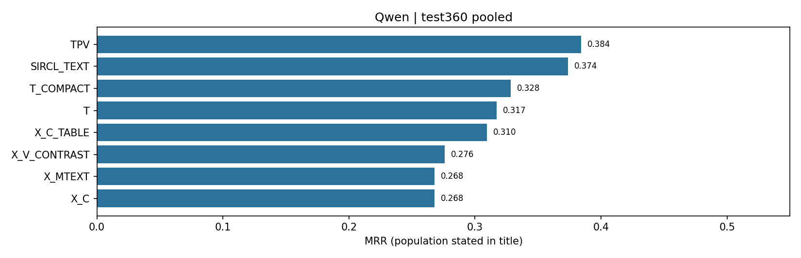

# RQ3.1：竞争证据选择 X 的效果与机制

Qwen-only 修订版：2026-09-30。原文件日期标识所分析的历史批次，并非新增实验日期。

本报告仅讨论 Qwen3.8-27B；结论由其自身病例和结果决定，不要求跨模型成立，也不推广为所有模型的性质。原始输出、分数、输入与实验状态未改；本轮新增推理调用为 0。

统计按 Qwen-only 范围重新分析：保留原科学问题的全部正负比较、病例掩码及失败处理，重新计算 Holm；有逐病例记录或差值的主比较重新复算配对检验与 dz。原始 p 在样本未变时本来就不依赖其他模型。CSV 数值往返影响浮点并列时，保留原数值并列口径，另存重算敏感性。附表 `raw_statistic_source` 明确区分重新配对计算与沿用同一 Qwen 样本的原始统计。没有把事后分析改称预注册发现。

## 实验范围与条件

X 从公共统计构建竞争证据包，配合文本、紧凑表、截图、Standard/Contrast 图和 M-text；另有预算、冗余、分组、时间对齐、身份/顺序扰动和重复调用。主比较是 360 个历史 test cases，三个主数据集各 120；旧 eval480 用于开发分析。现在二者都已暴露，不能再作为未来 untouched test。

## Qwen 的总体判断

最终 test 的 TPV MRR=0.3843、SIRCL_TEXT=0.3739、T_COMPACT=0.3282、T=0.3171；X_C_TABLE=0.3095、X_V_CONTRAST=0.2761、X_MTEXT=0.2679、X_C=0.2678。X 的两种部署视觉方案相对 TPV 和 SIRCL 均显著退化。X 不是仅仅“画得不好”：文本本身也未稳定超过强基线。

12 项 Qwen 主比较内，X_MTEXT 相对 X_C_TABLE 的退化仍显著；X_V_CONTRAST 相对同表格的 −0.0335 未通过校正。不能把前者写成全部视觉条件的普遍结论。TPV 对 T 的提升是另一个比较，不将它冒充本轮注册 X-family 的主要检验。

## 失败发生在哪一环

X 显著改变证据组成。后续核查 360 例时，根因 Metrics 涉及病例从 P0 的 207 降到 X 的 67，而关联 Trace 从 148 增至 231；51 个 node 根因中，根因 Metrics 从 28 降至 2。图边覆盖不能代替直接遥测覆盖。这里的计数是实体级描述，不是机制充分性证明。

Qwen node 子组：T=0.3464、TPV=0.3105、X-table=0.0196、X-vision=0.0039。便于配对的 Trace 和便宜图关系可能挤占单侧资源证据；缺 peer/日志/Trace 不应成为资源事实失去资格的理由。

与此同时，X 确实有新增有效线索：P0 没有、X 新增根因 Metrics 的 26 例，TPV→X-table 从 0.3365 到 0.4949；P0 有而 X 删除的 166 例则从 0.4874 到 0.2502。它是能力置换而不是完全无用；两组都由标签事后分层，不能直接作因果归因。

## 承载与机制干预

100-case 中，表格文本到同文本截图的 MRR 从 0.4958 到 0.3653，提示文字像素化会引入读取代价。取消分组、取消共同时间轴、降低区分度的效果并不一致，不支持继续无限优化对比布局。50% 预算明显损害文本；75% 变化很小，不能据此说越多越好。

候选顺序与重匿名化有影响：文本候选重排的点估计上升、视觉重匿名化点估计下降。重复调用波动小于若干表示差异，但不能事后取最好一次。所有机制比较在相应实验内部作 Qwen 校正，完整非显著及负向对照均保留。

## 质量、成本与案例

最终 2,880 个逻辑结果没有未解释的基础设施缺失，100 个模型输出失败仍按原评分计入；失败不是删除条件。图像输入与文本输入分别报告，不能用少输入抵消 MRR 退化。

`INC-559F0B2CEFB9` 显示视觉能改变候选归属与排序；`INC-E74A7A5234DB` 则说明可用 node 证据在视觉竞争中仍可能被忽略；`INC-641C662F70D0` 提醒巨大延迟可能属于错误实体。完整 reason/预测/输入路径在逐调用表，不能由正确答案反推解释必然正确。

CPU 异常计数 MRR=0.3483，BARO component=0.2626，X 内部排序=0.2178。它们不调用 LLM，只作为选择/推理必要性的参照，不等同完整 RCA 方法复现。八方法 oracle MRR=0.6846 仅描述互补性，不是部署性能。

## 可保留的研究方向

保留 X 找到的操作/流量增量，保护原有 node/资源证据；内容选择和表示必须分开。不能声称 X 已经解决证据缺失，也不能将全部失败归为模型 reasoning。

## 完整主结果表

### test360 pooled

| arm | n | mrr | ac@1 | ac@3 | ac@5 | avg@3 | avg@5 | input_tokens | output_tokens |
|---|---|---|---|---|---|---|---|---|---|
| SIRCL_TEXT | 360 | 0.3739 | 0.2778 | 0.4833 | 0.5028 | 0.3926 | 0.4350 | 13819.5528 | 108.6167 |
| T | 360 | 0.3171 | 0.2056 | 0.4472 | 0.4639 | 0.3398 | 0.3894 | 12938.9944 | 163.0361 |
| TPV | 360 | 0.3843 | 0.2917 | 0.4806 | 0.5028 | 0.4028 | 0.4428 | 14607.1361 | 161.4778 |
| T_COMPACT | 360 | 0.3282 | 0.2250 | 0.4611 | 0.4722 | 0.3472 | 0.3972 | 12920.8333 | 169.0861 |
| X_C | 360 | 0.2678 | 0.2167 | 0.3194 | 0.3472 | 0.2713 | 0.3006 | 5490.9778 | 201.3694 |
| X_C_TABLE | 360 | 0.3095 | 0.2556 | 0.3694 | 0.3944 | 0.3139 | 0.3444 | 7910.1778 | 182.1000 |
| X_MTEXT | 360 | 0.2679 | 0.2194 | 0.3222 | 0.3333 | 0.2769 | 0.2989 | 8323.0139 | 160.5222 |
| X_V_CONTRAST | 360 | 0.2761 | 0.2250 | 0.3278 | 0.3528 | 0.2815 | 0.3078 | 7237.4806 | 170.7056 |

## Qwen-only 配对统计

以下保留指定范围的全部比较，不只保留显著项；其他数据集、层级、故障和敏感性分析见附件。Pratt-Wilcoxon 双侧及 paired dz 沿用原方法；分类、相关性和组间检验不改称 Wilcoxon。不报告置信区间。

### final_pairwise_holm.csv

| visual | control | n | delta_mrr | wilcoxon_p | cohen_dz | holm_p |
|---|---|---|---|---|---|---|
| X_V_CONTRAST | T | 360 | -0.0411 | 0.2039 | -0.0782 | 0.6116 |
| X_V_CONTRAST | T_COMPACT | 360 | -0.0522 | 0.0381 | -0.1007 | 0.1906 |
| X_V_CONTRAST | TPV | 360 | -0.1082 | 1.57e-05 | -0.2271 | 0.0002 |
| X_V_CONTRAST | SIRCL_TEXT | 360 | -0.0978 | 4.3e-05 | -0.1952 | 0.0004 |
| X_V_CONTRAST | X_C | 360 | 0.0083 | 0.7433 | 0.0252 | 1.0000 |
| X_V_CONTRAST | X_C_TABLE | 360 | -0.0335 | 0.0101 | -0.1138 | 0.0708 |
| X_MTEXT | T | 360 | -0.0492 | 0.0842 | -0.0964 | 0.3370 |
| X_MTEXT | T_COMPACT | 360 | -0.0603 | 0.0193 | -0.1190 | 0.1160 |
| X_MTEXT | TPV | 360 | -0.1163 | 3.28e-06 | -0.2467 | 3.6e-05 |
| X_MTEXT | SIRCL_TEXT | 360 | -0.1060 | 2.68e-06 | -0.2124 | 3.21e-05 |
| X_MTEXT | X_C | 360 | 0.0001 | 0.7111 | 0.0004 | 1.0000 |
| X_MTEXT | X_C_TABLE | 360 | -0.0416 | 0.0014 | -0.1389 | 0.0108 |

## 分层、案例和复现附件

所有保留的表均仅含 Qwen 结果或公共数据/CPU 基线。大型表用于完整审计，不能把其中最优分组当作预注册确认。

- [cpu_baselines](RQ3_1_Results_Analysis_2026-09-19_assets/cpu_baselines.csv)
- [eval_arm_metrics](RQ3_1_Results_Analysis_2026-09-19_assets/eval_arm_metrics.csv)
- [eval_pairwise_holm](RQ3_1_Results_Analysis_2026-09-19_assets/eval_pairwise_holm.csv)
- [exposure_stratum_metrics](RQ3_1_Results_Analysis_2026-09-19_assets/exposure_stratum_metrics.csv)
- [fault_type_metrics](RQ3_1_Results_Analysis_2026-09-19_assets/fault_type_metrics.csv)
- [final_arm_metrics](RQ3_1_Results_Analysis_2026-09-19_assets/final_arm_metrics.csv)
- [final_call_records](RQ3_1_Results_Analysis_2026-09-19_assets/final_call_records.csv)
- [final_pairwise_holm](RQ3_1_Results_Analysis_2026-09-19_assets/final_pairwise_holm.csv)
- [mechanism_comparisons](RQ3_1_Results_Analysis_2026-09-19_assets/mechanism_comparisons.csv)
- [qwen_headline_metrics](RQ3_1_Results_Analysis_2026-09-19_assets/qwen_headline_metrics.csv)
- [reason_and_failure_summary](RQ3_1_Results_Analysis_2026-09-19_assets/reason_and_failure_summary.csv)
- [root_evidence_visibility](RQ3_1_Results_Analysis_2026-09-19_assets/root_evidence_visibility.csv)
- [root_granularity_metrics](RQ3_1_Results_Analysis_2026-09-19_assets/root_granularity_metrics.csv)
- [test_case_metadata](RQ3_1_Results_Analysis_2026-09-19_assets/test_case_metadata.csv)
- [visual_vs_T_transitions](RQ3_1_Results_Analysis_2026-09-19_assets/visual_vs_T_transitions.csv)
- [visual_vs_table_transitions](RQ3_1_Results_Analysis_2026-09-19_assets/visual_vs_table_transitions.csv)

分析口径、备份与复算说明见 [重分析说明](_qwen_only_reanalysis/README.md)。历史原始结果保持在对应 `RQs/` 下，本次没有调整实验队列、模型或评分器。
