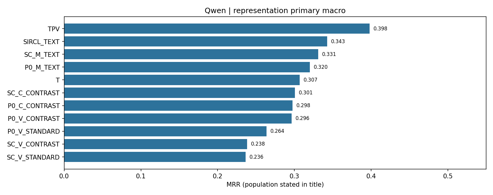
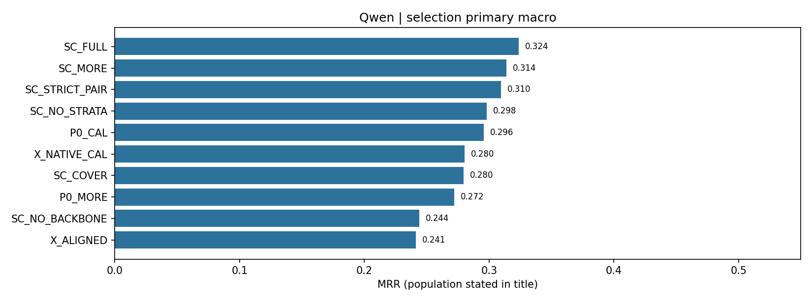
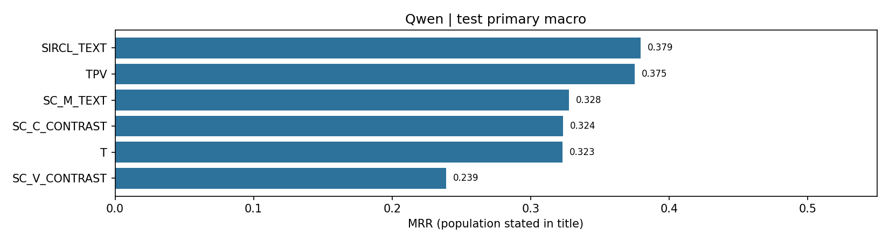

# RQ3.2：SignalCover 的增益、损失与实现边界

Qwen-only 修订版：2026-09-30。原文件日期标识所分析的历史批次，并非新增实验日期。

本报告仅讨论 Qwen3.8-27B；结论由其自身病例和结果决定，不要求跨模型成立，也不推广为所有模型的性质。原始输出、分数、输入与实验状态未改；本轮新增推理调用为 0。

统计按 Qwen-only 范围重新分析：保留原科学问题的全部正负比较、病例掩码及失败处理，重新计算 Holm；有逐病例记录或差值的主比较重新复算配对检验与 dz。原始 p 在样本未变时本来就不依赖其他模型。CSV 数值往返影响浮点并列时，保留原数值并列口径，另存重算敏感性。附表 `raw_statistic_source` 明确区分重新配对计算与沿用同一 Qwen 样本的原始统计。没有把事后分析改称预注册发现。

## 研究范围与方法

SignalCover（SC）用基础保留、机制覆盖、区分补充处理 X 的资源证据损失。四个阶段为 selection480、representation480、mechanisms100、test360；部分桥梁复用。C-Flat/C-Contrast、V-Standard/V-Contrast、M-Text 分开比较。模型失败计原零分，基础设施超时不伪装成模型错答。

表格主均值使用各阶段 whole-case 共同集合；配对检验沿原设计使用各对照实际可配对病例，所以 N 可以不同。Qwen selection 全集共同 N=439、主数据集 273；representation 为 426/268；test 为 341。不要把某 arm 全部完成样本均值与这些配对差值直接相减。

## Qwen 结论

SC 恢复了很多 X 丢失的资源证据，但没有击败 TPV。SC_FULL 相对无 backbone、相对 X_ALIGNED 的改善成立；相对 P0 的主数据集增益仅约 +0.0175，未构成可靠突破。SC_MORE 也没有说明更大输入能解决瓶颈。

仅对齐 X 的公共统计没有自动改善：X_ALIGNED 相对 P0 和 SC 的结果仍弱。下一步不应继续把校准统计量等同于选中了正确机制。

SC_V_CONTRAST 相对 SC_C_CONTRAST 在主数据集配对 ΔMRR=−0.0776；SC_M_TEXT 相对 SC_V_CONTRAST=+0.0986。test 上方向继续存在，SC 的图像方案显著弱于 T/TPV/SIRCL_TEXT。SC 与 P0 的选择×承载交互也提示，同一种事实选择可能更不适合图像读取。

## 正负规律

根因 Metrics 恢复不等于机制恢复。test 中直接 root-M 覆盖 SC=159、P0=162；计可接受 service/pod 映射时为 206/207。node 的资源覆盖恢复到 33/51，但排名并未随覆盖自动恢复。丢旧信号的 24 例 Qwen 从 0.3556 到 0.2361；新增的 21 例从 0.2635 到 0.3008，修复不足以抵消破坏。

有根据的正方向仍需保留：M 文本化明显缓解 SC 的全视觉损害；目标证据删除相对匹配非目标删除，在 M-Text 上有负向效应。但它说明特定观测对答案有作用，不证明整套 evidence bundle 机制已被正确读取。

## 实现审计对结论的限制

这些限制不能因缩小模型范围而删除：

- P0_MORE 不只是纯容量变化；C-Flat 已含对比引用，因此一些“增加对比”不是完全从无到有。
- C 条件取消分组存在请求完全不变的情况，应记 no-op，而不是把输出相同当鲁棒性。
- 指南中的前后半窗语义与公共窗口边界不一致，影响 444/480 eval、339/360 test；不能由这些对照独立声称时间推理无效。
- P0 与新池在统计/Trace 耗时语义上存在差异；strict-pair 截断不总保证双侧；目标删除实现可能只删首条事实。
- 噪声是在选择后加入，检验的是 Solver 的输入干扰，不是选择器抗噪能力。

## 案例与后续

历史案例表保留修复、破坏和不变病例。node I/O 曲线能提供有效方向，JVM memory 的强数值也可能绑定给错误实体；Trace 存在不等于能区分本地执行和外部等待。公开 reason 用于核查读到/误读什么，不作为隐藏推理解释。

这一阶段不支持扩展选择器名单；支持保护已验证 evidence backbone、修正实际动作与命名不一致，并把真实信息变更、组织变更和无效操作严格分开。只改一项代码不足以追溯修复旧结果，旧结果的适用范围继续如实标注。

## 完整主结果表

### representation primary macro

| arm | n | mrr | ac@1 | ac@3 | ac@5 | avg@3 | avg@5 | input_tokens | output_tokens |
|---|---|---|---|---|---|---|---|---|---|
| P0_C_CONTRAST | 268 | 0.2977 | 0.1791 | 0.4074 | 0.4860 | 0.3039 | 0.3707 | 9164.9216 | 186.5448 |
| P0_M_TEXT | 268 | 0.3200 | 0.2170 | 0.4197 | 0.4644 | 0.3335 | 0.3851 | 12848.5373 | 159.0858 |
| P0_V_CONTRAST | 268 | 0.2965 | 0.1949 | 0.3975 | 0.4424 | 0.3100 | 0.3592 | 10856.2201 | 171.6082 |
| P0_V_STANDARD | 268 | 0.2638 | 0.1802 | 0.3302 | 0.3936 | 0.2665 | 0.3158 | 9493.0672 | 201.3284 |
| SC_C_CONTRAST | 268 | 0.3008 | 0.1944 | 0.3893 | 0.4754 | 0.3017 | 0.3659 | 11797.6493 | 186.5858 |
| SC_M_TEXT | 268 | 0.3312 | 0.2400 | 0.4050 | 0.4905 | 0.3275 | 0.3868 | 15188.5037 | 170.4403 |
| SC_V_CONTRAST | 268 | 0.2385 | 0.1538 | 0.3115 | 0.3679 | 0.2438 | 0.2905 | 11063.0299 | 167.8657 |
| SC_V_STANDARD | 268 | 0.2363 | 0.1506 | 0.3045 | 0.3752 | 0.2382 | 0.2871 | 9547.3582 | 172.8022 |
| SIRCL_TEXT | 268 | 0.3427 | 0.2656 | 0.4342 | 0.4565 | 0.3532 | 0.3930 | 13826.5746 | 110.4627 |
| T | 268 | 0.3068 | 0.1991 | 0.4386 | 0.4610 | 0.3239 | 0.3780 | 12948.6381 | 170.0261 |
| TPV | 268 | 0.3980 | 0.3146 | 0.4948 | 0.5060 | 0.4160 | 0.4513 | 14602.1418 | 162.5410 |

### selection primary macro

| arm | n | mrr | ac@1 | ac@3 | ac@5 | avg@3 | avg@5 | input_tokens | output_tokens |
|---|---|---|---|---|---|---|---|---|---|
| P0_CAL | 273 | 0.2957 | 0.1968 | 0.3897 | 0.4484 | 0.3023 | 0.3578 | 9917.3736 | 181.5604 |
| P0_MORE | 273 | 0.2721 | 0.1788 | 0.3497 | 0.4262 | 0.2732 | 0.3285 | 20207.5055 | 186.6154 |
| SC_COVER | 273 | 0.2797 | 0.1897 | 0.3431 | 0.4445 | 0.2700 | 0.3354 | 13078.6813 | 188.9853 |
| SC_FULL | 273 | 0.3239 | 0.2302 | 0.4086 | 0.4814 | 0.3235 | 0.3829 | 13036.8571 | 189.3993 |
| SC_MORE | 273 | 0.3139 | 0.1935 | 0.4198 | 0.5042 | 0.3199 | 0.3869 | 15649.2051 | 192.6447 |
| SC_NO_BACKBONE | 273 | 0.2442 | 0.1421 | 0.3309 | 0.4073 | 0.2463 | 0.3085 | 16414.8278 | 189.1941 |
| SC_NO_STRATA | 273 | 0.2981 | 0.1856 | 0.3902 | 0.4887 | 0.2964 | 0.3666 | 13085.9670 | 197.7253 |
| SC_STRICT_PAIR | 273 | 0.3096 | 0.2048 | 0.3947 | 0.4780 | 0.3106 | 0.3754 | 13023.2491 | 195.0000 |
| X_ALIGNED | 273 | 0.2413 | 0.2000 | 0.2874 | 0.3059 | 0.2448 | 0.2678 | 5858.2198 | 181.3626 |
| X_NATIVE_CAL | 273 | 0.2803 | 0.2189 | 0.3350 | 0.3604 | 0.2903 | 0.3183 | 5840.5348 | 171.0952 |

### test primary macro

| arm | n | mrr | ac@1 | ac@3 | ac@5 | avg@3 | avg@5 | input_tokens | output_tokens |
|---|---|---|---|---|---|---|---|---|---|
| SC_C_CONTRAST | 341 | 0.3236 | 0.2402 | 0.3952 | 0.4738 | 0.3183 | 0.3758 | 11782.5484 | 197.1085 |
| SC_M_TEXT | 341 | 0.3278 | 0.2454 | 0.4094 | 0.4619 | 0.3304 | 0.3806 | 15109.4575 | 165.5953 |
| SC_V_CONTRAST | 341 | 0.2389 | 0.1549 | 0.3246 | 0.3744 | 0.2426 | 0.2929 | 10903.3138 | 172.9560 |
| SIRCL_TEXT | 341 | 0.3793 | 0.2799 | 0.4928 | 0.5134 | 0.3984 | 0.4426 | 13826.6393 | 108.5689 |
| T | 341 | 0.3230 | 0.2103 | 0.4561 | 0.4736 | 0.3449 | 0.3964 | 12946.6628 | 158.8299 |
| TPV | 341 | 0.3751 | 0.2836 | 0.4705 | 0.4938 | 0.3927 | 0.4331 | 14616.3079 | 163.1760 |

## Qwen-only 配对统计

以下保留指定范围的全部比较，不只保留显著项；其他数据集、层级、故障和敏感性分析见附件。Pratt-Wilcoxon 双侧及 paired dz 沿用原方法；分类、相关性和组间检验不改称 Wilcoxon。不报告置信区间。

### paired_statistics.csv

| phase | family | a | b | n | delta | p | dz | p_holm |
|---|---|---|---|---|---|---|---|---|
| selection | selection_secondary | X_NATIVE_CAL | P0_CAL | 296 | -0.0157 | 0.3433 | -0.0291 | 1.0000 |
| selection | selection_secondary | X_ALIGNED | P0_CAL | 297 | -0.0678 | 0.0050 | -0.1289 | 0.0396 |
| selection | selection_secondary | SC_COVER | P0_CAL | 298 | -0.0168 | 0.0984 | -0.0540 | 0.5901 |
| selection | selection_secondary | SC_FULL | P0_CAL | 294 | 0.0175 | 0.4389 | 0.0598 | 1.0000 |
| selection | selection_secondary | SC_NO_BACKBONE | P0_CAL | 296 | -0.0580 | 0.0032 | -0.1895 | 0.0291 |
| selection | selection_secondary | SC_NO_STRATA | P0_CAL | 296 | -0.0034 | 0.8122 | -0.0107 | 1.0000 |
| selection | selection_secondary | SC_STRICT_PAIR | P0_CAL | 294 | 0.0118 | 0.2216 | 0.0418 | 0.9454 |
| selection | selection_secondary | P0_MORE | P0_CAL | 297 | -0.0340 | 0.0622 | -0.1019 | 0.4353 |
| selection | selection_secondary | SC_MORE | P0_CAL | 296 | 0.0162 | 0.1891 | 0.0533 | 0.9454 |
| selection | rules_secondary | X_ALIGNED | X_NATIVE_CAL | 295 | -0.0469 | 0.0369 | -0.1468 | 0.1846 |
| selection | rules_secondary | SC_FULL | X_ALIGNED | 293 | 0.0869 | 0.0011 | 0.1638 | 0.0067 |
| selection | rules_secondary | SC_FULL | SC_NO_BACKBONE | 292 | 0.0761 | 0.0004 | 0.2460 | 0.0027 |
| selection | rules_secondary | SC_FULL | SC_NO_STRATA | 292 | 0.0199 | 0.9374 | 0.0712 | 1.0000 |
| selection | rules_secondary | SC_FULL | SC_COVER | 294 | 0.0368 | 0.0422 | 0.1399 | 0.1846 |
| selection | rules_secondary | SC_FULL | SC_STRICT_PAIR | 291 | 0.0160 | 0.9876 | 0.0655 | 1.0000 |
| selection | rules_secondary | SC_MORE | SC_FULL | 292 | 0.0013 | 0.3842 | 0.0050 | 1.0000 |
| representation | representation_secondary | P0_V_CONTRAST | P0_C_CONTRAST | 294 | 0.0062 | 0.9606 | 0.0176 | 1.0000 |
| representation | representation_secondary | P0_M_TEXT | P0_C_CONTRAST | 297 | 0.0236 | 0.2548 | 0.0891 | 1.0000 |
| representation | representation_secondary | P0_V_CONTRAST | P0_V_STANDARD | 291 | 0.0290 | 0.0812 | 0.1025 | 0.6498 |
| representation | representation_secondary | P0_M_TEXT | P0_V_CONTRAST | 295 | 0.0179 | 0.3569 | 0.0540 | 1.0000 |
| representation | representation_secondary | P0_C_CONTRAST | P0_CAL | 297 | -0.0189 | 0.4851 | -0.1085 | 1.0000 |
| representation | representation_secondary | SC_V_CONTRAST | SC_C_CONTRAST | 287 | -0.0776 | 0.0002 | -0.2051 | 0.0020 |
| representation | representation_secondary | SC_M_TEXT | SC_C_CONTRAST | 287 | 0.0312 | 0.3607 | 0.0962 | 1.0000 |
| representation | representation_secondary | SC_V_CONTRAST | SC_V_STANDARD | 292 | -0.0016 | 0.9064 | -0.0052 | 1.0000 |
| representation | representation_secondary | SC_M_TEXT | SC_V_CONTRAST | 292 | 0.0986 | 4.65e-07 | 0.3007 | 4.65e-06 |
| representation | representation_secondary | SC_C_CONTRAST | SC_FULL | 286 | -0.0214 | 0.3715 | -0.0773 | 1.0000 |
| representation | selection_by_carrier | SC_C_CONTRAST | P0_C_CONTRAST | 289 | 0.0126 | 0.5777 | 0.0381 | 0.7839 |
| representation | selection_by_carrier | SC_V_STANDARD | P0_V_STANDARD | 292 | -0.0336 | 0.1215 | -0.1031 | 0.3646 |
| representation | selection_by_carrier | SC_V_CONTRAST | P0_V_CONTRAST | 292 | -0.0678 | 0.0007 | -0.1942 | 0.0027 |
| representation | selection_by_carrier | SC_M_TEXT | P0_M_TEXT | 295 | 0.0135 | 0.3920 | 0.0447 | 0.7839 |
| test | locked_primary | SC_C_CONTRAST | T | 351 | -0.0038 | 0.9689 | -0.0094 | 1.0000 |
| test | locked_primary | SC_C_CONTRAST | TPV | 354 | -0.0605 | 0.0277 | -0.1404 | 0.1542 |
| test | locked_primary | SC_C_CONTRAST | SIRCL_TEXT | 351 | -0.0594 | 0.0257 | -0.1123 | 0.1542 |
| test | locked_primary | SC_V_CONTRAST | T | 354 | -0.0851 | 0.0017 | -0.1817 | 0.0119 |
| test | locked_primary | SC_V_CONTRAST | TPV | 357 | -0.1413 | 1.22e-08 | -0.3363 | 1.09e-07 |
| test | locked_primary | SC_V_CONTRAST | SIRCL_TEXT | 354 | -0.1367 | 2.19e-06 | -0.2653 | 1.75e-05 |
| test | locked_primary | SC_M_TEXT | T | 353 | 0.0023 | 0.6582 | 0.0054 | 1.0000 |
| test | locked_primary | SC_M_TEXT | TPV | 356 | -0.0460 | 0.1264 | -0.1138 | 0.3792 |
| test | locked_primary | SC_M_TEXT | SIRCL_TEXT | 353 | -0.0462 | 0.0693 | -0.0845 | 0.2773 |
| test | locked_carrier | SC_M_TEXT | SC_C_CONTRAST | 352 | 0.0110 | 0.4864 | 0.0347 | 0.4864 |
| test | locked_carrier | SC_V_CONTRAST | SC_C_CONTRAST | 353 | -0.0757 | 0.0004 | -0.1895 | 0.0009 |
| test | locked_carrier | SC_M_TEXT | SC_V_CONTRAST | 355 | 0.0918 | 4.4e-06 | 0.2653 | 1.32e-05 |
| mechanisms | mechanism_secondary | REMOVE_TARGET__C_CONTRAST | SC_C_CONTRAST | 40 | -0.0454 | 0.4941 | -0.1652 | 1.0000 |
| mechanisms | mechanism_secondary | REMOVE_TARGET__M_TEXT | SC_M_TEXT | 40 | -0.0987 | 0.0150 | -0.3170 | 0.2247 |
| mechanisms | mechanism_secondary | REMOVE_MATCHED_NONTARGET__C_CONTRAST | SC_C_CONTRAST | 39 | -0.0265 | 0.2619 | -0.1737 | 1.0000 |
| mechanisms | mechanism_secondary | REMOVE_MATCHED_NONTARGET__M_TEXT | SC_M_TEXT | 38 | 0.0382 | 0.0926 | 0.2417 | 1.0000 |
| mechanisms | mechanism_secondary | NO_GROUPING__C_CONTRAST | SC_C_CONTRAST | 59 | 0.0119 | 0.1573 | 0.1702 | 1.0000 |
| mechanisms | mechanism_secondary | NO_GROUPING__M_TEXT | SC_M_TEXT | 59 | -0.0068 | 0.9613 | -0.0280 | 1.0000 |
| mechanisms | mechanism_secondary | REDUNDANT_NOISE__C_CONTRAST | SC_C_CONTRAST | 59 | -0.0025 | 0.5227 | -0.0099 | 1.0000 |
| mechanisms | mechanism_secondary | REDUNDANT_NOISE__M_TEXT | SC_M_TEXT | 59 | 0.0056 | 0.7969 | 0.0202 | 1.0000 |
| mechanisms | mechanism_secondary | REANONYMIZE__C_CONTRAST | SC_C_CONTRAST | 58 | -0.0118 | 0.9433 | -0.0332 | 1.0000 |
| mechanisms | mechanism_secondary | REANONYMIZE__M_TEXT | SC_M_TEXT | 59 | 0.0186 | 0.5466 | 0.0511 | 1.0000 |
| mechanisms | mechanism_secondary | REPLICATE_1__C_CONTRAST | SC_C_CONTRAST | 59 | 0.0034 | 0.3173 | 0.1302 | 1.0000 |
| mechanisms | mechanism_secondary | REPLICATE_1__M_TEXT | SC_M_TEXT | 58 | 0.0009 | 0.5775 | 0.0198 | 1.0000 |
| mechanisms | mechanism_secondary | REPLICATE_2__C_CONTRAST | SC_C_CONTRAST | 58 | 0.0034 | 0.3173 | 0.1313 | 1.0000 |
| mechanisms | mechanism_secondary | REPLICATE_2__M_TEXT | SC_M_TEXT | 59 | -0.0085 | 0.3173 | -0.1302 | 1.0000 |
| mechanisms | mechanism_secondary | REMOVE_TARGET__C_CONTRAST | REMOVE_MATCHED_NONTARGET__C_CONTRAST | 40 | -0.0196 | 0.9646 | -0.0647 | 1.0000 |
| mechanisms | mechanism_secondary | REMOVE_TARGET__M_TEXT | REMOVE_MATCHED_NONTARGET__M_TEXT | 39 | -0.1513 | 0.0016 | -0.4815 | 0.0263 |

## 分层、案例和复现附件

所有保留的表均仅含 Qwen 结果或公共数据/CPU 基线。大型表用于完整审计，不能把其中最优分组当作预注册确认。

- [answer_patterns](RQ3_2_Results_Analysis_2026-09-22_assets/answer_patterns.csv)
- [arm_metrics](RQ3_2_Results_Analysis_2026-09-22_assets/arm_metrics.csv)
- [case_metadata](RQ3_2_Results_Analysis_2026-09-22_assets/case_metadata.csv)
- [completion_audit](RQ3_2_Results_Analysis_2026-09-22_assets/completion_audit.csv)
- [coverage_vs_rank](RQ3_2_Results_Analysis_2026-09-22_assets/coverage_vs_rank.csv)
- [diagnostic_union_not_deployable](RQ3_2_Results_Analysis_2026-09-22_assets/diagnostic_union_not_deployable.csv)
- [evidence_composition](RQ3_2_Results_Analysis_2026-09-22_assets/evidence_composition.csv)
- [exploratory_correlations](RQ3_2_Results_Analysis_2026-09-22_assets/exploratory_correlations.csv)
- [fault_metrics](RQ3_2_Results_Analysis_2026-09-22_assets/fault_metrics.csv)
- [fault_plot_labels_qwen3.8-27b](RQ3_2_Results_Analysis_2026-09-22_assets/fault_plot_labels_qwen3.8-27b.csv)
- [granularity_metrics](RQ3_2_Results_Analysis_2026-09-22_assets/granularity_metrics.csv)
- [intervention_identity_summary](RQ3_2_Results_Analysis_2026-09-22_assets/intervention_identity_summary.csv)
- [intervention_input_identity](RQ3_2_Results_Analysis_2026-09-22_assets/intervention_input_identity.csv)
- [logical_results](RQ3_2_Results_Analysis_2026-09-22_assets/logical_results.csv)
- [model_failure_reasons](RQ3_2_Results_Analysis_2026-09-22_assets/model_failure_reasons.csv)
- [paired_fault_effects](RQ3_2_Results_Analysis_2026-09-22_assets/paired_fault_effects.csv)
- [paired_statistics](RQ3_2_Results_Analysis_2026-09-22_assets/paired_statistics.csv)
- [qwen_headline_metrics](RQ3_2_Results_Analysis_2026-09-22_assets/qwen_headline_metrics.csv)
- [representative_pairs](RQ3_2_Results_Analysis_2026-09-22_assets/representative_pairs.csv)
- [root_metric_transitions](RQ3_2_Results_Analysis_2026-09-22_assets/root_metric_transitions.csv)
- [scored_cases_enriched](RQ3_2_Results_Analysis_2026-09-22_assets/scored_cases_enriched.csv)
- [selection_representation_interactions](RQ3_2_Results_Analysis_2026-09-22_assets/selection_representation_interactions.csv)

分析口径、备份与复算说明见 [重分析说明](_qwen_only_reanalysis/README.md)。历史原始结果保持在对应 `RQs/` 下，本次没有调整实验队列、模型或评分器。
