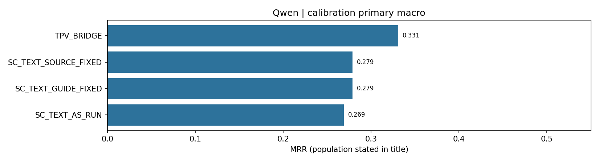
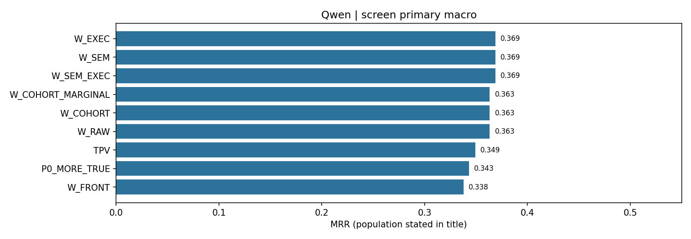
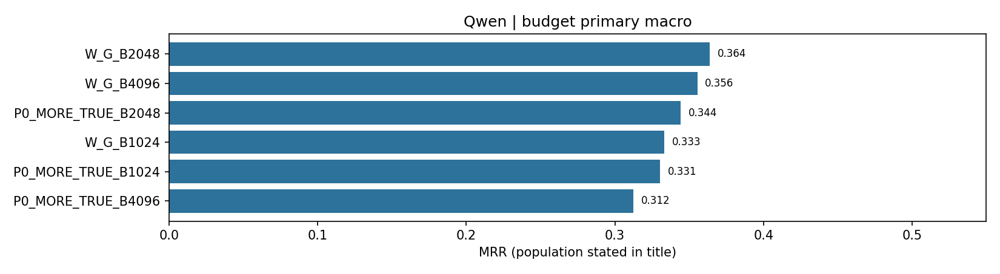
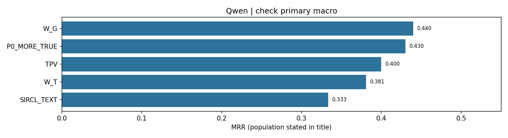
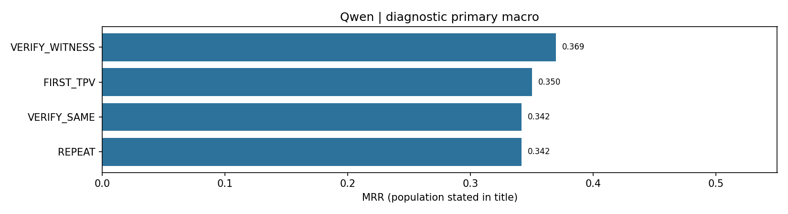

# RQ3.3：见证补充、预算与诊断利用

Qwen-only 修订版：2026-09-30。原文件日期标识所分析的历史批次，并非新增实验日期。

本报告仅讨论 Qwen3.8-27B；结论由其自身病例和结果决定，不要求跨模型成立，也不推广为所有模型的性质。原始输出、分数、输入与实验状态未改；本轮新增推理调用为 0。

统计按 Qwen-only 范围重新分析：保留原科学问题的全部正负比较、病例掩码及失败处理，重新计算 Holm；有逐病例记录或差值的主比较重新复算配对检验与 dz。原始 p 在样本未变时本来就不依赖其他模型。CSV 数值往返影响浮点并列时，保留原数值并列口径，另存重算敏感性。附表 `raw_statistic_source` 明确区分重新配对计算与沿用同一 Qwen 样本的原始统计。没有把事后分析改称预注册发现。

## 研究范围与流程

五个已完成阶段为校准、60-case 候选筛选、预算、120-case check，以及第二调用诊断。W 在保留 TPV 主体的基础上追加公开见证；RAW/SEM/EXEC/COHORT/FRONT 分别改变观测或其解释。后续预算固定 2,048 tokens，比较同预算 MORE、强文本 SIRCL 和 W 的图文承载。

只分析已运行部分。注册过但未执行的局部绑定、组织或事件图不能被写成负结果。最终 check 的 Qwen 共同有效 N=118。

## Qwen 的结果与新的解释

check 三主数据集 macro：TPV=0.4000、MORE=0.4304、W_T=0.3808、W_G=0.4398、SIRCL_TEXT=0.3333。W_G 是有价值的正向候选，应继续验证其修复与破坏模式。

但本轮 Qwen 证据的强度也有边界：相对 TPV pooled +0.0398，原始 p=0.0882；相对 MORE +0.0095，p=0.6462；相对 W_T +0.0586，p=0.1923。相对 SIRCL +0.1052 的原始 p=0.0193，在原阶段全部 Qwen 比较/范围的校正下未成立。

原扩量规则要求超过 MORE 的 macro 增益达到 0.01，而实际约 0.00941。因此当时停止扩量具有 Qwen 自身的依据；不能事后将门槛未通过改写为已通过，也不能将它解释成方法毫无希望。

## 哪些观察有用，哪些没有

screen 的 W_RAW、W_SEM/EXEC 点估计略高于 TPV；SEM 和 EXEC 没有清晰独立增益，若输入完全相同必须按 no-op 解释。预算从 2,048 到 4,096 未产生稳健改善，可能增加备选而损害首位。

P0 缺少而 W 新增根因直接观测的 11 例，MRR 从 0.0455 到 0.2455。它是针对“原本缺什么”的有用线索，但仍是小样本、标签后验分层。W_G 相对 TPV 有 8 个 Top-1 修复、2 个破坏；相对 W_T 有 23/11，且 15 个修复原已在前五。这使排名重分配成为值得研究的视觉作用。

## 案例与输出质量

`INC-83BCD48B2886`：node 3376 的 load 变化帮助从受影响组件回到宿主候选。`INC-BA41A280E858`：同类宿主提示却将 pod 46218 错推成 node 5360。共同教训是补充资源证据必须检验故障范围，不能把宿主异常直接等同故障源。

`INC-D9ABFB644D29` 展现 JVM/异常日志的竞争；`INC-D93BC27D5F39` 说明 JSON 排名正确也可能与 reason 矛盾。`INC-0060628741E9` 仍缺少有效根因见证。

SIRCL_TEXT 的 node 前缀等契约错误单列，不改统一 scorer 追溯救分。无法通过解析的输出沿原协议处理。

## 第二调用与成本

60-case FIRST_TPV/REPEAT/VERIFY_SAME/VERIFY_WITNESS 的 MRR 约为 0.3500/0.3417/0.3417/0.3694。见证核验相对同输入核验仅 +0.0278、未显著，调用成本约翻倍。现有证据不足以用多轮替代一次诊断。

prepare 的多设计批处理耗时不等同在线单次 RCA 延迟；模型 wall time 受并发影响，不能当纯 GPU 算力消耗。后续优先探索 W 的修复来源与 pod→node 破坏，不直接扩大预算或调用轮数。

## 完整主结果表

### calibration primary macro

| arm | n | mrr | ac@1 | ac@3 | ac@5 | avg@3 | avg@5 | input_tokens | output_tokens |
|---|---|---|---|---|---|---|---|---|---|
| TPV_BRIDGE | 58 | 0.3309 | 0.2426 | 0.4704 | 0.4704 | 0.3432 | 0.3941 | 14584.6724 | 160.6207 |
| SC_TEXT_AS_RUN | 58 | 0.2690 | 0.1889 | 0.3593 | 0.3944 | 0.2747 | 0.3226 | 13058.0862 | 208.4483 |
| SC_TEXT_GUIDE_FIXED | 58 | 0.2786 | 0.1741 | 0.3648 | 0.4519 | 0.2778 | 0.3441 | 13376.5690 | 186.8276 |
| SC_TEXT_SOURCE_FIXED | 58 | 0.2786 | 0.1741 | 0.3648 | 0.4519 | 0.2778 | 0.3441 | 13376.5690 | 186.8276 |

### screen primary macro

| arm | n | mrr | ac@1 | ac@3 | ac@5 | avg@3 | avg@5 | input_tokens | output_tokens |
|---|---|---|---|---|---|---|---|---|---|
| TPV | 58 | 0.3494 | 0.2611 | 0.4889 | 0.4889 | 0.3617 | 0.4126 | 14583.7759 | 160.0000 |
| P0_MORE_TRUE | 58 | 0.3432 | 0.2796 | 0.4519 | 0.4519 | 0.3494 | 0.3904 | 16440.7414 | 167.3103 |
| W_RAW | 58 | 0.3633 | 0.2963 | 0.4704 | 0.4704 | 0.3722 | 0.4115 | 15430.4310 | 159.0172 |
| W_SEM | 58 | 0.3688 | 0.2963 | 0.4870 | 0.4870 | 0.3778 | 0.4215 | 15472.2931 | 158.2241 |
| W_EXEC | 58 | 0.3688 | 0.2963 | 0.4870 | 0.4870 | 0.3778 | 0.4215 | 15710.8276 | 163.7586 |
| W_SEM_EXEC | 58 | 0.3688 | 0.2963 | 0.4870 | 0.4870 | 0.3778 | 0.4215 | 15752.6897 | 156.9138 |
| W_COHORT | 58 | 0.3633 | 0.2963 | 0.4704 | 0.4704 | 0.3722 | 0.4115 | 15823.6897 | 152.2931 |
| W_FRONT | 58 | 0.3378 | 0.2630 | 0.4389 | 0.4556 | 0.3457 | 0.3896 | 15753.6897 | 167.2241 |
| W_COHORT_MARGINAL | 58 | 0.3633 | 0.2963 | 0.4704 | 0.4704 | 0.3722 | 0.4115 | 15790.2759 | 153.7241 |

### budget primary macro

| arm | n | mrr | ac@1 | ac@3 | ac@5 | avg@3 | avg@5 | input_tokens | output_tokens |
|---|---|---|---|---|---|---|---|---|---|
| W_G_B1024 | 60 | 0.3333 | 0.2667 | 0.4500 | 0.4500 | 0.3389 | 0.3833 | 14936.3667 | 160.6000 |
| W_G_B2048 | 60 | 0.3639 | 0.3000 | 0.4667 | 0.4667 | 0.3722 | 0.4100 | 15468.9000 | 158.9667 |
| W_G_B4096 | 60 | 0.3556 | 0.2667 | 0.5000 | 0.5000 | 0.3667 | 0.4200 | 16265.9000 | 163.4167 |
| P0_MORE_TRUE_B1024 | 60 | 0.3306 | 0.2667 | 0.4333 | 0.4333 | 0.3389 | 0.3767 | 15520.8667 | 166.9500 |
| P0_MORE_TRUE_B2048 | 60 | 0.3444 | 0.2833 | 0.4500 | 0.4500 | 0.3500 | 0.3900 | 16478.2833 | 165.4167 |
| P0_MORE_TRUE_B4096 | 60 | 0.3125 | 0.2500 | 0.4000 | 0.4167 | 0.3167 | 0.3567 | 18380.0333 | 164.3000 |

### check primary macro

| arm | n | mrr | ac@1 | ac@3 | ac@5 | avg@3 | avg@5 | input_tokens | output_tokens |
|---|---|---|---|---|---|---|---|---|---|
| TPV | 118 | 0.4000 | 0.3235 | 0.4682 | 0.4848 | 0.4199 | 0.4459 | 14571.3983 | 163.0932 |
| SIRCL_TEXT | 118 | 0.3333 | 0.2545 | 0.4329 | 0.4498 | 0.3451 | 0.3853 | 13962.1356 | 105.1356 |
| P0_MORE_TRUE | 118 | 0.4304 | 0.3489 | 0.5190 | 0.5274 | 0.4510 | 0.4815 | 16417.6441 | 162.7881 |
| W_T | 118 | 0.3808 | 0.2722 | 0.5184 | 0.5355 | 0.3996 | 0.4522 | 13801.7881 | 180.5508 |
| W_G | 118 | 0.4398 | 0.3746 | 0.4934 | 0.5184 | 0.4538 | 0.4779 | 15420.4576 | 162.3136 |

### diagnostic primary macro

| arm | n | mrr | ac@1 | ac@3 | ac@5 | avg@3 | avg@5 | input_tokens | output_tokens |
|---|---|---|---|---|---|---|---|---|---|
| FIRST_TPV | 60 | 0.3500 | 0.2667 | 0.4833 | 0.4833 | 0.3611 | 0.4100 | 14621.1500 | 159.7833 |
| REPEAT | 60 | 0.3417 | 0.2500 | 0.4833 | 0.4833 | 0.3556 | 0.4067 | 14621.1500 | 156.7000 |
| VERIFY_SAME | 60 | 0.3417 | 0.2500 | 0.4833 | 0.4833 | 0.3556 | 0.4067 | 14807.9000 | 160.9500 |
| VERIFY_WITNESS | 60 | 0.3694 | 0.2833 | 0.5000 | 0.5000 | 0.3833 | 0.4300 | 15655.6500 | 157.4333 |

## Qwen-only 配对统计

以下保留指定范围的全部比较，不只保留显著项；其他数据集、层级、故障和敏感性分析见附件。Pratt-Wilcoxon 双侧及 paired dz 沿用原方法；分类、相关性和组间检验不改称 Wilcoxon。不报告置信区间。

### registered_paired_tests.csv

| stage | arm | baseline | n | delta | p | dz | p_holm |
|---|---|---|---|---|---|---|---|
| calibration | SC_TEXT_GUIDE_FIXED | SC_TEXT_AS_RUN | 60 | 0.0061 | 0.6647 | 0.0223 | 1.0000 |
| calibration | SC_TEXT_SOURCE_FIXED | SC_TEXT_GUIDE_FIXED | 60 | 0.0000 | 1.0000 | — | 1.0000 |
| screen | W_RAW | TPV | 58 | 0.0144 | 0.7678 | 0.0684 | 1.0000 |
| screen | W_SEM | TPV | 58 | 0.0201 | 0.9432 | 0.0939 | 1.0000 |
| screen | W_EXEC | TPV | 58 | 0.0201 | 0.9432 | 0.0939 | 1.0000 |
| screen | W_SEM_EXEC | TPV | 58 | 0.0201 | 0.9432 | 0.0939 | 1.0000 |
| screen | W_COHORT | TPV | 58 | 0.0144 | 0.7678 | 0.0684 | 1.0000 |
| screen | W_FRONT | TPV | 58 | -0.0129 | 0.2401 | -0.0408 | 1.0000 |
| screen | P0_MORE_TRUE | TPV | 58 | -0.0057 | 0.5706 | -0.0556 | 1.0000 |
| screen | W_COHORT | W_COHORT_MARGINAL | 58 | 0.0000 | 1.0000 | — | 1.0000 |
| screen | W_COHORT_MARGINAL | W_SEM_EXEC | 58 | -0.0057 | 0.3173 | -0.1313 | 1.0000 |
| screen | W_COHORT | W_SEM_EXEC | 58 | -0.0057 | 0.3173 | -0.1313 | 1.0000 |
| screen | W_FRONT | W_SEM_EXEC | 58 | -0.0330 | 0.2262 | -0.1061 | 1.0000 |
| budget | W_G_B1024 | W_G_B2048 | 60 | -0.0306 | 0.6218 | -0.1415 | 1.0000 |
| budget | W_G_B4096 | W_G_B2048 | 60 | -0.0083 | 0.6885 | -0.0601 | 1.0000 |
| budget | P0_MORE_TRUE_B1024 | P0_MORE_TRUE_B2048 | 60 | -0.0139 | 0.3132 | -0.1411 | 1.0000 |
| budget | P0_MORE_TRUE_B4096 | P0_MORE_TRUE_B2048 | 60 | -0.0319 | 0.1011 | -0.1984 | 1.0000 |
| budget | W_G_B1024 | P0_MORE_TRUE_B1024 | 60 | 0.0028 | 0.9864 | 0.0355 | 1.0000 |
| budget | W_G_B2048 | P0_MORE_TRUE_B2048 | 60 | 0.0194 | 0.7655 | 0.0854 | 1.0000 |
| budget | W_G_B4096 | P0_MORE_TRUE_B4096 | 60 | 0.0431 | 0.1522 | 0.2033 | 1.0000 |
| check | W_G | TPV | 118 | 0.0398 | 0.0882 | 0.1550 | 1.0000 |
| check | W_G | SIRCL_TEXT | 118 | 0.1052 | 0.0193 | 0.2134 | 0.4429 |
| check | W_G | P0_MORE_TRUE | 118 | 0.0095 | 0.6462 | 0.0392 | 1.0000 |
| check | W_G | W_T | 118 | 0.0586 | 0.1923 | 0.1287 | 1.0000 |
| diagnostic | VERIFY_WITNESS | VERIFY_SAME | 60 | 0.0278 | 0.1573 | 0.1804 | 1.0000 |
| diagnostic | VERIFY_SAME | REPEAT | 60 | 0.0000 | 1.0000 | — | 1.0000 |
| diagnostic | REPEAT | FIRST_TPV | 60 | -0.0083 | 0.3173 | -0.1291 | 1.0000 |

### registered_event_group_tests.csv

| stage | arm | baseline | n | delta | p | dz | p_holm |
|---|---|---|---|---|---|---|---|
| calibration | SC_TEXT_GUIDE_FIXED | SC_TEXT_AS_RUN | 50 | 0.0053 | 0.6818 | 0.0178 | 1.0000 |
| calibration | SC_TEXT_SOURCE_FIXED | SC_TEXT_GUIDE_FIXED | 50 | 0.0000 | 1.0000 | — | 1.0000 |
| screen | W_RAW | TPV | 48 | 0.0220 | 0.7818 | 0.0972 | 1.0000 |
| screen | W_SEM | TPV | 48 | 0.0255 | 0.9368 | 0.1121 | 1.0000 |
| screen | W_EXEC | TPV | 48 | 0.0255 | 0.9368 | 0.1121 | 1.0000 |
| screen | W_SEM_EXEC | TPV | 48 | 0.0255 | 0.9368 | 0.1121 | 1.0000 |
| screen | W_COHORT | TPV | 48 | 0.0220 | 0.7818 | 0.0972 | 1.0000 |
| screen | W_FRONT | TPV | 48 | -0.0110 | 0.2486 | -0.0318 | 1.0000 |
| screen | P0_MORE_TRUE | TPV | 48 | -0.0069 | 0.5721 | -0.0610 | 1.0000 |
| screen | W_COHORT | W_COHORT_MARGINAL | 48 | 0.0000 | 1.0000 | — | 1.0000 |
| screen | W_COHORT_MARGINAL | W_SEM_EXEC | 48 | -0.0035 | 0.3173 | -0.1443 | 1.0000 |
| screen | W_COHORT | W_SEM_EXEC | 48 | -0.0035 | 0.3173 | -0.1443 | 1.0000 |
| screen | W_FRONT | W_SEM_EXEC | 48 | -0.0365 | 0.2313 | -0.1071 | 1.0000 |
| budget | W_G_B1024 | W_G_B2048 | 50 | -0.0400 | 0.6150 | -0.1723 | 1.0000 |
| budget | W_G_B4096 | W_G_B2048 | 50 | -0.0178 | 0.6957 | -0.1283 | 1.0000 |
| budget | P0_MORE_TRUE_B1024 | P0_MORE_TRUE_B2048 | 50 | -0.0122 | 0.3174 | -0.1239 | 1.0000 |
| budget | P0_MORE_TRUE_B4096 | P0_MORE_TRUE_B2048 | 50 | -0.0339 | 0.1027 | -0.1981 | 0.7188 |
| budget | W_G_B1024 | P0_MORE_TRUE_B1024 | 50 | -1.11e-18 | 0.9918 | -1.47e-17 | 1.0000 |
| budget | W_G_B2048 | P0_MORE_TRUE_B2048 | 50 | 0.0278 | 0.7785 | 0.1133 | 1.0000 |
| budget | W_G_B4096 | P0_MORE_TRUE_B4096 | 50 | 0.0439 | 0.1600 | 0.1951 | 0.9602 |
| check | W_G | TPV | 94 | 0.0325 | 0.1356 | 0.1301 | 0.4069 |
| check | W_G | SIRCL_TEXT | 94 | 0.1266 | 0.0148 | 0.2669 | 0.0591 |
| check | W_G | P0_MORE_TRUE | 94 | 0.0048 | 0.9561 | 0.0231 | 0.9561 |
| check | W_G | W_T | 94 | 0.0681 | 0.1828 | 0.1551 | 0.4069 |
| diagnostic | VERIFY_WITNESS | VERIFY_SAME | 50 | 0.0333 | 0.1573 | 0.1980 | 0.4720 |
| diagnostic | VERIFY_SAME | REPEAT | 50 | 0.0000 | 1.0000 | — | 1.0000 |
| diagnostic | REPEAT | FIRST_TPV | 50 | -0.0100 | 0.3173 | -0.1414 | 0.6346 |

## 分层、案例和复现附件

所有保留的表均仅含 Qwen 结果或公共数据/CPU 基线。大型表用于完整审计，不能把其中最优分组当作预注册确认。

- [backbone_input_audit](RQ3_3_Results_Analysis_2026-09-24_assets/backbone_input_audit.csv)
- [check_rank_transitions](RQ3_3_Results_Analysis_2026-09-24_assets/check_rank_transitions.csv)
- [check_strata](RQ3_3_Results_Analysis_2026-09-24_assets/check_strata.csv)
- [cohort_applicability](RQ3_3_Results_Analysis_2026-09-24_assets/cohort_applicability.csv)
- [denominators](RQ3_3_Results_Analysis_2026-09-24_assets/denominators.csv)
- [failures](RQ3_3_Results_Analysis_2026-09-24_assets/failures.csv)
- [image_sources](RQ3_3_Results_Analysis_2026-09-24_assets/image_sources.csv)
- [input_noops](RQ3_3_Results_Analysis_2026-09-24_assets/input_noops.csv)
- [invalid_answer_details](RQ3_3_Results_Analysis_2026-09-24_assets/invalid_answer_details.csv)
- [paired_arm_metrics](RQ3_3_Results_Analysis_2026-09-24_assets/paired_arm_metrics.csv)
- [paired_case_audits](RQ3_3_Results_Analysis_2026-09-24_assets/paired_case_audits.csv)
- [preparation_timings](RQ3_3_Results_Analysis_2026-09-24_assets/preparation_timings.csv)
- [qwen_headline_metrics](RQ3_3_Results_Analysis_2026-09-24_assets/qwen_headline_metrics.csv)
- [reason_type_screen](RQ3_3_Results_Analysis_2026-09-24_assets/reason_type_screen.csv)
- [registered_event_group_tests](RQ3_3_Results_Analysis_2026-09-24_assets/registered_event_group_tests.csv)
- [registered_paired_tests](RQ3_3_Results_Analysis_2026-09-24_assets/registered_paired_tests.csv)
- [response_audit](RQ3_3_Results_Analysis_2026-09-24_assets/response_audit.csv)
- [root_coverage_changes](RQ3_3_Results_Analysis_2026-09-24_assets/root_coverage_changes.csv)
- [two_call_costs](RQ3_3_Results_Analysis_2026-09-24_assets/two_call_costs.csv)

分析口径、备份与复算说明见 [重分析说明](_qwen_only_reanalysis/README.md)。历史原始结果保持在对应 `RQs/` 下，本次没有调整实验队列、模型或评分器。
