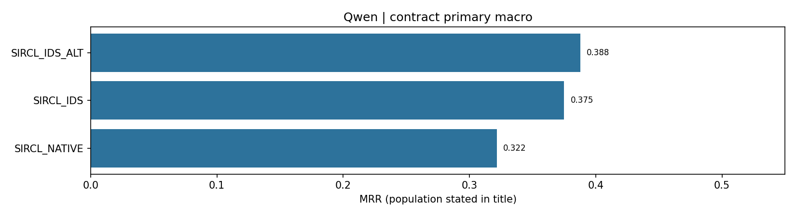
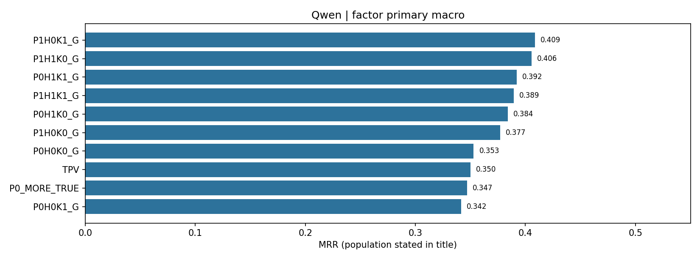
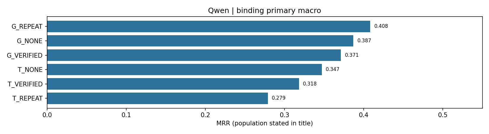
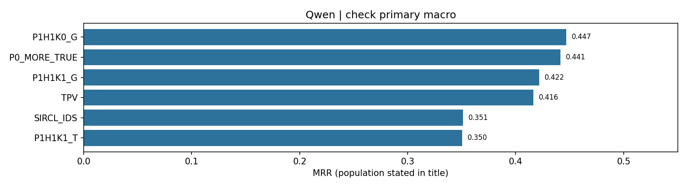

# RQ3.4：证据组合、自动核验与视觉绑定

Qwen-only 修订版：2026-09-30。原文件日期标识所分析的历史批次，并非新增实验日期。

本报告仅讨论 Qwen3.8-27B；结论由其自身病例和结果决定，不要求跨模型成立，也不推广为所有模型的性质。原始输出、分数、输入与实验状态未改；本轮新增推理调用为 0。

统计按 Qwen-only 范围重新分析：保留原科学问题的全部正负比较、病例掩码及失败处理，重新计算 Holm；有逐病例记录或差值的主比较重新复算配对检验与 dz。原始 p 在样本未变时本来就不依赖其他模型。CSV 数值往返影响浮点并列时，保留原数值并列口径，另存重算敏感性。附表 `raw_statistic_source` 明确区分重新配对计算与沿用同一 Qwen 样本的原始统计。没有把事后分析改称预注册发现。

## 方法与完成范围

本轮把输出契约修正、P/H/K 三因素、核验与视觉绑定、锁定 check 合在一起。P 表示候选证据包，H 表示宿主/同类范围支持，K 表示数值和关系的可核验说明。SAT/规则检查能验证 ID/字面数值/关系的一致性，不能证明一个因果诊断是真的。

四阶段 Qwen 共同病例数为 58、59、58、113；模型错误保留原评分，超时病例按各阶段共同掩码排除。private 标签只用于离线分析。

## Qwen 结果

锁定 check 的 macro：TPV=0.4163、MORE=0.4414、P1H1K0_G=0.4468、P1H1K1_G=0.4219、P1H1K1_T=0.3503、SIRCL_IDS=0.3513。去 K 的视觉版本是值得继续研究的较高点估计；完整 PHK 没有相对强基线形成确证增益。

PHK 相对 TPV 的 pooled 增益仅 +0.0063，相对 MORE −0.0192，相对 SIRCL_IDS +0.0678，Qwen check family 均未显著。图文 PHK 差约 +0.0723，但不能跳过其比较的多重校正。

三因素平均效应 P=+0.0279、H=+0.0230、K=+0.0025；三阶交互 −0.0664，原始 p≈0.0247，经完整七项 Qwen 析因 family 后不显著。不是所有可核验说明都能组合成更好的诊断。

## 自动核验的贡献和边界

输出契约对齐使 SIRCL_NATIVE 的 58 例格式失败从 11 降到 1，MRR 从 0.3218 到 0.3750；替代契约为 0.3877。它改善可执行性，但总 MRR 的配对提升仍经校正后未达显著。

核验能减少某些可观察的错误生成，不等于提高根因排序。K 可减少字面告警，却没有稳定提高 MRR；看到了数值不代表选对了机制。自动拒绝候选也不能建立在“reason 将合法数字 ID 称为另一种实体”这一启发式上，否则可能误杀本来正确的首位答案。

## 层次、故障和案例

Qwen service 子组，去 K 为约 0.5522、完整 PHK 为 0.5156；node 的两者约 0.2059，SIRCL_IDS 约 0.4510。pod 小组也提醒包增加可能牺牲原有直接信号。小组规模和校正见完整分层表，点估计差不能直接宣称显著。

`INC-27F3CF9F35C3`：restart 与同宿主实例对照能区分局部异常。`INC-9D1784608F61`：故障源的异常出现可晚于症状，且历史 trace 单位标签存在问题，不能把 earliest 当成因果源。`INC-6D1C8225111D`：page-fault 核验上下文可能抢走本来有用的 Trace 注意力。

历史输入中的单位误标按实际看到的内容记录，不能在报告中假装模型收到的是已修正值。对照并未证明 formal solver 可直接保证因果诊断，只支持它作为输出和证据一致性审计。

## 下一步含义

在 Qwen 上继续检验 W/PH 的有效观测、K 的干扰和不同层级的排序变化是合理的；没有依据把全部 auto reasoning 分支判为无用，也没有依据把字面核验升级成根因真值证明。

## 完整主结果表

### contract primary macro

| arm | n | mrr | ac@1 | ac@3 | ac@5 | avg@3 | avg@5 | input_tokens | output_tokens |
|---|---|---|---|---|---|---|---|---|---|
| SIRCL_NATIVE | 58 | 0.3218 | 0.2386 | 0.4105 | 0.4456 | 0.3301 | 0.3763 | 13229.6724 | 112.8448 |
| SIRCL_IDS | 58 | 0.3750 | 0.2737 | 0.4632 | 0.5158 | 0.3886 | 0.4360 | 13268.6724 | 106.0690 |
| SIRCL_IDS_ALT | 58 | 0.3877 | 0.2904 | 0.4632 | 0.5333 | 0.3942 | 0.4463 | 13288.6724 | 101.8966 |

### factor primary macro

| arm | n | mrr | ac@1 | ac@3 | ac@5 | avg@3 | avg@5 | input_tokens | output_tokens |
|---|---|---|---|---|---|---|---|---|---|
| TPV | 59 | 0.3501 | 0.2561 | 0.4947 | 0.4947 | 0.3646 | 0.4167 | 14596.4915 | 162.1864 |
| P0_MORE_TRUE | 59 | 0.3471 | 0.2904 | 0.4430 | 0.4430 | 0.3529 | 0.3889 | 16452.8983 | 163.1186 |
| P0H0K0_G | 59 | 0.3529 | 0.2904 | 0.4605 | 0.4605 | 0.3588 | 0.3995 | 15642.8814 | 158.1525 |
| P1H0K0_G | 59 | 0.3772 | 0.3061 | 0.4596 | 0.4596 | 0.3971 | 0.4221 | 15631.2203 | 155.8814 |
| P0H1K0_G | 59 | 0.3841 | 0.3061 | 0.4930 | 0.5096 | 0.3915 | 0.4388 | 16088.3220 | 159.1356 |
| P1H1K0_G | 59 | 0.4056 | 0.3237 | 0.5096 | 0.5096 | 0.4254 | 0.4591 | 15925.7627 | 155.9153 |
| P0H0K1_G | 59 | 0.3415 | 0.2904 | 0.4096 | 0.4096 | 0.3529 | 0.3756 | 15958.4237 | 157.2373 |
| P1H0K1_G | 59 | 0.4088 | 0.3070 | 0.5272 | 0.5272 | 0.4371 | 0.4732 | 15931.1695 | 161.8644 |
| P0H1K1_G | 59 | 0.3921 | 0.3237 | 0.4772 | 0.4772 | 0.4094 | 0.4365 | 16404.0508 | 157.4068 |
| P1H1K1_G | 59 | 0.3893 | 0.2904 | 0.5272 | 0.5272 | 0.4094 | 0.4565 | 16230.4915 | 156.0000 |

### binding primary macro

| arm | n | mrr | ac@1 | ac@3 | ac@5 | avg@3 | avg@5 | input_tokens | output_tokens |
|---|---|---|---|---|---|---|---|---|---|
| T_NONE | 58 | 0.3472 | 0.2611 | 0.4685 | 0.4685 | 0.3642 | 0.4059 | 14268.4138 | 175.2586 |
| T_REPEAT | 58 | 0.2790 | 0.1907 | 0.3963 | 0.3963 | 0.2988 | 0.3378 | 14734.7931 | 191.2586 |
| T_VERIFIED | 58 | 0.3182 | 0.2259 | 0.4685 | 0.4685 | 0.3296 | 0.3852 | 14572.8621 | 175.8966 |
| G_NONE | 58 | 0.3870 | 0.3130 | 0.4833 | 0.4833 | 0.4043 | 0.4359 | 15907.6724 | 155.4138 |
| G_REPEAT | 58 | 0.4083 | 0.3315 | 0.5185 | 0.5185 | 0.4228 | 0.4611 | 16374.0517 | 160.5517 |
| G_VERIFIED | 58 | 0.3713 | 0.2796 | 0.5019 | 0.5019 | 0.3889 | 0.4341 | 16212.1207 | 155.8621 |

### check primary macro

| arm | n | mrr | ac@1 | ac@3 | ac@5 | avg@3 | avg@5 | input_tokens | output_tokens |
|---|---|---|---|---|---|---|---|---|---|
| TPV | 113 | 0.4163 | 0.3390 | 0.4814 | 0.5077 | 0.4339 | 0.4617 | 14529.5575 | 163.2832 |
| P0_MORE_TRUE | 113 | 0.4414 | 0.3648 | 0.5253 | 0.5340 | 0.4601 | 0.4897 | 16375.4248 | 161.8761 |
| SIRCL_IDS | 113 | 0.3513 | 0.2648 | 0.4599 | 0.4691 | 0.3682 | 0.4086 | 13733.9381 | 103.0619 |
| P1H1K0_G | 113 | 0.4468 | 0.3838 | 0.5065 | 0.5246 | 0.4599 | 0.4858 | 15784.8319 | 158.9204 |
| P1H1K1_G | 113 | 0.4219 | 0.3651 | 0.4802 | 0.4889 | 0.4360 | 0.4572 | 16090.9823 | 163.7080 |
| P1H1K1_T | 113 | 0.3503 | 0.2335 | 0.4979 | 0.5067 | 0.3745 | 0.4274 | 14472.5929 | 176.5929 |

## Qwen-only 配对统计

以下保留指定范围的全部比较，不只保留显著项；其他数据集、层级、故障和敏感性分析见附件。Pratt-Wilcoxon 双侧及 paired dz 沿用原方法；分类、相关性和组间检验不改称 Wilcoxon。不报告置信区间。

### registered_comparisons.csv

| stage | a | b | n | delta | p | dz | p_holm | group_holm |
|---|---|---|---|---|---|---|---|---|
| contract | SIRCL_IDS | SIRCL_NATIVE | 58 | 0.0523 | 0.3258 | 0.1892 | 0.3258 | 0.3146 |
| contract | SIRCL_IDS_ALT | SIRCL_IDS | 58 | 0.0129 | 0.1573 | 0.1774 | 0.3146 | 0.3146 |
| factor | P1H1K1_G | TPV | 59 | 0.0395 | 0.3461 | 0.1344 | 0.4982 | 0.5157 |
| factor | P1H1K1_G | P0_MORE_TRUE | 59 | 0.0424 | 0.2491 | 0.1408 | 0.4982 | 0.5157 |
| factor | P1H1K1_G | P0H0K0_G | 59 | 0.0367 | 0.1316 | 0.1147 | 0.3949 | 0.4134 |
| binding | G_VERIFIED | G_REPEAT | 58 | -0.0374 | 0.1773 | -0.1803 | 0.7090 | 0.7452 |
| binding | T_VERIFIED | T_REPEAT | 58 | 0.0374 | 0.4935 | 0.1275 | 1.0000 | 0.9459 |
| binding | G_NONE | T_NONE | 58 | 0.0402 | 0.5012 | 0.0987 | 1.0000 | 0.9459 |
| binding | G_REPEAT | T_REPEAT | 58 | 0.1264 | 0.0630 | 0.3548 | 0.3150 | 0.4185 |
| binding | G_VERIFIED | T_VERIFIED | 58 | 0.0517 | 0.5372 | 0.1208 | 1.0000 | 0.9459 |
| check | P1H1K1_G | TPV | 113 | 0.0063 | 0.8136 | 0.0229 | 0.8136 | 0.8004 |
| check | P1H1K1_G | P0_MORE_TRUE | 113 | -0.0192 | 0.3846 | -0.0678 | 0.7692 | 0.8004 |
| check | P1H1K1_G | SIRCL_IDS | 113 | 0.0678 | 0.1858 | 0.1269 | 0.5574 | 0.0846 |

### factorial_effects.csv

| effect | n | delta | p | dz | p_holm | group_holm |
|---|---|---|---|---|---|---|
| P | 59 | 0.0279 | 0.0950 | 0.1531 | 0.5701 | 0.6544 |
| H | 59 | 0.0230 | 0.5328 | 0.1433 | 1.0000 | 1.0000 |
| K | 59 | 0.0025 | 0.7946 | 0.0154 | 1.0000 | 1.0000 |
| PH | 59 | -0.0374 | 0.1403 | -0.1421 | 0.7013 | 0.7792 |
| PK | 59 | 0.0092 | 0.9383 | 0.0518 | 1.0000 | 1.0000 |
| HK | 59 | -0.0148 | 0.4065 | -0.0887 | 1.0000 | 1.0000 |
| PHK | 59 | -0.0664 | 0.0247 | -0.2074 | 0.1731 | 0.1803 |

## 分层、案例和复现附件

所有保留的表均仅含 Qwen 结果或公共数据/CPU 基线。大型表用于完整审计，不能把其中最优分组当作预注册确认。

- [answer_quality](RQ3_4_Results_Analysis_2026-09-25_assets/answer_quality.csv)
- [check_rank_transitions](RQ3_4_Results_Analysis_2026-09-25_assets/check_rank_transitions.csv)
- [check_strata](RQ3_4_Results_Analysis_2026-09-25_assets/check_strata.csv)
- [conditional_factor_effects_exploratory](RQ3_4_Results_Analysis_2026-09-25_assets/conditional_factor_effects_exploratory.csv)
- [denominators](RQ3_4_Results_Analysis_2026-09-25_assets/denominators.csv)
- [factorial_effects](RQ3_4_Results_Analysis_2026-09-25_assets/factorial_effects.csv)
- [failures](RQ3_4_Results_Analysis_2026-09-25_assets/failures.csv)
- [image_references](RQ3_4_Results_Analysis_2026-09-25_assets/image_references.csv)
- [input_integrity_audit](RQ3_4_Results_Analysis_2026-09-25_assets/input_integrity_audit.csv)
- [intervention_effectiveness](RQ3_4_Results_Analysis_2026-09-25_assets/intervention_effectiveness.csv)
- [paired_arm_metrics](RQ3_4_Results_Analysis_2026-09-25_assets/paired_arm_metrics.csv)
- [qualitative_candidates](RQ3_4_Results_Analysis_2026-09-25_assets/qualitative_candidates.csv)
- [qwen_headline_metrics](RQ3_4_Results_Analysis_2026-09-25_assets/qwen_headline_metrics.csv)
- [registered_comparisons](RQ3_4_Results_Analysis_2026-09-25_assets/registered_comparisons.csv)
- [response_audit](RQ3_4_Results_Analysis_2026-09-25_assets/response_audit.csv)

分析口径、备份与复算说明见 [重分析说明](_qwen_only_reanalysis/README.md)。历史原始结果保持在对应 `RQs/` 下，本次没有调整实验队列、模型或评分器。
