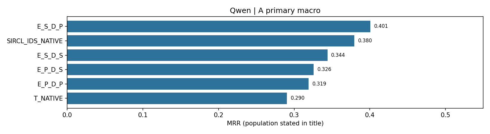
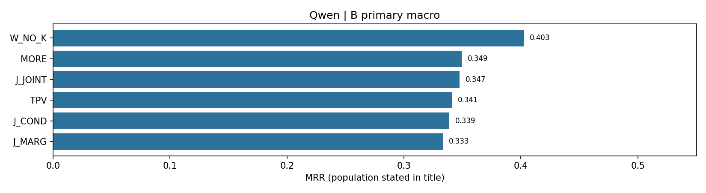

# RQ3.5 screen：证据、指令和联合信号

Qwen-only 修订版：2026-09-30。原文件日期标识所分析的历史批次，并非新增实验日期。

本报告仅讨论 Qwen3.8-27B；结论由其自身病例和结果决定，不要求跨模型成立，也不推广为所有模型的性质。原始输出、分数、输入与实验状态未改；本轮新增推理调用为 0。

统计按 Qwen-only 范围重新分析：保留原科学问题的全部正负比较、病例掩码及失败处理，重新计算 Holm；有逐病例记录或差值的主比较重新复算配对检验与 dz。原始 p 在样本未变时本来就不依赖其他模型。CSV 数值往返影响浮点并列时，保留原数值并列口径，另存重算敏感性。附表 `raw_statistic_source` 明确区分重新配对计算与沿用同一 Qwen 样本的原始统计。没有把事后分析改称预注册发现。

## 范围和设计

本报告为 screen，不是完整锁定验证。A 拆分父版 P/S 证据与 P/S 指令，另有原生桥梁；B 比较 TPV、MORE、W_NO_K、J_MARG、J_JOINT、J_COND。A 的完整排名共同 N=58，而四个核心条件的析因 N=59，某些两条件对照可用 60；B 共同 N=59。不能混用这些分母。

## Qwen 结果

A 的主数据集 macro：E_P_D_P=0.3191、E_P_D_S=0.3256、E_S_D_P=0.4006、E_S_D_S=0.3440、T_NATIVE=0.2904、SIRCL_IDS_NATIVE=0.3796。E_S_D_P 的方向值得探索，需要进一步验证提升来自哪些证据变化。

在完整四条件下，S 证据主效应约 +0.0551、S 指令 −0.0274、交互 −0.0689；三项 Qwen family 均经校正后未达显著。E_S_D_P 相对 E_P_D_P 的两条件增益约 +0.0992，但这里仍是小规模 screen，并伴随破坏，不是已验证新主方法。

B 的 macro：TPV=0.3411、MORE=0.3494、W_NO_K=0.4026、J_MARG=0.3333、J_JOINT=0.3474、J_COND=0.3387。W_NO_K 的信号比复杂的条件联合证据更值得保留；J_COND 相对 W_NO_K 为约 −0.065，Qwen 主比较校正后不显著。

## 机制和 no-op 审计

J 只在 28/60 cases 真正提供新包，32 例是输入 no-op 并合法复用。105 个实际包全部属于 request-family，没有 scope-family。不能把“联合证据”这个名义等同于已经测试了充足的宿主范围消歧。

比较 SIRCL 风格证据/指令是为了定位接口和证据机制，不是将他人完整方法包装为创新。父版指令不是天然更强，新的领域说明也没有对 Qwen 形成稳定好处。

## 案例与修复/破坏

`INC-6A048DD0C35E`：原本已有根因 Trace，补充上下文改变其权重，而不一定提供新根因事实。`INC-9ACC29B9B330`：即便有直接 I/O，仍可能把 node 故障归给受影响组件。`INC-BF08743A4A7D`：条件关联未阻止首位根因下降到第四；原回复见附件。

正确排名但 reason 未引用 J 不能证明 J 没有作用；同样，提到 J 也不能证明它导致修复。小样本内“提高哪些、损害哪些”的配对表比只看最高均值更有信息。

## 决策

保留 E_S_D_P 和 W_NO_K 为 Qwen 的有前景候选，用更大独立开发批次检查方向；不要把 screen 均值最高写成确证优势。复杂 J 需要先证明其内容真的改变和 scope 能力真的存在，而非继续扩大联合搜索。

## 完整主结果表

### A primary macro

| arm | n | mrr | ac@1 | ac@3 | ac@5 | avg@3 | avg@5 | input_tokens | output_tokens |
|---|---|---|---|---|---|---|---|---|---|
| E_P_D_P | 58 | 0.3191 | 0.2241 | 0.4148 | 0.4981 | 0.3105 | 0.3822 | 11998.2414 | 302.0000 |
| E_P_D_S | 58 | 0.3256 | 0.2056 | 0.4648 | 0.5352 | 0.3259 | 0.4059 | 11883.2414 | 270.1897 |
| E_S_D_P | 58 | 0.4006 | 0.2741 | 0.5315 | 0.5852 | 0.4179 | 0.4778 | 13027.3621 | 283.3966 |
| E_S_D_S | 58 | 0.3440 | 0.2037 | 0.4944 | 0.5296 | 0.3698 | 0.4337 | 12912.3621 | 237.2586 |
| T_NATIVE | 58 | 0.2904 | 0.1870 | 0.4463 | 0.4463 | 0.3074 | 0.3630 | 12986.5172 | 198.8103 |
| SIRCL_IDS_NATIVE | 58 | 0.3796 | 0.2870 | 0.4574 | 0.5130 | 0.3895 | 0.4352 | 13382.7414 | 104.5517 |

### B primary macro

| arm | n | mrr | ac@1 | ac@3 | ac@5 | avg@3 | avg@5 | input_tokens | output_tokens |
|---|---|---|---|---|---|---|---|---|---|
| TPV | 59 | 0.3411 | 0.2544 | 0.4728 | 0.4728 | 0.3550 | 0.4021 | 14603.2712 | 161.7966 |
| MORE | 59 | 0.3494 | 0.2877 | 0.4561 | 0.4561 | 0.3550 | 0.3954 | 16460.1525 | 160.9153 |
| W_NO_K | 59 | 0.4026 | 0.3211 | 0.5070 | 0.5070 | 0.4222 | 0.4561 | 15925.4915 | 152.3051 |
| J_MARG | 59 | 0.3333 | 0.2377 | 0.4570 | 0.4912 | 0.3386 | 0.3996 | 14864.0000 | 159.2881 |
| J_JOINT | 59 | 0.3474 | 0.2719 | 0.4395 | 0.4737 | 0.3500 | 0.3995 | 14870.4068 | 158.1356 |
| J_COND | 59 | 0.3387 | 0.2544 | 0.4395 | 0.4737 | 0.3442 | 0.3960 | 14942.2881 | 162.1356 |

## Qwen-only 配对统计

以下保留指定范围的全部比较，不只保留显著项；其他数据集、层级、故障和敏感性分析见附件。Pratt-Wilcoxon 双侧及 paired dz 沿用原方法；分类、相关性和组间检验不改称 Wilcoxon。不报告置信区间。

### registered_tests.csv

| experiment | family | contrast | n | delta_mrr | p | paired_dz | holm_p | group_holm |
|---|---|---|---|---|---|---|---|---|
| A | primary | evidence | 59 | 0.0551 | 0.3799 | 0.1351 | 0.5853 | 0.6523 |
| A | primary | instruction | 59 | -0.0274 | 0.2927 | -0.1274 | 0.5853 | 0.6523 |
| A | primary | interaction | 59 | -0.0689 | 0.0534 | -0.1811 | 0.1603 | 0.3560 |
| A | native_calibration | common_P-native_T | 59 | 0.0316 | 0.4996 | 0.0736 | 0.6342 | 0.2977 |
| A | native_calibration | common_S-native_S | 59 | -0.0373 | 0.3171 | -0.0895 | 0.6342 | 0.4354 |
| B | primary | J_COND-TPV | 59 | -0.0028 | 0.9942 | -0.0185 | 1.0000 | 1.0000 |
| B | primary | J_COND-MORE | 59 | -0.0113 | 0.6956 | -0.0683 | 1.0000 | 1.0000 |
| B | primary | J_COND-W_NO_K | 59 | -0.0650 | 0.1160 | -0.2428 | 0.3479 | 0.3304 |
| B | joint_mechanism | joint-marginal | 59 | 0.0141 | 0.5504 | 0.1207 | 0.6346 | 0.6346 |
| B | joint_mechanism | conditional-joint | 59 | -0.0085 | 0.3173 | -0.1302 | 0.6346 | 0.6346 |

### conditional_contrasts.csv

| experiment | contrast | n | p_exploratory | dz | holm_exploratory |
|---|---|---|---|---|---|
| A | E_S_D_P-E_P_D_P | 60 | 0.1360 | 0.2151 | 0.4081 |
| A | E_S_D_S-E_P_D_S | 59 | 0.7455 | 0.0467 | 1.0000 |
| A | E_P_D_S-E_P_D_P | 59 | 0.5196 | 0.0226 | 1.0000 |
| A | E_S_D_S-E_S_D_P | 60 | 0.0622 | -0.2730 | 0.2486 |
| B | J_COND-TPV | 59 | 0.9942 | -0.0185 | 1.0000 |
| B | J_JOINT-TPV | 60 | 0.7056 | 0.0575 | 1.0000 |
| B | J_MARG-TPV | 60 | 0.9795 | -0.0697 | 1.0000 |
| B | J_COND-MORE | 59 | 0.6956 | -0.0683 | 1.0000 |
| B | W_NO_K-TPV | 60 | 0.0330 | 0.2616 | 0.1650 |

## 分层、案例和复现附件

所有保留的表均仅含 Qwen 结果或公共数据/CPU 基线。大型表用于完整审计，不能把其中最优分组当作预注册确认。

- [availability_subgroups](RQ3_5_Screen_Analysis_2026-09-26_assets/availability_subgroups.csv)
- [conditional_contrasts](RQ3_5_Screen_Analysis_2026-09-26_assets/conditional_contrasts.csv)
- [cost_runtime](RQ3_5_Screen_Analysis_2026-09-26_assets/cost_runtime.csv)
- [cross_stage_common](RQ3_5_Screen_Analysis_2026-09-26_assets/cross_stage_common.csv)
- [event_group_sensitivity](RQ3_5_Screen_Analysis_2026-09-26_assets/event_group_sensitivity.csv)
- [failures](RQ3_5_Screen_Analysis_2026-09-26_assets/failures.csv)
- [fault_granularity](RQ3_5_Screen_Analysis_2026-09-26_assets/fault_granularity.csv)
- [manipulation_audit](RQ3_5_Screen_Analysis_2026-09-26_assets/manipulation_audit.csv)
- [output_diagnostics](RQ3_5_Screen_Analysis_2026-09-26_assets/output_diagnostics.csv)
- [paired_arm_metrics](RQ3_5_Screen_Analysis_2026-09-26_assets/paired_arm_metrics.csv)
- [per_record](RQ3_5_Screen_Analysis_2026-09-26_assets/per_record.csv)
- [qualitative_samples](RQ3_5_Screen_Analysis_2026-09-26_assets/qualitative_samples.csv)
- [qwen_headline_metrics](RQ3_5_Screen_Analysis_2026-09-26_assets/qwen_headline_metrics.csv)
- [registered_tests](RQ3_5_Screen_Analysis_2026-09-26_assets/registered_tests.csv)

分析口径、备份与复算说明见 [重分析说明](_qwen_only_reanalysis/README.md)。历史原始结果保持在对应 `RQs/` 下，本次没有调整实验队列、模型或评分器。
