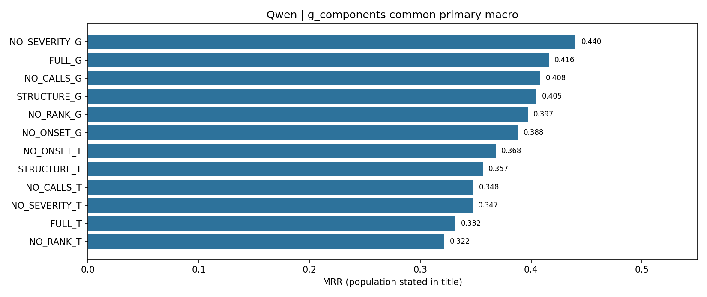
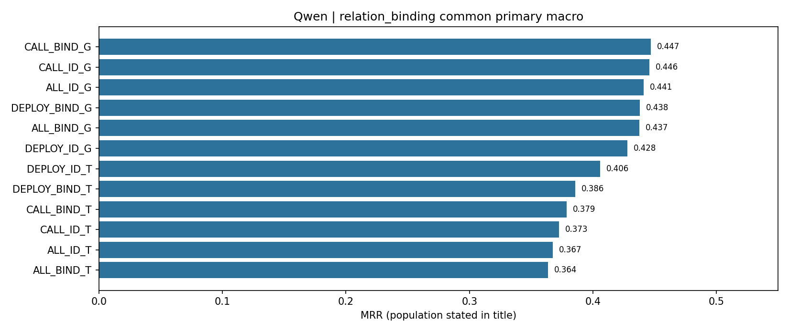
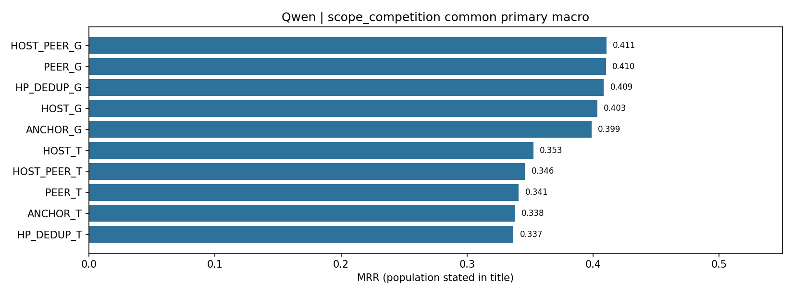

# RQ3.6-B：G 信息、故障范围与关系绑定机制

Qwen-only 修订版：2026-09-30。原文件日期标识所分析的历史批次，并非新增实验日期。

本报告仅讨论 Qwen3.8-27B；结论由其自身病例和结果决定，不要求跨模型成立，也不推广为所有模型的性质。原始输出、分数、输入与实验状态未改；本轮新增推理调用为 0。

统计按 Qwen-only 范围重新分析：保留原科学问题的全部正负比较、病例掩码及失败处理，重新计算 Holm；有逐病例记录或差值的主比较重新复算配对检验与 dz。原始 p 在样本未变时本来就不依赖其他模型。CSV 数值往返影响浮点并列时，保留原数值并列口径，另存重算敏感性。附表 `raw_statistic_source` 明确区分重新配对计算与沿用同一 Qwen 样本的原始统计。没有把事后分析改称预注册发现。

## 三个机制问题

B1 `g_components` 拆分 G 中的排名、严重度、onset 和调用边；B2 `scope_competition` 拆分宿主、peer、组合及去重；B3 `relation_binding` 比较全部/调用/部署关系及 ID/显式绑定。各 180 例（主数据集各 60），每个信息方案都有 Text/Graph 配对，不再泛泛比较一次图与文。

Qwen 完整共同病例分别为 163、170、170；逻辑目标为 2,160、1,800、2,160，超时为 17、10、11，模型失败为 4、0、1。完整病例只是阶段内的比较掩码，不把重复或引用的回答视为独立重复。

## Qwen 的主要结果

B1 FULL_T/G macro 为 0.3317/0.4160。NO_SEVERITY_G=0.4402 的正向点估计值得保留，但删除严重度、onset、排名或 calls 均未在完整 Qwen 主组件 family 得到可靠统一提升。不能声称 G 的全部作用已由某一个附带字段解释。

B2 的 host 平均效应很小；HOST_T 相对 ANCHOR_T 的 AC@5 可提高、AC@1 却轻微下降，提示补充背景扩大备选不一定提高首位。host/peer/dedup 实际可操作病例分别为 115/175/110，不适用病例不能伪造成新增证据。

一个应明确保留的 Qwen 视觉正结果是 HP_DEDUP_G 相对同方案 Text：pooled ΔMRR=+0.0750，在 B2 五项 carrier family 中 Holm p≈0.0391、事件组 p≈0.0187。扩大为跨 B1–B3 全部 17 项 carrier 的敏感性 family 后不再显著。因此它是有具体条件支持的视觉收益，而不是普适胜出。

B3 ALL_ID_G/T macro 为 0.4409/0.3674。pooled 差 +0.0738，case-level 校正尚未显著；修复/破坏 34/12，前五新增/丢失 18/18。这个模式更像重新排序已有候选，不能解释成大规模新增根因覆盖。

## 层次、模式与 case 解释

ALL_ID 的 node 子组 Text→Graph 约 0.3056→0.2986；pod 0.2698→0.3730；service 0.4424→0.5317。视觉增益不是各层级均匀出现。调用、部署和显式绑定没有形成一个校正后普遍优于全部关系的组件组合。

按 G 排名是否与根因对齐的事后分层发现：删除排名/onset 在不同组方向不同。比如 NO_ONSET_T−FULL_T 在 rank1 对齐组约 −0.1629，其余组约 +0.0677。这提示摘要既可能有用也可能诱导锚定；分组用了 gold，不能据此构建线上路由。

case 分析同时保留 graph 修复、宿主误归因、rank/order 误导和内容不变的 no-op。公开调用边只能证明观测关联，不能独立证明故障传播；错误类型称谓也不能自动等同未知 ID 幻觉。

## 适用范围与研究含义

本轮 Qwen 证据表明：G 有若干较大正向排序效应，去重后的宿主/peer 方案存在条件显著性；但排名/严重度/onset 的单字段删除、关系子集选择和显式绑定还没有形成稳定的独立改善。

下一步应把数值与关系结合的具体机制同强文本比较，保留主效应和敏感性 family 两种口径，不用缩小问题后才出现的显著性冒充所有图条件的共同结论。

## 完整主结果表

### g_components common primary macro

| arm | n | mrr | ac@1 | ac@3 | ac@5 | avg@3 | avg@5 | input_tokens | output_tokens |
|---|---|---|---|---|---|---|---|---|---|
| FULL_G | 163 | 0.4160 | 0.3407 | 0.5111 | 0.5169 | 0.4315 | 0.4657 | 18693.2945 | 146.2086 |
| FULL_T | 163 | 0.3317 | 0.2239 | 0.4805 | 0.4931 | 0.3484 | 0.4050 | 12714.0429 | 188.2822 |
| NO_CALLS_G | 163 | 0.4083 | 0.3353 | 0.4998 | 0.5124 | 0.4201 | 0.4570 | 18693.2945 | 150.2822 |
| NO_CALLS_T | 163 | 0.3477 | 0.2427 | 0.4922 | 0.4985 | 0.3664 | 0.4192 | 12560.5828 | 160.2822 |
| NO_ONSET_G | 163 | 0.3882 | 0.3034 | 0.4985 | 0.5048 | 0.4047 | 0.4448 | 18693.2945 | 146.0859 |
| NO_ONSET_T | 163 | 0.3682 | 0.2607 | 0.5111 | 0.5169 | 0.3893 | 0.4403 | 12530.1656 | 158.8160 |
| NO_RANK_G | 163 | 0.3969 | 0.3106 | 0.5048 | 0.5106 | 0.4155 | 0.4536 | 18693.2945 | 148.0307 |
| NO_RANK_T | 163 | 0.3218 | 0.2176 | 0.4630 | 0.4756 | 0.3385 | 0.3921 | 12625.0429 | 164.9387 |
| NO_SEVERITY_G | 163 | 0.4402 | 0.3646 | 0.5417 | 0.5479 | 0.4536 | 0.4913 | 18693.2945 | 147.1840 |
| NO_SEVERITY_T | 163 | 0.3472 | 0.2423 | 0.4873 | 0.4994 | 0.3650 | 0.4176 | 12558.9325 | 163.5828 |
| STRUCTURE_G | 163 | 0.4048 | 0.3223 | 0.5106 | 0.5228 | 0.4191 | 0.4593 | 18693.2945 | 144.8773 |
| STRUCTURE_T | 163 | 0.3565 | 0.2670 | 0.4801 | 0.4801 | 0.3750 | 0.4171 | 12160.0552 | 156.7669 |

### relation_binding common primary macro

| arm | n | mrr | ac@1 | ac@3 | ac@5 | avg@3 | avg@5 | input_tokens | output_tokens |
|---|---|---|---|---|---|---|---|---|---|
| ALL_BIND_G | 170 | 0.4375 | 0.3809 | 0.5162 | 0.5162 | 0.4489 | 0.4758 | 19993.6588 | 146.5824 |
| ALL_BIND_T | 170 | 0.3637 | 0.2632 | 0.4915 | 0.5033 | 0.3822 | 0.4307 | 14367.1176 | 178.2353 |
| ALL_ID_G | 170 | 0.4409 | 0.3923 | 0.5093 | 0.5093 | 0.4504 | 0.4740 | 19993.6588 | 149.3000 |
| ALL_ID_T | 170 | 0.3674 | 0.2632 | 0.4977 | 0.5090 | 0.3884 | 0.4355 | 14367.1176 | 173.2824 |
| CALL_BIND_G | 170 | 0.4468 | 0.3927 | 0.5160 | 0.5218 | 0.4569 | 0.4829 | 19891.0353 | 145.0059 |
| CALL_BIND_T | 170 | 0.3788 | 0.2817 | 0.5103 | 0.5160 | 0.3968 | 0.4445 | 14177.1647 | 156.9176 |
| CALL_ID_G | 170 | 0.4458 | 0.3920 | 0.5099 | 0.5216 | 0.4545 | 0.4814 | 19891.0353 | 147.4588 |
| CALL_ID_T | 170 | 0.3726 | 0.2756 | 0.5042 | 0.5098 | 0.3906 | 0.4383 | 14177.1647 | 156.8294 |
| DEPLOY_BIND_G | 170 | 0.4381 | 0.3820 | 0.5057 | 0.5231 | 0.4442 | 0.4758 | 19992.8882 | 141.8941 |
| DEPLOY_BIND_T | 170 | 0.3857 | 0.2821 | 0.5208 | 0.5385 | 0.4009 | 0.4559 | 14208.4706 | 166.8235 |
| DEPLOY_ID_G | 170 | 0.4278 | 0.3690 | 0.4988 | 0.5105 | 0.4375 | 0.4667 | 19992.8882 | 144.3765 |
| DEPLOY_ID_T | 170 | 0.4057 | 0.3058 | 0.5454 | 0.5510 | 0.4230 | 0.4742 | 14208.4706 | 161.0529 |

### scope_competition common primary macro

| arm | n | mrr | ac@1 | ac@3 | ac@5 | avg@3 | avg@5 | input_tokens | output_tokens |
|---|---|---|---|---|---|---|---|---|---|
| ANCHOR_G | 170 | 0.3987 | 0.3248 | 0.4934 | 0.4989 | 0.4136 | 0.4478 | 15414.4000 | 158.0529 |
| ANCHOR_T | 170 | 0.3382 | 0.2595 | 0.4461 | 0.4461 | 0.3548 | 0.3913 | 13792.1471 | 162.5118 |
| HOST_G | 170 | 0.4035 | 0.3246 | 0.4991 | 0.5047 | 0.4214 | 0.4547 | 15717.6176 | 160.0941 |
| HOST_PEER_G | 170 | 0.4105 | 0.3238 | 0.5170 | 0.5170 | 0.4328 | 0.4665 | 16270.8765 | 165.3412 |
| HOST_PEER_T | 170 | 0.3460 | 0.2609 | 0.4718 | 0.4718 | 0.3607 | 0.4051 | 14648.6235 | 162.2529 |
| HOST_T | 170 | 0.3527 | 0.2540 | 0.4825 | 0.4825 | 0.3752 | 0.4181 | 14095.3647 | 161.8176 |
| HP_DEDUP_G | 170 | 0.4085 | 0.3172 | 0.5164 | 0.5226 | 0.4303 | 0.4672 | 16083.6235 | 159.5000 |
| HP_DEDUP_T | 170 | 0.3368 | 0.2498 | 0.4607 | 0.4607 | 0.3535 | 0.3964 | 14461.3706 | 165.0353 |
| PEER_G | 170 | 0.4101 | 0.3359 | 0.4989 | 0.5051 | 0.4269 | 0.4582 | 15967.6588 | 163.2353 |
| PEER_T | 170 | 0.3410 | 0.2548 | 0.4660 | 0.4660 | 0.3567 | 0.4004 | 14345.4059 | 169.3118 |

## Qwen-only 配对统计

以下保留指定范围的全部比较，不只保留显著项；其他数据集、层级、故障和敏感性分析见附件。Pratt-Wilcoxon 双侧及 paired dz 沿用原方法；分类、相关性和组间检验不改称 Wilcoxon。不报告置信区间。

### paired_tests.csv

| family | stat_family | contrast | n | delta | p | dz | holm | group_holm |
|---|---|---|---|---|---|---|---|---|
| g_components | B1_primary | NO_RANK-FULL_T | 163 | -0.0102 | 0.4803 | -0.0443 | 1.0000 | 1.0000 |
| g_components | B1_carrier_interaction | NO_RANK_carrier_interaction | 163 | -0.0092 | 0.7535 | -0.0291 | 1.0000 | 0.9762 |
| g_components | B1_primary | NO_SEVERITY-FULL_T | 163 | 0.0153 | 0.6696 | 0.0628 | 1.0000 | 1.0000 |
| g_components | B1_carrier_interaction | NO_SEVERITY_carrier_interaction | 163 | 0.0092 | 0.4155 | 0.0338 | 1.0000 | 0.9198 |
| g_components | B1_primary | NO_ONSET-FULL_T | 163 | 0.0366 | 0.0493 | 0.1319 | 0.4931 | 0.2966 |
| g_components | B1_carrier_interaction | NO_ONSET_carrier_interaction | 163 | -0.0642 | 0.0432 | -0.1836 | 0.2161 | 0.0713 |
| g_components | B1_primary | STRUCTURE-FULL_T | 163 | 0.0248 | 0.2877 | 0.0699 | 1.0000 | 0.7470 |
| g_components | B1_carrier_interaction | STRUCTURE_carrier_interaction | 163 | -0.0359 | 0.3318 | -0.0860 | 1.0000 | 0.4589 |
| g_components | B1_primary | NO_CALLS-FULL_T | 163 | 0.0162 | 0.5943 | 0.0610 | 1.0000 | 1.0000 |
| g_components | B1_carrier_interaction | NO_CALLS_carrier_interaction | 163 | -0.0248 | 0.5231 | -0.0684 | 1.0000 | 0.7040 |
| scope_competition | B2_primary | HOST_average_T | 170 | 0.0093 | 0.1597 | 0.0553 | 1.0000 | 1.0000 |
| scope_competition | B2_primary | PEER_average_T | 170 | -0.0034 | 0.6404 | -0.0133 | 1.0000 | 1.0000 |
| scope_competition | B2_primary | HOST_PEER_interaction_T | 170 | -0.0088 | 0.2753 | -0.0336 | 1.0000 | 1.0000 |
| scope_competition | B2_primary | DEDUP_minus_HP_T | 170 | -0.0098 | 0.5567 | -0.0574 | 1.0000 | 1.0000 |
| relation_binding | B3_primary | CALL-ALL_ID_T | 170 | 0.0047 | 0.8168 | 0.0232 | 1.0000 | 1.0000 |
| relation_binding | B3_primary | DEPLOY-ALL_ID_T | 170 | 0.0371 | 0.0766 | 0.1348 | 0.6131 | 0.3537 |
| relation_binding | B3_primary | CALL-ALL_BIND_T | 170 | 0.0142 | 0.3979 | 0.0790 | 1.0000 | 1.0000 |
| relation_binding | B3_primary | DEPLOY-ALL_BIND_T | 170 | 0.0211 | 0.3137 | 0.0750 | 1.0000 | 0.7460 |
| relation_binding | B3_binding | ALL_BIND-ID_T | 170 | -0.0036 | 0.8131 | -0.0204 | 1.0000 | 1.0000 |
| relation_binding | B3_binding | CALL_BIND-ID_T | 170 | 0.0059 | 0.3173 | 0.0767 | 1.0000 | 1.0000 |
| relation_binding | B3_binding | DEPLOY_BIND-ID_T | 170 | -0.0196 | 0.2203 | -0.0934 | 1.0000 | 1.0000 |
| g_components | B1_primary | NO_RANK-FULL_G | 163 | -0.0194 | 0.7756 | -0.0734 | 1.0000 | 1.0000 |
| g_components | B1_primary | NO_SEVERITY-FULL_G | 163 | 0.0245 | 0.1441 | 0.1349 | 1.0000 | 1.0000 |
| g_components | B1_primary | NO_ONSET-FULL_G | 163 | -0.0276 | 0.1492 | -0.1281 | 1.0000 | 1.0000 |
| g_components | B1_primary | STRUCTURE-FULL_G | 163 | -0.0110 | 0.8138 | -0.0423 | 1.0000 | 1.0000 |
| g_components | B1_primary | NO_CALLS-FULL_G | 163 | -0.0087 | 0.6937 | -0.0344 | 1.0000 | 1.0000 |
| scope_competition | B2_primary | HOST_average_G | 170 | 0.0027 | 0.2143 | 0.0331 | 1.0000 | 1.0000 |
| scope_competition | B2_primary | PEER_average_G | 170 | 0.0096 | 0.5121 | 0.0519 | 1.0000 | 1.0000 |
| scope_competition | B2_primary | HOST_PEER_interaction_G | 170 | -0.0044 | 0.7344 | -0.0308 | 1.0000 | 1.0000 |
| scope_competition | B2_primary | DEDUP_minus_HP_G | 170 | -0.0015 | 0.7122 | -0.0113 | 1.0000 | 1.0000 |
| relation_binding | B3_primary | CALL-ALL_ID_G | 170 | 0.0049 | 0.3017 | 0.0243 | 1.0000 | 1.0000 |
| relation_binding | B3_primary | DEPLOY-ALL_ID_G | 170 | -0.0137 | 0.8075 | -0.0511 | 1.0000 | 1.0000 |
| relation_binding | B3_primary | CALL-ALL_BIND_G | 170 | 0.0093 | 0.5886 | 0.0463 | 1.0000 | 1.0000 |
| relation_binding | B3_primary | DEPLOY-ALL_BIND_G | 170 | -0.0005 | 0.8247 | -0.0024 | 1.0000 | 1.0000 |
| relation_binding | B3_binding | ALL_BIND-ID_G | 170 | -0.0039 | 0.9902 | -0.0193 | 1.0000 | 1.0000 |
| relation_binding | B3_binding | CALL_BIND-ID_G | 170 | 0.0005 | 0.8353 | 0.0023 | 1.0000 | 1.0000 |
| relation_binding | B3_binding | DEPLOY_BIND-ID_G | 170 | 0.0093 | 0.6603 | 0.0382 | 1.0000 | 1.0000 |
| g_components | carrier_g_components | FULL_G-T | 163 | 0.0847 | 0.0764 | 0.1854 | 0.3057 | 0.0802 |
| g_components | carrier_g_components | NO_RANK_G-T | 163 | 0.0755 | 0.0512 | 0.1803 | 0.2561 | 0.0928 |
| g_components | carrier_g_components | NO_SEVERITY_G-T | 163 | 0.0939 | 0.0213 | 0.2194 | 0.1277 | 0.0385 |
| g_components | carrier_g_components | NO_ONSET_G-T | 163 | 0.0204 | 0.5679 | 0.0514 | 0.5679 | 0.4687 |
| g_components | carrier_g_components | STRUCTURE_G-T | 163 | 0.0488 | 0.2112 | 0.1305 | 0.4699 | 0.3859 |
| g_components | carrier_g_components | NO_CALLS_G-T | 163 | 0.0598 | 0.1566 | 0.1472 | 0.4699 | 0.3765 |
| scope_competition | carrier_scope_competition | ANCHOR_G-T | 170 | 0.0603 | 0.2257 | 0.1510 | 0.4317 | 0.1831 |
| scope_competition | carrier_scope_competition | HOST_G-T | 170 | 0.0515 | 0.2158 | 0.1261 | 0.4317 | 0.1831 |
| scope_competition | carrier_scope_competition | PEER_G-T | 170 | 0.0711 | 0.0576 | 0.1640 | 0.1727 | 0.0959 |
| scope_competition | carrier_scope_competition | HOST_PEER_G-T | 170 | 0.0667 | 0.0366 | 0.1604 | 0.1464 | 0.0677 |
| scope_competition | carrier_scope_competition | HP_DEDUP_G-T | 170 | 0.0750 | 0.0078 | 0.1875 | 0.0391 | 0.0187 |
| relation_binding | carrier_relation_binding | ALL_ID_G-T | 170 | 0.0738 | 0.1054 | 0.1730 | 0.4113 | 0.0792 |
| relation_binding | carrier_relation_binding | ALL_BIND_G-T | 170 | 0.0735 | 0.0823 | 0.1619 | 0.4113 | 0.0792 |
| relation_binding | carrier_relation_binding | CALL_ID_G-T | 170 | 0.0740 | 0.0476 | 0.1745 | 0.2857 | 0.0566 |
| relation_binding | carrier_relation_binding | CALL_BIND_G-T | 170 | 0.0686 | 0.0899 | 0.1521 | 0.4113 | 0.0817 |
| relation_binding | carrier_relation_binding | DEPLOY_ID_G-T | 170 | 0.0230 | 0.5252 | 0.0582 | 0.5252 | 0.3533 |
| relation_binding | carrier_relation_binding | DEPLOY_BIND_G-T | 170 | 0.0520 | 0.1423 | 0.1208 | 0.4113 | 0.2603 |
| scope_competition | B2_conditional | HOST-ANCHOR_T | 170 | 0.0137 | 0.2166 | 0.0589 | 1.0000 | 1.0000 |
| scope_competition | B2_conditional | PEER-ANCHOR_T | 170 | 0.0010 | 0.4775 | 0.0035 | 1.0000 | 1.0000 |
| scope_competition | B2_conditional | HOST_PEER-PEER_T | 170 | 0.0049 | 0.9874 | 0.0255 | 1.0000 | 1.0000 |
| scope_competition | B2_conditional | HOST_PEER-HOST_T | 170 | -0.0078 | 0.8342 | -0.0263 | 1.0000 | 1.0000 |
| scope_competition | B2_conditional | HOST_PEER-ANCHOR_T | 170 | 0.0059 | 0.5224 | 0.0186 | 1.0000 | 1.0000 |
| scope_competition | B2_conditional | HOST-ANCHOR_G | 170 | 0.0049 | 0.1832 | 0.0454 | 1.0000 | 1.0000 |
| scope_competition | B2_conditional | PEER-ANCHOR_G | 170 | 0.0118 | 0.3153 | 0.0619 | 1.0000 | 1.0000 |
| scope_competition | B2_conditional | HOST_PEER-PEER_G | 170 | 0.0005 | 0.4212 | 0.0045 | 1.0000 | 1.0000 |
| scope_competition | B2_conditional | HOST_PEER-HOST_G | 170 | 0.0074 | 0.6292 | 0.0359 | 1.0000 | 1.0000 |
| scope_competition | B2_conditional | HOST_PEER-ANCHOR_G | 170 | 0.0123 | 0.2767 | 0.0558 | 1.0000 | 1.0000 |

### carrier_global_holm.csv

| family | stat_family | contrast | n | delta | p | dz | holm | group_holm |
|---|---|---|---|---|---|---|---|---|
| g_components | carrier_g_components | FULL_G-T | 163 | 0.0847 | 0.0764 | 0.1854 | 0.8407 | 0.2218 |
| g_components | carrier_g_components | NO_RANK_G-T | 163 | 0.0755 | 0.0512 | 0.1803 | 0.6666 | 0.2321 |
| g_components | carrier_g_components | NO_SEVERITY_G-T | 163 | 0.0939 | 0.0213 | 0.2194 | 0.3405 | 0.1026 |
| g_components | carrier_g_components | NO_ONSET_G-T | 163 | 0.0204 | 0.5679 | 0.0514 | 1.0000 | 0.7530 |
| g_components | carrier_g_components | STRUCTURE_G-T | 163 | 0.0488 | 0.2112 | 0.1305 | 1.0000 | 0.7530 |
| g_components | carrier_g_components | NO_CALLS_G-T | 163 | 0.0598 | 0.1566 | 0.1472 | 0.9959 | 0.7530 |
| scope_competition | carrier_scope_competition | ANCHOR_G-T | 170 | 0.0603 | 0.2257 | 0.1510 | 1.0000 | 0.7530 |
| scope_competition | carrier_scope_competition | HOST_G-T | 170 | 0.0515 | 0.2158 | 0.1261 | 1.0000 | 0.6410 |
| scope_competition | carrier_scope_competition | PEER_G-T | 170 | 0.0711 | 0.0576 | 0.1640 | 0.6907 | 0.2558 |
| scope_competition | carrier_scope_competition | HOST_PEER_G-T | 170 | 0.0667 | 0.0366 | 0.1604 | 0.5492 | 0.2218 |
| scope_competition | carrier_scope_competition | HP_DEDUP_G-T | 170 | 0.0750 | 0.0078 | 0.1875 | 0.1329 | 0.0636 |
| relation_binding | carrier_relation_binding | ALL_ID_G-T | 170 | 0.0738 | 0.1054 | 0.1730 | 0.8433 | 0.2218 |
| relation_binding | carrier_relation_binding | ALL_BIND_G-T | 170 | 0.0735 | 0.0823 | 0.1619 | 0.8407 | 0.2218 |
| relation_binding | carrier_relation_binding | CALL_ID_G-T | 170 | 0.0740 | 0.0476 | 0.1745 | 0.6666 | 0.1414 |
| relation_binding | carrier_relation_binding | CALL_BIND_G-T | 170 | 0.0686 | 0.0899 | 0.1521 | 0.8407 | 0.2452 |
| relation_binding | carrier_relation_binding | DEPLOY_ID_G-T | 170 | 0.0230 | 0.5252 | 0.0582 | 1.0000 | 0.7530 |
| relation_binding | carrier_relation_binding | DEPLOY_BIND_G-T | 170 | 0.0520 | 0.1423 | 0.1208 | 0.9959 | 0.7530 |

## 分层、案例和复现附件

所有保留的表均仅含 Qwen 结果或公共数据/CPU 基线。大型表用于完整审计，不能把其中最优分组当作预注册确认。

- [arm_metrics](RQ3_6_Mechanisms_Analysis_2026-09-28_assets/arm_metrics.csv)
- [candidate_and_evidence_patterns](RQ3_6_Mechanisms_Analysis_2026-09-28_assets/candidate_and_evidence_patterns.csv)
- [carrier_global_holm](RQ3_6_Mechanisms_Analysis_2026-09-28_assets/carrier_global_holm.csv)
- [case_review_candidates](RQ3_6_Mechanisms_Analysis_2026-09-28_assets/case_review_candidates.csv)
- [denominators](RQ3_6_Mechanisms_Analysis_2026-09-28_assets/denominators.csv)
- [failures](RQ3_6_Mechanisms_Analysis_2026-09-28_assets/failures.csv)
- [g_alignment_heterogeneity](RQ3_6_Mechanisms_Analysis_2026-09-28_assets/g_alignment_heterogeneity.csv)
- [g_summary_alignment](RQ3_6_Mechanisms_Analysis_2026-09-28_assets/g_summary_alignment.csv)
- [manipulation_and_repairs](RQ3_6_Mechanisms_Analysis_2026-09-28_assets/manipulation_and_repairs.csv)
- [node_pod_effect_heterogeneity](RQ3_6_Mechanisms_Analysis_2026-09-28_assets/node_pod_effect_heterogeneity.csv)
- [paired_case_deltas](RQ3_6_Mechanisms_Analysis_2026-09-28_assets/paired_case_deltas.csv)
- [paired_tests](RQ3_6_Mechanisms_Analysis_2026-09-28_assets/paired_tests.csv)
- [pattern_metrics](RQ3_6_Mechanisms_Analysis_2026-09-28_assets/pattern_metrics.csv)
- [per_record](RQ3_6_Mechanisms_Analysis_2026-09-28_assets/per_record.csv)
- [qwen_headline_metrics](RQ3_6_Mechanisms_Analysis_2026-09-28_assets/qwen_headline_metrics.csv)
- [reviewed_cases](RQ3_6_Mechanisms_Analysis_2026-09-28_assets/reviewed_cases.csv)
- [scope_confusion](RQ3_6_Mechanisms_Analysis_2026-09-28_assets/scope_confusion.csv)
- [sensitivity](RQ3_6_Mechanisms_Analysis_2026-09-28_assets/sensitivity.csv)
- [status_counts](RQ3_6_Mechanisms_Analysis_2026-09-28_assets/status_counts.csv)
- [strata_metrics](RQ3_6_Mechanisms_Analysis_2026-09-28_assets/strata_metrics.csv)
- [subgroup_tests](RQ3_6_Mechanisms_Analysis_2026-09-28_assets/subgroup_tests.csv)
- [within_dataset_complexity](RQ3_6_Mechanisms_Analysis_2026-09-28_assets/within_dataset_complexity.csv)

分析口径、备份与复算说明见 [重分析说明](_qwen_only_reanalysis/README.md)。历史原始结果保持在对应 `RQs/` 下，本次没有调整实验队列、模型或评分器。
