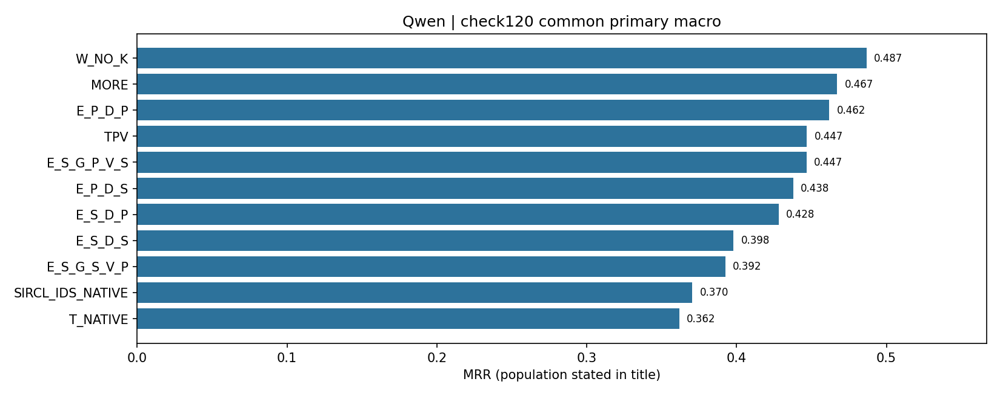

# RQ3.6-A：证据和指令拆分的复核

Qwen-only 修订版：2026-09-30。原文件日期标识所分析的历史批次，并非新增实验日期。

本报告仅讨论 Qwen3.8-27B；结论由其自身病例和结果决定，不要求跨模型成立，也不推广为所有模型的性质。原始输出、分数、输入与实验状态未改；本轮新增推理调用为 0。

统计按 Qwen-only 范围重新分析：保留原科学问题的全部正负比较、病例掩码及失败处理，重新计算 Holm；有逐病例记录或差值的主比较重新复算配对检验与 dz。原始 p 在样本未变时本来就不依赖其他模型。CSV 数值往返影响浮点并列时，保留原数值并列口径，另存重算敏感性。附表 `raw_statistic_source` 明确区分重新配对计算与沿用同一 Qwen 样本的原始统计。没有把事后分析改称预注册发现。

## 设计与样本

本报告仅分析 `exp_evidence_instruction_replication` 阶段 A 的 check120、11 条件。证据 P/S、领域说明 G、核验措辞 V 被分离，另有 T_NATIVE、SIRCL_IDS_NATIVE、TPV、W_NO_K。Qwen 有 24 个超时逻辑目标；整个阶段共同病例为 97（AIOPS-2022/2025/AegisLab 为 32/35/30）。子 factorial 的自身完整掩码较大，敏感性表单列。

## Qwen 的可靠结果与候选方向

最明确的正结果是文本接口校准：E_P_D_P 相对 T_NATIVE，pooled ΔMRR=+0.1017，Qwen 两项校准 family Holm p≈0.00277；事件组 p≈0.00486。它支持提示词封装、证据分块和答案形成条件的重要性，是文本接口贡献，不是视觉或新选择器贡献。

W_NO_K macro MRR=0.4867，为本批最高点估计。相对 TPV 约 +0.0387，有 6 个 Top-1 修复、1 个破坏；方向值得继续，不能因未达显著性就说无效，也不能称确证改善。

E_P_D_P=0.4618，E_S_D_P=0.4280。上一轮 S 的 screen 优势没有在这批完整共同病例中延续。三因素检验仍未确认通用 S 证据或指令收益。更换核验措辞 V 的平均效应很小，不能将“说一遍验证”当作自动 reasoning 能力。

## 为什么增加根因观测仍会下降

S 增加已展示根因关联 M/R/L，但在 P 已有 root-M 的 59 例，MRR 从 0.5944 到 0.4986；P 没有、S 新增的 28 例，从 0.3155 到 0.4167。保留“某条属于根因的指标”不足以保证保留了该故障的判别信号。

S 相对 P 的前五新提名/丢失为 10/20；Top-1 修复/破坏为 13/12。相近的首位净变化掩盖了备选列表损失，这能解释部分 MRR 下降。S 在两 AIOPS 合并后点估计改善，却在 AegisLab 从 0.6539 到 0.4639，总体均值抵消了异质性。

## 层次与案例

S 对 pod 的相对增益、对 node 的损失，和强调宿主的 G_S 所呈现的相反方向，是值得研究的范围混淆。node 共同病例仅 9，必须看样本量、故障组成和异质性检验，不用单个子组均值承诺普遍规律。

`INC-CEDB66058BB8`：根因 working-set 峰值被其他 root CPU 记录替换，owner 仍在但正确机制丢失。`INC-7F84D3BE3772`：见证改变故障范围解释，不是所有数值都是新增。`INC-BA41A280E858`：宿主压力诱导 pod→node 误判。完整案例在附表中；人工 reason 只支持公开文字所体现的错误。

## 稳健性与结论边界

将全部 120 例的超时按零分做敏感性时，E_S_D_P 与 E_P_D_P 的顺序可轻微反转；这不是主评分，但说明超时掩码影响候选排序。自身 factorial 掩码下接口校准仍有正向证据。不能将所有 S 输入一概判坏。

后续应保留已证实的接口作用，针对内存/宿主信号替换进行有目标的证据分析，并把视觉的贡献单独控制。此报告不把尚未执行阶段当结果，也不自动启动实验。

## 完整主结果表

### check120 common primary macro

| arm | n | mrr | ac@1 | ac@3 | ac@5 | avg@3 | avg@5 | input_tokens | output_tokens |
|---|---|---|---|---|---|---|---|---|---|
| E_P_D_P | 97 | 0.4618 | 0.3450 | 0.6041 | 0.6462 | 0.4733 | 0.5382 | 11839.9691 | 279.9794 |
| E_P_D_S | 97 | 0.4377 | 0.3371 | 0.5649 | 0.6046 | 0.4446 | 0.5045 | 11724.9691 | 280.2268 |
| E_S_D_P | 97 | 0.4280 | 0.3518 | 0.5263 | 0.5374 | 0.4405 | 0.4792 | 13357.3093 | 250.8247 |
| E_S_D_S | 97 | 0.3979 | 0.3239 | 0.4762 | 0.5079 | 0.4053 | 0.4463 | 13242.3093 | 328.6289 |
| E_S_G_P_V_S | 97 | 0.4467 | 0.3710 | 0.5453 | 0.5564 | 0.4599 | 0.4963 | 13330.3093 | 333.4845 |
| E_S_G_S_V_P | 97 | 0.3925 | 0.3230 | 0.4649 | 0.4871 | 0.4046 | 0.4354 | 13269.3093 | 264.4021 |
| MORE | 97 | 0.4670 | 0.3738 | 0.5599 | 0.5808 | 0.4878 | 0.5250 | 16309.2887 | 166.7938 |
| SIRCL_IDS_NATIVE | 97 | 0.3704 | 0.2885 | 0.4746 | 0.4857 | 0.3848 | 0.4251 | 13710.9381 | 105.6495 |
| TPV | 97 | 0.4469 | 0.3634 | 0.5185 | 0.5497 | 0.4631 | 0.4977 | 14465.0206 | 165.9072 |
| T_NATIVE | 97 | 0.3617 | 0.2433 | 0.5239 | 0.5350 | 0.3821 | 0.4411 | 12812.0928 | 166.8351 |
| W_NO_K | 97 | 0.4867 | 0.4167 | 0.5601 | 0.5601 | 0.5088 | 0.5293 | 15724.3711 | 157.7113 |

## Qwen-only 配对统计

以下保留指定范围的全部比较，不只保留显著项；其他数据集、层级、故障和敏感性分析见附件。Pratt-Wilcoxon 双侧及 paired dz 沿用原方法；分类、相关性和组间检验不改称 Wilcoxon。不报告置信区间。

### registered_tests.csv

| family | contrast | n | delta | p | dz | holm | group_holm |
|---|---|---|---|---|---|---|---|
| A_evidence_instruction | evidence_S_minus_P | 97 | -0.0325 | 0.3205 | -0.0757 | 0.6410 | 0.8132 |
| A_evidence_instruction | instruction_S_minus_P | 97 | -0.0292 | 0.1278 | -0.1278 | 0.3835 | 0.8132 |
| A_evidence_instruction | evidence_instruction_interaction | 97 | -0.0069 | 0.8405 | -0.0160 | 0.8405 | 0.8732 |
| A_instruction_components | G_S_minus_G_P | 97 | -0.0451 | 0.3746 | -0.1643 | 1.0000 | 1.0000 |
| A_instruction_components | V_S_minus_V_P | 97 | 0.0125 | 0.9553 | 0.0819 | 1.0000 | 1.0000 |
| A_instruction_components | G_V_interaction | 97 | -0.0153 | 0.5852 | -0.0701 | 1.0000 | 1.0000 |
| secondary_calibration | P_common_minus_native | 97 | 0.1017 | 0.0014 | 0.2929 | 0.0028 | 0.0049 |
| secondary_calibration | S_common_minus_native | 97 | 0.0241 | 0.9424 | 0.0495 | 0.9424 | 0.7783 |

### paired_contrasts.csv

| contrast | n | delta | p | dz | holm | group_holm |
|---|---|---|---|---|---|---|
| E_S_D_P-E_P_D_P | 97 | -0.0290 | 0.5651 | -0.0635 | 1.0000 | 1.0000 |
| E_S_D_S-E_P_D_S | 97 | -0.0359 | 0.4282 | -0.0716 | 1.0000 | 1.0000 |
| E_P_D_S-E_P_D_P | 97 | -0.0258 | 0.1191 | -0.0894 | 1.0000 | 1.0000 |
| E_S_D_S-E_S_D_P | 97 | -0.0326 | 0.3019 | -0.0967 | 1.0000 | 1.0000 |
| E_S_G_P_V_S-E_S_D_P | 97 | 0.0201 | 0.4680 | 0.1180 | 1.0000 | 1.0000 |
| E_S_G_S_V_P-E_S_D_P | 97 | -0.0375 | 0.2601 | -0.1307 | 1.0000 | 1.0000 |
| W_NO_K-TPV | 97 | 0.0387 | 0.3899 | 0.1503 | 1.0000 | 1.0000 |
| MORE-TPV | 97 | 0.0198 | 0.7548 | 0.0747 | 1.0000 | 1.0000 |
| E_S_D_P-TPV | 97 | -0.0172 | 0.7497 | -0.0326 | 1.0000 | 1.0000 |
| E_S_D_P-SIRCL_IDS_NATIVE | 97 | 0.0567 | 0.3641 | 0.1126 | 1.0000 | 1.0000 |
| TPV-T_NATIVE | 97 | 0.0899 | 0.1043 | 0.2055 | 1.0000 | 0.9422 |

## 分层、案例和复现附件

所有保留的表均仅含 Qwen 结果或公共数据/CPU 基线。大型表用于完整审计，不能把其中最优分组当作预注册确认。

- [arm_metrics](RQ3_6_Stage_A_Analysis_2026-09-26_assets/arm_metrics.csv)
- [factorial_case_deltas](RQ3_6_Stage_A_Analysis_2026-09-26_assets/factorial_case_deltas.csv)
- [factorial_own_mask_sensitivity](RQ3_6_Stage_A_Analysis_2026-09-26_assets/factorial_own_mask_sensitivity.csv)
- [failure_and_literal_audit](RQ3_6_Stage_A_Analysis_2026-09-26_assets/failure_and_literal_audit.csv)
- [failures](RQ3_6_Stage_A_Analysis_2026-09-26_assets/failures.csv)
- [fault_granularity](RQ3_6_Stage_A_Analysis_2026-09-26_assets/fault_granularity.csv)
- [paired_case_deltas](RQ3_6_Stage_A_Analysis_2026-09-26_assets/paired_case_deltas.csv)
- [paired_contrasts](RQ3_6_Stage_A_Analysis_2026-09-26_assets/paired_contrasts.csv)
- [per_record](RQ3_6_Stage_A_Analysis_2026-09-26_assets/per_record.csv)
- [posthoc_node_pod_heterogeneity](RQ3_6_Stage_A_Analysis_2026-09-26_assets/posthoc_node_pod_heterogeneity.csv)
- [qualitative_hash_sample](RQ3_6_Stage_A_Analysis_2026-09-26_assets/qualitative_hash_sample.csv)
- [qwen_headline_metrics](RQ3_6_Stage_A_Analysis_2026-09-26_assets/qwen_headline_metrics.csv)
- [registered_tests](RQ3_6_Stage_A_Analysis_2026-09-26_assets/registered_tests.csv)
- [root_associated_display_records](RQ3_6_Stage_A_Analysis_2026-09-26_assets/root_associated_display_records.csv)
- [root_metric_presence_outcomes](RQ3_6_Stage_A_Analysis_2026-09-26_assets/root_metric_presence_outcomes.csv)
- [root_top1_confusion](RQ3_6_Stage_A_Analysis_2026-09-26_assets/root_top1_confusion.csv)
- [w_added_observation_profile](RQ3_6_Stage_A_Analysis_2026-09-26_assets/w_added_observation_profile.csv)

分析口径、备份与复算说明见 [重分析说明](_qwen_only_reanalysis/README.md)。历史原始结果保持在对应 `RQs/` 下，本次没有调整实验队列、模型或评分器。
