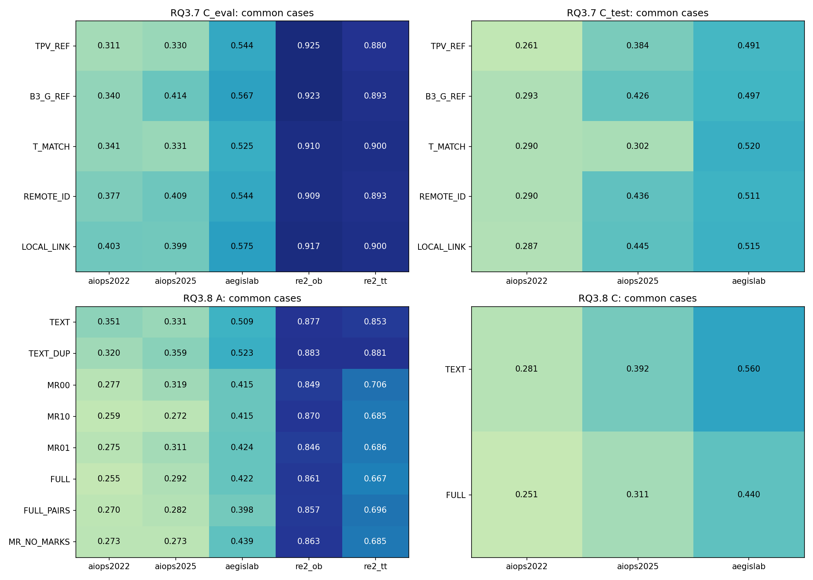
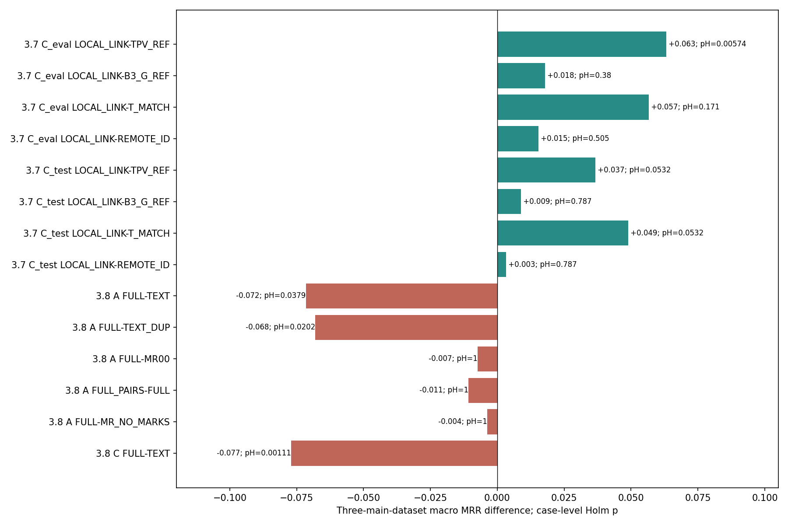
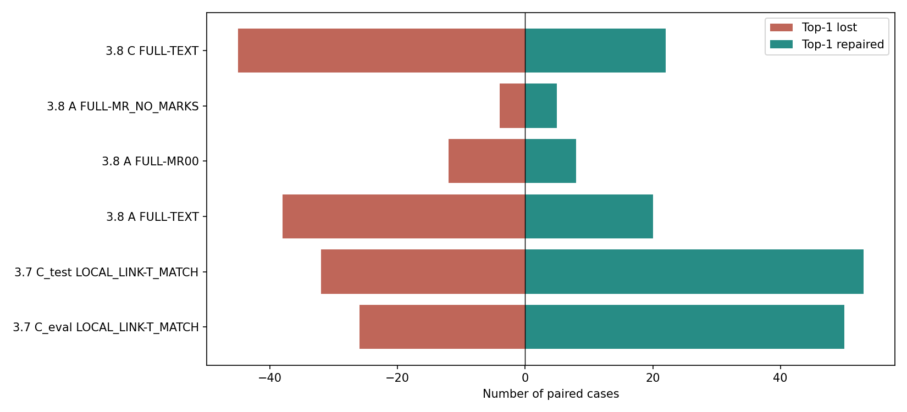
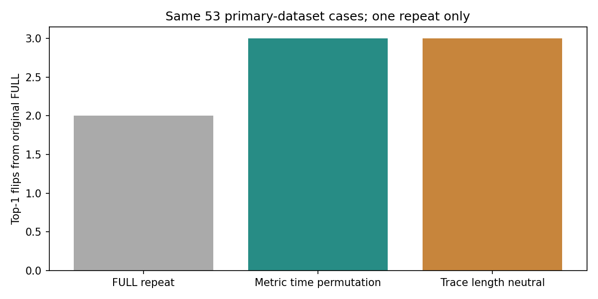
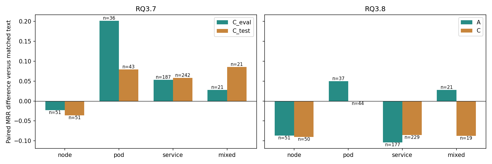
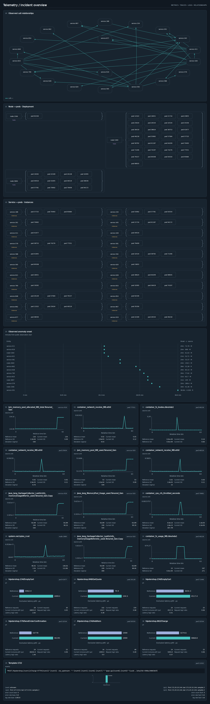
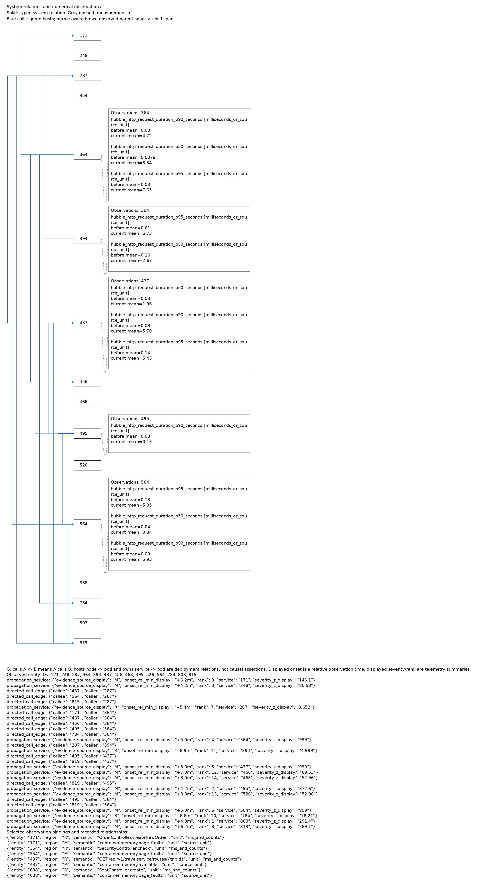
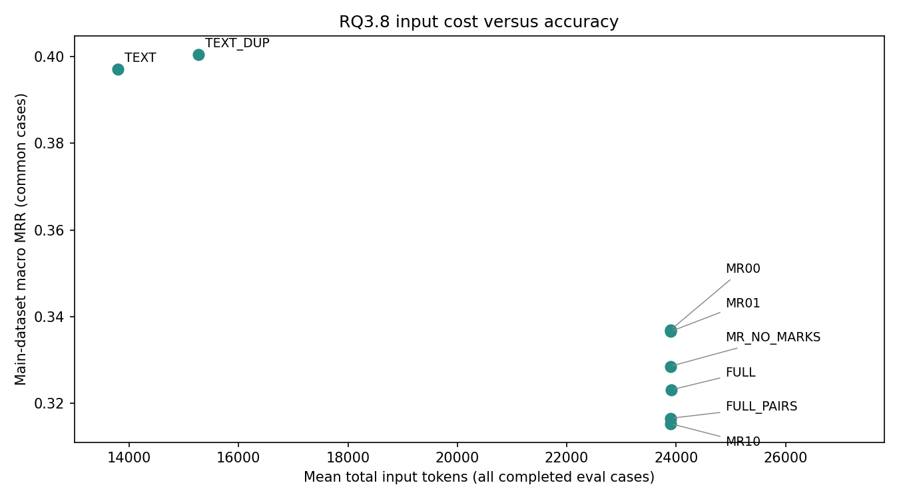

# RQ3.7-C 与 RQ3.8：Qwen 完整统计、诊断模式与案例分析

日期：2026-09-30。范围：已完成的本地 Qwen3.8-27B；新增模型调用 **0**。本报告不包含其他模型，不改变原结果、运行状态、选择器或 renderer。

## 1. 结论先行

**当前最值得保留的是 RQ3.7 的有限正向信号，而不是 RQ3.8 的完整 Dashboard。** 但 RQ3.7 也尚未证明局部连线是独立有效的机制。

1. **RQ3.7 数值面板＋关系融合：**在三主数据集 eval 上，相对旧 TPV 的配对 macro ΔMRR 为 **+0.0631，Holm p=0.00574**。扩大样本后仍有正向价值。相对同内容强文本为 **+0.0566，p=0.1712**，还不是病例级显著结论。
2. **RQ3.7 已暴露 test：**相对强文本为 **+0.0490，病例级 Holm p=0.0532**；事件组敏感性为 **+0.0677，p=0.0420**。应称为“有正向支持、对统计单位敏感”，不能把 0.0532 四舍五入成通过。相对分离面板仅 **+0.0032**：**没有证明必须把面板贴近实体并连线。**
3. **RQ3.8 完整真实运维 Dashboard：**在相同公共证据文本之上加整图，三主数据集 eval 的 macro ΔMRR 为 **−0.0716，p=0.0379**；已暴露 test 为 **−0.0771，p=0.00112**。后者事件组分析也支持退化。这里不是“没提升”，而是当前组合存在实质性代价。
4. **去掉曲线/条形色块、拆开两两调用边、打乱曲线时间顺序或抹平条形长度，均未显示可靠的正向机制证据。** 图形干预造成的排名波动未显著超过原请求重复。不能说模型完全不看图，也不能说它已正确使用图形进行 RCA。
5. **最有价值的新定位：**RQ3.8 的退化不是只发生在“根因证据没被选到”的病例。test 中，P0 指标卡片包含被接受根因实体的 151 例，文本 MRR **0.5905→图文 0.4492**。这一条件退化通过较宽探索性 family 校正；但它不证明图像损害的原因就是“有根因指标”，更不支持删除这些指标。

因此，下一步不能直接扩大完整 Dashboard，也不能再把“更真实、更漂亮、覆盖更全”当成准确率改善的代理。应优先定位并修复**已有证据被错误用于故障归因**的具体环节，再验证局部、可解释的视觉操作。

## 2. 数据、完成状态与有效分母

### 2.1 本报告实际纳入什么

| 批次 | 注册逻辑位置 | 有评分回答 | 请求超时 | 历史引用不可用 | 设计不可执行 |
|---|---:|---:|---:|---:|---:|
| RQ3.7-C eval480 × 5 条件 | 2,400 | 2,384 | 13 | 3 | 0 |
| RQ3.7-C test360 × 5 条件 | 1,800 | 1,791 | 9 | 0 | 0 |
| RQ3.8-A eval480 × 8 条件 | 3,840 | 3,757 | 35 | 0 | 48 |
| RQ3.8-B 机制100 × 3 个新增条件 | 300 | 281 | 1 | 0 | 18 |
| RQ3.8-C test360 × 2 条件 | 720 | 702 | 6 | 0 | 12 |
| 合计 | **9,060** | **8,915** | **64** | **3** | **78** |

“有评分回答”包括评分器认定的模型输出失败：RQ3.7 有 4 个、RQ3.8 有 6 个，均按原评分保留，而非排除。其错误类别为 `unknown/duplicate entity`，不能一概改称虚构实体：非法 ID 和重复/等价实体均可能触发该类错误。

RQ3.7 的三个不可用历史引用有明确终态，不是本次发现的无解释缺失。C 复用了 A 的 900 个逻辑位置：893 个有评分回答、7 个既有失败/不可用位置；新增 C 位置为 3,300，其中 3,282 个回答、18 个超时。引用并非独立复测。

RQ3.8 的精简前支线另有 **637 个终态位置**，不作为完成的正式效果比较。它们消耗的真实调用计入成本，不偷偷丢弃。

### 2.2 画布不可执行：排除的是 case×arm，不是无条件删除整个 case

遵循 RQ3.8 `DD-20260929-09`：超过 8192 px 的设计不进入 MRR、AC、AVG、配对检验、repair/break 或缺失边界。

- eval 有 **8 个 AegisLab cases** 在所需图形条件上不可执行；A 中为 48 个单元，B 中其机制子集另有 18 个单元。
- test 有 **12 个 AegisLab cases** 的完整图不可执行，为 12 个单元。
- 共 **20 个不同 cases / 78 个活跃单元**，不是 78 个完整 cases。
- TEXT 在这些 cases 上的有效结果仍保留；仅在需要与不可执行图比较时排除该 case。
- 完整图结构可执行率：eval **472/480=98.33%**；test **348/360=96.67%**。AegisLab 单独为 **92% / 90%**，显示容量限制集中在较长 Dashboard。

旧 `RQs/RQ3_8/src/gates.py::analyze` 仍有设计不可执行填零的历史实现。本次**没有调用或修改它**，新增独立离线分析脚本，明确执行最新排除政策。不能再拿旧字段 `end_to_end_mrr: 0` 作科学汇总。

### 2.3 审计深度与边界

已核对全部活跃位置与 roster；没有未解释缺项。全部 8,915 个 done 位置均找到输出、成本、输入、完整会话、请求、轨迹、completion 标记及其声明的 PNG 文件。评分与 flag 中已有评分交叉核对，所有指标均在合法范围。

不是重新跑 preparation，也不是重新计算所有大文件哈希。抽检图片复制后保留原始字节 SHA；源配置、注册表和分析脚本另存哈希。文件存在及标记一致不等于重新认证每个历史运行环境；原始有效性与资格状态保持不变。

RQ3.8 所有可比较非重复条件的**实际输入公共事实文本一致**，图形条件间完整文本也一致。FULL 相对 TEXT 额外带有固定的 582 字符、约 101 Qwen tokens 的看图说明，因此其对比是“图＋阅读说明”的完整表示方案，不是只改变像素。TEXT_DUP 按设计重复组件 ledger，不是等 token 对照。

eval480 与 test360 均已暴露。注册的窗口连接组中，两集合没有共有组；但这并不能抹去历史开发暴露，也不构成从未使用的独立测试。RQ3.7 的 fresh roster 为空，本报告没有新事件泛化结论。

## 3. 方法对照：不需要记忆缩写也能读懂

### RQ3.7-C：冻结证据后的数值—实体关系融合

| 代码标签 | 实际配置 | 本报告要回答的问题 |
|---|---|---|
| TPV_REF | 旧 P0 的 Metrics/Trace/Log 文本＋旧 G 图，沿用修正后的单位标签 | 完整方案是否优于历史强锚点？不是纯布局对照 |
| B3_G_REF | 已资格化追加观测与实体绑定文本＋旧 B3 关系图 | 新数值面板是否优于已有绑定方案？ |
| T_MATCH | 同一新增观测、关系和数值，按实体组织成强文本 | 同内容视觉方案是否真正优于文本？ |
| REMOTE_ID | 相同数值面板放在独立区域，依靠数字 ID 对应关系节点 | 不靠空间邻近和归属线是否已经足够？ |
| LOCAL_LINK | 同一面板靠近所属实体，并添加灰色观测归属线 | 预先锁定的融合方法；不逐例挑冠军 |

### RQ3.8：完整公共文本之上的真实组件副本

所有条件保留相同原始公共事实文本和候选。图像不是新的证据选择器。

| 代码标签 | 实际配置 |
|---|---|
| TEXT | 仅完整公共文本：原证据、追加观测及去重后的组件事实 ledger |
| TEXT_DUP | 无图；再重复一遍组件 ledger，检验单纯重复/强调 |
| MR00 | 调用网络、node→pod、service→pod、日志和 observed-onset 图；M/R 槽位留空 |
| MR10 | 上述基础图＋Metrics 时间折线卡片 |
| MR01 | 上述基础图＋Trace 前后延迟条形卡片 |
| FULL | 全部组件：基础图＋Metrics＋Trace |
| FULL_PAIRS | 全部组件不变，仅将调用网络概览改为逐边两两关系图 |
| MR_NO_MARKS | 全部组件，但去掉 M 曲线/点、R 条形色块；标题、数字、轴、页脚等仍在 |
| METRIC_TIME_PERMUTED | 仅置换曲线有限数值的时间顺序；文本仍正确，属于图文冲突压力测试 |
| TRACE_LENGTH_NEUTRAL | 仅让条形色块等长；数字仍正确，属于图形破坏压力测试 |
| FULL_REPEAT | 原完整图请求独立重复一次；绝不选择更好答案 |

MR00 不是“没有图”；MR_NO_MARKS 也不是“没有全部视觉信息”。不能把它们的差值解释成视觉整体的有无。

## 4. 统计方法与解释原则

主指标 MRR；完整附件同时报告 AC@1/3/5、AVG@3/5、修复/破坏、前五新增/丢失、候选数量、输出失败和成本。

- 主效果展示三主数据集等权 macro；分别报告五个数据集、AIOPS 合并、五集 macro 和 pooled。
- 双侧 paired Pratt-Wilcoxon 检验的单位是 case，配对差值按 12 位小数处理浮点并列；paired Cohen’s dz。**病例检验不是直接检验三个 macro 数字。**
- 使用注册的窗口连接组做组内差值均值，再做同 family Holm 敏感性分析；不将一个事件的多个窗口当成多个独立事件。
- 按用户授权做 Qwen-only 重分析。RQ3.7 各 cohort 的四项主比较一组；RQ3.8-A 五项主比较一组、三项 M×R 析因另一组；B 四项压力比较一组，重复单列；C 一项锁定比较。不同 dataset/scope 的分解属于 secondary，不择其中显著值冒充总体主结果。
- 分层和后加模式分析是探索性，保留全部正负项并做宽 family Holm；较宽的 `subgroup_profiles.csv` 进一步包含数据集内分层。不是事后挑一组再声称预注册成功。
- 不报告 CI。基础设施缺失给已知分数固定、未知分数在 [0,1] 的敏感性边界；设计不可执行不进入该边界。
- 大表使用“全部展示条件共同有效病例”，方便横向看；正式对比使用**该对比自己的配对掩码**，不因无关条件超时删病例。因此表中直接相减与检验表有轻微不同，不能混用分母。

## 5. RQ3.7-C：正向趋势保留，但融合机制没有被锁定

### 5.1 五条件共同病例上的准确率

eval 五条件共同有效 467 例，其中三主数据集 291 例；test 五条件共同有效 351 例。

| 实际配置 | eval 三主集 macro MRR | eval 五集 pooled MRR | test 三主集 macro MRR | test pooled MRR | test AC@1 | test AC@5 |
|---|---:|---:|---:|---:|---:|---:|
| 旧 TPV | 0.3950 | 0.5865 | 0.3786 | 0.3799 | 0.2934 | 0.4900 |
| 追加观测绑定＋旧 B3 图 | 0.4405 | 0.6171 | 0.4053 | 0.4063 | 0.3248 | 0.5100 |
| 同内容强文本 | 0.3989 | 0.5899 | 0.3709 | 0.3728 | 0.2650 | 0.5185 |
| 数值面板分离、ID 对应 | 0.4433 | 0.6160 | 0.4125 | 0.4136 | 0.3105 | 0.5442 |
| **数值面板邻近＋归属线** | **0.4590** | **0.6287** | **0.4159** | **0.4169** | **0.3191** | **0.5413** |

仅按各方法自己全部有效回答，LOCAL_LINK 的 test 为 **359 例、pooled MRR 0.4188**；不是它在所有比较中的统一分母。它距离项目 test≥0.65 的长期目标仍很远。

五集 pooled 的 0.6287 不能代替三主数据集的 0.4590，更不能说已接近生产可用。

### 5.2 主比较：扩大后发生了什么

以下均为三主集，对比自己的配对病例。Δ 是数据集等权 macro；dz 来自 case 差值。

| Cohort | 邻近＋归属线 相对什么 | n | ΔMRR | Holm p | dz | 组级 Holm p |
|---|---|---:|---:|---:|---:|---:|
| eval | 旧 TPV | 295 | +0.0631 | **0.00574** | 0.2015 | **0.00391** |
| eval | 旧 B3 图 | 296 | +0.0179 | 0.3802 | 0.0686 | 0.5014 |
| eval | 同内容强文本 | 295 | +0.0566 | 0.1712 | 0.1341 | 0.1295 |
| eval | 分离面板 | 296 | +0.0154 | 0.5052 | 0.0837 | 0.5145 |
| test | 旧 TPV | 356 | +0.0367 | 0.0532 | 0.1176 | 0.0562 |
| test | 旧 B3 图 | 356 | +0.0089 | 0.7866 | 0.0316 | 0.5210 |
| test | 同内容强文本 | 357 | +0.0490 | 0.0532 | 0.1175 | **0.0420** |
| test | 分离面板 | 359 | +0.0032 | 0.7866 | 0.0163 | 0.5924 |

**重要更新：**不是“之前结果全错了”，而是开发阶段的效应在扩量后缩小。对于不属于原 A180 的三主集 eval 病例，相对强文本的平均配对差仅 +0.0299（117 例），相对分离面板 −0.0042（118 例）；原开发子集对应 +0.0740/+0.0286。两组不是随机分配，不能据此估计调参偏差，但它们足以提醒我们不能把 A 的效果直接外推。

### 5.3 收益既有排序修复，也有新增提名

| 对比 | Top-1 修复 / 破坏 | 前五新增 / 丢失 | 修复来自原排名 2–5 | 修复来自原前五外 |
|---|---:|---:|---:|---:|
| eval：融合图−强文本 | 50 / 26 | 36 / 32 | 30 | 20 |
| test：融合图−强文本 | 53 / 32 | 52 / 42 | 30 | 23 |
| eval：融合图−旧 TPV | 27 / 6 | 30 / 16 | 10 | 17 |
| test：融合图−旧 TPV | 26 / 17 | 43 / 25 | 15 | 11 |

与强文本相比，明显存在双向变化；不是把遗漏根因单向补进答案。test 相对分离面板修复/破坏为 13/10，前五新增/丢失为 12/13，额外局部融合非常有限。

### 5.4 不能再只说“某个数据集有效”

test 中融合图相对强文本：AIOPS-2022 +0.0056，AIOPS-2025 **+0.1465**，AegisLab −0.0051。AIOPS-2025 的 119 对在四比较 dataset family p=0.00018；放入更宽的全模式探索 family 仍 p≈0.0120。

但“AIOPS-2025”仍不是机制。可进一步看到：

- node 组在 eval/test 都没有受益；pod 和 service 有正向点估计。
- 成功案例可以从被放大的 CPU/网络症状，转向 restart、局部内存故障、exclusive latency 与 server error 的组合。
- 也有 pod kill 案例丢掉原来第四名的正确 pod，改追 Trace 排名较高的其他组件。
- 融合图对分离面板的 test 差异近零，故目前不能将这些修复归于“灰色归属线”。

这里的具体机制是**候选之间的证据优先级发生变化**；哪一种视觉组织促成了有利变化，还没有被识别。

## 6. RQ3.8：真实 Dashboard 没有继承 RQ3.7 的正向趋势

### 6.1 完整结果

A 表为八条件共同病例：总 439，三主集 272；C 为两条件共同 342。指标都排除了不可执行图与必要比较中的超时。

| 配置 | A 三主集 macro MRR | A 五集 pooled MRR | A 三主集 AC@1 | A 三主集 AC@5 |
|---|---:|---:|---:|---:|
| 同事实文本 | 0.3971 | 0.5741 | 0.2941 | 0.5294 |
| 文本＋重复组件 ledger | **0.4005** | **0.5823** | **0.3015** | 0.5221 |
| 仅 G/日志/onset 图形副本 | 0.3369 | 0.5036 | 0.2500 | 0.4485 |
| 上述图＋Metrics 折线 | 0.3153 | 0.4899 | 0.2132 | 0.4412 |
| 上述图＋Trace 条形 | 0.3365 | 0.4987 | 0.2463 | 0.4522 |
| 全组件 Dashboard | 0.3231 | 0.4896 | 0.2279 | 0.4412 |
| 全组件＋两两调用边 | 0.3165 | 0.4907 | 0.2169 | 0.4449 |
| 全组件、移除 M/R 图形标记 | 0.3285 | 0.4968 | 0.2279 | 0.4522 |

| C 已暴露 test 配置 | AIOPS-2022（119 对） | AIOPS-2025（117 对） | AegisLab（106 对） | macro MRR | pooled MRR | AC@1 | AC@5 |
|---|---:|---:|---:|---:|---:|---:|---:|
| 同事实文本 | 0.2808 | 0.3925 | 0.5597 | **0.4110** | **0.4055** | **0.3129** | **0.5292** |
| 全组件 Dashboard | 0.2510 | 0.3105 | 0.4403 | 0.3339 | 0.3300 | 0.2456 | 0.4444 |



### 6.2 主比较与统计

| 比较 | 三主集配对 n | macro ΔMRR | Holm p | 解释 |
|---|---:|---:|---:|---|
| A：全图−同事实文本 | 286 | **−0.0716** | **0.0379** | 病例级退化；组级 p=0.0555，未通过 |
| A：全图−重复文本 | 286 | **−0.0680** | **0.0202** | 组级 p=0.0238 也支持退化 |
| A：全图−仅 G/日志/onset 图 | 285 | −0.0074 | 1.0000 | M/R 组件没有已证实增益 |
| A：两两边−全网络图 | 285 | −0.0108 | 1.0000 | 换拓扑画法没有解决问题 |
| A：有 M/R 标记−无 M/R 标记 | 286 | −0.0038 | 1.0000 | 没有证明曲线/色块帮助诊断 |
| C：全图−同事实文本 | 342 | **−0.0771** | **0.00112** | 组级 p=0.000679，退化得到复核 |

C 的 AIOPS-2025/AegisLab 分别为 −0.0819/−0.1195，单一 dataset 对比 p=0.0288/0.0127；这些分解不是三个相互独立的新主发现。

M×R 析因：Metrics 主效应 −0.0087（Holm p=0.5801），Trace 主效应 +0.0013（p=1），交互 +0.0054（p=1）。**既不能证明两者互补，也不能用不显著来证明等效。**



### 6.3 退化不是只交换第一、第二名

- A 全图相对文本：Top-1 修复 **20**、破坏 **38**；前五新增 **25**、丢失 **50**。
- C 全图相对文本：Top-1 修复 **22**、破坏 **45**；前五新增 **33**、丢失 **62**。
- C 的 22 个 Top-1 修复中，10 个来自原排名 2–5，12 个来自原前五外。

因此，整图不仅影响精细排序，还经常把原本已经正确提名的根因挤出最终列表。



基础设施缺失不足以解释方向：三主集 eligible cases 上，全图−文本的病例平均差值缺失边界为 A **[−0.0809, −0.0603]**、C **[−0.0804, −0.0631]**。这不是 CI，也不是给不可执行图补零；只对仍可执行但缺少回答的单元取最坏/最好分数。

## 7. 图形到底有没有被使用？

### 7.1 实际图像确实变了，不是消融没有接通

从实际已提交输入的 PNG 哈希检查：

- 有/无 M/R 图形标记、有/无 M/R 卡片，所有有效配对 PNG 均不同。
- 曲线时间置换与 FULL 的有效配对 PNG 均不同。
- Trace 等长有 1 对为合法空干预，直接引用原回答；不计作独立调用。
- 两两边与网络图有 7 对完全相同请求/图片，按协议引用；应在适用性解释中保留。
- FULL_REPEAT 与 FULL 的图像相同，但 call_key 不同，是实际重复调用。

这些检查证明“处理已实际施加”，不证明某个图元被模型正确读取。

### 7.2 与真实执行波动相比，干预效应很弱

使用三主数据集四条件共同的 **53 例**：

| 请求变化 | pooled MRR | macro MRR | 相对原图首位翻转 | 完整排名列表翻转 |
|---|---:|---:|---:|---:|
| 原完整图 | 0.3443 | 0.3592 | — | — |
| 原请求独立重复 | 0.3349 | 0.3509 | 2/53 | 7/53 |
| 仅打乱 Metrics 曲线时间 | 0.3443 | 0.3592 | 3/53 | 8/53 |
| 仅抹平 Trace 色块长度 | 0.3632 | 0.3759 | 3/53 | 6/53 |

四项注册压力对比的 Holm p 均为 1。附加配对精确翻转检验，相对 repeat 的首位/完整列表翻转差异亦未显著。五数据集共同 92 例的结论相同，明细保留。



**能说：**在完整正确文本仍在的条件下，当前曲线顺序和条形色块长度没有显示出可识别的、净正向的诊断贡献。

**不能说：**Qwen 不看任何图；时间形状对 RCA 永远无用；图形完全没有被读取；两种表示等效。一次 repeat、53 个主数据集共同样本，以及保留数字/标签位置的消融，都限制检验能力。文本兜底也是本实验条件的一部分。

## 8. 哪些病例受益，哪些受损？

### 8.1 根因层次：不是一个统一的“视觉有效”结论

以下为三主集、各对比共同病例，数值为旧文本→新视觉 MRR。混合层次表示原评测接受的标签横跨 pod/service，单独保留，不擅自改标签。

| 根因层次 | RQ3.7 eval | RQ3.7 test | RQ3.8 eval | RQ3.8 test |
|---|---|---|---|---|
| node | 0.3039→0.2810，n=51 | 0.3660→0.3301，n=51 | 0.3023→0.2157，n=51 | 0.4033→0.3133，n=50 |
| pod | 0.3032→0.5046，n=36 | 0.1705→0.2500，n=43 | 0.2568→0.3063，n=37 | 0.1553→0.1553，n=44 |
| service | 0.4648→0.5183，n=187 | 0.4228→0.4811，n=242 | 0.4729→0.3691，n=177 | 0.4662→0.3804，n=229 |
| pod/service 混合 | 0.2262→0.2540，n=21 | 0.1683→0.2540，n=21 | 0.1746→0.2024，n=21 | 0.2588→0.1711，n=19 |

这些是探索性点估计，层次分组并未普遍通过宽 family 校正。尤其不能仅凭 RQ3.8 eval 的 pod +0.0495 就定义自动路由：test 没有复现净提升。



RQ3.8 test 的 50 个 node 根因病例：文本首位选 node 20 次，其中正确 16；全图首位选 node 21 次，其中正确 13。首位误选 pod 从 2 增至 6。故 node 退化**不是单纯“看图后不选 node”**，还包括同层错误节点及跨层错误归属。44 个 pod 根因中，全图首位仍有 26 个 service、11 个 node；完整部署图并未自动解决故障范围判断。

### 8.2 根因指标已存在，却更容易被破坏

这里严格定义为：**P0 已选指标卡片的实体 ID 与至少一个原接受根因 ID 精确相符**；不把拓扑端点、模糊关联或仅出现候选名字计入。它不是“机制证据充分”，也不覆盖全部追加观测。

| RQ3.8 test 条件 | 配对 n | 文本 MRR | 全图 MRR | ΔMRR |
|---|---:|---:|---:|---:|
| 已有根因实体指标卡片 | 151 | 0.5905 | 0.4492 | **−0.1413** |
| 没有精确根因实体指标卡片 | 191 | 0.2592 | 0.2358 | −0.0234 |

第一组 raw p=0.000138；包含数据集内分层的较宽探索 family，Holm p≈**0.0212**。其中 AegisLab 72 对为 **0.6898→0.4815，Δ=−0.2083，宽 family p≈0.0366**。

这将问题从“继续提高根因实体 coverage”进一步收窄到“已有可用证据为何没有转化为正确排名”。但两组基线难度、故障组成与可破坏空间不同；**这不是 coverage 的随机干预，更不能说添加根因指标导致退化。**

### 8.3 Fault type 与复杂度：保留具体线索，拒绝硬编码

完整 fault-type 表含原始类别，不把 `network loss`、容器网络丢包等未经核实强行归并。

RQ3.8 test 的例子：

- `JVMMemoryStress`：16 对，ΔMRR **−0.3021**；raw p=0.00881，但宽探索校正后未显著。
- `io fault`：9 对，Δ **−0.2778**；样本小，未显著。
- `k8s容器内存负载`：13 对，Δ **+0.1282**；未显著。
- `network loss`：4 对，Δ **+0.4167**；不能把四例当作可部署规则。

调用、部署和 Trace 是否可观测的分层以及各数据集内结果已附表。数据集身份、故障类别、图大小、可观测性常相互绑定，不能把跨数据集差异直接命名为“擅长大图/多 hop”。

图片高度/实际 image tokens 与配对效果的**数据集内**探索性 Spearman 检验，在各自宽 family 下没有显著关联。因此“就是因为长图太大”目前只是候选解释，不是已证实原因。

## 9. 公开理由与案例：正确排名不等于正确解释

### 9.1 审阅方式

从三主数据集抽取 **60 个配对案例**：每个 RQ 各十个 MRR 改善、十个退化、十个不变；在 cohort×dataset 内按固定 hash 轮转。此处 repair/break 指 MRR 变化，区别于前面 Top-1 修复计数。该样本有意平衡，不能估计总体发生率。

已逐读其中 **16 对公开理由**；对四个代表案例定向核对实际输入或对应事实，并查看四张实际送入模型的原 PNG。其余案例的完整双侧输出与来源保存在附录，**不声称做了双人标注或 60 例全部人工验证**。全体结果另做确定性的显式实体类型扫描。

### 9.2 正向案例与其限制

**① RQ3.7 `INC-DABDFB89960F`，AegisLab / ContainerKill，1/3→1。**

强文本选择 CPU load 较显著的 service 410；融合图选择 pod 57798。实际输入有该 pod 的 restart 从 0 变为 1、当前 median=1，且评分通过原 service/pod 粒度规则命中 service 540。这是“从大症状转向直接可用性变化”的有效线索。

但是新理由声称 +6.2m 是最早 onset，实际 G 明细已有 +4.0m、+4.2m 的记录；不能将这个成功当作正确时间推理证明。

[实际融合图](RQ3_7C_RQ3_8_Qwen_Analysis_2026-09-30_assets/INC-DABDFB89960F.png) · [完整配对理由与输入定位](RQ3_7C_RQ3_8_Qwen_Analysis_2026-09-30_assets/case_audit_60.md)

**② RQ3.8 `INC-BA41A280E858`，AIOPS-2022 / 容器读 I/O 负载，1/2→1。**

文本选择宿主 node 5360，全图改为 pod 46218。公共曲线中，pod 文件系统 usage 从约 22.61 升至 626，随后恢复；另一个竞争 service 919 的多条 JVM 曲线在较后段小幅台阶变化。图中 node→pod 与 service→pod 关系确实存在。这与“区分局部 pod 行为和宿主/其他实例症状”的假设吻合。

但 reason 对具体时间和 Trace 的表述仍需谨慎：不能从一次正确排名断言图形是唯一作用来源。



**③ RQ3.7 `INC-7AB932D940B7`，AIOPS-2025 test / network loss，0→1。**

新回答把注意力转向 pod 23927 的 exclusive latency、server-error ratio 与宿主资源对照，旧回答追逐其他 service。属于有用的联合证据优先级改变；不能仅以该理由断言“图形读数能力提高”，因为这些数字同时在文本中。

### 9.3 退化案例：观测正确，归因仍可能错

**④ RQ3.7 `INC-018AC5D486B5`，AegisLab / NetworkCorrupt，1→1/2。**

文本把 service 702 的 Trace 异常排首位；融合图提升 CPU 脉冲明显的 877。输入中 CPU usage 约 0.006→0.4205/0.4201，随后回到约 0.005，确实是短时脉冲。新理由却称其为“持续”CPU spike 并推导故障传播。**真实数字被引用，不代表持续性和故障责任判断正确。**

[实际融合图](RQ3_7C_RQ3_8_Qwen_Analysis_2026-09-30_assets/INC-018AC5D486B5.png)

**⑤ RQ3.8 `INC-37ABFB78A80E`，AegisLab / HTTPRequestReplaceMethod，1→0。**

文本首位 495 命中接受标签；全图改选 364，并将 495 挤出列表。实际 onset 中 495 为 +4.2m，而 364 为 +5.0m；新理由强调的是后者所在的 999σ 高显著簇，而非全部候选中最早发生。图确实显示 803 没有调用边，但“孤立就不可能是故障源”不是可靠推论。

这是一条具体失败链：**挑出高显著子集 → 在子集里论证先后 → 用调用/孤立信息排除其他解释 → 根因退出前五。** 此链来自公开理由与事实核对，不代表已读取隐藏思考过程。



**⑥ RQ3.8 `INC-BDFA6FFC3C13`，AegisLab test / JVMMemoryStress，1→1/2。**

文本以 service 897 的自身延迟＋pod 11028 restart 为依据；全图改把较早 onset 的 493 放在前面，并将 897 的内存崩溃和 restart 解释成“后果”。直接故障观测没有消失，而是被重新赋予了错误的因果角色。

**⑦ RQ3.8 `INC-93D9EA50D239`，AIOPS-2025 test / code error，1→0。**

文本选择 633；全图选择其调用者 105，并用时间夹在其他事件之间来论证其为内部瓶颈。说明“看见一条调用链”仍不足以分清等待者与故障源。

### 9.4 不变和“答对但理由有问题”也必须保留

- RQ3.8 `INC-B84269FDA98E` 虽 1/2→1，但新理由同时说故障起源于 570、最终首位给 428，是可观察的解释—结论张力。
- RQ3.7 `INC-A1C6591B0184` 两边都错：共同文件系统变化被分别解释成局部写压力或共享上游，选了不同错误组件。
- RQ3.8 `INC-A630AAF01518` 两边都错：改变宿主/网络/Trace 的叙述并未找到实际 pod CPU 根因。
- RQ3.7 `INC-E2F836D2BEAA` 的 pod kill 从第四名变成完全遗漏，说明强 Trace 排名也可能盖过请求量/可用性证据。

其余逐读案例及全部 60 例的双侧原文均在[案例附录](RQ3_7C_RQ3_8_Qwen_Analysis_2026-09-30_assets/case_audit_60.md)，不只保留成功故事。

### 9.5 可自动核验的解释错误，不要包装成全面 grounding 分数

全量扫描 `service/pod/node + 数字 ID` 的显式类型引用，并用实际匿名映射核对。例：RQ3.8-A TEXT 有 469/474 个回答含此类显式引用，其中 28 个出现类型不符；FULL 只有 269/468 个含显式类型，其中 18 个不符。

**不能据 18<28 就说图减少幻觉**：全图更多直接写数字 ID，不说类型，核验机会也减少了。反过来，MRR 提高也不保证解释更可靠。该扫描只是局部一致性检查，没有证明全部数值、关系、持续性和因果主张正确。

## 10. 成本、速度与失败

### 10.1 同病例成本：完整图既没有提分，也没有省输入

| RQ3.8 对比集合 | 配置 | 平均文本 tokens | 平均图像 tokens | 平均总输入 | 平均输出 | 平均请求 wall 秒 |
|---|---|---:|---:|---:|---:|---:|
| A 三主集共同 286 对 | 文本 | 13,858.6 | 0 | 13,858.6 | 156.8 | 211.9 |
| 同上 | 完整图文 | 13,959.6 | 11,082.0 | 25,041.5 | 196.5 | 248.1 |
| C 共同 342 对 | 文本 | 13,842.8 | 0 | 13,842.8 | 157.7 | 202.4 |
| 同上 | 完整图文 | 13,943.8 | 11,045.0 | 24,988.8 | 200.5 | 223.6 |

test 总输入约增加 **80.5%**，输出也更长，MRR 却下降。当前 FULL 相对 TEXT 不在准确率—输入成本的有利前沿。

请求 wall time 含队列等待、prefill、decode、传输等，不能当作隔离的模型推理时间，也不能把多并发请求时长求和称为 GPU 小时。历史引用沿用原请求成本，不能再计一次支出。



RQ3.7 test 全部有效回答中：融合图平均总输入约 23,002，分离面板约 23,007，强文本约 14,768，旧 TPV 约 14,617。融合图同样不是输入压缩方法。

### 10.2 真实支出与停止支线

RQ3.8 三个本地 Qwen ledger 共记录 **5,361 次 initiated requests**：

| 范围 | 完成请求 | 基础设施失败请求 | 合计 |
|---|---:|---:|---:|
| 保留的精简队列 | 4,716 | 42 | **4,758** |
| 精简前已执行但停止扩展的支线 | 600 | 3 | **603** |
| 合计 | 5,316 | 45 | **5,361** |

精简队列的 4,740 个有评分逻辑位置只对应 4,716 个实际完成请求，差额 24 是合法引用。成本按 ledger 请求身份去重，而不是按逻辑位置相加。

完成请求中已记录输入约 **116.61M tokens**，其中图像 **41.63M**；输出 **1.024M**。超时成本文件中的 usage 零不能解释成“服务器没做计算”；这些数值是已记录用量，不是含全部失败开销的完整设备账单。本地这组 ledger 不包含远端 Nibi smoke/可能的远端执行，未把无法核实的远端支出并入。

### 10.3 CPU 与容量

已有缓存基础上的公共导出中位耗时：AIOPS-2022 4.68s、AIOPS-2025 1.37s、AegisLab 3.91s；对应 FULL renderer 内部记录中位约 0.85/0.80/1.00s。这些不是从原始大表开始的总 preparation 时间，也不包含全部浏览器启动/队列开销。

FULL 的 AegisLab 图高中位：eval 7800、test 7858 px；AIOPS-2022 约 5904/5872，AIOPS-2025 约 5430/5436。长图确实客观存在，并导致 20 个 AegisLab cases 的图形条件不可执行；但当前数据尚未因果证明“缩短图就能恢复 MRR”。

## 11. 这些结果支持哪些 gap，否定哪些叙事？

| 候选论点 | 本轮判定 |
|---|---|
| 加上更像真实运维的完整 Dashboard 会提高 RCA | **当前方案被结果否定**；eval/test 均退化 |
| 数值与实体关系融合完全没有价值 | 不成立；RQ3.7 对旧 TPV 有显著 eval 增益，对强文本有条件正向支持 |
| 局部邻近/归属虚线是增益来源 | 尚未识别；test 对分离面板差异仅约 0.003 |
| 更全的 M/R 图形有独立贡献 | 本轮没有支持；析因、标记消融和压力测试均未建立贡献 |
| 只是选择器没选到根因，继续扩 coverage 就能解决 | 不充分；有根因指标子集仍显著退化 |
| 图表使模型改变答案，因此它有效用了图 | 不成立；还需超过重复波动并改善正确性 |
| 最高异常/最早 onset/调用者就是根因 | 多个具体反例；观测显著性与故障责任必须分开 |
| 更少显式类型错误就代表 grounding 提高 | 不成立；不同条件的显式类型引用机会不同 |

与[现有 gap 报告](../CanvasRCA_Literature_Gaps_and_Storyline_2026-09-30.md)的对应：

- **V1 联合观测用于排除竞争解释：**有案例线索，尚未形成稳定方法增益；重点是 restart/资源/延迟/错误之间的具体比较，不是再建选择器目录。
- **V2 跨面板绑定：**关系完整显示仍不够；node/pod/service 范围与等待者/源头依然混淆。
- **V3 感知保留：**容量不足已证实，细字/长图造成推理退化尚未证实，二者分开。
- **V4 显著性误导：**公开理由有具体反例，但没有完成的严格干预将全部损失归因于 onset 或 severity；被精简的图形删除支线不能冒充完整验证。
- **V5 有效视觉利用 vs 视觉干扰：**本轮提供了强约束——整体加图有害，指定图形标记的增益未被识别，破坏反应不强于重复波动。

这不是“视觉 RCA 不可能”，而是**当前通用整图不是有效的诊断计算界面**。论文若要成为方法论文，还缺一个在同事实强文本之外、具有可定位机制并稳定提升 MRR 的视觉方法。

## 12. 下一步建议：先定位可修复计算，而不是再扩大整图

以下是基于本次分析的建议，不是新实验注册或运行授权。

1. **不继续扩大当前 FULL，不自动补全已停支线。** 它已在 342 个 test 配对上出现稳定退化；更多同类调用的价值低。
2. **保留强文本、旧 TPV、分离数值面板三个锚点。** LOCAL_LINK 可保留，但不能只留它而删除 REMOTE_ID，否则会失去判断“绑定线是否必要”的证据。
3. **优先选一个有真实观测支持的诊断操作。** 最有希望的是“局部可用性/执行异常，还是共同宿主/调用等待症状”的比较：例如 restart 与延迟/请求变化是否共同支持某个实体，而竞争组件只有高 z 或更早的非特异变化。
4. **先作离线、同事实的联合信号资格审计。** 明确实际是否有对齐时间、兼容单位、所属关系与正常对照；没有就不能编造相图或故障传播。核查错误发生在读值、绑定还是归因，不能一律归为看不清。
5. **若资格支持，再做一个小规模局部视觉试验。** 固定公共文本和证据，不扩大总上下文；只改变那一个联合比较的承载，使用有同样比较组织的强文本和分离图锚点。不要先注册上万调用。node 破坏、Top-5 丢失、reason 与排名矛盾必须作为副作用一起看。
6. **把成功门槛放回准确率与机制双重证据。** 既要净 repair 超过 break，也要相对匹配文本改善；有图/无图改变输出、图更漂亮、coverage 更多都不能代替。若局部试验仍失败，应修改方法方向，而不是用更复杂的故事解释整图退化。

目前尚不具备“MRR≥0.65、两 AIOPS 均≥0.60、可直接开始完整方法论文写作”的交付状态。可以开始整理可靠的经验发现与问题定义，但不能宣称 gap 已被填平。

## 13. 完整附件与复现

所有附件位于 [RQ3_7C_RQ3_8_Qwen_Analysis_2026-09-30_assets](RQ3_7C_RQ3_8_Qwen_Analysis_2026-09-30_assets)：

- [逐病例、逐条件记录](RQ3_7C_RQ3_8_Qwen_Analysis_2026-09-30_assets/per_case.csv)：9,060 行，包括结果、分数、原因、成本、层次、故障类型及源路径。
- [全指标汇总](RQ3_7C_RQ3_8_Qwen_Analysis_2026-09-30_assets/summary.csv)：完整 MRR/AC/AVG；available 与 common 掩码均保留。
- [主比较、析因与事件组敏感性](RQ3_7C_RQ3_8_Qwen_Analysis_2026-09-30_assets/tests.csv)、[配对差值](RQ3_7C_RQ3_8_Qwen_Analysis_2026-09-30_assets/paired_differences.csv)。
- [分层效果与宽 family 统计](RQ3_7C_RQ3_8_Qwen_Analysis_2026-09-30_assets/subgroup_profiles.csv)、[扩展模式](RQ3_7C_RQ3_8_Qwen_Analysis_2026-09-30_assets/patterns.csv)、[层次误选](RQ3_7C_RQ3_8_Qwen_Analysis_2026-09-30_assets/root_prediction_levels.csv)。
- [图形干预 vs 重复](RQ3_7C_RQ3_8_Qwen_Analysis_2026-09-30_assets/flip_vs_repeat.csv)、[实际空干预核对](RQ3_7C_RQ3_8_Qwen_Analysis_2026-09-30_assets/noop_audit.csv)。
- [60 例配对附录](RQ3_7C_RQ3_8_Qwen_Analysis_2026-09-30_assets/case_audit_60.md)、[抽样名单](RQ3_7C_RQ3_8_Qwen_Analysis_2026-09-30_assets/balanced_60_cases.csv)、[16 对定向审阅记录及边界](RQ3_7C_RQ3_8_Qwen_Analysis_2026-09-30_assets/qualitative_review_notes.md)、[显式类型核查](RQ3_7C_RQ3_8_Qwen_Analysis_2026-09-30_assets/explicit_type_audit.csv)。
- [完整性审计](RQ3_7C_RQ3_8_Qwen_Analysis_2026-09-30_assets/integrity_audit.json)、[容量排除清单](RQ3_7C_RQ3_8_Qwen_Analysis_2026-09-30_assets/design_exclusions.csv)、[超时及不可用引用](RQ3_7C_RQ3_8_Qwen_Analysis_2026-09-30_assets/timeouts.csv)。
- [逐 arm 成本](RQ3_7C_RQ3_8_Qwen_Analysis_2026-09-30_assets/costs.csv)、[实际调用 ledger 对账](RQ3_7C_RQ3_8_Qwen_Analysis_2026-09-30_assets/rq38_incurred_calls.csv)、[已记录 preparation 耗时](RQ3_7C_RQ3_8_Qwen_Analysis_2026-09-30_assets/recorded_preparation_cost.csv)。
- [图像尺寸](RQ3_7C_RQ3_8_Qwen_Analysis_2026-09-30_assets/image_sizes.csv)、[尺寸条件关联](RQ3_7C_RQ3_8_Qwen_Analysis_2026-09-30_assets/size_effect_associations.csv)、[原图来源与 SHA](RQ3_7C_RQ3_8_Qwen_Analysis_2026-09-30_assets/figure_provenance.json)、[来源契约与脚本 SHA](RQ3_7C_RQ3_8_Qwen_Analysis_2026-09-30_assets/source_authorities.json)。

复现命令（只做离线分析；不会启动模型或重建输入）：

```bash
cd /home/lglsj/CanvasRCA_nibi
/home/lglsj/CanvasRCA/venvs/tools/bin/python RQs/RQ3_8/scripts/analyze_qwen_completed.py
/home/lglsj/CanvasRCA/venvs/tools/bin/python RQs/RQ3_8/scripts/analyze_qwen_patterns.py
```

两条命令生成统计表与图表，不覆盖本报告人工撰写的解释。所有旧报告、原始回答、失败、日志、图像与历史注册均保留；本轮没有启动推理、实验队列或多 Agent。
