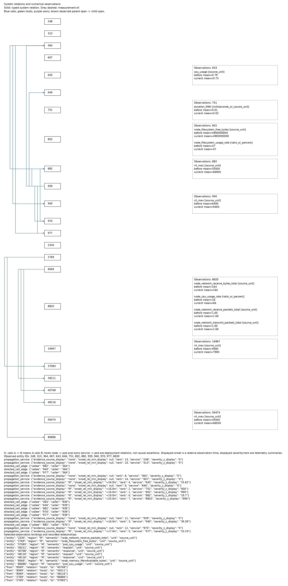
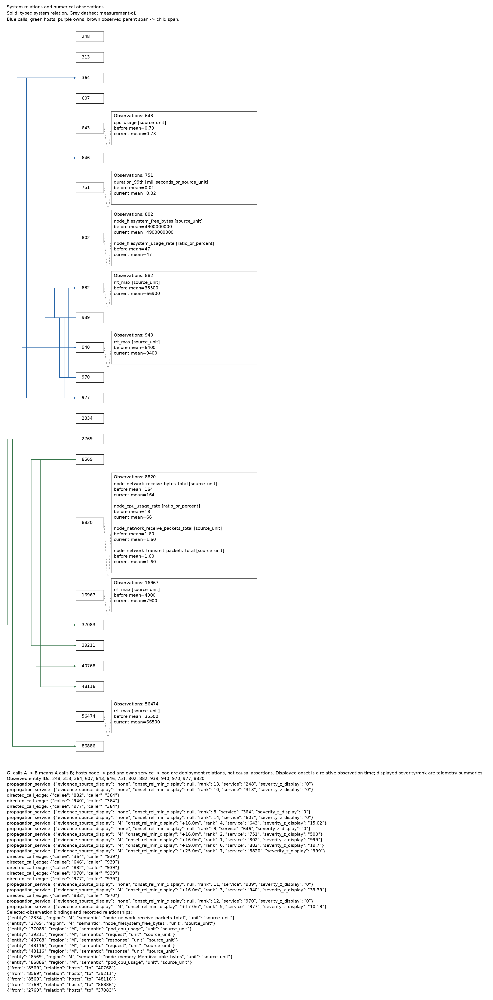
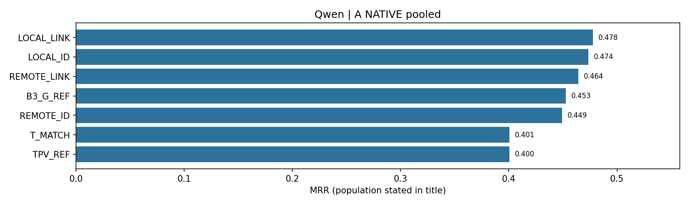
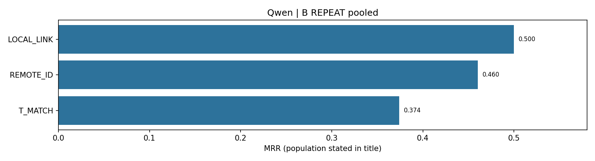
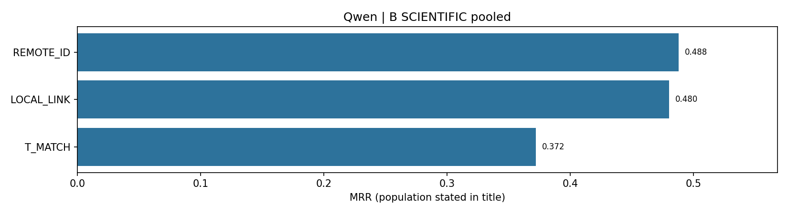
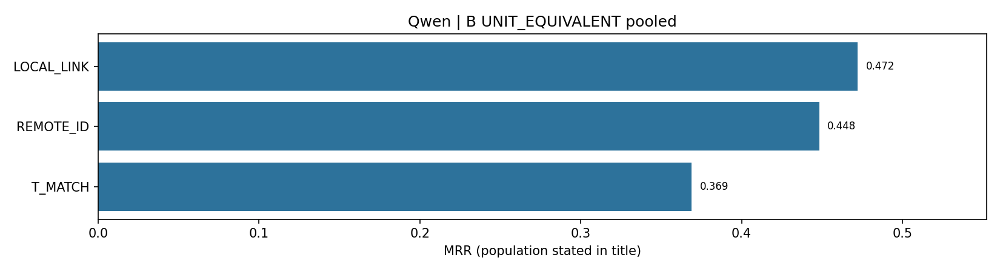

# RQ3.7 A/B：数值和关系的受控视觉融合

Qwen-only 修订版：2026-09-30。原文件日期标识所分析的历史批次，并非新增实验日期。

本报告仅讨论 Qwen3.8-27B；结论由其自身病例和结果决定，不要求跨模型成立，也不推广为所有模型的性质。原始输出、分数、输入与实验状态未改；本轮新增推理调用为 0。

统计按 Qwen-only 范围重新分析：保留原科学问题的全部正负比较、病例掩码及失败处理，重新计算 Holm；有逐病例记录或差值的主比较重新复算配对检验与 dz。原始 p 在样本未变时本来就不依赖其他模型。CSV 数值往返影响浮点并列时，保留原数值并列口径，另存重算敏感性。附表 `raw_statistic_source` 明确区分重新配对计算与沿用同一 Qwen 样本的原始统计。没有把事后分析改称预注册发现。

## 设计和已完成范围

这是数值证据与实体关系融合的 A/B 报告，不包含随后阶段 C 的结果。A 使用 180 个开发病例；五个新条件为 T_MATCH、REMOTE_ID、REMOTE_LINK、LOCAL_ID、LOCAL_LINK，另有 TPV_REF、B3_G_REF。所有新条件保留相同事实，区别在数值冗余承载、面板邻近与显式归属线。主方法事先固定为 LOCAL_LINK，不逐 case 选最佳答案。

Qwen 核心共同病例为 177；与 TPV/B3 对照分别有 175/176 个兼容病例。B 为 90-case 编码稳健性实验，共同有效 84；真正可单位换算仅 22，均来自 AegisLab。科学计数法、等价单位和独立 REPEAT 不能混为一种干预。

## Qwen 重新统计后的结论

LOCAL_LINK 在 A 核心 pooled MRR=0.4779，T_MATCH=0.4007，REMOTE_ID=0.4492；REMOTE_LINK=0.4642、LOCAL_ID=0.4736。它是有价值的正向候选。

Qwen 四项主比较内：相对 TPV_REF，ΔMRR=+0.0771、Holm p≈0.00854、dz≈0.2666，Top-1 修复/破坏 17/1；相对同内容 T_MATCH，ΔMRR=+0.0772、原始 p≈0.0346、Holm p≈0.1039。后者在病例级主 family 尚未成立，但不能概括为“视觉没有贡献”。

特别需要更新的正证据是事件组敏感性：LOCAL_LINK 相对 T_MATCH 的组均差约 +0.1035，145 个组，Qwen 四项组级 family Holm p≈0.0367；相对 TPV 也显著。故结论是“相对 TPV 的提升明确；相对强文本的正向效果得到事件组分析支持，但病例级多重校正尚不充分”。两种分析权重不同，不能择一隐去另一种。

相对旧 B3_G_REF +0.0279、相对 REMOTE_ID +0.0287 经校正后未达显著；邻近、连接和交互三项析因也未显著。完整方案获益不代表已证明归属虚线或邻近中的某一项是原因。

## 提升发生在哪里

相对 T_MATCH，有 35 个 Top-1 修复、16 个破坏；修复中 21 个根因原已在前五，14 个原在前五外；前五新增/丢失为 24/20。主要作用包含候选重排，而非单向扩充覆盖。

有直接 root 数值面板的 84 例 T→LOCAL_LINK 为约 0.6141→0.7113；没有的 93 例为 0.2079→0.2670。孤立根因 21 例也有提升，但 REMOTE_ID 同样较高，不能将其独占归因于 LOCAL。

层次仍有取舍：node 的 T_MATCH/LOCAL_LINK 约 0.3467/0.2933，pod 为 0.3651/0.5556，service 为 0.4519/0.5409。AIOPS-2022/2025 中没有合格连续条形图，只有标签读数；真正连续图形覆盖 AegisLab 44/60。不能把整体效果表述为“条形图解决所有数值阅读”。

## 数字和单位稳健性

科学计数法使 T_MATCH 在 84 例中首位翻转 12 次，原输入 REPEAT 仅 1 次；LOCAL_LINK 为 10 次对 0 次。配对翻转检验在 Qwen 范围内仍支持对等价写法的敏感性。它不是多轮成功概率，也不通过挑选重复回答救分。

在实际单位干预的 22 例，T_MATCH ΔMRR=0、REMOTE_ID≈−0.0530、LOCAL_LINK≈−0.1061。样本很小，不能宣称已确证单位退化；也没有依据说融合图消除了单位敏感性。保留全部 84 例的注册端点与 22 例适用子集，两者回答不同问题。

## 解释质量、成本与案例

LOCAL_LINK 平均输入约 23,048 tokens，T_MATCH 14,773，TPV 14,589，B3 19,985。它不是省输入方法。显式实体类型误称在 T_MATCH/LOCAL_LINK 为 22/32，不支持“更高 MRR 必然减少幻觉”。

`INC-B63AC53AB86F`：排序正确但可能虚构调用边。`INC-6E6E1B20F2D5`：CPU 从 18 到 66 的变化仍可能被其他资源解释压过。`INC-FDC8B6B87BEB`：图让正确 node 排名被 pod 症状取代。单位变换破坏案例 `INC-491E85FD6009` 也应保留。原输入/输出定位见案例附件。

### 原始 Qwen 输入示例

以下是当时实际提供给 Qwen 的图像，不是本轮重新渲染；完整输入、回答和 SHA-256 见 [case_artifact_index.csv](RQ3_7_Results_Analysis_2026-09-28_assets/case_artifact_index.csv)。单个截图用于解释失败机制，不能代替全体统计。

另一个对照示例：[REMOTE_ID](RQ3_7_Results_Analysis_2026-09-28_assets/INC-331437929E47_REMOTE_ID.png)、[LOCAL_LINK](RQ3_7_Results_Analysis_2026-09-28_assets/INC-331437929E47_LOCAL_LINK.png)。

## 阶段判断

现有 Qwen 数据足以把 LOCAL_LINK 列为需要扩大验证的方向，而不是宣称其已普遍超过同内容文本。A 中相对 TPV、强文本的 macro 增益与数据集/node 安全条件是后续扩量的依据；显著性、探索性扩量条件和方法普适性是三件事。本次仅改报告，不自动启动 C 或推理。

## 完整主结果表

### A NATIVE pooled

| arm | n | mrr | ac@1 | ac@3 | ac@5 | avg@3 | avg@5 | input_tokens | output_tokens |
|---|---|---|---|---|---|---|---|---|---|
| B3_G_REF | 176 | 0.4527 | 0.3977 | 0.5284 | 0.5284 | 0.4640 | 0.4898 | 19985.1023 | 148.7443 |
| LOCAL_ID | 177 | 0.4736 | 0.4068 | 0.5537 | 0.5537 | 0.4915 | 0.5164 | 23047.9266 | 151.9774 |
| LOCAL_LINK | 177 | 0.4779 | 0.4068 | 0.5593 | 0.5650 | 0.4953 | 0.5232 | 23047.9266 | 152.8814 |
| REMOTE_ID | 177 | 0.4492 | 0.3729 | 0.5424 | 0.5424 | 0.4689 | 0.4983 | 23047.9266 | 152.0621 |
| REMOTE_LINK | 177 | 0.4642 | 0.3898 | 0.5537 | 0.5537 | 0.4840 | 0.5119 | 23047.9266 | 152.9322 |
| TPV_REF | 175 | 0.4005 | 0.3143 | 0.4971 | 0.5143 | 0.4171 | 0.4560 | 14589.4686 | 164.2914 |
| T_MATCH | 177 | 0.4007 | 0.2994 | 0.5367 | 0.5424 | 0.4200 | 0.4689 | 14773.0000 | 157.8136 |

### B REPEAT pooled

| arm | n | mrr | ac@1 | ac@3 | ac@5 | avg@3 | avg@5 | input_tokens | output_tokens |
|---|---|---|---|---|---|---|---|---|---|
| LOCAL_LINK | 84 | 0.5000 | 0.4286 | 0.5833 | 0.5833 | 0.5198 | 0.5452 | 23173.3214 | 151.0714 |
| REMOTE_ID | 84 | 0.4603 | 0.3810 | 0.5595 | 0.5595 | 0.4802 | 0.5119 | 23173.3214 | 149.6071 |
| T_MATCH | 84 | 0.3740 | 0.2976 | 0.4762 | 0.4881 | 0.3849 | 0.4262 | 14810.8214 | 162.9643 |

### B SCIENTIFIC pooled

| arm | n | mrr | ac@1 | ac@3 | ac@5 | avg@3 | avg@5 | input_tokens | output_tokens |
|---|---|---|---|---|---|---|---|---|---|
| LOCAL_LINK | 84 | 0.4802 | 0.4048 | 0.5714 | 0.5714 | 0.5000 | 0.5286 | 23556.4762 | 152.0714 |
| REMOTE_ID | 84 | 0.4881 | 0.4167 | 0.5714 | 0.5714 | 0.5079 | 0.5333 | 23556.4762 | 148.5952 |
| T_MATCH | 84 | 0.3720 | 0.2857 | 0.4881 | 0.5000 | 0.3849 | 0.4310 | 15253.1905 | 157.8452 |

### B UNIT_EQUIVALENT pooled

| arm | n | mrr | ac@1 | ac@3 | ac@5 | avg@3 | avg@5 | input_tokens | output_tokens |
|---|---|---|---|---|---|---|---|---|---|
| LOCAL_LINK | 84 | 0.4722 | 0.3929 | 0.5714 | 0.5714 | 0.4921 | 0.5238 | 22982.2976 | 148.4524 |
| REMOTE_ID | 84 | 0.4484 | 0.3571 | 0.5595 | 0.5595 | 0.4722 | 0.5071 | 22982.2976 | 151.2857 |
| T_MATCH | 84 | 0.3690 | 0.2976 | 0.4762 | 0.4762 | 0.3810 | 0.4190 | 14628.9405 | 157.2262 |

## Qwen-only 配对统计

以下保留指定范围的全部比较，不只保留显著项；其他数据集、层级、故障和敏感性分析见附件。Pratt-Wilcoxon 双侧及 paired dz 沿用原方法；分类、相关性和组间检验不改称 Wilcoxon。不报告置信区间。

### registered_comparisons.csv

| family | effect | a | b | n | delta | p | dz | holm_p |
|---|---|---|---|---|---|---|---|---|
| primary_four | — | LOCAL_LINK | REMOTE_ID | 177 | 0.0287 | 0.1795 | 0.1563 | 0.2054 |
| group_sensitivity | — | LOCAL_LINK | REMOTE_ID | 145 | 0.0279 | 0.1830 | 0.1545 | 0.1903 |
| primary_four | — | LOCAL_LINK | T_MATCH | 177 | 0.0772 | 0.0346 | 0.1747 | 0.1039 |
| group_sensitivity | — | LOCAL_LINK | T_MATCH | 145 | 0.1035 | 0.0122 | 0.2392 | 0.0367 |
| primary_four | — | LOCAL_LINK | B3_G_REF | 176 | 0.0279 | 0.1027 | 0.1053 | 0.2054 |
| group_sensitivity | — | LOCAL_LINK | B3_G_REF | 144 | 0.0173 | 0.0952 | 0.0687 | 0.1903 |
| primary_four | — | LOCAL_LINK | TPV_REF | 175 | 0.0771 | 0.0021 | 0.2666 | 0.0085 |
| group_sensitivity | — | LOCAL_LINK | TPV_REF | 144 | 0.0720 | 0.0012 | 0.2613 | 0.0046 |
| factorial_three | proximity | — | — | 177 | 0.0191 | 0.2388 | 0.1243 | 0.3832 |
| factorial_three | link | — | — | 177 | 0.0097 | 0.1277 | 0.1219 | 0.3832 |
| factorial_three | interaction | — | — | 177 | -0.0108 | 0.1747 | -0.0621 | 0.3832 |

### registered_robustness_statistics.csv

| family | arm | encoding | n | delta | p | dz | holm_p |
|---|---|---|---|---|---|---|---|
| equivalence_six | T_MATCH | SCIENTIFIC | 84 | 0.0030 | 0.5993 | 0.0116 | 1.0000 |
| equivalence_six | T_MATCH | UNIT_EQUIVALENT | 84 | 0.0000 | 1.0000 | — | 1.0000 |
| repeat_variation_descriptive | T_MATCH | REPEAT | 84 | 0.0050 | 0.1573 | 0.1522 | 0.4719 |
| equivalence_six | REMOTE_ID | SCIENTIFIC | 84 | 0.0258 | 0.1780 | 0.1495 | 0.8900 |
| equivalence_six | REMOTE_ID | UNIT_EQUIVALENT | 84 | -0.0139 | 0.5544 | -0.0977 | 1.0000 |
| repeat_variation_descriptive | REMOTE_ID | REPEAT | 84 | -0.0020 | 0.9932 | -0.0217 | 1.0000 |
| equivalence_six | LOCAL_LINK | SCIENTIFIC | 84 | -0.0198 | 0.4634 | -0.1059 | 1.0000 |
| equivalence_six | LOCAL_LINK | UNIT_EQUIVALENT | 84 | -0.0278 | 0.0833 | -0.1874 | 0.4997 |
| repeat_variation_descriptive | LOCAL_LINK | REPEAT | 84 | 0.0000 | 1.0000 | — | 1.0000 |

### exploratory_flip_vs_repeat.csv

| arm | encoding | n | p | holm_p |
|---|---|---|---|---|
| T_MATCH | SCIENTIFIC | 84 | 0.0010 | 0.0059 |
| T_MATCH | UNIT_EQUIVALENT | 22 | 0.5000 | 1.0000 |
| REMOTE_ID | SCIENTIFIC | 84 | 0.0215 | 0.0859 |
| REMOTE_ID | UNIT_EQUIVALENT | 22 | 0.5000 | 1.0000 |
| LOCAL_LINK | SCIENTIFIC | 84 | 0.0020 | 0.0098 |
| LOCAL_LINK | UNIT_EQUIVALENT | 22 | 0.2500 | 0.7500 |

其中 `primary_four` 是四项病例级主比较；`group_sensitivity` 是对应四项事件组比较；`factorial_three` 是邻近、连接、交互三项。不能将组级显著性标成病例级显著性。

## 分层、案例和复现附件

所有保留的表均仅含 Qwen 结果或公共数据/CPU 基线。大型表用于完整审计，不能把其中最优分组当作预注册确认。

- [A_core_records](RQ3_7_Results_Analysis_2026-09-28_assets/A_core_records.csv)
- [aegis_bars_strata](RQ3_7_Results_Analysis_2026-09-28_assets/aegis_bars_strata.csv)
- [all_metrics](RQ3_7_Results_Analysis_2026-09-28_assets/all_metrics.csv)
- [all_seven_common_sensitivity](RQ3_7_Results_Analysis_2026-09-28_assets/all_seven_common_sensitivity.csv)
- [applicable_robustness](RQ3_7_Results_Analysis_2026-09-28_assets/applicable_robustness.csv)
- [case_artifact_index](RQ3_7_Results_Analysis_2026-09-28_assets/case_artifact_index.csv)
- [case_review_sampling](RQ3_7_Results_Analysis_2026-09-28_assets/case_review_sampling.csv)
- [explicit_entity_type_scan](RQ3_7_Results_Analysis_2026-09-28_assets/explicit_entity_type_scan.csv)
- [explicit_type_summary](RQ3_7_Results_Analysis_2026-09-28_assets/explicit_type_summary.csv)
- [exploratory_flip_vs_repeat](RQ3_7_Results_Analysis_2026-09-28_assets/exploratory_flip_vs_repeat.csv)
- [exploratory_strata](RQ3_7_Results_Analysis_2026-09-28_assets/exploratory_strata.csv)
- [failures](RQ3_7_Results_Analysis_2026-09-28_assets/failures.csv)
- [fault_performance](RQ3_7_Results_Analysis_2026-09-28_assets/fault_performance.csv)
- [feature_strata](RQ3_7_Results_Analysis_2026-09-28_assets/feature_strata.csv)
- [level_performance](RQ3_7_Results_Analysis_2026-09-28_assets/level_performance.csv)
- [output_quality](RQ3_7_Results_Analysis_2026-09-28_assets/output_quality.csv)
- [primary_rounded_tie_sensitivity](RQ3_7_Results_Analysis_2026-09-28_assets/primary_rounded_tie_sensitivity.csv)
- [public_features_private_annotation](RQ3_7_Results_Analysis_2026-09-28_assets/public_features_private_annotation.csv)
- [qwen_headline_metrics](RQ3_7_Results_Analysis_2026-09-28_assets/qwen_headline_metrics.csv)
- [rank_movement](RQ3_7_Results_Analysis_2026-09-28_assets/rank_movement.csv)
- [registered_comparisons](RQ3_7_Results_Analysis_2026-09-28_assets/registered_comparisons.csv)
- [registered_granularity](RQ3_7_Results_Analysis_2026-09-28_assets/registered_granularity.csv)
- [registered_robustness_statistics](RQ3_7_Results_Analysis_2026-09-28_assets/registered_robustness_statistics.csv)
- [registered_summary](RQ3_7_Results_Analysis_2026-09-28_assets/registered_summary.csv)

分析口径、备份与复算说明见 [重分析说明](_qwen_only_reanalysis/README.md)。历史原始结果保持在对应 `RQs/` 下，本次没有调整实验队列、模型或评分器。
