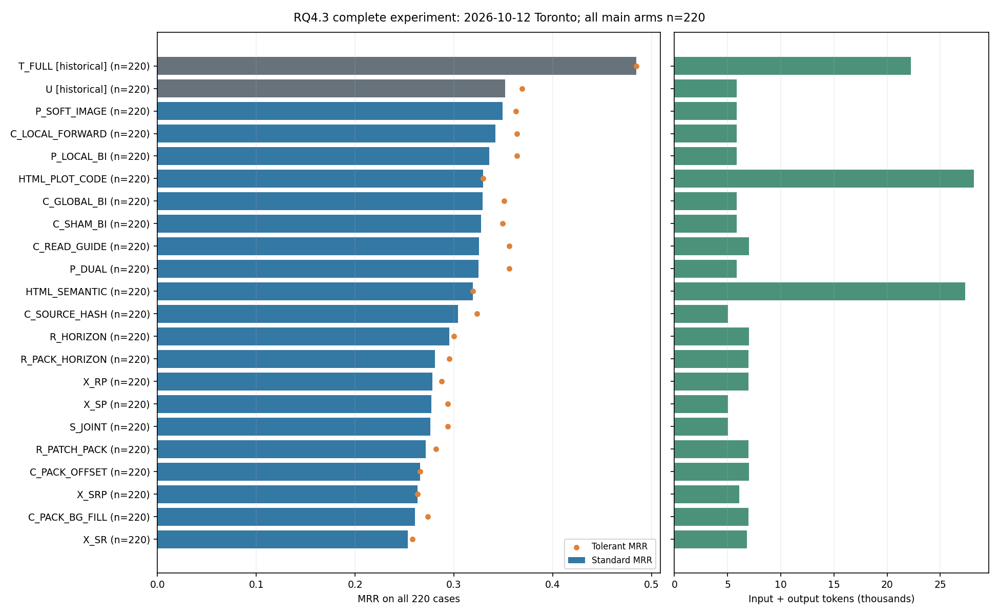
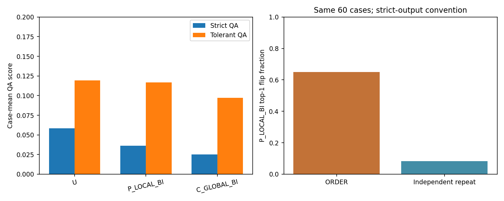
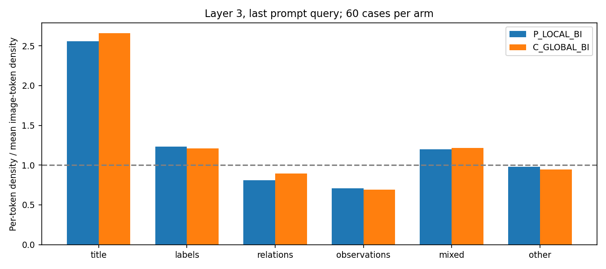

# RQ4.3：选择、绘图与视觉输入处理的结果及决策分析

**版本：2026-10-12 Toronto 完整实验数据版；替代此前11:48截点分析。**

本版纳入正式队列的全部 **4,832/4,832 个位置**。20个当前主矩阵臂均完成全部220例，历史U/T_FULL各220例继续复用。后续新增289个位置全部来自此前未完成的八个臂；原有提交哈希全部不变，QA、attention、重复及人工审核样本没有变化。

**最终运行状态：** 12:09前后程序自行完成 **4,637次真实完成调用＋195引用**，`phase_complete.json`确认writer已排空，服务执行正常收尾。本文全部当前性能、成本、分层、失败与配对统计均基于完整队列；旧截点只用于第5节说明更新幅度，不再作为当前分母。

## 1. 直接结论

**RQ4.3 暂未产生值得替换历史 A_UNIFORM_E50 的纯视觉方法，预选 X_SRP 没有达到性能目标。** 已完整运行的新纯视觉臂中，P_SOFT_IMAGE 点估计最高：标准 MRR **0.3491**、宽容 **0.3627**，与历史 U 的 **0.3517 / 0.3692** 接近；X_SRP 为 **0.2630 / 0.2630**。强文本历史 T_FULL 为 **0.4846**，历史混合 MARGINAL_FIVE 为 **0.5054**。后两者是合法对照，MARGINAL_FIVE 不是当前纯视觉方案。

这轮有三个可用于下一步决策的实质发现：

1. **省 token 已实现，排名缺口仍大。** P_SOFT_IMAGE 每例 input+output 约 5,852 token，比 T_FULL 少 **73.69%**，但标准 MRR 少 **0.1355**。X_SRP 比 U 更贵约 3.89%，MRR 反而低 0.0888。不能把省 token 当作完成项目目标，也不能把 token 降幅直接当作墙钟或 GPU 成本降幅。
2. **序列化顺序确实显著扰动诊断，普通重复不能解释其幅度。** P_LOCAL_BI 固定 60 例中，ORDER 首选翻转 39 例，独立重复仅 5 例；额外翻转 56.67 个百分点，固定机制族 Holm p=**1.747×10⁻⁷**。PNG、提示和保留 token 集合相同，改变的是视觉 token 的登记顺序。它没有带来可靠的平均排名提升。
3. **QA 失败包含严重接口损失，也包含真实的目标定位、单位和关系绑定错误。** 增加宽容评分后，U/P_LOCAL/C_GLOBAL 从 0.0583/0.0361/0.0250 提高到 **0.1194/0.1167/0.0972**。实际阅读 36 组 QA—RCA 回答发现：正确读数可以绑定到错误实体；QA 局部读错仍可能在 RCA 选对根因；同一 QA 答案可能对应不同排名与互相矛盾的理由。它比“两个分数不相关”提供了更具体的问题定位。

**完整结果确认：本轮所有新纯视觉臂的标准MRR均未超过历史U的0.3517，更未达到强文本0.4846。** 八个恢复臂最终标准MRR为0.2535–0.3252；补齐尾部没有改变“本轮没有推进到更强纯视觉方法”的工程判断。历史后端兼容性限制仍须保留，不把这一数值比较包装成同期受控推断。

## 2. 数据、版本与分析完整性

- 冻结队列全部完成：4,832个逻辑位置，包括4,400个主矩阵位置、180个QA、240个ORDER/REPEAT、12个计时位置；实际4,637次完成调用、195个精确引用。
- 已提交 **4,832/4,832（100%）**；其中RCA位置4,652，QA180。主矩阵 **4,400/4,400**，每臂220例，没有未提交位置。相对旧截点新增249次真实完成调用、40个引用，共289个位置。
- 220 病例为已暴露开发数据：AIOPS-2022/2025 各60，AegisLab 100；事件组分别33/60/100，共193。总体均值按病例加权，另列三个数据集宏平均及事件组等权结果。
- 最终账本另有22个历史基础设施失败、14个中断记录；无在途调用或未解决位置。失败尝试不当作新病例重复计分，已提交的模型无效回答仍为零分，不因恢复而重答。
- 本分析校验4,832个完成记录的哈希、请求生成身份，重新核对全部4,652份RCA及180份QA分数，并复算440份历史U/T回答；**评分不一致0，生成身份不一致0**。这不是重新渲染或推理。
- 150项病例/事件组 Pratt 计算由独立 Decimal 秩实现复核，最大 p 差1.67×10⁻¹⁶；全部Holm结果一致。本次新增模型调用 **0**。

证据：[完整终态清单](RQ4_3_Qwen_Analysis_2026-10-12_assets/snapshot.json)、[增量与未变化范围核验](RQ4_3_Qwen_Analysis_2026-10-12_assets/final_update.json)、[完整性核验](RQ4_3_Qwen_Analysis_2026-10-12_assets/integrity.json)、[统计独立复核](RQ4_3_Qwen_Analysis_2026-10-12_assets/statistics_verification.json)、[实际输入来源索引](RQ4_3_Qwen_Analysis_2026-10-12_assets/input_lineage.csv)。代码、实际回答及登记失败均保留；本报告没有修改正式运行器、队列、原始评分或模型输入。

运行期间经历 HF、并发 HF 和 vLLM 后端迁移。完整主矩阵包含 HF legacy 232、concurrency_v9/v11/v12 分别28/25/23、vLLM 4,092个位置；其中引用位置继承被引用回答的生成后端。资格文件的历史兼容状态为 **not_demonstrated**，所以对历史 U/T 的效应只作工程描述，不能包装成同期后端受控的因果结论。恢复臂多在较晚时段运行，运行顺序也是解释限制。

## 3. 本轮到底比较什么

| 方向 | 臂 | 实际变化与对照含义 |
|---|---|---|
| 历史参照 | U、T_FULL | 复用 RQ4.1 的 A_UNIFORM_E50 和完整强文本；不新增相同请求。 |
| 证据选择 S | S_JOINT、C_SOURCE_HASH | 在保护候选、资源和关系等必要内容后，按来源单元选择可选证据；JOINT与哈希控制使用同预算。它不是完整事实不变的表示实验。 |
| 输入处理 P | P_LOCAL_BI、P_SOFT_IMAGE、P_DUAL | LOCAL对语言前0–2层GatedDeltaNet做来源局部双向辅助，混合系数.25；SOFT在语言首个full-attention层3对图像query做软双向混合；DUAL叠加。不是简单改变视觉编码器层数或再换剪枝比例。 |
| P控制 | C_LOCAL_FORWARD、C_SHAM_BI、C_GLOBAL_BI | 区分反向补充、正确来源分组与全局分组；同一基础图形和保留预算。 |
| 绘图 R | R_PATCH_PACK、R_HORIZON、R_PACK_HORIZON | 注册的紧凑来源编译、horizon时序表示及组合；通过unified renderer新增组件，不修改历史组件。修订后同时涉及读图字典、几何及token支持分配，不能归因为“只换一种曲线”。 |
| R控制 | C_PACK_OFFSET、C_READ_GUIDE、C_PACK_BG_FILL | 分别测试同图偏移、原图加同读图说明、把新增观测token槽替换成真实背景token。背景特征不是零向量。 |
| 组合 | X_SP、X_SR、X_RP、X_SRP | 选择/绘图/处理的组合；X_SRP仍是预选方法。X_SRP使用修复后的v8编译，R-only为v14修订；接口差异不允许把全部组合当作干净三因子设计。 |
| 系统对照 | HTML_SEMANTIC、HTML_PLOT_CODE | 用户授权的单调用结构化文本对照；前者是紧凑语义HTML，后者增加绘图代码描述。均无图像，不是纯视觉候选，也不是直接输入几十万token网页源码。 |

S_DISTINGUISH/S_REPRESENT因近似重复取消；未恢复的R/X QA和额外重复不能写成“全部机制已测”。普通精确请求引用不产生新模型调用，已在表中计入其逻辑部署成本。近似请求没有因名字不同就冒充新证据。

设计来源：[冻结技术契约](../experiment_plans/RQ4_3_Blind_Review_2026-10-10/technical_contract_v5.md)、[v7资格](RQ4_3_CPU_Qualification_v7_2026-10-11.md)、[X_SRP修复资格](RQ4_3_X_SRP_CPU_Qualification_v8_2026-10-11.md)、[恢复臂及HTML扩展](RQ4_3_Direct_Retention_and_Extension_2026-10-11.md)。

## 4. 所有臂的绝对性能

标准评分沿用中央 `scorer`：输出必须满足五个不同、合法候选和完整schema要求，模型无效回答整单零分。**宽容RCA分数**按原五个位置保留合法候选；非法ID和重复ID占原位置但不得命中，不向前压缩、不补候选、不改实体映射。它是事后接口敏感性分析，不替换登记主指标。

以下每行均为完整220例，各臂病例集合相同，均值之差等于这220例的平均配对差。成本含结果引用的逻辑input+output，不是研究过程中新增支出的计数。

| Arm | 已提交 / 220 | 标准 MRR | 宽容 MRR | AC@1 | AC@3 | AC@5 | 平均 input+output |
| --- | --- | --- | --- | --- | --- | --- | --- |
| U | 220 | 0.3517 | 0.3692 | 0.2409 | 0.4455 | 0.5636 | 5850.7 |
| T_FULL | 220 | 0.4846 | 0.4846 | 0.3909 | 0.5682 | 0.6409 | 22243.9 |
| P_SOFT_IMAGE | 220 | 0.3491 | 0.3627 | 0.2318 | 0.4500 | 0.5636 | 5851.9 |
| C_LOCAL_FORWARD | 220 | 0.3420 | 0.3640 | 0.2318 | 0.4227 | 0.5545 | 5852.4 |
| P_LOCAL_BI | 220 | 0.3358 | 0.3638 | 0.2227 | 0.4227 | 0.5545 | 5858.4 |
| C_GLOBAL_BI | 220 | 0.3290 | 0.3510 | 0.2136 | 0.4273 | 0.5455 | 5856.2 |
| C_SHAM_BI | 220 | 0.3276 | 0.3495 | 0.2227 | 0.4091 | 0.5318 | 5854.8 |
| P_DUAL | 220 | 0.3250 | 0.3561 | 0.2136 | 0.4091 | 0.5364 | 5851.8 |
| S_JOINT | 220 | 0.2762 | 0.2936 | 0.1455 | 0.3682 | 0.5227 | 5026.6 |
| C_SOURCE_HASH | 220 | 0.3039 | 0.3233 | 0.1909 | 0.4045 | 0.5182 | 5043.5 |
| R_PATCH_PACK | 220 | 0.2715 | 0.2821 | 0.1591 | 0.3455 | 0.4727 | 6979.6 |
| R_HORIZON | 220 | 0.2956 | 0.3002 | 0.2000 | 0.3636 | 0.4773 | 6995.4 |
| R_PACK_HORIZON | 220 | 0.2811 | 0.2955 | 0.1773 | 0.3727 | 0.4636 | 6984.9 |
| C_PACK_OFFSET | 220 | 0.2659 | 0.2659 | 0.1591 | 0.3409 | 0.4727 | 7010.5 |
| C_READ_GUIDE | 220 | 0.3252 | 0.3563 | 0.2227 | 0.3955 | 0.5227 | 7018.6 |
| C_PACK_BG_FILL | 220 | 0.2608 | 0.2737 | 0.1409 | 0.3545 | 0.4682 | 6977.9 |
| X_SP | 220 | 0.2773 | 0.2940 | 0.1591 | 0.3591 | 0.5045 | 5022.7 |
| X_SR | 220 | 0.2535 | 0.2580 | 0.1500 | 0.3045 | 0.4455 | 6819.4 |
| X_RP | 220 | 0.2785 | 0.2876 | 0.1682 | 0.3545 | 0.4773 | 6979.3 |
| X_SRP | 220 | 0.2630 | 0.2630 | 0.1591 | 0.3273 | 0.4591 | 6078.1 |
| HTML_SEMANTIC | 220 | 0.3191 | 0.3191 | 0.2136 | 0.3909 | 0.5273 | 27318.0 |
| HTML_PLOT_CODE | 220 | 0.3294 | 0.3294 | 0.2182 | 0.4182 | 0.5364 | 28138.3 |

**每数据集及宏平均：** 每个单元为“标准MRR / 宽容MRR (实际n)”。AegisLab在总体中占100/220，宏平均则三个数据集等权。

| Arm | AIOPS-2022 标准/宽容 (n) | AIOPS-2025 标准/宽容 (n) | AegisLab 标准/宽容 (n) | 三数据集宏平均 标准/宽容 |
| --- | --- | --- | --- | --- |
| U | 0.3050 / 0.3383 (60) | 0.2811 / 0.2950 (60) | 0.4222 / 0.4322 (100) | 0.3361 / 0.3552 |
| T_FULL | 0.3650 / 0.3650 (60) | 0.4039 / 0.4039 (60) | 0.6048 / 0.6048 (100) | 0.4579 / 0.4579 |
| P_SOFT_IMAGE | 0.3050 / 0.3217 (60) | 0.2686 / 0.2853 (60) | 0.4238 / 0.4338 (100) | 0.3325 / 0.3469 |
| C_LOCAL_FORWARD | 0.2808 / 0.3308 (60) | 0.2667 / 0.2806 (60) | 0.4240 / 0.4340 (100) | 0.3238 / 0.3485 |
| P_LOCAL_BI | 0.2758 / 0.3425 (60) | 0.2617 / 0.2811 (60) | 0.4162 / 0.4262 (100) | 0.3179 / 0.3499 |
| C_GLOBAL_BI | 0.2858 / 0.3275 (60) | 0.2558 / 0.2781 (60) | 0.3988 / 0.4088 (100) | 0.3135 / 0.3381 |
| C_SHAM_BI | 0.2742 / 0.3075 (60) | 0.2317 / 0.2622 (60) | 0.4172 / 0.4272 (100) | 0.3077 / 0.3323 |
| P_DUAL | 0.2669 / 0.3392 (60) | 0.2539 / 0.2789 (60) | 0.4025 / 0.4125 (100) | 0.3078 / 0.3435 |
| S_JOINT | 0.2156 / 0.2572 (60) | 0.2300 / 0.2467 (60) | 0.3403 / 0.3437 (100) | 0.2620 / 0.2825 |
| C_SOURCE_HASH | 0.2478 / 0.2811 (60) | 0.2072 / 0.2114 (60) | 0.3957 / 0.4157 (100) | 0.2836 / 0.3027 |
| R_PATCH_PACK | 0.2344 / 0.2733 (60) | 0.1886 / 0.1886 (60) | 0.3435 / 0.3435 (100) | 0.2555 / 0.2685 |
| R_HORIZON | 0.1844 / 0.2011 (60) | 0.2169 / 0.2169 (60) | 0.4095 / 0.4095 (100) | 0.2703 / 0.2759 |
| R_PACK_HORIZON | 0.2436 / 0.2797 (60) | 0.2239 / 0.2406 (60) | 0.3378 / 0.3378 (100) | 0.2684 / 0.2860 |
| C_PACK_OFFSET | 0.2492 / 0.2492 (60) | 0.1764 / 0.1764 (60) | 0.3297 / 0.3297 (100) | 0.2517 / 0.2517 |
| C_READ_GUIDE | 0.2667 / 0.3333 (60) | 0.2264 / 0.2569 (60) | 0.4197 / 0.4297 (100) | 0.3042 / 0.3400 |
| C_PACK_BG_FILL | 0.2408 / 0.2714 (60) | 0.2011 / 0.2011 (60) | 0.3087 / 0.3187 (100) | 0.2502 / 0.2637 |
| X_SP | 0.2186 / 0.2519 (60) | 0.2364 / 0.2531 (60) | 0.3372 / 0.3438 (100) | 0.2641 / 0.2829 |
| X_SR | 0.2131 / 0.2297 (60) | 0.2150 / 0.2150 (60) | 0.3008 / 0.3008 (100) | 0.2430 / 0.2485 |
| X_RP | 0.2483 / 0.2817 (60) | 0.1850 / 0.1850 (60) | 0.3527 / 0.3527 (100) | 0.2620 / 0.2731 |
| X_SRP | 0.2042 / 0.2042 (60) | 0.2044 / 0.2044 (60) | 0.3333 / 0.3333 (100) | 0.2473 / 0.2473 |
| HTML_SEMANTIC | 0.2803 / 0.2803 (60) | 0.2694 / 0.2694 (60) | 0.3722 / 0.3722 (100) | 0.3073 / 0.3073 |
| HTML_PLOT_CODE | 0.2686 / 0.2686 (60) | 0.2819 / 0.2819 (60) | 0.3943 / 0.3943 (100) | 0.3150 / 0.3150 |

**补充绝对指标：** Precision@1与AC@1相同；Precision@K为前K个位置命中的比例，AVG@K为AC@1…AC@K的平均，不是Precision或Average Precision。多种可接受实体可能使Precision@K不等于AC@K/K。

| Arm | Precision@3 | Precision@5 | AVG@3 | AVG@5 | 事件组等权 MRR |
| --- | --- | --- | --- | --- | --- |
| U | 0.1606 | 0.1373 | 0.3394 | 0.4209 | 0.3580 |
| T_FULL | 0.2455 | 0.1764 | 0.4879 | 0.5391 | 0.5073 |
| P_SOFT_IMAGE | 0.1621 | 0.1391 | 0.3409 | 0.4218 | 0.3558 |
| C_LOCAL_FORWARD | 0.1530 | 0.1345 | 0.3273 | 0.4091 | 0.3526 |
| P_LOCAL_BI | 0.1561 | 0.1345 | 0.3212 | 0.4045 | 0.3452 |
| C_GLOBAL_BI | 0.1530 | 0.1336 | 0.3182 | 0.4009 | 0.3364 |
| C_SHAM_BI | 0.1515 | 0.1309 | 0.3121 | 0.3936 | 0.3373 |
| P_DUAL | 0.1485 | 0.1327 | 0.3121 | 0.3927 | 0.3323 |
| S_JOINT | 0.1439 | 0.1282 | 0.2636 | 0.3509 | 0.2891 |
| C_SOURCE_HASH | 0.1455 | 0.1155 | 0.2939 | 0.3736 | 0.3163 |
| R_PATCH_PACK | 0.1318 | 0.1173 | 0.2636 | 0.3364 | 0.2857 |
| R_HORIZON | 0.1379 | 0.1118 | 0.2848 | 0.3518 | 0.3138 |
| R_PACK_HORIZON | 0.1394 | 0.1100 | 0.2788 | 0.3436 | 0.2907 |
| C_PACK_OFFSET | 0.1303 | 0.1145 | 0.2530 | 0.3273 | 0.2756 |
| C_READ_GUIDE | 0.1439 | 0.1255 | 0.3106 | 0.3873 | 0.3370 |
| C_PACK_BG_FILL | 0.1288 | 0.1109 | 0.2591 | 0.3300 | 0.2689 |
| X_SP | 0.1439 | 0.1218 | 0.2621 | 0.3473 | 0.2904 |
| X_SR | 0.1121 | 0.1018 | 0.2409 | 0.3109 | 0.2591 |
| X_RP | 0.1348 | 0.1164 | 0.2712 | 0.3418 | 0.2915 |
| X_SRP | 0.1197 | 0.1082 | 0.2530 | 0.3191 | 0.2736 |
| HTML_SEMANTIC | 0.1439 | 0.1200 | 0.3045 | 0.3791 | 0.3191 |
| HTML_PLOT_CODE | 0.1561 | 0.1236 | 0.3212 | 0.3945 | 0.3321 |

逐数据集全部AC/Precision/AVG、事件组及失败字段见[完整主表](RQ4_3_Qwen_Analysis_2026-10-12_assets/main_summary.csv)，不是只保留ΔMRR。

## 5. 八个恢复臂补齐后的变化

本节仅用于比较旧报告与完整结果，旧均值不参与当前统计。新增289个位置的分布为：R_PATCH_PACK 37、R_HORIZON 42、R_PACK_HORIZON 30、C_PACK_OFFSET 34、C_READ_GUIDE 32、C_PACK_BG_FILL 34、X_SR 42、X_RP 38。

| Arm | 此前 n | 此前标准 MRR | 最终标准 MRR | 最终宽容 MRR | 标准均值变化 |
| --- | --- | --- | --- | --- | --- |
| R_PATCH_PACK | 183 | 0.2843 | 0.2715 | 0.2821 | -0.0128 |
| R_HORIZON | 178 | 0.3097 | 0.2956 | 0.3002 | -0.0141 |
| R_PACK_HORIZON | 190 | 0.2755 | 0.2811 | 0.2955 | +0.0055 |
| C_PACK_OFFSET | 186 | 0.2642 | 0.2659 | 0.2659 | +0.0018 |
| C_READ_GUIDE | 188 | 0.3319 | 0.3252 | 0.3563 | -0.0067 |
| C_PACK_BG_FILL | 186 | 0.2524 | 0.2608 | 0.2737 | +0.0084 |
| X_SR | 178 | 0.2606 | 0.2535 | 0.2580 | -0.0071 |
| X_RP | 182 | 0.2656 | 0.2785 | 0.2876 | +0.0129 |

八臂标准MRR均值变化在−0.0141至+0.0129之间，整体判断没有反转；PATCH相对背景控制的配对差由−0.00044变为+0.01068，说明局部方向仍应以完整数据为准。其他12个已完成主臂的指标不变。全部20个当前臂共同病例从57例恢复到完整220例，[共同病例表](RQ4_3_Qwen_Analysis_2026-10-12_assets/all_arm_common_cases.csv)现与全量主表一致。无未知位置，原缺失结果上下界已收敛到最终点值；取消且未运行的臂仍标为not_run，不伪造结果。

旧截点清单及八臂旧值保留在[原截点](RQ4_3_Qwen_Analysis_2026-10-12_assets/snapshot_previous_cutoff.json)、[原主表](RQ4_3_Qwen_Analysis_2026-10-12_assets/main_summary_previous_cutoff.csv)，当前正文与图表均已更新。前后均值变化包含补齐病例带来的样本组成变化，不是方法或模型被修改。

## 6. MRR—成本：哪些改动真的有价值

| Arm | 指令/文本输入 | 保留图像 token | 输出 | 合计 | 相对历史 U | 相对历史 T_FULL |
| --- | --- | --- | --- | --- | --- | --- |
| U | 421.0 | 5223.0 | 206.7 | 5850.7 | 1.000× | 0.263× |
| T_FULL | 22057.5 | 0.0 | 186.4 | 22243.9 | 3.802× | 1.000× |
| P_SOFT_IMAGE | 421.0 | 5223.0 | 207.9 | 5851.9 | 1.000× | 0.263× |
| C_LOCAL_FORWARD | 421.0 | 5223.0 | 208.4 | 5852.4 | 1.000× | 0.263× |
| P_LOCAL_BI | 421.0 | 5223.0 | 214.4 | 5858.4 | 1.001× | 0.263× |
| C_GLOBAL_BI | 421.0 | 5223.0 | 212.2 | 5856.2 | 1.001× | 0.263× |
| C_SHAM_BI | 421.0 | 5223.0 | 210.8 | 5854.8 | 1.001× | 0.263× |
| P_DUAL | 421.0 | 5223.0 | 207.9 | 5851.8 | 1.000× | 0.263× |
| S_JOINT | 421.0 | 4400.0 | 205.6 | 5026.6 | 0.859× | 0.226× |
| C_SOURCE_HASH | 421.0 | 4421.6 | 200.9 | 5043.5 | 0.862× | 0.227× |
| R_PATCH_PACK | 1568.0 | 5188.6 | 222.9 | 6979.6 | 1.193× | 0.314× |
| R_HORIZON | 1568.0 | 5207.6 | 219.8 | 6995.4 | 1.196× | 0.314× |
| R_PACK_HORIZON | 1568.0 | 5196.2 | 220.8 | 6984.9 | 1.194× | 0.314× |
| C_PACK_OFFSET | 1568.0 | 5205.2 | 237.3 | 7010.5 | 1.198× | 0.315× |
| C_READ_GUIDE | 1568.0 | 5223.0 | 227.6 | 7018.6 | 1.200× | 0.316× |
| C_PACK_BG_FILL | 1568.0 | 5188.6 | 221.3 | 6977.9 | 1.193× | 0.314× |
| X_SP | 421.0 | 4400.0 | 201.7 | 5022.7 | 0.858× | 0.226× |
| X_SR | 1568.0 | 5036.1 | 215.3 | 6819.4 | 1.166× | 0.307× |
| X_RP | 1568.0 | 5188.6 | 222.7 | 6979.3 | 1.193× | 0.314× |
| X_SRP | 831.1 | 5036.1 | 210.9 | 6078.1 | 1.039× | 0.273× |
| HTML_SEMANTIC | 27110.6 | 0.0 | 207.5 | 27318.0 | 4.669× | 1.228× |
| HTML_PLOT_CODE | 27925.6 | 0.0 | 212.7 | 28138.3 | 4.809× | 1.265× |

本表成本比基于完全相同的220例。以下补充关键方法的三个数据集成本；其余臂的逐数据集成本见完整主表：

| Arm | AIOPS-2022 总 token | AIOPS-2025 总 token | AegisLab 总 token |
| --- | --- | --- | --- |
| U | 5975.7 | 5431.3 | 6027.4 |
| T_FULL | 22673.7 | 19323.1 | 23738.5 |
| P_SOFT_IMAGE | 5974.5 | 5433.5 | 6029.4 |
| X_SRP | 6122.8 | 5781.8 | 6229.0 |
| HTML_SEMANTIC | 28576.5 | 23420.2 | 28901.6 |
| HTML_PLOT_CODE | 29406.7 | 24241.8 | 29715.2 |

P_SOFT_IMAGE相对T_FULL的总token分别下降约73.65%、71.88%、74.60%；相对U几乎不变。原生U/P分支指令约421token，恢复R控制约1,568token，增加约1,147token说明；因此R虽然重排图形，却没有整体降低输入。完整选择臂S_JOINT约5,027token，较U减少14.09%，同时MRR低0.0755；这是一条有明显性能代价的压缩点，不是更优部署方法。

HTML_SEMANTIC约27,318token、HTML_PLOT_CODE约28,138token，相对T_FULL增加22.81%和26.50%，MRR却分别低0.1655和0.1552。它们证明“将这个dashboard的事实重新序列化成HTML”没有自动恢复强文本表现；不能由此断言HTML普遍无效，也不能把完整强文本优势全归因于有没有图像。

### 时延必须按实际运行路径解释

| Arm | vLLM 结果 n | 请求模型段均值 s | 中位数 s | vision 段 s | 本轮编译记录 s |
| --- | --- | --- | --- | --- | --- |
| P_SOFT_IMAGE | 186 | 43.59 | 40.92 | 2.46 | 8.58 |
| P_LOCAL_BI | 190 | 44.53 | 41.90 | 2.46 | 8.57 |
| X_SRP | 214 | 37.83 | 34.90 | 1.69 | 2.51 |
| R_PATCH_PACK | 220 | 42.16 | 40.46 | 2.12 | 1.72 |
| HTML_SEMANTIC | 220 | 65.26 | 61.37 | 0.09 | 0.38 |
| HTML_PLOT_CODE | 220 | 65.47 | 61.50 | 0.09 | 0.38 |

以上是vLLM结果的模型请求段记录，含该次并发负载下的等待；不是独占GPU计算时间，也不能用其倒数直接估算全队列吞吐。连续冷路径与冻结输入缓存路径分别保存在[runtime_by_backend.csv](RQ4_3_Qwen_Analysis_2026-10-12_assets/runtime_by_backend.csv)。恢复臂的缓存路径排队可达数千秒，排除了离线渲染；不能将它称作完整冷启动。HTML的vision字段仍可能包含通用预处理开销，并不表示编码了图片。

后端切换、CPU提前准备、关机暂停和队列等待影响墙钟；本报告不把不同路径均值相加伪造冷时延，也不声称已证明同负载下1.05倍时延目标。实际研究支出只对`actual_calls=1`计费，部署成本则连引用条件也计完整逻辑输入输出。CPU编译、图像原始token、保留token、输出和计时逐调用保存在[calls.csv](RQ4_3_Qwen_Analysis_2026-10-12_assets/calls.csv)。

## 7. 配对统计及预选方法判定

采用双侧Pratt-zero Wilcoxon、差值保留12位、病例和事件组分别Holm校正、配对dz，不报告CI。AIOPS-2022存在重复事件组，因此事件组推断尤其重要。signed-rank检验不等价于任意分布下的“均值差为零”检验。

主要两项比较为X_SRP−U/T_FULL；由于历史后端兼容未建立，固定族保留位置但标为`identity_ineligible`、计算占位p=1，**不把这个1解释为实测证据支持无差异**。九项优化族同理。已取消臂也保留固定位置，避免事后缩小校正族。

X_SRP对U：ΔMRR **−0.08879**，dz−0.200，46病例改善、76破坏、98不变；AC@1修复18/破坏36，AC@5修复24/破坏47。对T_FULL：ΔMRR **−0.22167**，dz−0.507，28改善、94破坏、98不变；AC@1修复9/破坏60。无论是否作因果推断，登记工程目标都没有达到。不是因为某个小部件“不显著”才否定完整方法，而是完整方法本身点估计、覆盖和成本均不支持推进。

登记归因族共11个位置，当前可计算的比较如下：

| 比较 | 共同 n / 事件组 | ΔMRR | dz | RR 改善/破坏/不变 | 病例 pH | 事件组 pH |
| --- | --- | --- | --- | --- | --- | --- |
| S_JOINT − C_SOURCE_HASH | 220/193 | -0.02773 | -0.086 | 43/46/131 | 1.0000 | 1.0000 |
| R_PATCH_PACK − C_PACK_OFFSET | 220/193 | +0.00561 | 0.016 | 41/41/138 | 1.0000 | 1.0000 |
| R_PATCH_PACK − C_READ_GUIDE | 220/193 | -0.05371 | -0.153 | 35/59/126 | 0.1544 | 0.1815 |
| R_HORIZON − C_READ_GUIDE | 220/193 | -0.02962 | -0.079 | 35/47/138 | 1.0000 | 1.0000 |
| R_PACK_HORIZON − C_READ_GUIDE | 220/193 | -0.04417 | -0.114 | 43/55/122 | 1.0000 | 1.0000 |
| P_LOCAL_BI − C_LOCAL_FORWARD | 220/193 | -0.00629 | -0.057 | 13/13/194 | 1.0000 | 1.0000 |
| P_LOCAL_BI − C_SHAM_BI | 220/193 | +0.00818 | 0.061 | 13/8/199 | 1.0000 | 1.0000 |
| R_PATCH_PACK − C_PACK_BG_FILL | 220/193 | +0.01068 | 0.045 | 26/22/172 | 1.0000 | 1.0000 |
| P_LOCAL_BI − C_GLOBAL_BI | 220/193 | +0.00674 | 0.045 | 15/11/194 | 1.0000 | 1.0000 |

这些比较在完整220病例、193事件组上仍没有通过校正。R_PATCH−C_READ_GUIDE的未校正病例/组p=.01404/.01650，但固定11项归因族校正后为.1544/.1815，不能将其报告为校正后显著。此前已查看过部分结果，但没有据此改队列或追加比较；本版使用预定完整终点及原固定校正族，不作序贯检验主张。原始p、组效应、AC修复/破坏见[归因表](RQ4_3_Qwen_Analysis_2026-10-12_assets/attribution.csv)。四项交互仍因历史兼容及R版本不一致不可用于登记因果推断，样本补齐不修复这种设计限制。

六项事后系统比较单独成族：[比较表](RQ4_3_Qwen_Analysis_2026-10-12_assets/posthoc_system_comparisons.csv)。全部比较现为220共同病例、193组；HTML_CODE−SEMANTIC ΔMRR+0.01030、X_SRP−X_SP为−0.01439、R_HORIZON−R_PATCH为+0.02409，六项的病例/组pH均为1。即使HTML等比较的原始结果没变，同族其他比较补齐后其Holm值也会变化；本版同步重新计算整个固定族。均不支持把事后最高点追认为预选成功方法。

## 8. 按方向解释结果

**S：选择的收益不足以抵偿证据损失。** S_JOINT与哈希控制同为220例，MRR为.2762/.3039，差−.02773；Top1修复9例、破坏19例。不能证明哈希最优，但现有“有诊断含义的选择”没有胜过廉价同预算控制。下一步不应仅因选择准则听起来合理就复用它。

**P：最温和的处理最接近原基线，复杂叠加没有形成收益。** P_SOFT_IMAGE为.3491；P_LOCAL为.3358；DUAL为.3250。LOCAL相对forward控制反而−.00629，相对sham/global仅+.00818/+.00674。局部、双向、来源正确性目前都没有建立独立排名贡献。此处是语言层视觉前缀处理，不能与RQ4.2视觉编码器分区混称为同一干预。

**R：可读资格通过不等于模型更善于利用。** 完整220例上，三种R均低于C_READ_GUIDE；R_PATCH−C_READ_GUIDE为−.05371，R_HORIZON为−.02962，R_PACK_HORIZON为−.04417。PATCH对偏移控制仅+.00561，对背景填充控制+.01068，均未建立独立收益。这些结果更像是新版编译/密度/组织组合尚未解决证据权衡，而不是某一个像素对齐技巧已经奏效。没有R侧QA结果，不能进一步把失败定位成“读数没有改善”。

**X：组合没有保住已经有效的底座。** X_SRP标准与宽容MRR相同，只有2个无效回答，所以其主要损失不能归因于严格评分。它对X_SP增加约1,055token却少.01439MRR，AC@5修复26/破坏36。37个精确回退引用X_SP仍在分母；不能只看有变化的183例。X_SR/X_RP虽已补齐220例，但各自版本和说明不同，不能把跨版本差异直接分配给S/R/P部件。

**HTML：强文本优势不仅是“文字更容易OCR”。** 两个无图系统均无格式无效回答，但排名仍在.32附近，成本反而更高。完整强文本、紧凑HTML和图片的组织接口不同，当前证据提示需要研究事实组织和推断方式；它不允许绕过用户纯视觉主线，把HTML改称新视觉方法。

### 根因粒度的薄弱环节

| Arm | AIOPS-2022 node (19) | AIOPS-2022 pod (23) | AIOPS-2022 service (18) |
| --- | --- | --- | --- |
| T_FULL | 0.3860 | 0.2638 | 0.4722 |
| U | 0.1579 | 0.4123 | 0.3231 |
| P_SOFT_IMAGE | 0.1404 | 0.4268 | 0.3231 |
| P_LOCAL_BI | 0.1053 | 0.4159 | 0.2769 |
| X_SRP | 0.1842 | 0.1196 | 0.3333 |

上述为小分层的描述值，没有新的显著性主张。AIOPS-2022的node场景尤其困难；这与历史选择器容易损失资源/宿主信息的风险一致，但本轮不能仅凭分层分数确定原因。完整故障类型与粒度表：[fault_summary.csv](RQ4_3_Qwen_Analysis_2026-10-12_assets/fault_summary.csv)、[granularity_summary.csv](RQ4_3_Qwen_Analysis_2026-10-12_assets/granularity_summary.csv)。

## 9. 标准分与宽容分：接口损失有多大

| Arm | 模型无效数 | 含非法候选 | 含重复候选 | 精确结果引用数 | 宽容−标准 MRR |
| --- | --- | --- | --- | --- | --- |
| U | 14 | 6 | 8 | 0 | +0.0174 |
| T_FULL | 0 | 0 | 0 | 0 | +0.0000 |
| P_SOFT_IMAGE | 12 | 8 | 4 | 0 | +0.0136 |
| C_LOCAL_FORWARD | 16 | 10 | 6 | 0 | +0.0220 |
| P_LOCAL_BI | 15 | 9 | 6 | 0 | +0.0280 |
| C_GLOBAL_BI | 15 | 9 | 7 | 0 | +0.0220 |
| C_SHAM_BI | 16 | 7 | 9 | 0 | +0.0220 |
| P_DUAL | 19 | 12 | 7 | 0 | +0.0311 |
| S_JOINT | 14 | 11 | 3 | 0 | +0.0174 |
| C_SOURCE_HASH | 19 | 12 | 8 | 0 | +0.0193 |
| R_PATCH_PACK | 9 | 8 | 1 | 19 | +0.0106 |
| R_HORIZON | 6 | 2 | 4 | 37 | +0.0045 |
| R_PACK_HORIZON | 12 | 8 | 6 | 19 | +0.0144 |
| C_PACK_OFFSET | 1 | 1 | 0 | 20 | +0.0000 |
| C_READ_GUIDE | 15 | 10 | 6 | 40 | +0.0311 |
| C_PACK_BG_FILL | 12 | 9 | 4 | 23 | +0.0129 |
| X_SP | 12 | 6 | 6 | 0 | +0.0167 |
| X_SR | 2 | 2 | 1 | 0 | +0.0045 |
| X_RP | 10 | 8 | 2 | 0 | +0.0091 |
| X_SRP | 2 | 1 | 1 | 37 | +0.0000 |
| HTML_SEMANTIC | 0 | 0 | 0 | 0 | +0.0000 |
| HTML_PLOT_CODE | 0 | 0 | 0 | 0 | +0.0000 |

完整主矩阵4,400份回答中207份模型无效（4.70%）；133份涉及非法候选、81份涉及重复候选，两类有交集。模型仍生成完整理由和列表，宿主事后校验计零，不是出现坏ID就提前终止且没有回答。

P_LOCAL宽容分比标准高.0280、P_DUAL高.0311，说明接口损失实在存在；但宽容后仍远低于强文本。X_SRP没有被宽容重评救回，更能排除“只是评分器太严”的解释。宽容计分仍处罚错误实体/重复占位，不能当作允许虚构候选的正式协议。

所有失败的原回答位置、错误种类与非法/重复ID保存在[失败明细](RQ4_3_Qwen_Analysis_2026-10-12_assets/output_failures.csv)，没有为了提高分数删除任何失败。

## 10. QA：严格、宽容、可见性与回答内容一起看

### 10.1 评分口径与接口问题

180份QA来自固定60例×U/P_LOCAL/C_GLOBAL，每臂353道适用题；有7道不适用题，不补题、不换病例。QA是独立单调用，回答不喂给RCA。登记严格评分要求完整六键；145/180份未满足该接口，其中28份是空对象，8份完整JSON不可解析；另有多余键、标点键名、字符串化对象和自由文字藏在JSON键值中。

用户要求新增的**事后宽容QA**：按题独立评分；允许无歧义的键名大小写/标点差异、额外键和一层有效JSON字符串对象；忽略不要求的子字段；关系类型允许去掉尾部箭头记号。保留数值精度与原单位容差、实体真值、阶段及方向；不交换边、不猜实体、不补缺项、不根据真值选择冲突答案。无法提取的题仍计零，原严格分保留。规则、脚本及逐题真值均可复核：[规则](RQ4_3_Qwen_Analysis_2026-10-12_assets/qa_tolerance_protocol.json)、[实现](RQ4_3_Qwen_Analysis_2026-10-12_assets/qa_tolerant.py)、[逐题表](RQ4_3_Qwen_Analysis_2026-10-12_assets/qa_tolerant_questions.csv)。

| Arm | 病例 | 严格 QA | 宽容 QA | 可见题条件宽容 QA | 严格合法回答 | 可解析 JSON |
| --- | --- | --- | --- | --- | --- | --- |
| U | 60 | 0.0583 | 0.1194 | 0.1681 | 13 | 57 |
| P_LOCAL_BI | 60 | 0.0361 | 0.1167 | 0.1611 | 9 | 57 |
| C_GLOBAL_BI | 60 | 0.0250 | 0.0972 | 0.1264 | 13 | 58 |

“可见”沿用冻结几何/token支持定义，并不是模型已看懂。平均可见题比例74.22%；主QA分保留所有适用题，条件分只看支持可见题，不能用条件分替换分母。宽容后仍存在明显地板效应，低相关容易受测量误差压低。

| 题目 | 适用数/可见数（每臂） | U 正确题数 | P_LOCAL 正确题数 | C_GLOBAL 正确题数 |
| --- | --- | --- | --- | --- |
| q1 指定标量 | 60/36 | 9 | 6 | 5 |
| q2 实体＋单位 | 60/36 | 1 | 2 | 0 |
| q3 指定两点大小 | 59/59 | 21 | 22 | 20 |
| q4 指定计数/速率 | 58/37 | 9 | 10 | 9 |
| q5 实体＋单位＋阶段 | 58/37 | 2 | 2 | 1 |
| q6 关系两端＋类型＋方向 | 58/58 | 0 | 0 | 0 |

局部数字/大小比较能够恢复一部分正确答案；实体＋单位及关系端点/方向仍很差。**关系题三臂均0/58**，而并非所有回答都是空白：U/P/Global分别有35/34/39份可提取关系答案。可明确判断该“带目标标记的关系问答任务”失败；不能把它扩大为模型完全不具备任何关系理解能力。

### 10.2 分数关联：不把不显著写成独立性

用同病例的P/Global BASE、U本轮已有REPEAT对齐诊断，避免用历史U回答冒充同期内容。每项60例，以下Spearman相关仅描述，未经事后多重比较校正，不作确认性结论：

| Arm | 宽容 QA vs 标准 RR：ρ / p | 宽容 QA vs 宽容 RR：ρ / p |
| --- | --- | --- |
| U | +0.1475 / 0.2606 | +0.1272 / 0.3326 |
| P_LOCAL_BI | -0.0278 / 0.8331 | +0.0221 / 0.8669 |
| C_GLOBAL_BI | +0.0182 / 0.8902 | +0.0979 / 0.4566 |

P−U的宽容QA变化与RR变化ρ=.0099；P−Global为−.0676。P比Global宽容QA高.01944，但对应60例RR平均低.01167。低相关不证明读取和诊断独立，原因包括QA接口地板、目标题未必是根因相关证据、QA与RCA任务不同、token目标标记与输出指令不同。

**回答本身也有可量化的共同模式：** P与U共187个双方可提取的题对，规范化后101个答案完全相同，其中64个是双方相同的错误答案；P与Global共178题对，82个相同、54个同错。它说明许多局部误读跨处理方法持续存在；这些题对不作为独立病例扩大统计样本量。明细：[答案一致性](RQ4_3_Qwen_Analysis_2026-10-12_assets/qa_paired_answer_agreement.csv)、[QA—RCA对齐](RQ4_3_Qwen_Analysis_2026-10-12_assets/qa_rca_linked.csv)。

### 10.3 真正读取回答：36组逐份人工对照

每数据集固定哈希选4例，共12例×3臂。逐份阅读QA原文、每题答案与真值、RCA候选和完整理由；不是只搜索关键词。另实际打开三个数据集各一张对应QA dashboard，核对其中关键目标的公共来源。审核结论及全部样本见[人工对照记录](RQ4_3_Qwen_Analysis_2026-10-12_assets/qa_manual_review.md)、[36组完整回答](RQ4_3_Qwen_Analysis_2026-10-12_assets/qa_linked_manual_sample.json)。主要发现是：

- **格式损失会伪装成认知失败。** INC-89856C07F4EE的U/P在自由文字里明确读出正确Q1=54.25，但没有q1字段，自动宽容仍为0；Global结构化写出同值得1/6，三个RCA却都RR=.5。人工正确片段单独说明，没有主观填补全样本分数。
- **正确数字不保证归属正确。** INC-B84269FDA98E三臂都答对127、5和大小比较，却把Q1的570绑到65901，把Q4的count当ms；三者QA同为.5，真正根因570只在U排第4，P/Global漏出Top5。读取、绑定和候选覆盖是不同环节。
- **QA归属错也不妨碍独立RCA选中正确实体。** INC-65CE2F2F3440三臂把Q2从8158错绑到82742/ms，但RCA都把8158排第一。U标准RR1，P/Global因尾部87242非法而标准归零；宽容后全为1。这是输出接口混淆，不应错误解释成认知差异。
- **相同正确局部信息可对应相反诊断。** INC-F162EC56F576中U/P都答对count4283和比较，U首选564、P首选238；理由分别说564变慢、564接近参考。QA只问一部分事实，不能代表是否正确权衡真正影响排序的配对证据。
- **相同QA错误也可以伴随排名不同。** INC-34562D2C5CC4三份QA原文相同且全部错；真正命中实体437在U/Global第2、P第4。P理由还提到437有独立网络超时，却未把它排前。这直接指向证据使用／权衡问题。
- **丰富理由不等于正确比较。** INC-EDDC755A08F5的QA为`{}`，RCA却长篇解释，并把1.11e9→5.129e8说成增加；INC-96E8C237EFAF的Global把20735→1084.8称为sharp increase。这些是回答内部可验证的方向矛盾。

因此本轮可建立的是：**接口、目标定位、数值读取、实体/单位绑定、关系比较、因果推断、排序和最终合法性形成多个可分离的失败环节。** 当前没有证明某个QA误读因果导致某个RCA排名；QA答案未传入RCA，理由也是模型报告的解释，并不等于可观测内部推理轨迹。上述实际内容比单独“QA与MRR无关”的表述更准确。

## 11. 顺序扰动：当前最明确的机制信号

P_LOCAL固定60例BASE/ORDER/REPEAT的标准MRR为.2461/.2764/.2606。ORDER首选翻转39/60，独立重复5/60；完整排名变化59/60 vs11/60。额外首选翻转+56.67pp，病例/组Pratt p=1.456×10⁻⁸、固定12项机制族Holm p=1.747×10⁻⁷、dz=1.064。

这里严格输出失败统一视为无效首选，因此补充有效回答敏感性：ORDER双方合法51例中31次翻转，REPEAT双方合法53例中2次翻转；分母不同，不能直接作同样的配对检验。进一步限制为同后端的37例，ORDER翻转21、REPEAT3，事后p=2.209×10⁻⁵，方向保持。

所有60例已核验 **prompt、PNG哈希、保留token集合一致**。ORDER改变登记token序列顺序，不能说图片重新排版，也不能说完整模型输入计算不变。历史U的ORDER37/60、REPEAT3/60只作描述，因为BASE跨历史后端；主要可用信号来自本轮P_LOCAL。

ORDER的平均RR变化+.03028没有通过校正，所以结论是**顺序敏感性远大于重复噪声**，不是“换顺序能提分”，也不是“每个翻转都变坏”。它与RQ4.1、RQ3.21的扰动结果形成跨轮一致的警示，但干预对象不同，不能将数值直接合并。[重复/顺序表](RQ4_3_Qwen_Analysis_2026-10-12_assets/repeat_order.csv)、[输入一致性](RQ4_3_Qwen_Analysis_2026-10-12_assets/order_input_parity.csv)、[同后端敏感性](RQ4_3_Qwen_Analysis_2026-10-12_assets/same_backend_order_summary.json)。

## 12. Attention：记录了什么，能解释什么

全量540个要求记录的真实调用全部匹配到摘要，0漏采、0采集错误、0几何映射哈希不一致。覆盖固定60例的9个条件：U QA/ORDER/REPEAT，P_LOCAL BASE/QA/ORDER/REPEAT，C_GLOBAL BASE/QA；不是所有方法或全220例都有attention。该子集在旧截点已完整，新增289个位置不要求attention，因而本节复用经核验不变的原分析。

实际只记录语言层3的两次查询——**最后一个prompt query和第一个decode query**——对文本指令及图像分区的聚合。没有完整attention矩阵、全部层或后续生成全程；“完整分析”指分析全部实际采集内容，不声称未采集的注意力轨迹可以重建。图像分区按实际processor几何和保留/置换token重建；标题区域含dashboard标题和卡片标题，不能将它全部称为页眉。

| 60例BASE，最后prompt query | P_LOCAL_BI | C_GLOBAL_BI |
|---|---:|---:|
| 指令文本占总attention mass | 86.41% | 87.38% |
| 图像占总mass | 13.59% | 12.62% |
| 标题占图像mass | 17.39% | 18.04% |
| 标题每token密度 / 图像平均密度 | 2.56× | 2.66× |
| 观测图元占图像mass | 38.99% | 38.26% |
| 观测每token密度 / 图像平均密度 | .707× | .694× |

标题富集现象在本轮仍可观察，普通总mass比较会混入区域面积，所以同时报告每token归一化密度。它**不是有害attention sink的因果证据**：查询位置靠近任务指令，标题有语义定位用途，mass也不等于最终答案对信息的依赖。标题密度与RR的探索Spearman：P_LOCAL−.1983(p=.129)、Global−.1545(p=.239)，不能据此推出删除标题会提分。

540份摘要共430,472字节，每份762–805字节，折算每万次**实际记录**约7.97MB；这是摘要本体。包含登记附属、索引和临时开销的保守上界为 **730,464,256字节/万次**，低于1decimalGB。本版不据此宣布整个实验25GB/万次的最终保留门槛已通过；writer已经排空，但全实验占用仍须独立核验。

完整数据：[区域逐调用表](RQ4_3_Qwen_Analysis_2026-10-12_assets/attention_regions.csv)、[汇总](RQ4_3_Qwen_Analysis_2026-10-12_assets/attention_summary.csv)、[记录及映射核验](RQ4_3_Qwen_Analysis_2026-10-12_assets/attention_integrity.json)、[实际记录索引](RQ4_3_Qwen_Analysis_2026-10-12_assets/attention_records.csv)。两个query、QA/ORDER/REPEAT均在附件中保留，没有只取支持标题现象的一组记录。

## 13. 历史参照与这轮应保留的进展

| 历史方法 | 总体标准MRR | 性质及当前用途 |
|---|---:|---|
| RQ3.16 MARGINAL_FIVE | .5054 | 强文本＋原生边际图的混合方法；保留为历史高位参照，不是纯视觉。 |
| RQ4.1 T_FULL | .4846 | 220例强文本；本轮复核原回答与评分，没有重跑。 |
| RQ4.1 A_UNIFORM_E50 | .3517 | 当前历史纯视觉最高参照，成本约5,851token。 |
| RQ4.2 NATIVE4 | .3235 | 四图系统；并未达到文本目标。 |
| RQ4.2 SEM | .3084 | 视觉编码器来源分区预选候选，已经结束。 |
| RQ4.3 P_SOFT_IMAGE | .3491 | 本轮已完成的新纯视觉最高点，未超过历史U。 |
| RQ4.3 X_SRP | .2630 | 本轮预选完整候选，未达到推进条件。 |

来源：[RQ3.16](RQ3_16_Qwen_Analysis_2026-10-03.md)、[RQ4.1](RQ4_1_Qwen_Analysis_2026-10-09.md)、[RQ4.2](RQ4_2_Qwen_Analysis_2026-10-10.md)。

不能忽略工程成果：已支持真实来源选择、unified新图形、语言前缀干预、vLLM批处理、轻量attention及可中断恢复，接口失效也有可复核的宽容重评分。**但这些工程能力尚未转化成更高纯视觉MRR。** 历史约.50混合分数不能接到本轮纯视觉曲线上，宣称同一pipeline已持续提升。

## 14. 当前决策与下一步讨论边界

1. **预选X_SRP不进入采用阶段。** 完整220例已足够作这个工程决策，拒绝理由是整套结果失败，不要求所有部件先分别显著。
2. **保留U作为纯视觉性能/成本底座。** P_SOFT_IMAGE可以作为接近底座的观察点，但当前没有资格替换U，更不能因本轮新臂中最高就追认成功。
3. **不继续自动扩张S/R/P的微小变体。** 选择未胜哈希、复杂P未胜简单、R未胜同说明控制，当前支持的是重新定位问题，不是再加一轮比例/布局搜索。
4. **QA后续先解决测量有效性，再研究诊断关联。** 现有结果同时受输出协议、目标定位和低正确率限制；需要把“数字读对却归属错”“理由正确但排序错”“尾项非法整单零分”分别观察。任何新测量都应独立登记，不修改本轮答案或自动启动新调用。
5. **优先讨论两个可检验方向：** 如何在不增加诊断文本的前提下稳定实体—单位—字段绑定；如何减少token序列顺序对排名的偶然影响。它们来自已见具体错误，但尚不是已验证的新方法。本报告不预先承诺其能提分，也没有部署下一轮。

正式队列已全部完成并排空。本版按用户要求补入八臂全部尾部结果，重新计算涉及它们的统计与完整校正族；QA、顺序、attention及人工回答审核范围不变。没有重答任何请求，没有修改队列、模型或原评分，下一轮讨论应以本版完整结果为准。

## 15. 可复算与审计材料

- 主分析：[analyze.py](RQ4_3_Qwen_Analysis_2026-10-12_assets/analyze.py)；独立统计、attention与重复审核：[supplement.py](RQ4_3_Qwen_Analysis_2026-10-12_assets/supplement.py)。
- QA宽容与回答对齐：[qa_tolerant.py](RQ4_3_Qwen_Analysis_2026-10-12_assets/qa_tolerant.py)；1,059题独立核验：[qa_independent_verification.json](RQ4_3_Qwen_Analysis_2026-10-12_assets/qa_independent_verification.json)；人工审查：[qa_manual_review.md](RQ4_3_Qwen_Analysis_2026-10-12_assets/qa_manual_review.md)。
- 全部逐调用分数/成本：[calls.csv](RQ4_3_Qwen_Analysis_2026-10-12_assets/calls.csv)；逐数据集完整主表：[main_summary.csv](RQ4_3_Qwen_Analysis_2026-10-12_assets/main_summary.csv)。
- 主要族：[primary.csv](RQ4_3_Qwen_Analysis_2026-10-12_assets/primary.csv)；优化族：[optimization.csv](RQ4_3_Qwen_Analysis_2026-10-12_assets/optimization.csv)；归因族：[attribution.csv](RQ4_3_Qwen_Analysis_2026-10-12_assets/attribution.csv)；机制族：[mechanism.csv](RQ4_3_Qwen_Analysis_2026-10-12_assets/mechanism.csv)；交互状态：[interactions.csv](RQ4_3_Qwen_Analysis_2026-10-12_assets/interactions.csv)。
- QA严格：[qa_summary.csv](RQ4_3_Qwen_Analysis_2026-10-12_assets/qa_summary.csv)；QA宽容：[qa_tolerant_summary.csv](RQ4_3_Qwen_Analysis_2026-10-12_assets/qa_tolerant_summary.csv)；相关性：[qa_rca_correlations.csv](RQ4_3_Qwen_Analysis_2026-10-12_assets/qa_rca_correlations.csv)。
- 原输入/回答与评分证据由[snapshot.json](RQ4_3_Qwen_Analysis_2026-10-12_assets/snapshot.json)、[input_lineage.csv](RQ4_3_Qwen_Analysis_2026-10-12_assets/input_lineage.csv)、[case_audit_index.json](RQ4_3_Qwen_Analysis_2026-10-12_assets/case_audit_index.json)定位；对话保留原无效内容，不重写为宽容提取后的JSON。

所有新增文件是直接可读Markdown/JSON/CSV/Python及报告PNG；没有压缩归档，没有新增模型调用。本版为完整实验数据分析，模型队列完成状态已核验；最终空间保留门槛仍需独立收官核验，不由统计报告代替。
