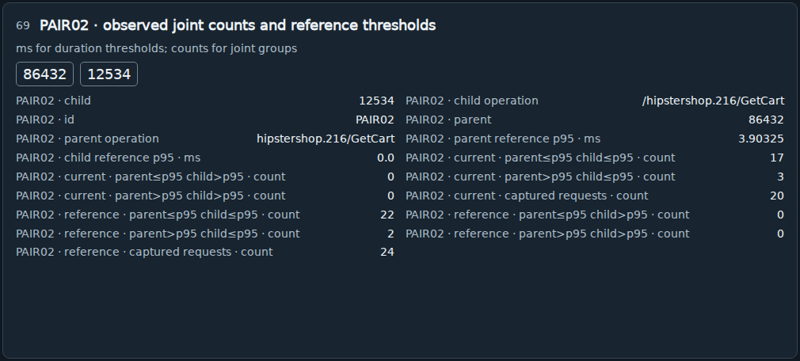
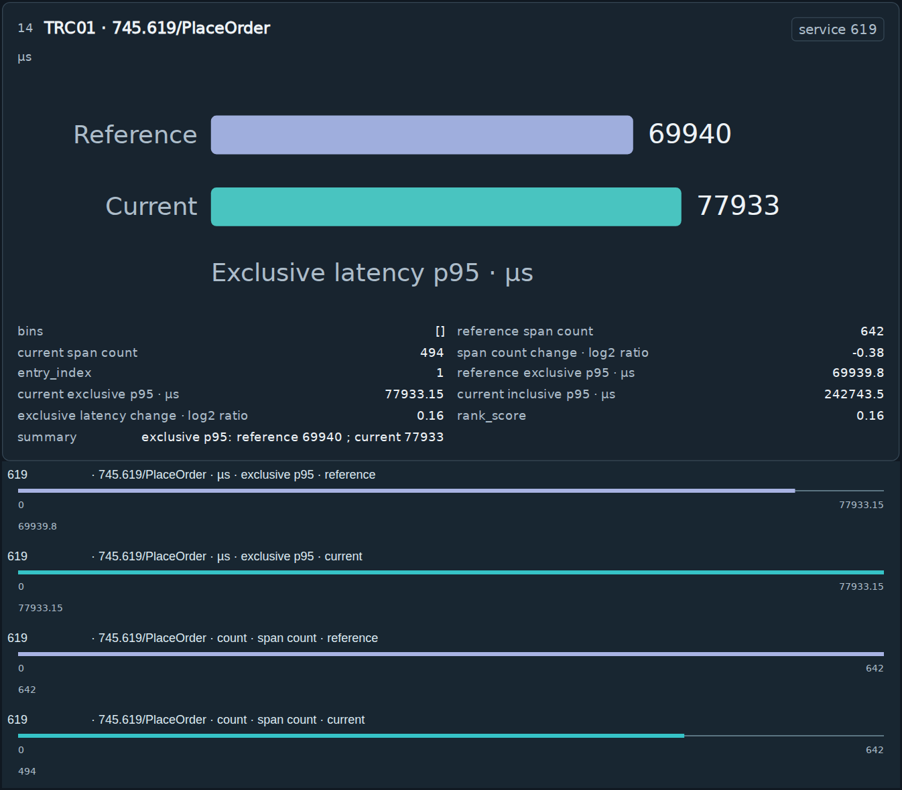
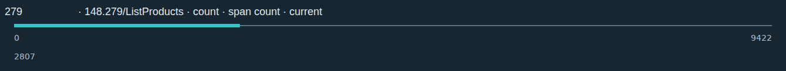

# RQ4.7 QA 题目可回答性审计

日期：2026-10-20。范围：仍保留的 S_COMPARE 独立 QA，60 个病例、360 题。

## 1. 结论与纠正

**至少 19/360 题（5.28%，涉及 17 个病例）是无效题。** 它们询问父子调用的联合计数或请求数量，却被套入要求单个 `entity` 的模板，标准答案为 `""`。图中没有“这个问题的实体答案应为空字符串”的约定。虽然标量数值可见，完整五字段答案没有得到合理定义；这些零分不能作为模型能力错误。

这属于出题和资格审核失误。来源记录可被程序定位，不代表问题能被模型按要求唯一回答。原先审核没有拦住空实体，也没有证明所有五字段都能从可见输入及明确的解码约定中获得。

**其余 341 题也不能直接宣布有效。** 本次进一步发现未定义的阶段用语、未登记的等价写法，以及指向整行而非单个测量值的目标。这些问题使原来的完整 QA 零分不适合作为视觉理解能力或 QA—RCA 脱节的机制证据。

本审计保留原始题目、回答、标准答案和原分数；另存有效性标记，没有事后修改标准答案或给模型重新作答。独立 QA 的输出没有进入 RCA，因此本次发现不改变三种 S 方法的根因排名、成本或其比较。

## 2. 方法、范围与查看上限

对全部 360 题读取原请求、源卡片、DOM 字段绑定、实际图像几何、processor 网格和保留 token 索引，复核目标、可见文本与标准答案。仅做离线文件审计，没有运行 renderer、processor、模型服务或新增模型调用。

实际查看 **13 张图**：一张完整原工作区、十张来源卡片的原像素裁剪、两张原目标矩形裁剪。裁剪也分别计入查看次数，低于用户要求的总计 20 张；没有继续打开其他图。抽样有意覆盖三个数据集、空实体、长名称、阶段、单位、等价写法及整行目标，因此不能据此估计全部题目的光栅可读率。

裁剪只是原始模型输入的审计摘图，没有重绘或新增标注，也未作为新模型输入。原图哈希、裁剪范围、查看记录见[抽样索引](artifacts/RQ4_7_2026-10-20/qa_answerability_audit/visual_sample_index.json)。

## 3. 全量核查结果

| 检查 | 结果 | 能支持的判断 |
| --- | ---: | --- |
| 目标位于实际画布内 | 360/360 | 没有发现目标框跑到图外。 |
| 目标位于登记面板内、与登记 DOM 框一致 | 360/360 | 没有发现这里的坐标计算错位。 |
| 标准标量数值可在来源卡片的可见文本记录中找到 | 360/360 | 未发现答案数值只存在于隐藏后端的情形；不等于全部光栅都清晰。 |
| 非空标准实体在来源卡片文本中出现 | 341/341 | 这些实体不是仅由隐藏标签生成；不证明问题只接受 ID 的约定合理。 |
| 标准实体为空 | **19/360** | 已确认无效题，联合计数被错误强行单实体化。 |
| 要求 `whole_window` / `observed_window` | **90/360** | 这些标准阶段字符串未在对应卡片出现，也没有 QA 解码定义。 |
| 要求两类未登记等价单位写法 | **41/360** | 19 题 `ratio_or_percent`、22 题 `milliseconds_or_source_unit`；宽容评分不接受其自然空格写法。 |
| 目标框是完整新增比较行 | **61/360** | 一框内可能同时有观测、轴刻度及 ID；题目没有文字指定要读哪一种数字。 |
| 目标没有任何保留 merged token 与之相交 | 0/360 | 未发现目标矩形完全没有 token 支持；相交不等于语义信息充分。 |
| 目标矩形面积的保留覆盖比例低于 50% | 51/360 | 几何覆盖不足的风险，不能直接换算成丢失了多少信息。 |

风险项存在重叠，**不能相加为无效题总数**。上述四类题目风险的并集为 195 题，但只有空实体的 19 题被本次明确标为无效；“其余未认证有效”也不等于判为错误或无解。

空实体题按数据集为：AIOPS-2022 5 题、AIOPS-2025 7 题、AegisLab 7 题。阶段问题包括 `whole_window` 83 题和 `observed_window` 7 题。另有 37 题标准 `reference` 未逐字印在卡片上；部分可由 `before` 等标识解释，本次不一并判为无效。

记录几何估算的卡片最小字号经 processor 后，概览目标所在卡片约为 8.96–12.50px，局部卡片约 18.01px，新增比较行 18px。这是卡片级保守下界，不是逐个目标的 OCR 测量，也不能当作所有字段确切字号。

## 4. 明确的无效题：有数值，但完整正解未定义

以下题号沿原记录采用零起始编号，避免与 JSON 数组位置混淆。

| 病例 / 题号 | 实际来源 | 原标准答案的问题 |
| --- | --- | --- |
| INC-B646C4677B96 / q4 | PAIR02 的 reference、parent>p95 且 child>p95 的联合请求数为 0；卡片标明父 86432、子 12534。 | `entity=""` 无法表达参与关系的两个实体。 |
| INC-96E8C237EFAF / q5 | PAIR01 父 888、子 173；reference 的指定联合分组计数为 40。 | 同样没有单个实体正解，不能要求模型猜出空字符串。 |
| INC-776EE000D01C / q5 | PAIR01 父 902、子 690；reference captured requests 为 506。 | 请求配对的数量不是一个单实体属性。 |



这里“无解”指**按当前完整答案模板没有合理定义的正解**，不是说数值 0、40 或 506 没有画出来。把标准实体改成 null 也不能自动修复：未来需要按关系题定义父子端点或明确不评分此字段，并在出题前完成协议资格。

## 5. 多种合理表达与未充分指明的目标

### 5.1 实体与操作描述被当作不同答案

INC-C10F5EA649A5 的 q2 标准为 service 619、current exclusive p95=77933.15µs。模型回答：

```json
{"value":"77933","entity":"745.619/PlaceOrder","unit":"µs","statistic":"exclusive p95","phase":"current"}
```

数值在 1% 内、单位、统计和阶段正确；实体栏用了图上操作名。原图同时印有 service 619 和该操作名，当前提示却没有要求实体字段只填数字 ID。现行规则因 `745.619/PlaceOrder != 619` 将完整题计零。这是需要源映射审核的合理表达差异，不能直接等同于回答了另一实体；也不能用“字符串含有 619”来自动放宽所有题。



INC-98BF3F9714D0 的相关回答把统计写为 `reference exclusive p95` 或 `current exclusive p95`，阶段也另行答对。原标准只接受 `exclusive p95`，没有消除这种冗余但语义相容的前缀。宽容评分没有完整语义别名，不能把这些差异全部解释为统计口径读错。

### 5.2 阶段和单位要求依赖未说明的后台命名

例如 INC-85C93CE3CB89 的指标卡能看到 baseline=14.22，但标准阶段为 `whole_window`；卡片及 QA 提示没有定义这一命名，baseline 也可能被读者理解为参考阶段。INC-39682657768A 的日志模板次数为 14，标准阶段却要求 `observed_window`；同卡也有 reference/current 统计。隐藏来源元数据不能替代向读者说明统计覆盖窗口。

INC-B646C4677B96 的 q0 卡片打印单位 `milliseconds or source unit`，标准为 `milliseconds_or_source_unit`。评分只对 `source unit` 等少数写法做别名处理，没有接受前述自然语言写法。因此完整照抄可见单位也可能计错。这是协议问题，不是已证明该模型此题实际正确；它在该题的实际数值回答也错误。

### 5.3 坐标框内出现多个数字

INC-1E7AE92CAA11 的 current span count 目标框内同时有实体 279、操作编号、坐标最大值 9422 和观测读数 2807。原题只给图号和矩形，不写“请读该行 current span count 的观测值”。图形仍有可解释的轴与读数，不能因此宣布 9422 与 2807 都是同一个测量的正确值；但“这个框中的数值”并非充分明确的语义问题。



当前提示还未定义图号是否从 0 开始、框坐标是否为 0..1000、框的四项是否依次为左上右下。模型回答中出现定位混淆，不能在没有明确目标契约的情况下全部归因于感知失败。

## 6. 对原结果的影响

1. **原始完整 QA=0/360 是既有协议下的记录，不是通过资格审核的能力指标。** 即使只排除 19 题，其余题的上述问题仍未修复，不能把 0/341 重新包装成合格结果。
2. 完整 QA 恒零时，相关系数不定义。不能声称“完整 QA 与 RCA 零相关”，更不能据此宣布两种能力独立。
3. 原数字子项只有 5/360 在 1% 内命中指定目标。这个低命中现象仍存在，但含目标定位协议等混杂，不能只用实体/单位别名解释，也不能作为单纯数值读取能力的测量。
4. 本次没有对剩余题建立全面、多答案的语义评分器。实例已证明表达失配，不能据此估算所有合理答案被错判的比例。
5. **RCA 的实际排名和成本不变。** QA 是独立调用，没有将其回答或标准答案交给诊断模型；本次修正针对 QA 有效性及相关机制结论。

## 7. 后续资格要求，尚未执行

若以后重做 QA，应先区分单实体、父子关系和全局统计题；每个被评分字段必须有非空且可解释的答案，或预先明确为不适用。来源内部字段不自动成为读者能理解的标准答案。

每题需要可定位的目标、明确的测量对象及可见依据，坐标和索引约定须写清。对单位、统计和阶段登记语义等价表达；实体别名必须通过唯一来源映射认证，不按任意包含 ID 的字符串修复。用少量、独立的人工解题审核检验可回答性和多解，再决定是否运行大批 QA。

以上是有效性修复建议，不是本次新模型调用或重跑实验的授权。本次没有修改运行代码、评分器、原记录或 `Codex.md`。

## 8. 可核查附件

- [全量问题、可见文本、坐标与回答](artifacts/RQ4_7_2026-10-20/qa_answerability_audit/questions.json)
- [逐题有效性标记，独立于原分数](artifacts/RQ4_7_2026-10-20/qa_answerability_audit/validity_annotations.json)
- [量化摘要](artifacts/RQ4_7_2026-10-20/qa_answerability_audit/summary.json)
- [13 次查看的原图与裁剪来源](artifacts/RQ4_7_2026-10-20/qa_answerability_audit/visual_sample_index.json)
- [原题与评分代码的未变哈希](artifacts/RQ4_7_2026-10-20/qa_answerability_audit/unchanged_protocol_and_scores.json)
- [离线审计脚本](artifacts/RQ4_7_2026-10-20/qa_answerability_audit/audit.py)
- [修订后的实验报告](RQ4_7_Qwen_Analysis_2026-10-20.md)
