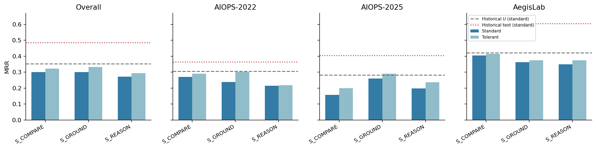
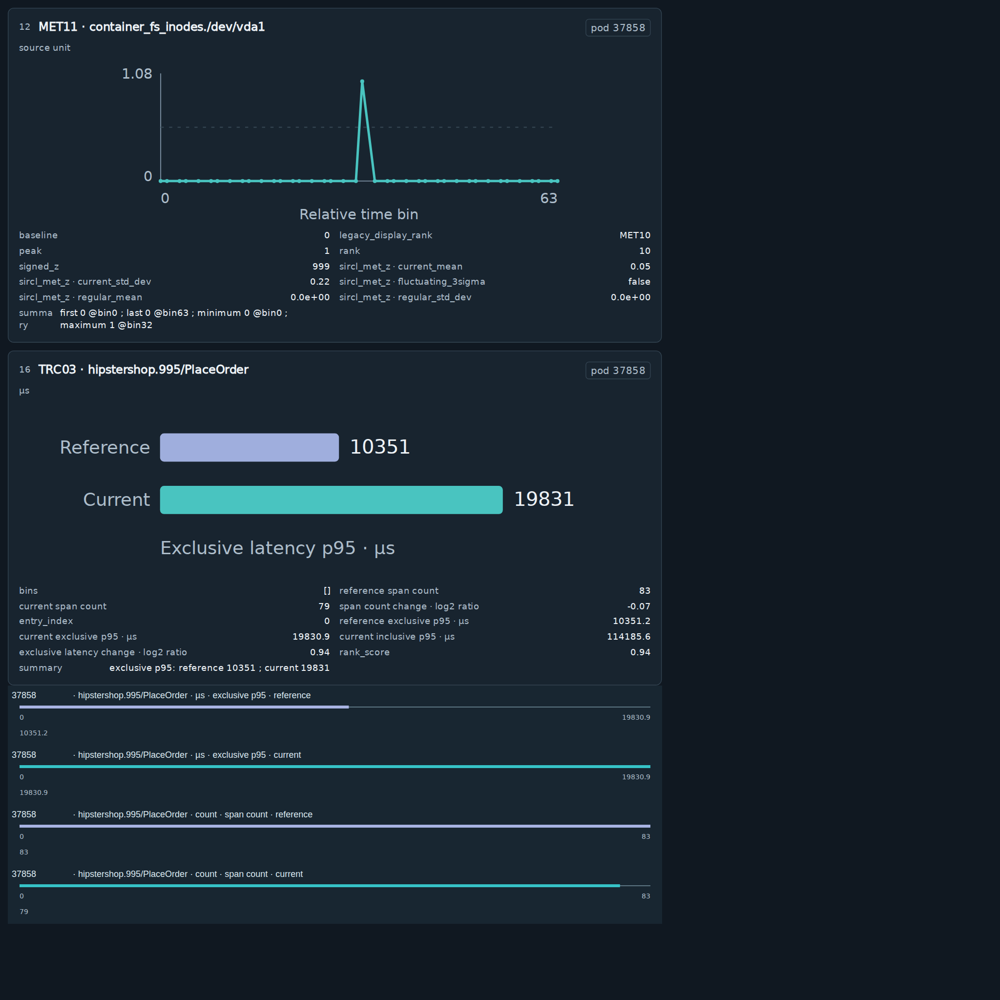
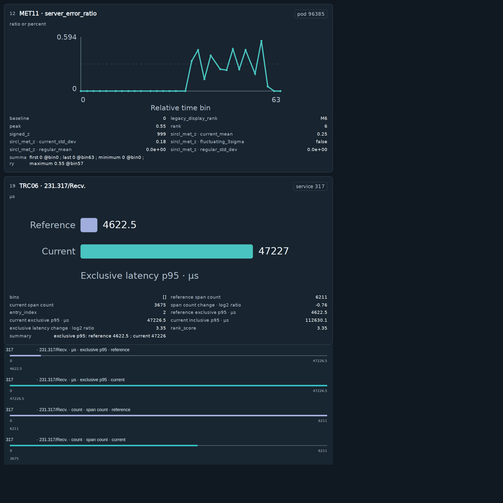
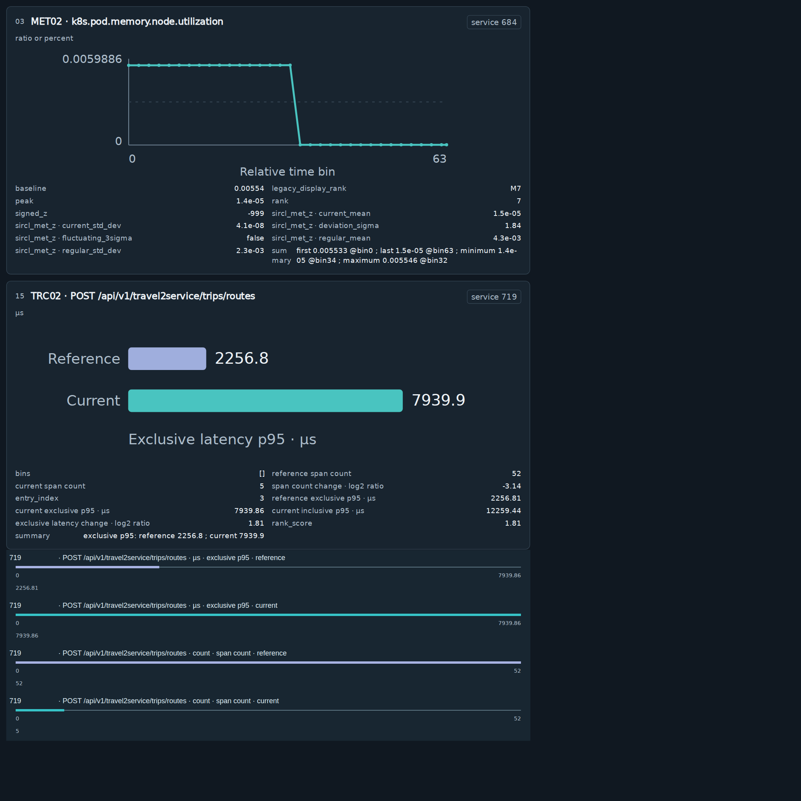

# RQ4.7 实验分析：保留的单次纯视觉条件

日期：2026-10-20；范围：本地 `source_workspace_v1`。本报告仅分析保留的 S_COMPARE、S_GROUND、S_REASON，不涉及 Nibi。

> **用户授权删除后的版本。** M_CROP、M_CLOSED、M_COMPARE 及其共享规划的全部实验记录、原始对话、输入输出、attention、评分、统计汇总和图表已经删除。原报告中的相关结果及比较也已移除，没有备份；不能再从本报告附件复算这些被删除的条件。实验代码和设计文档保留原定义，不表示相应数据仍存在。公共证据对象仅在仍被 S 臂实际输入引用时保留。

## 1. 核心结论

**三个保留的单次纯视觉方法均没有超过历史均匀剪枝 U。** 预选 S_GROUND 标准/宽容 MRR为0.3005/0.3320，历史U为0.3517/0.3692，强文本为0.4846。完整工作区和前置观测增加成本，却没有推进整体排名。

本轮保留的主要发现是：

1. 来源元组前置输出相对同图直接排名，标准ΔMRR仅+0.0006，原预登记Holm校正未通过。
2. 前置简短自由分析为0.2712，三个数据集点估计都低于直接排名；更多分析文字不是当前系统的有效改进。
3. S_GROUND标准候选无效率16.36%，高于S_COMPARE的6.36%。输出结构完整不等于读数、来源或排名合法。
4. 新增局部图使逻辑总token为U的1.72–1.77倍；虽然低于强文本，排名也明显低于强文本，不能称为保持性能的降本。
5. 实际回答存在“数值能读出，但定位、单位、实体归属或排名不一致”。正确根因也可能伴随错误部署关系与理由。
6. 保留QA的完整五字段正确率为0，不能用地板分数宣布QA与RCA独立；本轮保留的反事实位置/标签条件也都不适用。
7. 实采attention只覆盖第3层最后prompt与首个decode查询，不能当作最终排名决策attention或因果证据。

结论是结束本轮候选，保留U作为已测纯视觉参照；不以剩余预算自动重跑，不把个别成功病例当作整体采用依据。

## 2. 实验条件、数据与模型

U为历史A_UNIFORM_E50：完整图像进入视觉编码器后，身份/标签等锚点保留，可选证据token约均匀保留一半。不是随机裁掉半张图，也没有跳过完整视觉编码。本轮保留U的原概览PNG、候选与保留索引，额外加入CPU确定性生成的来源完整工作区。

来源完整指实体、信号/操作、单位、统计口径、阶段和必要关系端点共同呈现。只对兼容量纲/口径使用共同尺度；不补取遥测、不添加推测因果边。全部诊断信息在unified renderer图像内；文本仅为任务、读图和格式要求。

| Arm | 实际输入 | 输出差异 | 角色 |
| --- | --- | --- | --- |
| S_COMPARE | U概览＋同一CPU工作区 | 先五候选排名，后理由/置信度 | 同图参照 |
| S_GROUND | 与S_COMPARE完全相同图像 | 先≤3条带来源归属的观测，再排名 | 单次预选 |
| S_REASON | 与S_COMPARE完全相同图像 | 先≤3条短自由分析，再排名 | 前置分析控制 |

全部220例为已暴露开发病例：AIOPS-2022/2025各60，AegisLab100。主要统计使用193个数据集内事件组，分别33/60/100，病例分析另报；不是独立确认集。

本地冻结BF16 Qwen3.8-27B（Qwen3_5架构），vLLM0.24.0、PyTorch2.11.0、Transformers5.14.1；8个CPU worker、GPU并发8、显存利用率0.8、40960上下文、8192输出上限、seed42、thinking关闭。排名数组采用既有贪心解码，辅助/前置字段仍采样，不能把全部输出称为完全确定。

历史U、T_FULL、MARGINAL_FIVE直接复用原回答/成本，后端、提示与时期差异限制跨轮因果解释。MARGINAL_FIVE是完整文本与重复边际图的hybrid，不是纯视觉结果。

## 3. 删除后的保留范围与完整性

| 范围 | 保留逻辑位置 | 保留真实调用 | 保留attention摘要 |
| --- | --- | --- | --- |
| formal | 870 | 750 | 247 |
| smoke | 6 | 5 | 4 |

保留的正式位置包含660份主诊断、30份S_GROUND独立重复、60份独立QA和120个不适用的QA干预位置。删除后的目录是历史实验的单次条件保留子集，不再声称拥有原完整矩阵或可恢复其余条件。

保留的S完成记录及其实际请求、轨迹、评分文件、输入PNG和实采attention经哈希核验；三个S预编译请求身份保持不变。S记录中曾附带的已删除分支准备信息和调度依赖也已移除，实际模型输入、输出、评分和attention不变。共享评分标签、候选映射、公共来源、完整对话继续可读。SQLite中已移除被删除条件的行并执行secure_delete和VACUUM；执行凭据与原完整运行标记退役，防止从旧队列自动重新生成被删除数据。

新的`frozen/retained_manifest.json`和`retained_*_queue.json`明确标识保留子集，而非冒充未改动的原完整冻结清单。未运行模型、渲染、特征提取或重评分来替代已删除回答。

## 4. 性能与评分口径

标准评分要求五个不同合法候选；未知或重复使整份排名计零。宽容评分只去首尾空白和明确类型前缀，非法/重复项在原排名计未命中，不修复相似数字、不移动后续项。两者均使用中央scorer的原标签映射和粒度规则。

MRR为首个命中排名倒数均值，AC@k为前k至少命中一个根因的比例；Precision@k为前k命中条目比例；AVG@k为AC@1…AC@k的平均。

| Arm | 标准MRR | 宽容MRR | 标准AC@1 | AC@3 | AC@5 | 无效/220 |
| --- | --- | --- | --- | --- | --- | --- |
| S_COMPARE | 0.2999 | 0.3217 | 0.1864 | 0.3636 | 0.5455 | 14 |
| S_GROUND | 0.3005 | 0.3320 | 0.1955 | 0.3773 | 0.5091 | 36 |
| S_REASON | 0.2712 | 0.2941 | 0.1591 | 0.3636 | 0.4727 | 25 |

| 历史参照 | 标准MRR | 宽容MRR¹ | AC@1 | AC@3 | AC@5 | 总token |
| --- | --- | --- | --- | --- | --- | --- |
| A_UNIFORM_E50 | 0.3517 | 0.3692 | 0.2409 | 0.4455 | 0.5636 | 5,851 |
| T_FULL | 0.4846 | 0.4846 | 0.3909 | 0.5682 | 0.6409 | 22,244 |
| MARGINAL_FIVE | 0.5054 | — | 0.4091 | 0.5818 | 0.6682 | 23,128 |

¹ U/T的宽容值为原回答上的离线敏感性评分，未改历史标准分。MARGINAL_FIVE引用包未提供同口径宽容重评所需原回答，留空。

| Arm | A22标准/宽容MRR | A25标准/宽容MRR | Aegis标准/宽容MRR | 三数据集等权标准/宽容MRR |
| --- | --- | --- | --- | --- |
| S_COMPARE | 0.2694 / 0.2903 | 0.1569 / 0.1992 | 0.4040 / 0.4140 | 0.2768 / 0.3011 |
| S_GROUND | 0.2378 / 0.3017 | 0.2597 / 0.2908 | 0.3627 / 0.3750 | 0.2867 / 0.3225 |
| S_REASON | 0.2147 / 0.2181 | 0.1975 / 0.2364 | 0.3493 / 0.3743 | 0.2539 / 0.2763 |

整体按60/60/100病例加权，宏平均按三个数据集等权。S_GROUND相对S_COMPARE在A25提高0.1028，但A22下降0.0317、Aegis下降0.0413；A25是17例升、12例降、31例不变。事后的接口×数据集比较族也未通过校正，不能筛出A25作为整体成功。

## 5. 配对统计与修复/破坏

双侧Pratt-zero Wilcoxon，差值保留12位，事件组先平均病例差值再等权检验；病例分析另报。dz为均值/样本标准差。不报告CI，signed-rank不能当作任意分布均值零假设检验。

下表仅保留两个S内部比较；pH保留原预登记六项族的Holm结果，未因删除其他数据而缩小族重新争取显著性。

### 标准评分

| 比较 | 病例ΔMRR | 病例pH | 事件ΔRR | 事件p | 事件pH | 事件dz | 病例升/降/平 |
| --- | --- | --- | --- | --- | --- | --- | --- |
| S_GROUND - S_COMPARE | 0.0006 | 0.9799 | 0.0087 | 0.4122 | 1.0000 | 0.0235 | 45/58/117 |
| S_GROUND - S_REASON | 0.0293 | 0.9544 | 0.0352 | 0.1096 | 0.6574 | 0.0957 | 61/48/111 |

### 宽容评分

| 比较 | 病例ΔMRR | 病例pH | 事件ΔRR | 事件p | 事件pH | 事件dz | 病例升/降/平 |
| --- | --- | --- | --- | --- | --- | --- | --- |
| S_GROUND - S_COMPARE | 0.0104 | 1.0000 | 0.0169 | 0.8015 | 1.0000 | 0.0482 | 49/56/115 |
| S_GROUND - S_REASON | 0.0380 | 0.4069 | 0.0413 | 0.0402 | 0.2410 | 0.1083 | 66/46/108 |

保留的主要比较均未通过原族Holm。S_GROUND高于自由分析的点估计不等于结构化归属具有已建立的普遍收益。

相对历史U的逐例修复/破坏（升降指RR，不要求零分变正确）：

| Arm−U | ΔMRR | RR升/降/平 | AC@1修复/破坏 | AC@5修复/破坏 |
| --- | --- | --- | --- | --- |
| S_COMPARE | -0.0518 | 33/59/128 | 12/24 | 18/22 |
| S_GROUND | -0.0512 | 40/69/111 | 21/31 | 19/31 |
| S_REASON | -0.0805 | 48/75/97 | 16/34 | 26/46 |

S_GROUND相对U有40例改善、69例下降，说明有利个案存在，却不足以抵消总体破坏。历史参照非同期，不把所有变化都归因于单个新组件。

## 6. 实际工作区与输入限制

全部220例选两张卡片：214例M/R、4例M/M、2例M/L，没有局部G卡；这里M/R/L/G分别指指标、Trace、日志和关系模态，**不是实验臂名称**。完整概览仍保留全部既有证据。

每组只含一个来源卡片；206例一个卡片内比较加一个来源完整视图，14例两个来源完整视图；8例有比较容量回退。Trace内部阶段p95/span count对齐真实发生，但没有形成跨来源双卡比较。

卡片矩形平均仅占固定2048²工作区58.50%，不是墨迹像素率；外部空白也有编码成本。卡内原图、摘要、附加对齐行又有重复。当前没有独立消融，不能把这些因素确定为排名下降原因。

下列为S臂真实原PNG，哈希一致且以硬链接复用，不是重绘图：

### AIOPS-2022 · INC-123B5115D9C1

### AIOPS-2025 · INC-E74124445490

### AegisLab · INC-1899A22CF097

## 7. 输出接口与来源陈述

| Arm | 无效 | 重复ID病例 | 未知ID病例 | 宽容挽回非零RR | 标准→宽容MRR |
| --- | --- | --- | --- | --- | --- |
| S_COMPARE | 14 | 7 | 8 | 7 | 0.2999→0.3217 |
| S_GROUND | 36 | 7 | 32 | 14 | 0.3005→0.3320 |
| S_REASON | 25 | 0 | 25 | 8 | 0.2712→0.2941 |

重复与未知可在同一回答发生，不能相加当无效总数。宽容后仍低于U，故接口损失不能解释全部排名缺口。未知输出对照候选、原公共关系节点/端点和来源角色核验，不擅自修复近似ID。例如某回答的118与目录1118不等价。

S_GROUND主回答共631条观测。原精确元组审计：1条完全匹配、564条未找到精确元组、66条位置无效。后两类不能全部当虚假：字段别名、近似数值和定性描述也会无法精确匹配。

独立拆解有366条可解析数值，29条与所指卡片某行精确相同，45条在1%内，36条同时近似匹配且实体受该卡支持；90条实体在所指卡获得支持。这些不是完整正确率，数值可能巧合。

更直接的不可用输出是reading字面值`}, {`出现65条、`}`40条、null52条。合法JSON形状不等于有效观测。个别根因排对仍伴随错误单位或关系，排名与解释可信度必须分别审核。

## 8. QA与反事实：保留结果及边界

**有效性纠正（2026-10-20）：完整QA测量未通过题目有效性审计。** 360题中19题的标准实体为空，却要求回答单个实体，已确认为无效题；另有90题使用未定义的阶段名称、41题存在单位等价写法未被接受的风险，风险项有重叠。下面保留原协议分数用于追溯，不能将它们当作合格的视觉能力或QA—RCA脱节证据。独立QA没有进入诊断，RCA排名和成本不受此纠正影响。详见[题目可回答性审计](RQ4_7_QA_Answerability_Audit_2026-10-20.md)。

固定60例，每数据集20例，每例6题，按图号/bbox查找目标，回答数值、实体、单位、统计口径、阶段。没有把目标另外圈到图上；360目标中180进入局部工作区。

| 题数 | 精确数值 | 1%宽容数值 | 宽容实体 | 宽容单位 | 宽容统计 | 宽容阶段 | 完整五字段 |
| --- | --- | --- | --- | --- | --- | --- | --- |
| 360 | 0.83% | 1.39% | 1.11% | 3.61% | 0.83% | 22.22% | 0/360 |

精确数值3/360，宽容5/360；完整元组恒零，因此与RR的相关不定义，不能写为零相关或独立。

进一步核对评分实现后，完整QA不是“六题全部正确才计分”，而是每题要求value/entity/unit/statistic/phase五项同时正确，再对适用题平均。360题中宽容正确字段数为：0项271题、1项78题、2项7题、3项3题、4项1题、5项0题。五道数值在1%内正确的题，没有一道entity字段被当前规则认可。

其中存在明确的接口/评分表达失配：INC-C10F5EA649A5的目标为entity619、current exclusive p95=77933.15µs；模型回答77933、µs、exclusive p95、current均正确，却把entity填成图上的操作名`745.619/PlaceOrder`，因不等于`619`而联合计零。QA提示仅列出entity字符串字段，未明确要求只填实体ID。另两题把statistic写为`reference/current exclusive p95`，虽然阶段另已正确，仍与目标`exclusive p95`不匹配。现行“宽容”仅有数值1%、少数单位拼写和实体类型前缀处理；statistic/phase基本仍是去空白后的字符串相等，不能称为充分语义容错。

因此零分混合了无效题、未说明的定位/回答协议、未命中目标和测量表达不匹配，不能归结为一般视觉理解能力为零。355/360题没有命中指定目标数值，但该现象也受目标接口混杂，不能简单等同于真实数字读取失败。这里只补充离线诊断，未修改原评分或运行代码。

宽容数值与RR的探索Spearmanρ=0.1572、p=0.2303，也不建立独立性。

160个回答数值在图中某处公共行有1%内匹配，正确指定目标却只有5个，其中16个匹配另一道题。常见数字可能巧合，不能把所有匹配都认定为定位错误，但实际案例能证明部分目标混淆。实体85次被填成卡片编号，单位227次为空。

此QA混合了坐标定位、读数、归属和输出协议；guide未明确重述0..1000归一化与图像编号，长统计字符串、泛化source_unit和无单一实体的计数也有测量限制。不能把分数直接称为一般读图能力。

全量来源/坐标审计中，360个标准数值都能在来源卡片可见文本记录中找到，目标框也都落在登记图元内；但DOM存在不等于像素清晰或完整答案唯一。实际只查看13张图（含裁剪），遵守不超过20张的抽查上限，样例没有发现数值根本未绘制的情况。明确的19题错误是把父子联合统计套入单实体答案模板，并不是数值不存在。其余341题没有因此获得有效性认证。

保留的60个位置交换和60个标签交换都因无法构造匹配来源对而不适用；本轮不能提出新的反事实位置或标签机制结论。历史RQ4.3顺序敏感性没有被本轮复现或推翻。

## 9. 定性证据：真实S回答

固定哈希每数据集6例，合计18例；保留三个S诊断及对应独立QA全文，不按分数选病例。案例不外推为总体解释错误率。

| 病例 | 保留的实际现象 | 启示 |
| --- | --- | --- |
| INC-123B5115D9C1 | GROUND读出19831，接近PlaceOrder current p95的19830.9µs，框却指向上方指标卡；正确根因从COMPARE第一变成GROUND第二。独立QA答1.08。 | 能读出真数与稳定定位、使用该数不同。 |
| INC-B646C4677B96 | GROUND根因第一命中，却把约1.7e7的Trace耗时写为ms，原单位µs；部分框采用0..1而非0..1000。 | 正确排名不保证单位与定位准确。 |
| INC-E74124445490 | GROUND根因第一命中，理由却称pod96385属于service628；公共部署边是317→96385。 | 成功排名可伴随错误来源关系。 |
| INC-85C93CE3CB89 | COMPARE把500.78→778.12µs称为500倍；REASON把约404590µs写成404s，并把train操作当训练负载。 | 数值比较、换算与操作语义可同时错。 |
| INC-39682657768A | REASON理由称171是origin，services却以547第一、615第二，171未列入五名。 | 理由与最终可执行排名不一致。 |
| INC-1899A22CF097 | GROUND首选684正确；COMPARE首选719、684第四，RR0.25→1。 | 有利个案应承认，但不抵消总体破坏；OOM等因果陈述仍需核验。 |

高置信度也不保证正确：GROUND的124份high回答标准Top-1仅20.97%。这只是类别条件频率，不是完整概率校准检验。

## 10. 成本、输出长度与速度

| Arm | 平均输入 | 平均输出 | 总token | 相对U | 相对T_FULL |
| --- | --- | --- | --- | --- | --- |
| S_COMPARE | 9,846 | 206.9182 | 10,053 | 1.7182× | 0.4519× |
| S_GROUND | 9,920 | 415.6864 | 10,336 | 1.7666× | 0.4647× |
| S_REASON | 9,879 | 344.1045 | 10,223 | 1.7473× | 0.4596× |

| 条件/数据集 | 总token | 相对U | 相对T_FULL |
| --- | --- | --- | --- |
| S_COMPARE/AIOPS-2022 | 10,175 | 1.7028× | 0.4488× |
| S_COMPARE/AIOPS-2025 | 9,638 | 1.7745× | 0.4988× |
| S_COMPARE/AegisLab | 10,229 | 1.6970× | 0.4309× |
| S_GROUND/AIOPS-2022 | 10,457 | 1.7499× | 0.4612× |
| S_GROUND/AIOPS-2025 | 9,927 | 1.8278× | 0.5138× |
| S_GROUND/AegisLab | 10,508 | 1.7434× | 0.4427× |
| S_REASON/AIOPS-2022 | 10,355 | 1.7328× | 0.4567× |
| S_REASON/AIOPS-2025 | 9,812 | 1.8067× | 0.5078× |
| S_REASON/AegisLab | 10,390 | 1.7239× | 0.4377× |

三个S图像相同，平均编码前图像token20347.57，送入语言模型的保留图像token9318.97，其中新增工作区4096。编码前与保留后不是同一预算，最终保留上限不代表没有完整视觉编码。GROUND/REASON生成更多前置内容，增加实际开销。

原整体运行吞吐混合了已删除条件，本版本不再保存或报告它来代表S方法速度；保留S自身阶段计时如下：

| Arm | 最终输入→验证/秒 | 视觉阶段/秒 | 语言阶段/秒 | 在线准备/秒 |
| --- | --- | --- | --- | --- |
| S_COMPARE | 43.93 | 2.78 | 39.70 | 1.30 |
| S_GROUND | 84.44 | 2.79 | 80.25 | 1.29 |
| S_REASON | 70.18 | 2.79 | 65.79 | 1.31 |

计时包含并发服务影响，不是独占GPU kernel时间；列也不能简单相加当冷路径。遥测解析/绘图提前完成，连续在线链还含预取队列等待，没有全程GPU利用率/功率序列，不能声称得到完整冷部署或能耗比较。

## 11. 独立重复

| 样本 | 相同输入 | 原文同 | 五名顺序同 | 首选同 | 标准MRR原→重复 | 宽容MRR原→重复 | 无效原→重复 |
| --- | --- | --- | --- | --- | --- | --- | --- |
| 30 | 30 | 6 | 18 | 29 | 0.3189→0.3106 | 0.3589→0.3472 | 6→7 |

排序变化12/30，首选仅变化1/30；不能把尾部重排当40%首选翻转。重复为同prompt/PNG/gather/seed的真实新调用，不是引用，标准ΔMRR−0.0083，相对同子集历史U仍为负，没有恢复工程推进方向。

## 12. 保留的attention分析

仅保留S真实调用的实采摘要，参考每个scope的retained_status计数。覆盖第3层最后prompt和首个decode查询，没有完整矩阵或实际services数字生成时的全程attention。数据删除前的混合汇总不保留；下面只用S主诊断各60实际测量。

| Arm | 样本 | 指令token比例 | 指令attention质量 | 全部图像质量 | 局部质量 |
| --- | --- | --- | --- | --- | --- |
| S_COMPARE | 60 | 5.39% | 86.67% | 13.33% | 2.12% |
| S_GROUND | 60 | 6.10% | 85.92% | 14.08% | 2.50% |
| S_REASON | 60 | 5.71% | 86.75% | 13.25% | 2.01% |

局部4096token约占保留图像token44%，只获得总质量约2.0–2.5%，单位token质量约为图像平均0.36–0.40倍。这是有限早期query的描述，不能推出最终诊断不使用图或新增图造成退化。

原顶层页眉的保留token为零，因此其质量为零是选择规则结构结果；面板标题仍在各面板内，不能称为解决标题sink。指令位置邻近查询也可能影响质量分配，不能据此建议删除指令来提分。

所有保留的实际attention及必要映射继续可读，未额外重放模型。每次摘要≤64KiB；保留内容为实际采集的测量及所需映射，不表示未收集矩阵可以恢复。

## 13. 历史比较与决定

RQ4.1的U仍是纯视觉参照；RQ4.2来源分区、RQ4.3局部处理、RQ4.4高清补图、RQ4.6复杂覆盖代理均没有稳定超过U。RQ4.7的S条件补充说明：把正确归属写进输出要求，并不保证它在实际陈述与排名中实现。

像素保留、读数能力、归属、理由与排名是不同层次。优化一个代理没有保证最终排名提高；但当前QA定位/字段语义有混杂，不能把低相关直接当机制发现。MARGINAL_FIVE约0.5054属于完整强文本加重复边际图，不能与纯视觉结果混为同一方法。

S_GROUND相对U标准ΔMRR−0.0512，三个数据集MRR及AC@5都下降。总token低于强文本的门槛虽通过，排名门槛失败，重复未恢复收益。候选不推进，独立确认未触发。

后续若研究来源绑定，应先验证可定位的QA目标、可评分字段语义与可构造的匹配来源；先用很小接口资格集排除地板效应，再谈机制和大矩阵。这里是研究启示，不是新执行授权。没有自动后续调用。

## 14. 保留文件与复算边界

剩余S的精确输入PNG、prompt、输出、完整对话、标签/候选映射、评分、成本时序、token操作和实采attention全部保留。没有压缩包，也没有被删除条件的备份。实验代码/设计仍在，执行凭据已退役；保留子集不能作为原完整实验的恢复入口。

- [S逐例分数](artifacts/RQ4_7_2026-10-20/per_case.csv)
- [S完整指标/成本/时序](artifacts/RQ4_7_2026-10-20/metrics_cost_timing.csv)
- [保留的主要比较](artifacts/RQ4_7_2026-10-20/primary_statistics.json)
- [S修复/破坏](artifacts/RQ4_7_2026-10-20/paired_repairs.csv)
- [S逐题QA与原回答](artifacts/RQ4_7_2026-10-20/qa_case_answers.json)
- [S来源陈述](artifacts/RQ4_7_2026-10-20/grounded_claims.json)
- [固定18例S原回答全文](artifacts/RQ4_7_2026-10-20/fixed18_actual_answers.md)
- [S独立重复](artifacts/RQ4_7_2026-10-20/repeats.json)
- [S逐查询attention](artifacts/RQ4_7_2026-10-20/attention_per_query.csv)
- [保留子集清单](../../RQs/RQ4_7/results/source_workspace_v1/frozen/retained_manifest.json)

历史实验及代码仍可追溯；本轮已删除条件的输入、对话、attention或结果不能再声称可复算。

## 附录：完整S绝对指标

### 标准

| Arm | 数据集 | MRR | AC@1 | AC@3 | AC@5 | P@1 | P@3 | AVG@3 | AVG@5 |
| --- | --- | --- | --- | --- | --- | --- | --- | --- | --- |
| S_COMPARE | 整体 | 0.2999 | 0.1864 | 0.3636 | 0.5455 | 0.1864 | 0.1333 | 0.2712 | 0.3655 |
| S_COMPARE | AIOPS-2022 | 0.2694 | 0.1667 | 0.3167 | 0.5000 | 0.1667 | 0.1167 | 0.2389 | 0.3267 |
| S_COMPARE | AIOPS-2025 | 0.1569 | 0.0667 | 0.2000 | 0.3667 | 0.0667 | 0.0667 | 0.1278 | 0.2067 |
| S_COMPARE | AegisLab | 0.4040 | 0.2700 | 0.4900 | 0.6800 | 0.2700 | 0.1833 | 0.3767 | 0.4840 |
| S_GROUND | 整体 | 0.3005 | 0.1955 | 0.3773 | 0.5091 | 0.1955 | 0.1409 | 0.2864 | 0.3609 |
| S_GROUND | AIOPS-2022 | 0.2378 | 0.1500 | 0.3000 | 0.4167 | 0.1500 | 0.1000 | 0.2222 | 0.2900 |
| S_GROUND | AIOPS-2025 | 0.2597 | 0.1833 | 0.2833 | 0.4167 | 0.1833 | 0.1111 | 0.2444 | 0.2967 |
| S_GROUND | AegisLab | 0.3627 | 0.2300 | 0.4800 | 0.6200 | 0.2300 | 0.1833 | 0.3500 | 0.4420 |
| S_REASON | 整体 | 0.2712 | 0.1591 | 0.3636 | 0.4727 | 0.1591 | 0.1364 | 0.2652 | 0.3391 |
| S_REASON | AIOPS-2022 | 0.2147 | 0.1333 | 0.2500 | 0.4000 | 0.1333 | 0.0889 | 0.1889 | 0.2600 |
| S_REASON | AIOPS-2025 | 0.1975 | 0.1167 | 0.2500 | 0.3500 | 0.1167 | 0.0944 | 0.1889 | 0.2433 |
| S_REASON | AegisLab | 0.3493 | 0.2000 | 0.5000 | 0.5900 | 0.2000 | 0.1900 | 0.3567 | 0.4440 |

### 宽容

| Arm | 数据集 | MRR | AC@1 | AC@3 | AC@5 | P@1 | P@3 | AVG@3 | AVG@5 |
| --- | --- | --- | --- | --- | --- | --- | --- | --- | --- |
| S_COMPARE | 整体 | 0.3217 | 0.2045 | 0.3864 | 0.5773 | 0.2045 | 0.1409 | 0.2909 | 0.3891 |
| S_COMPARE | AIOPS-2022 | 0.2903 | 0.1833 | 0.3333 | 0.5333 | 0.1833 | 0.1222 | 0.2556 | 0.3500 |
| S_COMPARE | AIOPS-2025 | 0.1992 | 0.1000 | 0.2500 | 0.4333 | 0.1000 | 0.0833 | 0.1667 | 0.2533 |
| S_COMPARE | AegisLab | 0.4140 | 0.2800 | 0.5000 | 0.6900 | 0.2800 | 0.1867 | 0.3867 | 0.4940 |
| S_GROUND | 整体 | 0.3320 | 0.2091 | 0.4273 | 0.5727 | 0.2091 | 0.1576 | 0.3182 | 0.4027 |
| S_GROUND | AIOPS-2022 | 0.3017 | 0.2000 | 0.3833 | 0.5000 | 0.2000 | 0.1278 | 0.2889 | 0.3633 |
| S_GROUND | AIOPS-2025 | 0.2908 | 0.1833 | 0.3500 | 0.5000 | 0.1833 | 0.1333 | 0.2778 | 0.3467 |
| S_GROUND | AegisLab | 0.3750 | 0.2300 | 0.5000 | 0.6600 | 0.2300 | 0.1900 | 0.3600 | 0.4600 |
| S_REASON | 整体 | 0.2941 | 0.1773 | 0.3864 | 0.5091 | 0.1773 | 0.1455 | 0.2848 | 0.3645 |
| S_REASON | AIOPS-2022 | 0.2181 | 0.1333 | 0.2500 | 0.4167 | 0.1333 | 0.0889 | 0.1889 | 0.2633 |
| S_REASON | AIOPS-2025 | 0.2364 | 0.1500 | 0.3000 | 0.4000 | 0.1500 | 0.1111 | 0.2278 | 0.2867 |
| S_REASON | AegisLab | 0.3743 | 0.2200 | 0.5200 | 0.6300 | 0.2200 | 0.2000 | 0.3767 | 0.4720 |
