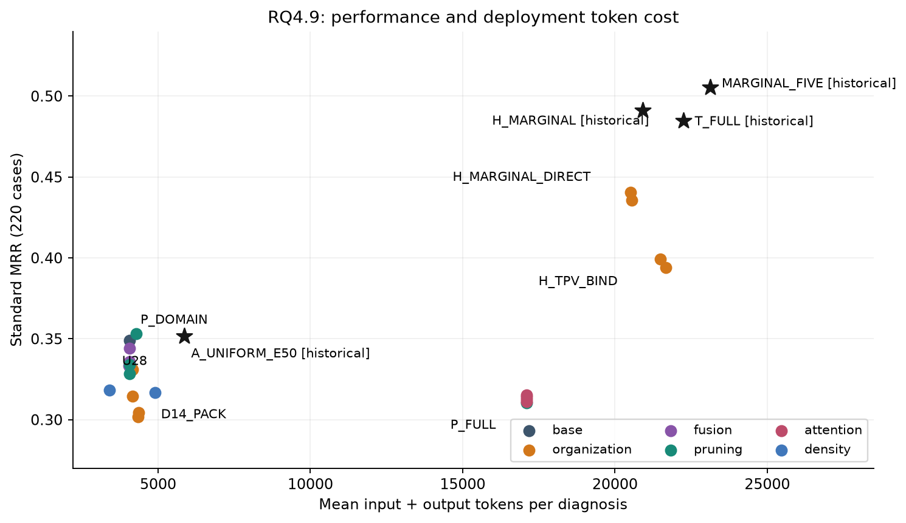
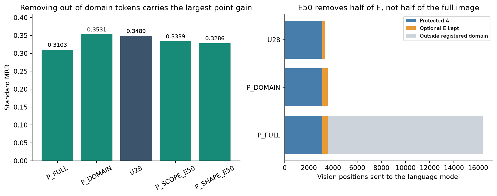
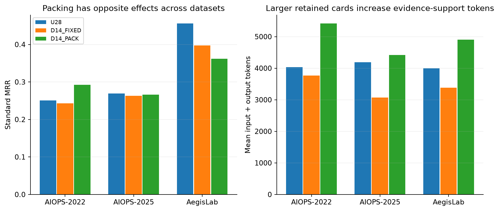
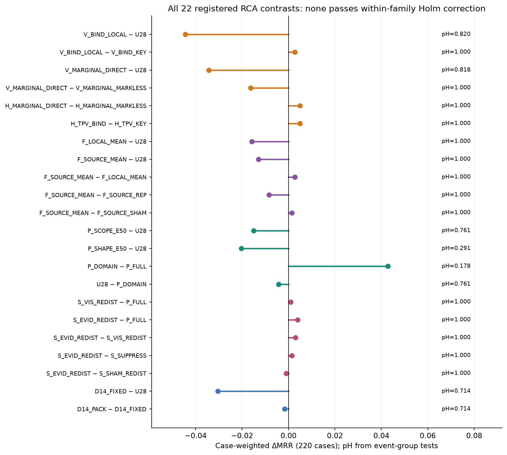
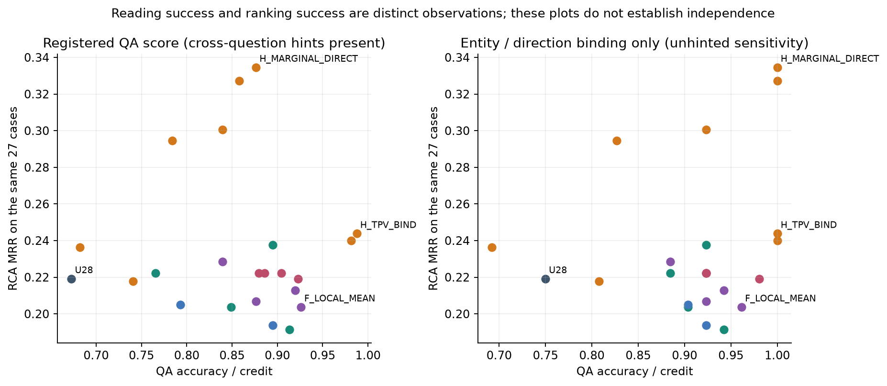
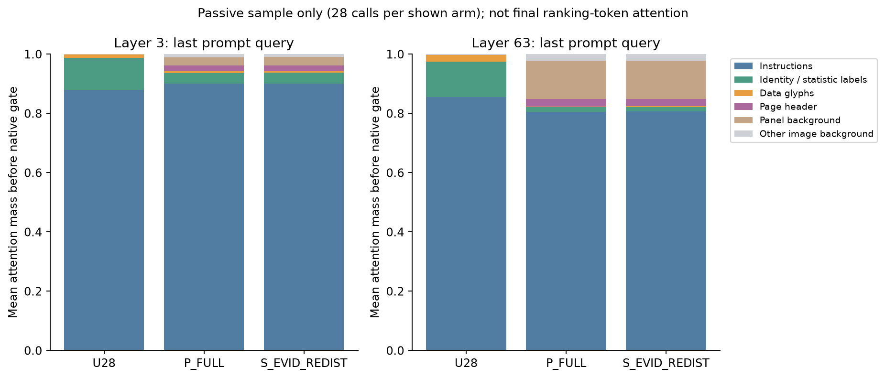

# RQ4.9 完整实验分析：视觉证据组织、压缩与注意力分配

**日期：2026-10-22。对象：本地 `organization_v1` 完整实验。状态：5,850/5,850 正式位置全部提交，存储收尾通过。**

本报告只做离线分析，没有新增模型调用、重跑原实验或操作 Nibi。分析对应最新版[《论文主线》](../../论文主线.md)，以[正式计划](../experiment_plans/RQ4_9_Dashboard_Organization_Compression_and_Attention_Plan_2026-10-21.md)冻结的比较为主要依据。全部数据仍是已暴露的开发病例，不能称为独立测试。

## 1. 先给出结论

**本轮没有获得可以替代现有方法的新候选，但得到一个更明确的分解：移除登记证据域外的视觉位置，比继续删掉证据图元更值得关注。** 最高新纯视觉条件 `P_DOMAIN` 的标准 MRR 为 **0.3531**；新 hybrid 最高为 `H_MARGINAL_DIRECT` 的 **0.4405**。前者与历史 U 的 0.3517 基本持平，后者低于强文本 0.4846、历史独占边际图 0.4912 和重复补充边际图 0.5054。

这不等于本轮没有信息。以下十项是适合进入讨论和论文证据整理的结果：

1. **主要正向信号出现在域外位置移除。** 同图 `P_DOMAIN−P_FULL` 为 **+0.0428 MRR**，43例改善、26例变坏；总 token 下降约75%。原始事件组 p=0.0446，但四项剪枝族 Holm 后 pH=0.1784，属于值得保留的开发信号。
2. **进一步删一半 E 没有追加排名收益。** U28为0.3489，低于 P_DOMAIN 的0.3531；两者只相差约224个视觉位置。不能把“U整体优于完整图”全部归因于删曲线或柱形。
3. **新画布下，A占了保留图像位置的93.27%。** E50只影响剩下的少量可选位置，并非删除整图的一半。融合真正求多token均值的位置平均仅占最终图像位置约4.34%。这给所有算子结果增加了实际干预范围的边界。
4. **融合没有超过同组直接取代表。** SOURCE_MEAN为0.3359，SOURCE_REP为0.3442；同组、同位置的对照没有支持 embedding 均值带来诊断收益。它确实执行了融合，不能说是没有运行；也不能把这一种小范围均值操作外推为否定所有视觉融合。
5. **局部绑定与改进边际画法没有提高纯视觉整体排名。** LOCAL为0.3045，DIRECT为0.3145，均低于U28。LOCAL的AC@5反而更高，说明“把正确候选列进前五”和“把它排到第一”可以朝不同方向变化。
6. **本轮再次没有建立边际点标记的独立贡献。** 纯视觉 DIRECT−MARKLESS为−0.0163；hybrid为+0.0050，均未通过校正。不能据此把历史边际图方案的0.5054归给点标记，也不能断言点普遍有害。
7. **固定14卡后的放大重排具有数据集差异。** PACK−FIXED在AIOPS-2022为+0.0494，在AegisLab为−0.0353，整体为−0.0016；更大显示不是这个范围内的普遍解法。
8. **Attention操作是真实、但质量较小的干预。** 四臂全部220例都有候选及可执行head；适用head-query约43.3%，实际释放量约占适用分布的0.67%。四种策略的MRR只在0.3112–0.3152，均未建立收益，也没有优于普通域外供体控制。
9. **读取、解释和排序确实应当分开审查；现有QA还不能给出干净的机制证明。** 25/27例中另一道题直接给出了读数题答案；单位题多数类即达92.6%；较长回答还受到2048输出上限影响。实体／方向题仍可单独利用，旧QA分数保留并明确这些限制。
10. **全量结果取代所有临时结果。** 220例覆盖完整；最早登记的90例中82例来自AegisLab，不能把那种组成下的临时高MRR当成最终总体表现。正式完成调用没有未知缺口，标准主矩阵模型失败125/5060=2.47%。

**22项预注册RCA比较，在各自族内进行Holm校正后，没有一项达到0.05。** 报告同时承认观察到的工程差异，不把“不显著”写成“已经证明没有效果”。



图1：横轴是每次诊断实际输入＋输出token，纵轴是完整220例的标准MRR。历史星号和本轮条件不是同期、等事实对照；其作用是判断项目离强文本还有多远。

## 2. 数据、协议与比较口径

### 2.1 完成了什么

|模块|正式位置|说明|
|---|---:|---|
|RCA主矩阵|5,060|23条件×220例，全部单次诊断|
|独立QA|621|23条件×27例|
|QA控制|79|隔离27、位置交换27、统计标签交换25；两例确实不适用|
|RCA独立重复|90|三个登记条件各30例|
|合计|5,850|无缺失正式位置|

三个数据集分别为60、60、100例。主要推断使用事件组作为分析单位：AIOPS-2022有33组，AIOPS-2025有60组，AegisLab有100组，合计193组。病例加权总体MRR与三个数据集等权宏平均同时报告，不能混用。

正式队列实际新完成5,783次调用，其余67个位置是严格相同生成身份的引用；包括资格与性能补测后，总共保留5,975份会话记录，对应5,908次真实完成调用。另有两次资格阶段基础设施失败，账本保留；它们不是正式未知病例。实际发起共5,910次，未超过6,000上限。引用不增加真实调用或存储预算分母，部署成本仍记完整的一次请求。

本地BF16 Qwen3.8-27B、vLLM、40960上下文、RCA最多8192输出、QA最多2048输出；CPU八个独立worker，GPU并发八，显存利用率配置0.8。最终五候选接口及评分语义保持。排名前缀采用贪心选择，解释部分采样；temperature=1、top_p=0.95、seed=42，thinking关闭。因此不能把全部回答称为完全贪心或跨随机种子复现。

### 2.2 新的U28和历史U不是同一份输入

M/R/L/G分别指指标、Trace、日志、拓扑关系四类遥测证据。U28是新的4096×4096画布，所有面板总计最多28张。实际卡片数为11–28，平均17.05；历史画布平均68.07张，每例排除了平均51.02张历史卡片。来源单元整组装入，容量不足整组跳过，不能因此称为全事实无损重排。

完整候选目录和公共窗口受到保护，已有边际关系优先保留，其他来源按冻结顺序装入。故障标签及历史答案不进入选择器。保留候选名称只保证答案可以表达，不保证该实体的全部诊断证据也被保留。

一个窄的离线核验是：是否仍有**直接以根因实体命名的M/R/L诊断卡**。U28为44.5%，D14两臂为41.8%。该核验排除候选目录和拓扑，不将列出实体视为拥有它的诊断明细；它也不等于“其余病例不可诊断”，因为其他实体、关系或共享基础设施仍可能提供有效线索。只用它说明选择确实改变了证据覆盖，不能用它设定分母或事后挑病例。

### 2.3 标准、宽容和成本

标准RCA要求当前候选中的五个不同合法ID及登记输出字段；无效回答计零。宽容分数按已登记提取和实体匹配口径离线计算，用来量化接口损失；它不替换主指标，也不会回调模型补答。全部RCA评分使用`scorer`。

MRR是正确根因的倒数名次平均；AC@k表示前k个候选是否命中；Precision@k表示前k个候选中命中的比例；AVG@k是前1到k各层命中准确率的平均。Precision@1等于AC@1，完整原始字段另见CSV。

成本区分编码前图像token、送入语言模型的图像token、文字／边界token和输出。剪枝发生在视觉编码完成后，不能把语言模型输入减少解释为免除了整张图的视觉编码。本文“降本”在数值比较中指总token；墙钟、视觉编码和预处理单独说明，未折算美元或能耗。

## 3. 23个条件究竟改变了什么

|分支|条件|实际干预|
|---|---|---|
|公共基础|U28|新有限证据画布；保护A，空间最远点选取约一半E|
|纯视觉组织|V_BIND_LOCAL / V_BIND_KEY|同类标识就近放置，或改为卡内编号键表|
|纯视觉边际图|V_MARGINAL_DIRECT / MARKLESS|明确样本、总体统计及来源绑定；对照只去点，保留数值和几何|
|Hybrid边际图|H_MARGINAL_DIRECT / MARKLESS|完整配对来源独占入图，剩余完整强输入留在文本；点控制相同|
|Hybrid拓扑|H_TPV_BIND / H_TPV_KEY|拓扑独占入节点—有向边图；就近绑定或编号键表，其余证据留文本|
|融合|F_LOCAL_MEAN|在卡内对可选E分组，均值替换原embedding，保留代表位置|
|融合|F_SOURCE_MEAN / REP / SHAM|来源兼容分组求均值；同组直接取代表；固定置换非代表成员后求均值|
|剪枝|P_SCOPE_E50 / P_SHAPE_E50|E中attention显著度／覆盖选择；曲线端点转折与柱端优先，再空间补足|
|域控制|P_FULL / P_DOMAIN|完整16384个视觉位置；仅保留登记A∪E|
|Attention|S_VIS_REDIST / S_EVID_REDIST|从候选sink释放部分质量，分别重分配至全图像或登记证据域|
|Attention控制|S_SUPPRESS / S_SHAM_REDIST|同类供体仅抑制归一化；普通域外供体转向证据域|
|数量／显示|D14_FIXED / D14_PACK|同一最多14卡集合，原位删除其余卡；或重排放大|

A是强制保护的身份、标签及其实际图元支持，E是登记证据支持中不属于A的可选位置。共享patch可能同时包含文字、数值和图形；这些名称是支持映射，不是对embedding内容的纯语义分离。A不会因为称为“锚点”就只含实体ID。

纯视觉条件的诊断事实只通过renderer生成的图像提供，文字保留任务及读图要求。Hybrid获得本轮明确授权：配对或拓扑来源及其派生统计整组交给图像，其余诊断事实在文本中；关联标签可重复，诊断事实不重复。**Hybrid保留的总事实集合比有限U28更广，不能用两条路线的MRR差声称纯粹的视觉／文本载体因果效应。**

## 4. 全部性能结果与历史参照

### 4.1 全220例主表

| Arm | 标准 MRR | 宽容 MRR | AIOPS-2022 | AIOPS-2025 | AegisLab | 平均总 token | 无效回答 /220 |
|---|---|---|---|---|---|---|---|
| U28 | 0.3489 | 0.3566 | 0.2506 | 0.2692 | 0.4557 | 4056 | 7 |
| V_BIND_LOCAL | 0.3045 | 0.3071 | 0.2086 | 0.1897 | 0.4308 | 4353 | 4 |
| V_BIND_KEY | 0.3017 | 0.3017 | 0.2442 | 0.1983 | 0.3983 | 4334 | 4 |
| V_MARGINAL_DIRECT | 0.3145 | 0.3295 | 0.2586 | 0.2147 | 0.4080 | 4170 | 7 |
| V_MARGINAL_MARKLESS | 0.3308 | 0.3465 | 0.2700 | 0.2197 | 0.4340 | 4169 | 7 |
| H_MARGINAL_DIRECT | 0.4405 | 0.4451 | 0.3725 | 0.3775 | 0.5192 | 20518 | 2 |
| H_MARGINAL_MARKLESS | 0.4355 | 0.4401 | 0.3581 | 0.3742 | 0.5188 | 20553 | 3 |
| H_TPV_BIND | 0.3991 | 0.3991 | 0.3997 | 0.2747 | 0.4733 | 21497 | 2 |
| H_TPV_KEY | 0.3941 | 0.3941 | 0.3911 | 0.2547 | 0.4795 | 21660 | 1 |
| F_LOCAL_MEAN | 0.3331 | 0.3377 | 0.2400 | 0.2358 | 0.4473 | 4053 | 4 |
| F_SOURCE_MEAN | 0.3359 | 0.3405 | 0.2394 | 0.2608 | 0.4388 | 4056 | 5 |
| F_SOURCE_REP | 0.3442 | 0.3520 | 0.2553 | 0.2436 | 0.4580 | 4057 | 8 |
| F_SOURCE_SHAM | 0.3344 | 0.3389 | 0.2672 | 0.2406 | 0.4310 | 4059 | 3 |
| P_SCOPE_E50 | 0.3339 | 0.3452 | 0.2389 | 0.2344 | 0.4505 | 4056 | 7 |
| P_SHAPE_E50 | 0.3286 | 0.3331 | 0.2322 | 0.2317 | 0.4445 | 4058 | 4 |
| P_FULL | 0.3103 | 0.3209 | 0.2492 | 0.2192 | 0.4017 | 17096 | 10 |
| P_DOMAIN | 0.3531 | 0.3577 | 0.2567 | 0.2325 | 0.4833 | 4282 | 3 |
| S_VIS_REDIST | 0.3112 | 0.3241 | 0.2372 | 0.2317 | 0.4033 | 17096 | 9 |
| S_EVID_REDIST | 0.3142 | 0.3203 | 0.2506 | 0.2275 | 0.4045 | 17101 | 7 |
| S_SUPPRESS | 0.3128 | 0.3211 | 0.2533 | 0.2275 | 0.3997 | 17092 | 9 |
| S_SHAM_REDIST | 0.3152 | 0.3213 | 0.2506 | 0.2219 | 0.4100 | 17096 | 7 |
| D14_FIXED | 0.3184 | 0.3299 | 0.2428 | 0.2628 | 0.3972 | 3403 | 9 |
| D14_PACK | 0.3168 | 0.3259 | 0.2922 | 0.2664 | 0.3618 | 4909 | 3 |

宽容评分没有改变主要判断。P_DOMAIN只由0.3531变为0.3577；最高hybrid由0.4405变为0.4451。与强文本的缺口主要仍是排序表现，不能全部归为ID或格式错误。

### 4.2 历史系统

| 历史参照 | 总体 MRR | A22 | A25 | AegisLab | 平均总 token | 输入含义 |
|---|---|---|---|---|---|---|
| T_FULL | 0.4846 | 0.3650 | 0.4039 | 0.6048 | 22244 | 完整强文本 |
| A_UNIFORM_E50 | 0.3517 | 0.3050 | 0.2811 | 0.4222 | 5851 | 旧完整视觉画布＋锚点保护及E50 |
| MARGINAL_FIVE | 0.5054 | 0.4286 | 0.3708 | 0.6322 | 23128 | 完整文本＋重复表达配对事实的边际图 |
| H_MARGINAL | 0.4912 | 0.3461 | 0.3764 | 0.6472 | 20916 | RQ4.5：配对来源独占入图，其余文本 |

历史MARGINAL_FIVE的完整文本已包含配对信息，图像又以边际分布重复表达；RQ4.5 H_MARGINAL则是整组来源独占移入图像，不能混称为同一方法。T_FULL是项目内冻结的完整强文本输入与单次五候选任务，不是只给几个摘要的弱文本。

本轮最高纯视觉P_DOMAIN相对旧U仅+0.0014；最高hybrid相对T_FULL为−0.0441、相对历史H_MARGINAL为−0.0507、相对MARGINAL_FIVE为−0.0648。跨期后端、提示、输入组织不完全相同，这些是工程参照，不是同期单因素检验。没有理由据此宣布更换历史最强方法。

### 4.3 命中、排序及宏平均

| Arm | AC@1 | AC@3 | AC@5 | Precision@3 | AVG@3 | AVG@5 | 三数据集宏平均 MRR |
|---|---|---|---|---|---|---|---|
| U28 | 0.2591 | 0.4000 | 0.5227 | 0.1561 | 0.3348 | 0.4009 | 0.3251 |
| V_BIND_LOCAL | 0.1682 | 0.4000 | 0.5682 | 0.1545 | 0.2894 | 0.3809 | 0.2764 |
| V_BIND_KEY | 0.1636 | 0.3955 | 0.5682 | 0.1576 | 0.2848 | 0.3809 | 0.2803 |
| V_MARGINAL_DIRECT | 0.2091 | 0.3864 | 0.5045 | 0.1561 | 0.3091 | 0.3727 | 0.2938 |
| V_MARGINAL_MARKLESS | 0.2136 | 0.4227 | 0.5318 | 0.1652 | 0.3288 | 0.4000 | 0.3079 |
| H_MARGINAL_DIRECT | 0.3136 | 0.5545 | 0.6455 | 0.2424 | 0.4439 | 0.5200 | 0.4231 |
| H_MARGINAL_MARKLESS | 0.3091 | 0.5409 | 0.6409 | 0.2379 | 0.4379 | 0.5127 | 0.4170 |
| H_TPV_BIND | 0.2818 | 0.4955 | 0.6136 | 0.2152 | 0.3924 | 0.4682 | 0.3826 |
| H_TPV_KEY | 0.2727 | 0.5000 | 0.6045 | 0.2136 | 0.3924 | 0.4673 | 0.3751 |
| F_LOCAL_MEAN | 0.2364 | 0.3909 | 0.5091 | 0.1561 | 0.3242 | 0.3882 | 0.3077 |
| F_SOURCE_MEAN | 0.2364 | 0.3864 | 0.5318 | 0.1545 | 0.3182 | 0.3927 | 0.3130 |
| F_SOURCE_REP | 0.2545 | 0.3909 | 0.5182 | 0.1515 | 0.3303 | 0.3945 | 0.3190 |
| F_SOURCE_SHAM | 0.2273 | 0.4000 | 0.5318 | 0.1561 | 0.3258 | 0.3927 | 0.3129 |
| P_SCOPE_E50 | 0.2409 | 0.3909 | 0.5091 | 0.1576 | 0.3227 | 0.3873 | 0.3079 |
| P_SHAPE_E50 | 0.2318 | 0.3636 | 0.5227 | 0.1409 | 0.3091 | 0.3800 | 0.3028 |
| P_FULL | 0.2091 | 0.3864 | 0.5000 | 0.1561 | 0.3015 | 0.3691 | 0.2900 |
| P_DOMAIN | 0.2682 | 0.4000 | 0.5091 | 0.1591 | 0.3455 | 0.3991 | 0.3242 |
| S_VIS_REDIST | 0.2045 | 0.3864 | 0.5136 | 0.1561 | 0.3000 | 0.3727 | 0.2907 |
| S_EVID_REDIST | 0.2045 | 0.4000 | 0.5182 | 0.1621 | 0.3061 | 0.3782 | 0.2942 |
| S_SUPPRESS | 0.2045 | 0.3955 | 0.5091 | 0.1606 | 0.3061 | 0.3764 | 0.2935 |
| S_SHAM_REDIST | 0.2091 | 0.3955 | 0.5136 | 0.1591 | 0.3061 | 0.3773 | 0.2942 |
| D14_FIXED | 0.1955 | 0.4045 | 0.5364 | 0.1500 | 0.3121 | 0.3891 | 0.3009 |
| D14_PACK | 0.2000 | 0.4091 | 0.5227 | 0.1652 | 0.3121 | 0.3864 | 0.3068 |

V_BIND_LOCAL的AC@5从U28的0.5227升至0.5682，但AC@1从0.2591降至0.1682。它更常把根因放进前五，却更少放在第一。这说明仅用“覆盖了多少实体”“找到了多少候选”解释MRR，遗漏了排序环节。

P_DOMAIN的AC@1高于U28，但AC@5较低；它也没有达到本轮逐数据集及AC@5均不下降的推进要求。最高点估计并不自动成为预选方法。

## 5. 五个研究问题的解释

### 5.1 输入组织与marginal：没有新的整体收益，点标记贡献仍未建立

LOCAL−KEY仅+0.0027，不能建立就近绑定优于键表。LOCAL−U28为−0.0444，但同时增加标识及约7%的输入成本，不能简化为“距离更近有害”。组织方式影响了完整视觉表示；只有对应比较得到支持，才能进一步归给具体部件。

V_MARGINAL_DIRECT为0.3145，MARKLESS为0.3308。两者在全部220例沿用相同的保留索引；211例的PNG真的不同，另9例无合格配对、无实际点干预。只看211例，差值仍为−0.0170；hybrid对应适用子集为+0.0052。正式分母仍保留220例，没有筛选有利病例。

DIRECT−MARKLESS的纯视觉修复/破坏为16/21，hybrid为9/7。去点没有删除数值注释、轴、刻度和标签，也不是空图。因此比较只回答“点图元在已有强数值表达之上的增量价值”。本轮与RQ3.16相互补充：边际图方案可能有用，但其收益尚不能明确归于点。

H_TPV_BIND−KEY为+0.0050，但实际平均图像保留位置约2345与2555，绑定画法改变了局部支持和token成本。这是两套表达方式的系统对照，不是完全等预算的距离干预。它没有超过历史强文本，不能据本轮单独宣称拓扑图普遍带来最大收益，也不抹掉历史具体条件下的正向证据。

### 5.2 Token融合：成本下降来自输出位置减少，均值没有表现出额外价值

四个融合条件均用U28同一PNG及相同q预算；所有A保留。来源版本让兼容来源、信号、单位、统计口径和阶段共同决定分组，均值FP32累加后回BF16，位置编码取原代表位置，未修改权重。

LOCAL_MEAN为0.3331，SOURCE_MEAN为0.3359，SOURCE_REP为0.3442，SOURCE_SHAM为0.3344。SOURCE_MEAN相对REP为−0.0083，相对SHAM为+0.0015，均无可靠优势。18例相对REP修复、15例破坏，但破坏的RR幅度足以抵消更多的小修复；只数胜场不等于MRR提高。

平均约224.56个E输出组，其中仅约145个含多个成员；SOURCE_MEAN真正发生多token平均的输出位置约占最终图像位置**4.34%**，最大组6个成员。REP是对同一分组取原代表，并未执行均值；SHAM改变组内非代表成员。存在真实算子差异，但其作用范围有限。当前证据可以结束这套均值方案，不能推导所有融合或训练过的视觉压缩都无效。

### 5.3 剪枝：先分清删域外位置，再谈删证据



平均完整图为16384个视觉位置；A约3112.55、E约448.59。P_DOMAIN保留3561.14，U28保留3337.11。**整图到证据域移除了约78.3%的位置；证据域到E50只再移除约224个、即域内约6.3%。** U28保留位置中A占93.27%。

因此，本轮能作的具体回答是：主要正向点估计出现在第一段，而不是进一步删掉E的第二段。域外也可能含视觉上下文及未登记信息，不能将它们统称为“绝对无信息空白”。保留E或删除E的局部片段对人类是否难读，也不能直接等同于语言模型对已编码embedding的使用方式。

这里没有从输入PNG中挖掉像素。完整图先经过视觉编码，输出位置已经可能携带周围乃至其他区域的信息，再在送入语言模型前选择或融合。因此一个位置没有直接保留，不等于它原先承载的内容已经从所有剩余embedding中消失；相反，保留一个位置也不保证其中的字符被正确读取。这是当前操作位置决定的解释边界，尚未测得各事实的内部信息流。

P_SCOPE_E50为0.3339，P_SHAPE_E50为0.3286，均低于U28。SCOPE使用真实attention信号，没有拿embedding范数冒充；形状方法保留实际曲线端点／转折和柱端支持。它们没有靠“实现了更高级选择”就获得收益。SCOPE的平均视觉阶段时间约4.31秒，U28约2.45秒，额外信号获取也有成本。

这一分解支持优先保留“登记域筛选”作为后续工作假设；尚未形成“域外移除已经经校正证实提高MRR”，更没有形成“随机删曲线会改善诊断”的结论。U及U28的E选择均为确定性最远点空间规则。

### 5.4 Attention sink：操作执行了，但没有可靠排名收益

| Arm | 标准 MRR | 候选位置均值 | 候选范围 | 适用 head-query 比例 | 释放量/全部 head-query | 释放量/适用 head-query | 完全无操作病例 |
|---|---|---|---|---|---|---|---|
| S_VIS_REDIST | 0.3112 | 171.7 | 147–218 | 43.3% | 0.3% | 0.7% | 0 |
| S_EVID_REDIST | 0.3142 | 171.6 | 147–218 | 43.3% | 0.3% | 0.7% | 0 |
| S_SUPPRESS | 0.3128 | 171.6 | 147–218 | 43.2% | 0.3% | 0.7% | 0 |
| S_SHAM_REDIST | 0.3152 | 171.7 | 147–218 | 43.4% | 0.3% | 0.7% | 0 |

检测在第3层、最后八个公共指令token查询中进行，只考虑A∪E之外、在至少六个查询上密度达均匀水平五倍的位置。这些是语言模型主干的full-attention层，非视觉编码器内部的层。干预第3–59层的文本查询，保留第63层、原生gate、线性attention状态、权重和位置编码。仅当head图像质量至少0.2且非sink图像比例至少0.8时执行。

释放40%指的是**供体自身的attention质量**，不是40%的总attention。实际平均释放约占适用head-query分布0.67%，若按所有head-query计约0.29%。四臂每例都有候选和至少一个适用head，故不存在“因为全部无操作才没有效果”的问题；但当前干预量也不能描述成大幅改写了全部attention。

四臂MRR与P_FULL的0.3103接近。EVID−FULL只在9例改变正确根因RR（6修复、3破坏）；与SHAM比较仅5例改变RR，2修复、3破坏。普通域外供体控制不差于候选sink供体，当前数据不支持候选sink具有特异性的有害作用。

不同干预会改变后续激活，实际候选数、适用head和释放量略有差异；共同规则不等于每层实际剂量完全相同。这里检验的是完整策略，不能称为完全相同剂量下唯一供体类别的纯因果隔离。

### 5.5 数量—可读性：同样14张卡，更大显示没有整体胜出



D14两臂使用同一集合，平均13.97卡。FIXED为0.3184，PACK为0.3168。重排在AIOPS-2022提高0.0494、AIOPS-2025提高0.0036，在AegisLab降低0.0353；全体49例改善、39例破坏、132例不变，净MRR仍略降。

重排使保留图像位置从约2685增至4198，总token从3402增至4908，增幅约44.3%。同一事实获得更大支持面积并非无成本。D14_FIXED−U28还包含删事实，PACK−FIXED则包含位置、密度、尺度变化，不能把两者混成分辨率的独立效应。

固定的公开特征分层仅作描述：每实体来源统计数量≤23时PACK−FIXED约+0.0490，>23时约−0.0646；这些分组仍与数据集及证据结构相关，不能直接把它变成已验证路由规则。最小字号阈值约18px的细微差别主要是浮点几何尾差，不解释为有科学意义的字号分层。没有根据新MRR再调整中位数或挑成功子组。

## 6. 统计分析：看差值，也看不确定性的来源

事件组内先平均病例RR差，再对193组做双侧Pratt-zero Wilcoxon；零差参与Pratt排序定义，差值保留12位。五个比较族分别Holm校正。病例分析另外对220例同样处理，不将相关病例冒充完全独立事件。dz为配对差均值除以配对差标准差，事件组dz和病例加权MRR变化不混用。按协议不报告CI。



| 比较 | 病例 ΔMRR | 事件组 Δ | 事件组 dz | 事件组原始 p | 事件组 pH | 病例 pH | 修复/破坏/不变 |
|---|---|---|---|---|---|---|---|
| V_BIND_LOCAL − U28 | -0.04439 | -0.04247 | -0.130 | 0.1640 | 0.8198 | 1.0000 | 44/54/122 |
| V_BIND_LOCAL − V_BIND_KEY | 0.00273 | 0.01179 | 0.059 | 0.5169 | 1.0000 | 1.0000 | 39/37/144 |
| V_MARGINAL_DIRECT − U28 | -0.03432 | -0.04080 | -0.126 | 0.1363 | 0.8176 | 1.0000 | 36/47/137 |
| V_MARGINAL_DIRECT − V_MARGINAL_MARKLESS | -0.01629 | -0.01960 | -0.096 | 0.4562 | 1.0000 | 1.0000 | 16/21/183 |
| H_MARGINAL_DIRECT − H_MARGINAL_MARKLESS | 0.00500 | 0.00037 | 0.003 | 0.6277 | 1.0000 | 1.0000 | 9/7/204 |
| H_TPV_BIND − H_TPV_KEY | 0.00500 | 0.00668 | 0.055 | 0.3831 | 1.0000 | 1.0000 | 13/9/198 |
| F_LOCAL_MEAN − U28 | -0.01576 | -0.01742 | -0.107 | 0.2464 | 1.0000 | 1.0000 | 17/24/179 |
| F_SOURCE_MEAN − U28 | -0.01295 | -0.01379 | -0.079 | 0.5840 | 1.0000 | 1.0000 | 19/23/178 |
| F_SOURCE_MEAN − F_LOCAL_MEAN | 0.00280 | 0.00363 | 0.026 | 0.5749 | 1.0000 | 1.0000 | 15/12/193 |
| F_SOURCE_MEAN − F_SOURCE_REP | -0.00833 | -0.00705 | -0.046 | 0.6635 | 1.0000 | 1.0000 | 18/15/187 |
| F_SOURCE_MEAN − F_SOURCE_SHAM | 0.00152 | 0.00669 | 0.038 | 0.7078 | 1.0000 | 1.0000 | 21/19/180 |
| P_SCOPE_E50 − U28 | -0.01500 | -0.01965 | -0.103 | 0.3804 | 0.7609 | 0.8058 | 18/23/179 |
| P_SHAPE_E50 − U28 | -0.02030 | -0.02191 | -0.157 | 0.0972 | 0.2915 | 0.2942 | 11/20/189 |
| P_DOMAIN − P_FULL | 0.04280 | 0.04722 | 0.156 | 0.0446 | 0.1784 | 0.1469 | 43/26/151 |
| U28 − P_DOMAIN | -0.00424 | -0.00197 | -0.010 | 0.6607 | 0.7609 | 0.8058 | 22/24/174 |
| S_VIS_REDIST − P_FULL | 0.00091 | 0.00604 | 0.096 | 0.2439 | 1.0000 | 1.0000 | 8/4/208 |
| S_EVID_REDIST − P_FULL | 0.00394 | 0.00535 | 0.079 | 0.3140 | 1.0000 | 1.0000 | 6/3/211 |
| S_EVID_REDIST − S_VIS_REDIST | 0.00303 | -0.00069 | -0.012 | 0.7442 | 1.0000 | 1.0000 | 4/5/211 |
| S_EVID_REDIST − S_SUPPRESS | 0.00144 | 0.00186 | 0.031 | 0.9853 | 1.0000 | 1.0000 | 5/5/210 |
| S_EVID_REDIST − S_SHAM_REDIST | -0.00098 | -0.00112 | -0.025 | 0.6564 | 1.0000 | 1.0000 | 2/3/215 |
| D14_FIXED − U28 | -0.03045 | -0.03641 | -0.136 | 0.3571 | 0.7142 | 0.7831 | 39/41/140 |
| D14_PACK − D14_FIXED | -0.00159 | -0.00168 | -0.005 | 0.3602 | 0.7142 | 0.7831 | 49/39/132 |

“修复/破坏”在此指倒数排名提高/降低，不仅限于首位翻转。差值为零可能包括两臂都失败或两臂都把根因排在同一名次。事件组检验的均值与220例加权均值可能不同；例如H_MARGINAL点控制的病例差+0.0050，事件等权差只有+0.00037。

P_DOMAIN−P_FULL是最强的正向剪枝线索，但pH未通过。其余多个差值很小，许多病例完全相同。本轮没有足够证据宣布新方法的优势，也没有通过等效性设计证明所有方法实质等效。Signed-rank检验不是对任意分布下“均值差等于零”的无条件检验。

## 7. QA：哪些发现可保留，哪些必须收缩

### 7.1 题目可见性和评分基本合同

27例中25例以配对来源为目标，另外两例分别是Trace和Metric回退；对应157个不同题目合同。23种输入合计3611个题目实例，加控制后4075个。此次所有oracle非空，登记目标在实际输入中存在；数值零与空值分开；原始显示字符串、替代答案、题号和宽容提取过程可追溯。

本轮原始结果按宽容内容评分；代码块、自然语言及轻微格式偏差不自动抹掉答案。严格格式率单独保存，不能把它当正确率。无效题号逐项过滤。当前实际4075个题目实例的接受集合都只有一个单值解；题干约定若p50/p95同值可答任一种，并不意味着本批出现了要求同时给出多个值的题。因此本轮并未实质检验“多值只答对一部分得0.5”的能力。

### 7.2 本次分析确认的三项测量限制

**第一，题间提示污染了数值与统计识别测量。** 25/27例中，q1询问某阶段父总体p50/p95，q4却在同一个请求里问“显示值X对应p50还是p95”，直接写出了q1的正确数值。q1又提供了统计类型和阶段，反过来提示q4。q1中的milliseconds也提示了q5单位。这是QA题干间的答案提示，不是RCA标签泄漏；独立QA没有输入RCA。

因此，不能把这些题的高分都称为从图像读出的能力。实体和关系端点方向不在这些题干里直接给出，可以作为较干净的绑定子项；仍需说明它只测25个配对目标附近的有限行为。

**第二，答案类别不均衡。** 单位题25/27为ms，直接猜ms已有92.6%准确率；统计类型多数类为13/25=52%，阶段多数类为15/26=57.7%。报告多数类是为了区分读取与先验猜测，不能拿单位高分证明跨单位理解。

**第三，输出完整性也是QA分数的组成部分。** U28有8/27次达到2048输出上限，有效答案覆盖75.2%；H_MARGINAL无长度终止，覆盖100%。模型可能在长篇解释中读错、反复改口，或没有到达可提取的最终答案。截断和格式接收不能算基础设施缺失，也不能把它们都解释成纯粹的感知错误。

### 7.3 全部QA结果及同病例RCA

| Arm | 平均题目得分 | 整份全对率 | 实体/方向 | 有效答案覆盖 | 到2048上限 /27 | 同27例 RCA MRR | 整份全对但非首位正确 |
|---|---|---|---|---|---|---|---|
| U28 | 0.6728 | 0.4815 | 0.7500 | 75.2% | 8 | 0.2191 | 12 |
| V_BIND_LOCAL | 0.6821 | 0.5926 | 0.6923 | 68.8% | 9 | 0.2364 | 15 |
| V_BIND_KEY | 0.7407 | 0.5926 | 0.8077 | 79.0% | 7 | 0.2179 | 14 |
| V_MARGINAL_DIRECT | 0.8395 | 0.6296 | 0.9231 | 90.4% | 4 | 0.3006 | 14 |
| V_MARGINAL_MARKLESS | 0.7840 | 0.6296 | 0.8269 | 82.8% | 6 | 0.2944 | 16 |
| H_MARGINAL_DIRECT | 0.8765 | 0.4815 | 1.0000 | 100.0% | 0 | 0.3346 | 11 |
| H_MARGINAL_MARKLESS | 0.8580 | 0.4444 | 1.0000 | 100.0% | 0 | 0.3272 | 10 |
| H_TPV_BIND | 0.9877 | 0.9259 | 1.0000 | 98.7% | 0 | 0.2438 | 23 |
| H_TPV_KEY | 0.9815 | 0.8889 | 1.0000 | 98.1% | 0 | 0.2401 | 23 |
| F_LOCAL_MEAN | 0.9259 | 0.7778 | 0.9615 | 96.2% | 1 | 0.2037 | 19 |
| F_SOURCE_MEAN | 0.9198 | 0.8148 | 0.9423 | 95.5% | 1 | 0.2130 | 20 |
| F_SOURCE_REP | 0.8765 | 0.7407 | 0.9231 | 92.4% | 2 | 0.2068 | 18 |
| F_SOURCE_SHAM | 0.8395 | 0.6296 | 0.8846 | 88.5% | 4 | 0.2284 | 15 |
| P_SCOPE_E50 | 0.8951 | 0.8148 | 0.9231 | 94.3% | 3 | 0.2377 | 21 |
| P_SHAPE_E50 | 0.7654 | 0.4444 | 0.8846 | 86.0% | 4 | 0.2222 | 11 |
| P_FULL | 0.8488 | 0.7407 | 0.9038 | 91.7% | 5 | 0.2037 | 18 |
| P_DOMAIN | 0.9136 | 0.8519 | 0.9423 | 93.6% | 2 | 0.1914 | 20 |
| S_VIS_REDIST | 0.8858 | 0.8148 | 0.9231 | 90.4% | 3 | 0.2222 | 19 |
| S_EVID_REDIST | 0.8796 | 0.7778 | 0.9231 | 94.9% | 3 | 0.2222 | 19 |
| S_SUPPRESS | 0.9228 | 0.8148 | 0.9808 | 97.5% | 2 | 0.2191 | 19 |
| S_SHAM_REDIST | 0.9043 | 0.8148 | 0.9231 | 92.4% | 2 | 0.2222 | 19 |
| D14_FIXED | 0.8951 | 0.7778 | 0.9231 | 92.4% | 2 | 0.1938 | 20 |
| D14_PACK | 0.7932 | 0.4815 | 0.9038 | 89.2% | 4 | 0.2049 | 12 |

表中“实体/方向”只包含未直接被题干提示答案的绑定子项；“有效答案覆盖”指接收器提取到了非空候选答案，而不是答对。整份全对采用每题宽容信用均为1。最后一列说明：例如H_TPV_BIND有25/27份整份QA全对，其中23份RCA并非首位正确。QA本身测到的是一个配对目标，而RCA需要从多来源证据中决定真正的根因，这两个任务范围不同。

还要区分答案的实际载体：25个配对目标在H_TPV中仍由文本承载，因为只移交了拓扑；在H_MARGINAL中才由图像承载。实际请求中的配对文本与来源归属对此一致。因此H_TPV近99%的QA不能写成“拓扑图读数近99%”，也不能与纯视觉得分直接比较为相同载体上的视觉能力。所谓方向题多为指出父→子关系的子端点，仍是有限绑定任务，不代表多跳拓扑诊断能力。



每臂27例的QA—RR Spearman相关均未达到0.05，原始p最小约0.130；不能因此声称二者统计独立或“QA永远没用”。题间提示、输出长度、局部目标范围、根因相关性和小样本都影响解释。

事后六项探索QA比较中，LOCAL_MEAN、SOURCE_MEAN、P_DOMAIN相对U28的平均QA分别提高0.2531、0.2469、0.2407，经该探索族Holm后pH约0.0147、0.0153、0.0107；但同27例RCA并未提高。这支持“当前QA测量上的改善不必伴随同期排名改善”的描述。它不是预注册的因果中介检验，而且得分还混入了题间提示和回答完成率；不能写成已经完全解明读取—诊断脱节机制。

### 7.4 三个机制控制

|控制|适用病例|相对U28平均QA变化|Holm pH|
|---|---:|---:|---:|
|目标隔离|27|+0.1914|0.4104|
|位置交换|27|+0.0648|0.4940|
|统计标签交换|25|−0.1467|0.1721|

统计标签交换没有空答案；它把所有目标p50/p95标签交换，数值不动。独立核对实际图元后，25/25个目标的current父分布变成**显示p50大于p95**。因此这是反事实文字读取与统计先验冲突的合成控制，不是普通合法遥测的简单重命名；q1答案随之改变，q4题干中的数值提示结构也改变。其整份全对率为零不能简单解释成一般来源绑定完全失败。

三个控制均未通过对应校正，也没有把不可执行两例当作零效果。当前QA足以展示一些实际错读及接收行为，不足以作为已校准的完整机制量表。

## 8. 实际回答审核：不只比较分数

分析按固定哈希、每数据集一例，查看U28与H_MARGINAL_DIRECT的QA和RCA原文及相应显示字段；另选五个明确事后的修复／破坏病例，查看十二份RCA回答，再核对一份统计标签QA。共9个不同病例、18份RCA和7份QA回答。抽样用于识别具体错误路径，不代表全量错误率。没有新增打开dashboard图片，沿用资格阶段六张图的目检额度；此处字段核验基于真实请求保存的renderer文字绑定和几何，不能冒称新像素级全量审核。

### 8.1 三个不按结果选取的例子

**AIOPS-2022，INC-56A429CF3650：QA全对仍可能与诊断无关。** 实际PAIR02父p95 reference为91.45379999999997、current为62.26789999999997。U28的QA把current读成约91.9997，答错阶段比较；同一原文在看见q4提供的数值后，又把q1修正为91.4538，直接展示题间提示能够影响答案。Hybrid六题全对，但两条RCA都没有将真实根因emailservice排入前五。其解释分别围绕网络、磁盘／文件系统等其他证据，而不是该QA目标。不能据此认定“读懂根因证据也没用”，因为QA问的并不是已知根因证据。

**AIOPS-2025，INC-92A00B34EECF：很小的读数偏差反转比较。** reference父p50=1.97、current=1.9485000000000001。U28实际回答引用current=1.985，并选择current；Hybrid也选择current，二者这题都错。U28把tidb-tikv排第二，Hybrid排第四，RR为0.5和0.25。两种RCA解释都同时使用其他Metric和Trace证据，所以这不是已识别的单个读数错误→排名变化因果链。

**AegisLab，INC-F14E2228C557：正确RCA可以伴随失败QA。** U28两种配对统计卡实际显示相同reference p95=118.59589835000011；模型在QA里反复声称另一个值115.18450001，最终2048截断、没有提取到六题答案。它却把真实根因ts-inside-payment-service排第一，主要援引该实体的日志／延迟。Hybrid同样首位正确，QA为5/6但错答阶段equal。这里不能把QA零分解释成图上无解，也不能把首位正确当作已正确读完所有统计。

### 8.2 五个事后对照与一份合成QA

|病例与比较|实际排名变化|原回答中的可核查行为|可支持的解释边界|
|---|---|---|---|
|INC-D8E048E38FF6，DOMAIN对FULL|RR 0→1|FULL侧重连接中断pod；DOMAIN改排ts-order-service。DOMAIN理由同时把“94ms vs1735ms”描述成增加|排序修复不保证比较文字正确，不能据此称推理已修复|
|INC-493A8D7F2EC5，DOMAIN对FULL、D14 PACK对FIXED|DOMAIN 1→0；PACK 0→1|删除域外后转向存储/WAL异常；同14卡重排又转向currencyservice的Trace|同一病例对不同显示操作方向相反，不能给所有干预贴统一“去噪”解释|
|INC-A195F9A69AFC，SOURCE_MEAN对REP|RR 1→0|MEAN把service333的jvm.cpu.load和service368的container.cpu.usage归到service533；实际输入明确标为333/368|确有跨来源错配；但不能仅凭这一例证明均值在内部造成了错配|
|INC-3316B6DBC59B，SOURCE_MEAN对REP|RR 0.25→1|相同候选集合前后顺序改变，MEAN把client_error实体787提前，REP更看重rt_max实体879|融合也有修复，整体是有得有失而非统一损害|
|INC-1899A22CF097，D14 PACK对FIXED|RR 1→0|FIXED虽然首位正确，却将container.memory.usage写成µs，并把数值下降称为spike；输入是源单位且从约7.47e8降到约6.2e5|正确排名可以依赖错误叙述，解释可靠性必须独立评价|
|INC-1B936A4C6354，统计标签QA|5/6|实际current parent p50=6.488，模型q1却给3.461；q6选对current，但它引用的比较数值仍错|答案类别正确可以掩盖错误读数；该例属于合成QA，不能算RCA收益|

这些案例只把文本中的错数、单位和归属断言与显示绑定对照；模型生成理由不是内部思维链的真实记录。未逐句证明的因果词不作为机制事实。审核索引保存在[qualitative_review.json](RQ4_9_Qwen_Analysis_2026-10-22_assets/qualitative_review.json)，原始会话不复制到报告附件。

## 9. Attention记录说明了什么

### 9.1 真实覆盖

采集四个full-attention层3/23/43/63的最后prompt query和首个decode query，不记录完整矩阵。正式阶段共有1427个有采集的会话记录、11416条层／查询测量；QA每臂27例，主要RCA每臂28–29例（含精确复用的资格样例），另含独立重复和QA控制。表格始终注明各条件实际n，不将它包装成全部220例的attention审查。

度量区分公共指令、hybrid诊断文字、身份／统计标签、数据图元、标题和背景，并保存区域token数量与每token密度。共享token按登记优先级归类，标签类可能同时含图形数值；区域归类不能保证embedding只表示那一类内容。



### 9.2 被动观察与主动干预合起来的结论

U28在最后prompt query上，指令文字平均质量约87.9%（第3层）、85.5%（第63层）；数据图元约1.07%、2.27%。P_FULL第63层指令约80.6%、卡内背景12.85%、页眉2.48%、标签1.58%、数据图元0.21%。这些是所采查询的分布，并非所有推理token都如此。

数量校正很重要：P_FULL的页眉每token密度高于全序列均匀水平，大片卡内背景虽总量不低，密度却低于均匀水平；不能只看背景总质量就说它是sink。该页眉包含标题及背景patch，当前汇总也不能将质量全部归到标题文字。

S_EVID在第3层确实提高了标签和图元的部分质量、降低了供体部分质量，但到第63层区域平均分布仍与FULL很接近。配合真实释放量与MRR，可得结论是：**本轮固定候选检测和小质量重分配并未转化为可靠诊断收益。** 不能推导“没有attention问题”；也不能把两个查询上的文字集中写成模型没有使用视觉。

测量发生在原生gate之前，保留gate后的实际贡献未被这些汇总直接表示。首个decode query往往对应回答起始格式，不是根因ID或最终排序字段；未采线性attention层及后续排名token。没有声称已经定位最终决策的内部因果机制。

## 10. 成本、运行与错误分母

### 10.1 实际token成本

| Arm | 编码前图像 token | LM图像 token | 文字/边界 token | 输出 token | 总 token | /T_FULL A22 | /T_FULL A25 | /T_FULL Aegis |
|---|---|---|---|---|---|---|---|---|
| U28 | 16384 | 3337 | 513 | 206 | 4056 | 0.178× | 0.217× | 0.168× |
| P_DOMAIN | 16384 | 3561 | 513 | 207 | 4282 | 0.186× | 0.231× | 0.177× |
| P_FULL | 16384 | 16384 | 513 | 199 | 17096 | 0.754× | 0.885× | 0.720× |
| F_SOURCE_MEAN | 16384 | 3337 | 513 | 206 | 4056 | 0.178× | 0.216× | 0.168× |
| H_MARGINAL_DIRECT | 15714 | 1805 | 18436 | 276 | 20518 | 0.941× | 0.920× | 0.913× |
| H_TPV_BIND | 16086 | 2345 | 18896 | 257 | 21497 | 0.943× | 0.943× | 0.991× |
| D14_FIXED | 16384 | 2685 | 513 | 205 | 3403 | 0.166× | 0.159× | 0.142× |
| D14_PACK | 16384 | 4198 | 513 | 197 | 4909 | 0.239× | 0.228× | 0.207× |

U28总体总token相对历史强文本下降81.8%，但MRR低0.1358。P_DOMAIN下降80.8%，MRR仍低0.1315。纯视觉成本优势真实存在，仍未转化为强文本级排序。

H_MARGINAL_DIRECT总体降7.76%；A22/A25/AegisLab分别降5.87%、7.98%、8.74%，未达到三个数据集均至少10%的目标；同时排名没有保住历史水平。H_TPV_BIND总体只降3.36%，AegisLab只降0.88%。当前Hybrid不是性能—成本目标同时达成的方法。

低于U28成本的D14_FIXED损失排名；D14_PACK则成本更高仍无总体收益。融合与U28相同位置预算，彼此总成本几乎相同；不能把均值本身当作比同预算剪枝进一步省token。

### 10.2 吞吐、版本与时延

按调用账本将正式responded调用区间取并集，累计活跃调用窗口约11.339小时，5,783次实际完成，对应约8.50 calls/min。该口径排除手动暂停和没有进行调用的准备间隔；不能当作从第一次启动到最终完成的全天候吞吐，也不是GPU忙碌百分比。最后一次phase标记的18384秒只覆盖最后一段恢复运行，不是整轮耗时。

运行中为解决慢算子做过经资格的融合内核优化；178个主矩阵位置来自旧`vllm_v13`，其余来自`rq49_fused_sink_v3`。模型权重、BF16及科学输入没有更改，但算术归约次序可能变化，必须披露。共同使用新版本的配对子集约210–213例：DOMAIN−FULL仍+0.0397；U28−DOMAIN约−0.0006；MEAN−REP约−0.0099；D14 PACK−FIXED约−0.0016。主结论方向没有依靠旧慢版本产生；敏感性不取代原220分母。

不同臂在并发混合负载下的平均在线响应约43–74秒，包含等待和生成长度差异；它不是串行独占GPU的单call耗时，也不能由8.50calls/min倒算为每call只用7秒计算。正式GPU利用率没有一条覆盖整个实验的统一完整序列，不能用性能smoke约87.7%的样本均值冒充全正式均值。

没有按公共包读入到答案验证连续计时的完整冷路径实验，不能把分开记录的渲染、编码和生成时间相加后称为严格冷时延。完整逐call和runtime分层数据见[runtime.csv](RQ4_9_Qwen_Analysis_2026-10-22_assets/runtime.csv)。

### 10.3 错误与重复

主矩阵125/5060份标准模型失败，占2.47%；80份含非法候选，39份含重复候选，6份触及8192输出上限，这些类别可能重叠。全部原回答保留并按协议计零，没有正确性重试。正式基础设施未知为零，所以无需用缺失结果的乐观界限补齐分母；标准／宽容区别另报。保存的主矩阵解释未发现中文字符，不能把最后一次长调用归因为切换中文提示。

| 条件 | 重复病例数 | 原/重复 MRR | 首位/正确根因rank翻转 | 完整五候选相同 | 整段回答完全相同 |
|---|---|---|---|---|---|
| U28 | 30 | 0.2389 / 0.2389 | 0 / 0 | 28/30 | 6/30 |
| V_MARGINAL_DIRECT | 30 | 0.3039 / 0.3039 | 0 / 0 | 30/30 | 11/30 |
| H_MARGINAL_DIRECT | 30 | 0.3622 / 0.3622 | 0 / 0 | 29/30 | 12/30 |

三种重复的正确根因rank与top1均不变，但U28有2份、H_MARGINAL有1份完整五候选顺序不同，解释原文也常不同。因此“重复MRR相同”不等于逐字确定性；30例固定种子重复也不等于跨模型或跨随机种子的稳定性证明。

## 11. 与《论文主线》逐项对应

|主线问题|本轮新增的证据|本轮不作的外推|
|---|---|---|
|1、2：单一M/R/L/G视觉化的成本与收益|保留历史分工证据；当前拓扑handoff没有超过强文本|本轮没有穷举四类单独移交，不能作为四类排序的重新证明|
|3、4：输入组织及pure/hybrid两条线|局部绑定、键表、边际图均有完整对照；AC@5与首位排序可分离|没有发现可迁移的“某类故障就该某种布局”规律|
|5：融合|同组代表与均值的直接对照，小范围融合没有额外排名价值|不否定训练压缩、其他非线性融合或更大范围操作|
|6：剪枝|域外移除贡献的点估计大于进一步E50；SCOPE与形状保护未胜过均匀|域筛选尚未通过本族校正，不能宣布根本机制已证明|
|7：分辨率|14卡重排包含尺度变化，有明显数据集差异|不是干净的分辨率单因素复验，也不改写历史已测范围|
|8：sink|候选存在、实际操作有剂量、有普通域外供体对照，但排名几乎不变|不能把高attention等同有害，不能声称彻底排除sink问题|
|9：QA—RCA错配|正确回答、正确归属、正确解释和正确排名确实可分离；本轮QA存在已确认题间提示|不能用低相关宣称独立，不能称已经建立完整因果链|
|10：数量／可读性|28上限与14卡系统取舍，PACK−FIXED在不同数据集方向不同|没有求得全局最优卡片数|
|11：边际图|两条路线的点控制再次限制“点带来收益”的主张|不能把混合重复表达方案成绩自动视为纯视觉收益|

《论文主线》中历史上标为已证明的内容，应在论文中连同其当时的条件和报告引用呈现。本轮给出新的适用边界，不需要把所有负结果扩成无穷实验，也不应为了更好故事把未通过的部件主张写成已确认。

## 12. 从现有结果得出的下一步优先级

**方法端先保留历史有效完整方案，研究端集中解释域筛选和证据使用，而不是再展开一批同预算小算子。** 当前最有希望的信号是DOMAIN−FULL，而不是新的均值、复杂E选择或当前sink策略。本轮不自动采用最高分P_DOMAIN，不改变预选方法身份，不追加调用。

QA需要先解除同一请求内部的答案提示，并把有限目标的读图任务与RCA实际引用同源证据对应起来。现有不被提示的实体／方向子项和已经保存的原回答可以继续离线利用；无需为了修文档重跑全部RCA。统计标签反事实应明确作为违背分位数常识的合成测试，不能与自然故障读取混在一起解释。

论文更可靠的当前叙述是：**视觉输入可以大幅减少语言模型token，但“内容可见、局部读对、候选命中、解释正确、根因首位”是不同关卡；在已测试条件中，增加标签、平均特征或重分配少量attention并未打通这条链。** 全部负结果、真实修复与破坏、以及测量缺陷都是实证边界，不能被一个最高均值掩盖。冻结后独立病例验证仍待形成真正达到推进标准的方法后开展。

## 13. 完整性、存储与复现

正式结果已经排空并完成哈希、引用和重评分核验。存储从28.824GB收敛到6.847GB，释放21.977GB；按5,908次真实完成调用为11.589GB/万次，低于25GB。Attention及保守计入的映射约0.420GB，为0.711GB/万次，低于1GB。没有用压缩包满足预算。

完整会话采用“提交记录→共享精确请求→共享PNG”的可读引用。冻结原结果、输入像素、原分数、采集attention、标签映射及操作审计均保留；全部5,850正式位置离线重评分数值一致，原始错误文本未覆盖。39条诊断错误字符串只有JSON schema键打印顺序不同，属于呈现差异。

本次新报告、CSV、图和复现代码放在独立报告附件目录，**没有写回已完成哈希清单的原结果树**。本报告不沿用旧`qa_rca_review.json`的未审核状态冒充完成；新增抽样范围和注释另行保存。将约13MB新增报告及分析材料一并计入后，总占用约6.86GB，约11.61GB/万次；即使将新增分析材料全部保守归入attention账，也低于0.74GB/万次。不能通过换目录规避预算；精确交付核验见[verification.json](RQ4_9_Qwen_Analysis_2026-10-22_assets/verification.json)。

主要入口：

- [正式完成标记](../../RQs/RQ4_9/results/organization_v1/formal/phase_complete.json)、[调用账本](../../RQs/RQ4_9/results/organization_v1/calls.sqlite)、[原始分析](../../RQs/RQ4_9/results/organization_v1/analysis/summary.json)。
- [完整23臂×数据集指标](RQ4_9_Qwen_Analysis_2026-10-22_assets/metrics.csv)、[逐病例指标、成本和原会话引用](RQ4_9_Qwen_Analysis_2026-10-22_assets/case_metrics.csv)、[44条事件组／病例统计](RQ4_9_Qwen_Analysis_2026-10-22_assets/statistics.csv)。
- [逐题原答案与接受集合](RQ4_9_Qwen_Analysis_2026-10-22_assets/qa_items.csv)、[QA汇总](RQ4_9_Qwen_Analysis_2026-10-22_assets/qa_summary.csv)、[题间提示核验](RQ4_9_Qwen_Analysis_2026-10-22_assets/qa_target_hint_audit.csv)、[QA控制](RQ4_9_Qwen_Analysis_2026-10-22_assets/qa_controls.csv)、[明确标为事后的QA统计](RQ4_9_Qwen_Analysis_2026-10-22_assets/qa_exploratory.csv)。
- [实际操作数量](RQ4_9_Qwen_Analysis_2026-10-22_assets/operators.csv)、[真实sink剂量](RQ4_9_Qwen_Analysis_2026-10-22_assets/sink_cases.csv)、[attention区域测量](RQ4_9_Qwen_Analysis_2026-10-22_assets/attention_rows.csv)、[附加敏感性与完整复核数据](RQ4_9_Qwen_Analysis_2026-10-22_assets/details.json)、[冻结公开阈值的描述分层](RQ4_9_Qwen_Analysis_2026-10-22_assets/strata.csv)、[故障类型及根因粒度描述](RQ4_9_Qwen_Analysis_2026-10-22_assets/faults.csv)。
- [9例文字与来源审核](RQ4_9_Qwen_Analysis_2026-10-22_assets/qualitative_review.json)、[完整报告数据快照](RQ4_9_Qwen_Analysis_2026-10-22_assets/snapshot.json)、[存储核验](../../RQs/RQ4_9/results/organization_v1/finalization.json)、[直接会话查看器](../../RQs/RQ4_9/results/organization_v1/conversations/index.html)。

复现聚合与图表（不调用模型、不重新渲染）：

```bash
cd /home/lglsj/CanvasRCA_nibi
PYTHONPATH=src:. python3 -B - <<'PY'
from RQs.RQ4_9.src.gates import build_report_data, build_report_details
print(build_report_data())
print(build_report_details())
PY
python3 -B docs/experiment_reports/RQ4_9_Qwen_Analysis_2026-10-22_assets/build_report.py
```

需要浏览器查看会话时，在仓库根目录运行`python3 -m http.server 8769 --bind 127.0.0.1`，打开`http://127.0.0.1:8769/RQs/RQ4_9/results/organization_v1/conversations/index.html`。该网页使用本地静态文件，不发送模型请求。

逐例故障标签分层只用于离线解释，不进入输入。52种故障类型单格最多15例，不能作为稳定细分结论；根因粒度为service152、node28、pod23、pod/service17，最后一类也不足20。公开特征的多个分层没有作新的确认性假设检验，也没有用它们追认赢家。

冻结执行版本：`d13710530260198118475fc6d127b16d8575636d2b165b889f8bf7717e3929d9`。原保留文件清单SHA256：`15926cd93711f8d46e9059e07de91180ab3dd81555abbc7e4b0f828a99df0cc6`。本次依据的《论文主线》SHA256：`52aa3a63b09466865cd3df4e4a8cce5a873b370b6f653bb249c2e305280fa6cc`。
