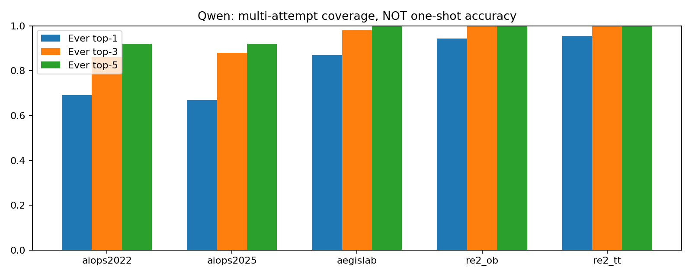

# Tournament：Qwen 的覆盖、失败机制与方法互补

Qwen-only 修订版：2026-09-30。原文件日期标识所分析的历史批次，并非新增实验日期。

本报告仅讨论 Qwen3.8-27B；结论由其自身病例和结果决定，不要求跨模型成立，也不推广为所有模型的性质。原始输出、分数、输入与实验状态未改；本轮新增推理调用为 0。

统计按 Qwen-only 范围重新分析：保留原科学问题的全部正负比较、病例掩码及失败处理，重新计算 Holm；有逐病例记录或差值的主比较重新复算配对检验与 dz。原始 p 在样本未变时本来就不依赖其他模型。CSV 数值往返影响浮点并列时，保留原数值并列口径，另存重算敏感性。附表 `raw_statistic_source` 明确区分重新配对计算与沿用同一 Qwen 样本的原始统计。没有把事后分析改称预注册发现。

## 研究范围与条件

38 轮顺序淘汰；某 case 首次 Top-1 命中后不再进入后续轮次。Qwen 有 5,736 个逻辑尝试、5,440 个实际新请求。只能在同一轮实际运行的剩余集合、或相邻轮共同病例中作配对比较，不能按新增数对所有方法排统一实力榜。

## 覆盖与主要发现

Qwen 累计 AC@1 覆盖 394/480（82.08%），AC@3=452/480，AC@5=464/480。best-of-attempts 的 oracle MRR=0.8855。它们描述探索覆盖，不是单方法单次诊断的性能。

尚未 Top-1 的 86 例中，70 例曾入前五：最佳第 2 名 53 例、第 3 名 5 例、第 4 名 9 例、第 5 名 3 例；16 例从未进入前五。不能把这 70 例全部称为纯推理失败，因为部分轮次没有保留关键事实，或只是宽泛提名。

R3 Trace support/confidence 与 R11 Metrics 文本化提供最清晰的共同剩余集正向变化。R10→R11 的 187 例选中事实一致，新增 Top-1 43 例，ΔMRR 约 +0.1753。其变化同时包括数值承载、画布分配和 token，不能唯一归因为数字读取。

R2 的稳健指标、R3 的操作级 Trace、R4/R18 的日志策略修复不同故障；R21 波动与 R22 传播前沿仍有新增。后期边际收益迅速下降：R17–28 为 1,293 次逻辑尝试换来 31 例新增，R29–38 为 904 次换来 8 例。没有依据继续无限增加选择器。

## 成败模式与数据集差异

- AIOPS-2022：69/100 Top-1 覆盖，node 内存消耗仅 1/5，容器 CPU 负载 9/9。强 Trace/日志可能让受影响 pod/service 抢走宿主故障的排序。
- AIOPS-2025：67/100，pod failure 5/13、node CPU stress 2/6；部分根因只有资源或状态线索。不能要求所有有效证据同时具有 Trace 和 Log 支持。
- AegisLab：87/100，其余 13 例均曾进入前五。应关注多重 HTTP/JVM/数据库异常中的候选排序，不只增加实体可见性。
- RE2-OB/TT：分别 85/90、86/90，所有病例曾进入前五；高覆盖不构成复杂宿主故障的泛化证明。

数据集内部，根因 Metrics 数量、最大偏离、部分 Trace/Log 覆盖与成功相关。feature_tests 使用 Mann–Whitney，categorical_tests 使用分类检验，不能将其误写成配对因果效应。标签用于事后解释，不能成为线上选择特征。

## 可追溯案例

- `INC-90722DCD5A51`：R10/R11 都保留 node 6351 的 load、free-memory、write-await。R10 先选 pod，R11 改选 node。它支持承载改变能修复已有证据的使用，而不证明文字天然更好。
- `INC-11AFCDDD7B6E`：R35 新增根因家族的 Metrics/Trace/Log 后，从前五外到第一。请求量下降但 exclusive latency 近似不变，说明吞吐/连接行为也有区分力，不能只找“变慢”。
- `INC-1FDAD91BB9BE`：公共池有根因数据库实例的 4 条 Metrics，无 Trace/Log；末轮仍没选入直接证据。某一历史轮选到过不等于当前输入存在。

正确排名与正确解释应分开。Qwen 未 Top-1 的完整回答约 89.53% 自报 high confidence；这不是可靠校准。reason 出现根因 ID 也不等于能支持其排名。当前有效轮次残余基础设施失败为 0，格式失败 2 条，远不足以解释剩余困难。

## 统计和下一步

相邻轮比较在每个数据范围的 37 个 Qwen 对照内校正；feature family 同样保留全部 Qwen 特征。适应性剩余集决定这些检验属于探索分析，不是独立验证。完整 38 轮数值和故障类型保留在表格中。

历史提出的 X 只是该阶段设计假说；后续 RQ3.1 已给出其结果，不能在本报告保留“尚未测试”的现状判断。最值得继承的是信号类型、层次和承载的具体规律，而不是把多轮 oracle 当作可部署方案。

## 完整主结果表

| dataset | n | covered | ever_top3 | ever_top5 | remaining | first_mrr | oracle_mrr |
|---|---|---|---|---|---|---|---|
| aiops2022 | 100 | 69 | 86 | 92 | 31 | 0.2970 | 0.7862 |
| aiops2025 | 100 | 67 | 88 | 92 | 33 | 0.3147 | 0.7790 |
| aegislab | 100 | 87 | 98 | 100 | 13 | 0.4843 | 0.9300 |
| re2_ob | 90 | 85 | 90 | 90 | 5 | 0.7556 | 0.9722 |
| re2_tt | 90 | 86 | 90 | 90 | 4 | 0.6354 | 0.9778 |
| aiops_combined | 200 | 136 | 174 | 184 | 64 | 0.3058 | 0.7826 |
| primary | 300 | 223 | 272 | 284 | 77 | 0.3653 | 0.8317 |
| all | 480 | 394 | 452 | 464 | 86 | 0.4891 | 0.8855 |

## Qwen-only 配对统计

以下保留指定范围的全部比较，不只保留显著项；其他数据集、层级、故障和敏感性分析见附件。Pratt-Wilcoxon 双侧及 paired dz 沿用原方法；分类、相关性和组间检验不改称 Wilcoxon。不报告置信区间。

### paired_round_tests.csv

| round | n | delta_rr | p | dz | holm_p |
|---|---|---|---|---|---|
| 2 | 314 | 0.0258 | 0.9925 | 0.0884 | 1.0000 |
| 3 | 290 | 0.1093 | 3.97e-08 | 0.3657 | 1.47e-06 |
| 4 | 265 | 0.0462 | 0.0723 | 0.1805 | 1.0000 |
| 5 | 247 | 0.0126 | 0.6237 | 0.0470 | 1.0000 |
| 6 | 232 | 0.0228 | 0.1096 | 0.1181 | 1.0000 |
| 7 | 232 | -0.0172 | 0.0132 | -0.0727 | 0.4272 |
| 8 | 225 | 0.0876 | 0.0021 | 0.2872 | 0.0732 |
| 9 | 204 | 0.0540 | 0.0562 | 0.1872 | 1.0000 |
| 10 | 193 | 0.0119 | 0.9794 | 0.0503 | 1.0000 |
| 11 | 187 | 0.1753 | 7.59e-07 | 0.4794 | 2.73e-05 |
| 12 | 144 | 0.0712 | 0.0077 | 0.2916 | 0.2607 |
| 13 | 134 | -0.0093 | 0.2518 | -0.0528 | 1.0000 |
| 14 | 132 | -0.0018 | 0.8474 | -0.0102 | 1.0000 |
| 15 | 132 | 0.0346 | 0.1169 | 0.1681 | 1.0000 |
| 16 | 128 | 0.0146 | 0.6192 | 0.0693 | 1.0000 |
| 17 | 125 | 0.0051 | 0.8749 | 0.0233 | 1.0000 |
| 18 | 121 | 0.0306 | 0.1471 | 0.1629 | 1.0000 |
| 19 | 119 | 0.0008 | 0.7986 | 0.0046 | 1.0000 |
| 20 | 118 | 0.0244 | 0.8720 | 0.1024 | 1.0000 |
| 21 | 115 | 0.0365 | 0.4928 | 0.1390 | 1.0000 |
| 22 | 109 | 0.0349 | 0.8609 | 0.1314 | 1.0000 |
| 23 | 102 | 0.0587 | 0.0726 | 0.2507 | 1.0000 |
| 24 | 98 | -0.0233 | 0.0829 | -0.1142 | 1.0000 |
| 25 | 98 | 0.0080 | 0.7682 | 0.0600 | 1.0000 |
| 26 | 97 | 0.0136 | 0.8663 | 0.1013 | 1.0000 |
| 27 | 97 | -0.0062 | 0.4678 | -0.0360 | 1.0000 |
| 28 | 94 | 0.0193 | 0.0931 | 0.1152 | 1.0000 |
| 29 | 94 | 0.0009 | 1.0000 | 0.0060 | 1.0000 |
| 30 | 93 | 0.0145 | 0.7195 | 0.0860 | 1.0000 |
| 31 | 92 | 0.0237 | 0.0740 | 0.1367 | 1.0000 |
| 32 | 92 | 0.0007 | 0.5222 | 0.0060 | 1.0000 |
| 33 | 92 | -0.0333 | 0.0129 | -0.2115 | 0.4272 |
| 34 | 92 | 0.0252 | 0.1353 | 0.1509 | 1.0000 |
| 35 | 91 | 0.0482 | 0.3297 | 0.1954 | 1.0000 |
| 36 | 86 | 0.0110 | 0.4432 | 0.0605 | 1.0000 |
| 37 | 86 | -0.0448 | 0.0184 | -0.2922 | 0.5710 |
| 38 | 86 | 0.0248 | 0.1429 | 0.2177 | 1.0000 |

### feature_tests.csv

| feature | p | holm_p |
|---|---|---|
| pool_M | 1.52e-05 | 0.0001 |
| pool_R | 0.0003 | 0.0020 |
| pool_L | 0.2114 | 0.4228 |
| pool_G | 0.0528 | 0.2032 |
| pool_candidate_count | 0.4236 | 0.4236 |
| pool_missing_fraction | 0.0003 | 0.0020 |
| pool_root_M | 0.0508 | 0.2032 |
| pool_root_R | 5.04e-11 | 4.53e-10 |
| pool_root_L | 5.83e-05 | 0.0004 |
| pool_root_metric_max_z | 1.03e-11 | 1.03e-10 |

## 分层、案例和复现附件

所有保留的表均仅含 Qwen 结果或公共数据/CPU 基线。大型表用于完整审计，不能把其中最优分组当作预注册确认。

- [all_first_successes](Tournament_Analysis_2026-09-15_assets/all_first_successes.csv)
- [all_uncovered_cases](Tournament_Analysis_2026-09-15_assets/all_uncovered_cases.csv)
- [case_profiles](Tournament_Analysis_2026-09-15_assets/case_profiles.csv)
- [case_profiles_with_archival_structure](Tournament_Analysis_2026-09-15_assets/case_profiles_with_archival_structure.csv)
- [categorical_tests](Tournament_Analysis_2026-09-15_assets/categorical_tests.csv)
- [coverage](Tournament_Analysis_2026-09-15_assets/coverage.csv)
- [failure_counts](Tournament_Analysis_2026-09-15_assets/failure_counts.csv)
- [fault_root_coverage](Tournament_Analysis_2026-09-15_assets/fault_root_coverage.csv)
- [feature_tests](Tournament_Analysis_2026-09-15_assets/feature_tests.csv)
- [manual_case_notes](Tournament_Analysis_2026-09-15_assets/manual_case_notes.csv)
- [observations](Tournament_Analysis_2026-09-15_assets/observations.csv)
- [paired_round_tests](Tournament_Analysis_2026-09-15_assets/paired_round_tests.csv)
- [phase_profiles](Tournament_Analysis_2026-09-15_assets/phase_profiles.csv)
- [qwen_headline_metrics](Tournament_Analysis_2026-09-15_assets/qwen_headline_metrics.csv)
- [reason_screen](Tournament_Analysis_2026-09-15_assets/reason_screen.csv)
- [round_results](Tournament_Analysis_2026-09-15_assets/round_results.csv)
- [round_success_failure_features](Tournament_Analysis_2026-09-15_assets/round_success_failure_features.csv)

分析口径、备份与复算说明见 [重分析说明](_qwen_only_reanalysis/README.md)。历史原始结果保持在对应 `RQs/` 下，本次没有调整实验队列、模型或评分器。
