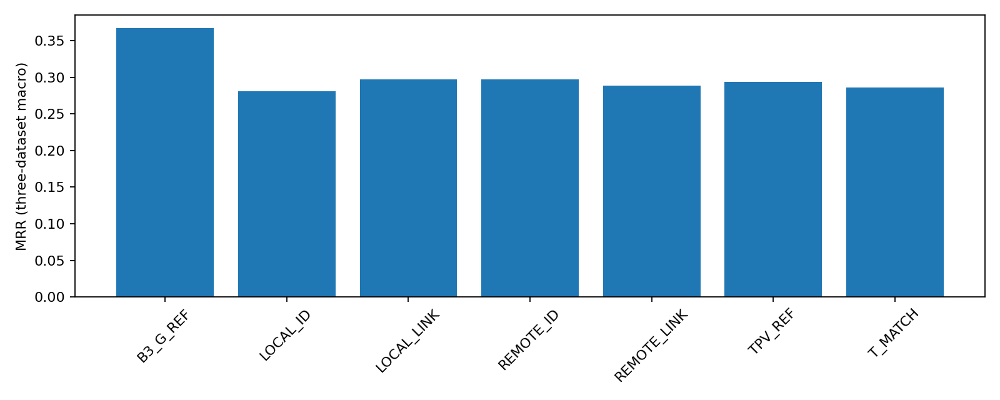
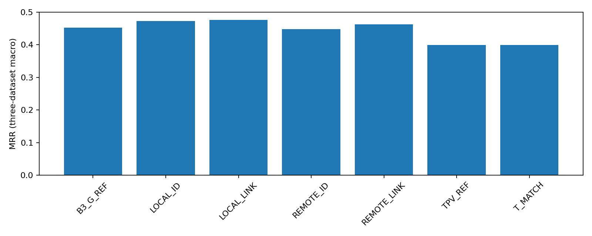

# RQ3.7 completed-stage analysis

Paired cases; reused answers are not independent repetitions. No confidence intervals.

| Experiment | Model | Cohort | Arm | Encoding | Subset | N | MRR |
|---|---|---|---|---|---|---:|---:|
| A | qwen3.8-27b | development | B3_G_REF | NATIVE | pooled | 176 | 0.4527 |
| A | qwen3.8-27b | development | B3_G_REF | NATIVE | aiops_combined | 117 | 0.3746 |
| A | qwen3.8-27b | development | B3_G_REF | NATIVE | aegislab | 59 | 0.6073 |
| A | qwen3.8-27b | development | B3_G_REF | NATIVE | aiops2022 | 58 | 0.3103 |
| A | qwen3.8-27b | development | B3_G_REF | NATIVE | aiops2025 | 59 | 0.4379 |
| A | qwen3.8-27b | development | B3_G_REF | NATIVE | primary_macro | 176 | 0.4518 |
| A | qwen3.8-27b | development | LOCAL_ID | NATIVE | pooled | 177 | 0.4736 |
| A | qwen3.8-27b | development | LOCAL_ID | NATIVE | aiops_combined | 117 | 0.4046 |
| A | qwen3.8-27b | development | LOCAL_ID | NATIVE | aegislab | 60 | 0.6083 |
| A | qwen3.8-27b | development | LOCAL_ID | NATIVE | aiops2022 | 58 | 0.3592 |
| A | qwen3.8-27b | development | LOCAL_ID | NATIVE | aiops2025 | 59 | 0.4492 |
| A | qwen3.8-27b | development | LOCAL_ID | NATIVE | primary_macro | 177 | 0.4722 |
| A | qwen3.8-27b | development | LOCAL_LINK | NATIVE | pooled | 177 | 0.4779 |
| A | qwen3.8-27b | development | LOCAL_LINK | NATIVE | aiops_combined | 117 | 0.4067 |
| A | qwen3.8-27b | development | LOCAL_LINK | NATIVE | aegislab | 60 | 0.6167 |
| A | qwen3.8-27b | development | LOCAL_LINK | NATIVE | aiops2022 | 58 | 0.3649 |
| A | qwen3.8-27b | development | LOCAL_LINK | NATIVE | aiops2025 | 59 | 0.4477 |
| A | qwen3.8-27b | development | LOCAL_LINK | NATIVE | primary_macro | 177 | 0.4764 |
| A | qwen3.8-27b | development | REMOTE_ID | NATIVE | pooled | 177 | 0.4492 |
| A | qwen3.8-27b | development | REMOTE_ID | NATIVE | aiops_combined | 117 | 0.3860 |
| A | qwen3.8-27b | development | REMOTE_ID | NATIVE | aegislab | 60 | 0.5722 |
| A | qwen3.8-27b | development | REMOTE_ID | NATIVE | aiops2022 | 58 | 0.3448 |
| A | qwen3.8-27b | development | REMOTE_ID | NATIVE | aiops2025 | 59 | 0.4266 |
| A | qwen3.8-27b | development | REMOTE_ID | NATIVE | primary_macro | 177 | 0.4479 |
| A | qwen3.8-27b | development | REMOTE_LINK | NATIVE | pooled | 177 | 0.4642 |
| A | qwen3.8-27b | development | REMOTE_LINK | NATIVE | aiops_combined | 117 | 0.4003 |
| A | qwen3.8-27b | development | REMOTE_LINK | NATIVE | aegislab | 60 | 0.5889 |
| A | qwen3.8-27b | development | REMOTE_LINK | NATIVE | aiops2022 | 58 | 0.3534 |
| A | qwen3.8-27b | development | REMOTE_LINK | NATIVE | aiops2025 | 59 | 0.4463 |
| A | qwen3.8-27b | development | REMOTE_LINK | NATIVE | primary_macro | 177 | 0.4629 |
| A | qwen3.8-27b | development | TPV_REF | NATIVE | pooled | 175 | 0.4005 |
| A | qwen3.8-27b | development | TPV_REF | NATIVE | aiops_combined | 116 | 0.3154 |
| A | qwen3.8-27b | development | TPV_REF | NATIVE | aegislab | 59 | 0.5678 |
| A | qwen3.8-27b | development | TPV_REF | NATIVE | aiops2022 | 57 | 0.2617 |
| A | qwen3.8-27b | development | TPV_REF | NATIVE | aiops2025 | 59 | 0.3672 |
| A | qwen3.8-27b | development | TPV_REF | NATIVE | primary_macro | 175 | 0.3989 |
| A | qwen3.8-27b | development | T_MATCH | NATIVE | pooled | 177 | 0.4007 |
| A | qwen3.8-27b | development | T_MATCH | NATIVE | aiops_combined | 117 | 0.3348 |
| A | qwen3.8-27b | development | T_MATCH | NATIVE | aegislab | 60 | 0.5292 |
| A | qwen3.8-27b | development | T_MATCH | NATIVE | aiops2022 | 58 | 0.3362 |
| A | qwen3.8-27b | development | T_MATCH | NATIVE | aiops2025 | 59 | 0.3333 |
| A | qwen3.8-27b | development | T_MATCH | NATIVE | primary_macro | 177 | 0.3996 |
| A | gemma-4-26b-a4b | development | B3_G_REF | NATIVE | pooled | 180 | 0.3667 |
| A | gemma-4-26b-a4b | development | B3_G_REF | NATIVE | aiops_combined | 120 | 0.3083 |
| A | gemma-4-26b-a4b | development | B3_G_REF | NATIVE | aegislab | 60 | 0.4833 |
| A | gemma-4-26b-a4b | development | B3_G_REF | NATIVE | aiops2022 | 60 | 0.3167 |
| A | gemma-4-26b-a4b | development | B3_G_REF | NATIVE | aiops2025 | 60 | 0.3000 |
| A | gemma-4-26b-a4b | development | B3_G_REF | NATIVE | primary_macro | 180 | 0.3667 |
| A | gemma-4-26b-a4b | development | LOCAL_ID | NATIVE | pooled | 180 | 0.2806 |
| A | gemma-4-26b-a4b | development | LOCAL_ID | NATIVE | aiops_combined | 120 | 0.2292 |
| A | gemma-4-26b-a4b | development | LOCAL_ID | NATIVE | aegislab | 60 | 0.3833 |
| A | gemma-4-26b-a4b | development | LOCAL_ID | NATIVE | aiops2022 | 60 | 0.2667 |
| A | gemma-4-26b-a4b | development | LOCAL_ID | NATIVE | aiops2025 | 60 | 0.1917 |
| A | gemma-4-26b-a4b | development | LOCAL_ID | NATIVE | primary_macro | 180 | 0.2806 |
| A | gemma-4-26b-a4b | development | LOCAL_LINK | NATIVE | pooled | 180 | 0.2972 |
| A | gemma-4-26b-a4b | development | LOCAL_LINK | NATIVE | aiops_combined | 120 | 0.2375 |
| A | gemma-4-26b-a4b | development | LOCAL_LINK | NATIVE | aegislab | 60 | 0.4167 |
| A | gemma-4-26b-a4b | development | LOCAL_LINK | NATIVE | aiops2022 | 60 | 0.2833 |
| A | gemma-4-26b-a4b | development | LOCAL_LINK | NATIVE | aiops2025 | 60 | 0.1917 |
| A | gemma-4-26b-a4b | development | LOCAL_LINK | NATIVE | primary_macro | 180 | 0.2972 |
| A | gemma-4-26b-a4b | development | REMOTE_ID | NATIVE | pooled | 180 | 0.2972 |
| A | gemma-4-26b-a4b | development | REMOTE_ID | NATIVE | aiops_combined | 120 | 0.2458 |
| A | gemma-4-26b-a4b | development | REMOTE_ID | NATIVE | aegislab | 60 | 0.4000 |
| A | gemma-4-26b-a4b | development | REMOTE_ID | NATIVE | aiops2022 | 60 | 0.2833 |
| A | gemma-4-26b-a4b | development | REMOTE_ID | NATIVE | aiops2025 | 60 | 0.2083 |
| A | gemma-4-26b-a4b | development | REMOTE_ID | NATIVE | primary_macro | 180 | 0.2972 |
| A | gemma-4-26b-a4b | development | REMOTE_LINK | NATIVE | pooled | 180 | 0.2889 |
| A | gemma-4-26b-a4b | development | REMOTE_LINK | NATIVE | aiops_combined | 120 | 0.2333 |
| A | gemma-4-26b-a4b | development | REMOTE_LINK | NATIVE | aegislab | 60 | 0.4000 |
| A | gemma-4-26b-a4b | development | REMOTE_LINK | NATIVE | aiops2022 | 60 | 0.2500 |
| A | gemma-4-26b-a4b | development | REMOTE_LINK | NATIVE | aiops2025 | 60 | 0.2167 |
| A | gemma-4-26b-a4b | development | REMOTE_LINK | NATIVE | primary_macro | 180 | 0.2889 |
| A | gemma-4-26b-a4b | development | TPV_REF | NATIVE | pooled | 180 | 0.2935 |
| A | gemma-4-26b-a4b | development | TPV_REF | NATIVE | aiops_combined | 120 | 0.2361 |
| A | gemma-4-26b-a4b | development | TPV_REF | NATIVE | aegislab | 60 | 0.4083 |
| A | gemma-4-26b-a4b | development | TPV_REF | NATIVE | aiops2022 | 60 | 0.2333 |
| A | gemma-4-26b-a4b | development | TPV_REF | NATIVE | aiops2025 | 60 | 0.2389 |
| A | gemma-4-26b-a4b | development | TPV_REF | NATIVE | primary_macro | 180 | 0.2935 |
| A | gemma-4-26b-a4b | development | T_MATCH | NATIVE | pooled | 180 | 0.2861 |
| A | gemma-4-26b-a4b | development | T_MATCH | NATIVE | aiops_combined | 120 | 0.2375 |
| A | gemma-4-26b-a4b | development | T_MATCH | NATIVE | aegislab | 60 | 0.3833 |
| A | gemma-4-26b-a4b | development | T_MATCH | NATIVE | aiops2022 | 60 | 0.2333 |
| A | gemma-4-26b-a4b | development | T_MATCH | NATIVE | aiops2025 | 60 | 0.2417 |
| A | gemma-4-26b-a4b | development | T_MATCH | NATIVE | primary_macro | 180 | 0.2861 |
| B | qwen3.8-27b | robustness | LOCAL_LINK | REPEAT | pooled | 84 | 0.5000 |
| B | qwen3.8-27b | robustness | LOCAL_LINK | REPEAT | aiops_combined | 55 | 0.4000 |
| B | qwen3.8-27b | robustness | LOCAL_LINK | REPEAT | aegislab | 29 | 0.6897 |
| B | qwen3.8-27b | robustness | LOCAL_LINK | REPEAT | aiops2022 | 27 | 0.2901 |
| B | qwen3.8-27b | robustness | LOCAL_LINK | REPEAT | aiops2025 | 28 | 0.5060 |
| B | qwen3.8-27b | robustness | LOCAL_LINK | REPEAT | primary_macro | 84 | 0.4952 |
| B | qwen3.8-27b | robustness | LOCAL_LINK | SCIENTIFIC | pooled | 84 | 0.4802 |
| B | qwen3.8-27b | robustness | LOCAL_LINK | SCIENTIFIC | aiops_combined | 55 | 0.3818 |
| B | qwen3.8-27b | robustness | LOCAL_LINK | SCIENTIFIC | aegislab | 29 | 0.6667 |
| B | qwen3.8-27b | robustness | LOCAL_LINK | SCIENTIFIC | aiops2022 | 27 | 0.2716 |
| B | qwen3.8-27b | robustness | LOCAL_LINK | SCIENTIFIC | aiops2025 | 28 | 0.4881 |
| B | qwen3.8-27b | robustness | LOCAL_LINK | SCIENTIFIC | primary_macro | 84 | 0.4755 |
| B | qwen3.8-27b | robustness | LOCAL_LINK | UNIT_EQUIVALENT | pooled | 84 | 0.4722 |
| B | qwen3.8-27b | robustness | LOCAL_LINK | UNIT_EQUIVALENT | aiops_combined | 55 | 0.4000 |
| B | qwen3.8-27b | robustness | LOCAL_LINK | UNIT_EQUIVALENT | aegislab | 29 | 0.6092 |
| B | qwen3.8-27b | robustness | LOCAL_LINK | UNIT_EQUIVALENT | aiops2022 | 27 | 0.2901 |
| B | qwen3.8-27b | robustness | LOCAL_LINK | UNIT_EQUIVALENT | aiops2025 | 28 | 0.5060 |
| B | qwen3.8-27b | robustness | LOCAL_LINK | UNIT_EQUIVALENT | primary_macro | 84 | 0.4684 |
| B | qwen3.8-27b | robustness | REMOTE_ID | REPEAT | pooled | 84 | 0.4603 |
| B | qwen3.8-27b | robustness | REMOTE_ID | REPEAT | aiops_combined | 55 | 0.3727 |
| B | qwen3.8-27b | robustness | REMOTE_ID | REPEAT | aegislab | 29 | 0.6264 |
| B | qwen3.8-27b | robustness | REMOTE_ID | REPEAT | aiops2022 | 27 | 0.2531 |
| B | qwen3.8-27b | robustness | REMOTE_ID | REPEAT | aiops2025 | 28 | 0.4881 |
| B | qwen3.8-27b | robustness | REMOTE_ID | REPEAT | primary_macro | 84 | 0.4559 |
| B | qwen3.8-27b | robustness | REMOTE_ID | SCIENTIFIC | pooled | 84 | 0.4881 |
| B | qwen3.8-27b | robustness | REMOTE_ID | SCIENTIFIC | aiops_combined | 55 | 0.3818 |
| B | qwen3.8-27b | robustness | REMOTE_ID | SCIENTIFIC | aegislab | 29 | 0.6897 |
| B | qwen3.8-27b | robustness | REMOTE_ID | SCIENTIFIC | aiops2022 | 27 | 0.2716 |
| B | qwen3.8-27b | robustness | REMOTE_ID | SCIENTIFIC | aiops2025 | 28 | 0.4881 |
| B | qwen3.8-27b | robustness | REMOTE_ID | SCIENTIFIC | primary_macro | 84 | 0.4831 |
| B | qwen3.8-27b | robustness | REMOTE_ID | UNIT_EQUIVALENT | pooled | 84 | 0.4484 |
| B | qwen3.8-27b | robustness | REMOTE_ID | UNIT_EQUIVALENT | aiops_combined | 55 | 0.3636 |
| B | qwen3.8-27b | robustness | REMOTE_ID | UNIT_EQUIVALENT | aegislab | 29 | 0.6092 |
| B | qwen3.8-27b | robustness | REMOTE_ID | UNIT_EQUIVALENT | aiops2022 | 27 | 0.2531 |
| B | qwen3.8-27b | robustness | REMOTE_ID | UNIT_EQUIVALENT | aiops2025 | 28 | 0.4702 |
| B | qwen3.8-27b | robustness | REMOTE_ID | UNIT_EQUIVALENT | primary_macro | 84 | 0.4442 |
| B | qwen3.8-27b | robustness | T_MATCH | REPEAT | pooled | 84 | 0.3740 |
| B | qwen3.8-27b | robustness | T_MATCH | REPEAT | aiops_combined | 55 | 0.2727 |
| B | qwen3.8-27b | robustness | T_MATCH | REPEAT | aegislab | 29 | 0.5661 |
| B | qwen3.8-27b | robustness | T_MATCH | REPEAT | aiops2022 | 27 | 0.2469 |
| B | qwen3.8-27b | robustness | T_MATCH | REPEAT | aiops2025 | 28 | 0.2976 |
| B | qwen3.8-27b | robustness | T_MATCH | REPEAT | primary_macro | 84 | 0.3702 |
| B | qwen3.8-27b | robustness | T_MATCH | SCIENTIFIC | pooled | 84 | 0.3720 |
| B | qwen3.8-27b | robustness | T_MATCH | SCIENTIFIC | aiops_combined | 55 | 0.2606 |
| B | qwen3.8-27b | robustness | T_MATCH | SCIENTIFIC | aegislab | 29 | 0.5833 |
| B | qwen3.8-27b | robustness | T_MATCH | SCIENTIFIC | aiops2022 | 27 | 0.2469 |
| B | qwen3.8-27b | robustness | T_MATCH | SCIENTIFIC | aiops2025 | 28 | 0.2738 |
| B | qwen3.8-27b | robustness | T_MATCH | SCIENTIFIC | primary_macro | 84 | 0.3680 |
| B | qwen3.8-27b | robustness | T_MATCH | UNIT_EQUIVALENT | pooled | 84 | 0.3690 |
| B | qwen3.8-27b | robustness | T_MATCH | UNIT_EQUIVALENT | aiops_combined | 55 | 0.2727 |
| B | qwen3.8-27b | robustness | T_MATCH | UNIT_EQUIVALENT | aegislab | 29 | 0.5517 |
| B | qwen3.8-27b | robustness | T_MATCH | UNIT_EQUIVALENT | aiops2022 | 27 | 0.2469 |
| B | qwen3.8-27b | robustness | T_MATCH | UNIT_EQUIVALENT | aiops2025 | 28 | 0.2976 |
| B | qwen3.8-27b | robustness | T_MATCH | UNIT_EQUIVALENT | primary_macro | 84 | 0.3654 |
| B | gemma-4-26b-a4b | robustness | LOCAL_LINK | REPEAT | pooled | 90 | 0.3278 |
| B | gemma-4-26b-a4b | robustness | LOCAL_LINK | REPEAT | aiops_combined | 60 | 0.2083 |
| B | gemma-4-26b-a4b | robustness | LOCAL_LINK | REPEAT | aegislab | 30 | 0.5667 |
| B | gemma-4-26b-a4b | robustness | LOCAL_LINK | REPEAT | aiops2022 | 30 | 0.2000 |
| B | gemma-4-26b-a4b | robustness | LOCAL_LINK | REPEAT | aiops2025 | 30 | 0.2167 |
| B | gemma-4-26b-a4b | robustness | LOCAL_LINK | REPEAT | primary_macro | 90 | 0.3278 |
| B | gemma-4-26b-a4b | robustness | LOCAL_LINK | SCIENTIFIC | pooled | 90 | 0.2778 |
| B | gemma-4-26b-a4b | robustness | LOCAL_LINK | SCIENTIFIC | aiops_combined | 60 | 0.2000 |
| B | gemma-4-26b-a4b | robustness | LOCAL_LINK | SCIENTIFIC | aegislab | 30 | 0.4333 |
| B | gemma-4-26b-a4b | robustness | LOCAL_LINK | SCIENTIFIC | aiops2022 | 30 | 0.2333 |
| B | gemma-4-26b-a4b | robustness | LOCAL_LINK | SCIENTIFIC | aiops2025 | 30 | 0.1667 |
| B | gemma-4-26b-a4b | robustness | LOCAL_LINK | SCIENTIFIC | primary_macro | 90 | 0.2778 |
| B | gemma-4-26b-a4b | robustness | LOCAL_LINK | UNIT_EQUIVALENT | pooled | 90 | 0.2944 |
| B | gemma-4-26b-a4b | robustness | LOCAL_LINK | UNIT_EQUIVALENT | aiops_combined | 60 | 0.2250 |
| B | gemma-4-26b-a4b | robustness | LOCAL_LINK | UNIT_EQUIVALENT | aegislab | 30 | 0.4333 |
| B | gemma-4-26b-a4b | robustness | LOCAL_LINK | UNIT_EQUIVALENT | aiops2022 | 30 | 0.2333 |
| B | gemma-4-26b-a4b | robustness | LOCAL_LINK | UNIT_EQUIVALENT | aiops2025 | 30 | 0.2167 |
| B | gemma-4-26b-a4b | robustness | LOCAL_LINK | UNIT_EQUIVALENT | primary_macro | 90 | 0.2944 |
| B | gemma-4-26b-a4b | robustness | REMOTE_ID | REPEAT | pooled | 90 | 0.3111 |
| B | gemma-4-26b-a4b | robustness | REMOTE_ID | REPEAT | aiops_combined | 60 | 0.2333 |
| B | gemma-4-26b-a4b | robustness | REMOTE_ID | REPEAT | aegislab | 30 | 0.4667 |
| B | gemma-4-26b-a4b | robustness | REMOTE_ID | REPEAT | aiops2022 | 30 | 0.2333 |
| B | gemma-4-26b-a4b | robustness | REMOTE_ID | REPEAT | aiops2025 | 30 | 0.2333 |
| B | gemma-4-26b-a4b | robustness | REMOTE_ID | REPEAT | primary_macro | 90 | 0.3111 |
| B | gemma-4-26b-a4b | robustness | REMOTE_ID | SCIENTIFIC | pooled | 90 | 0.3056 |
| B | gemma-4-26b-a4b | robustness | REMOTE_ID | SCIENTIFIC | aiops_combined | 60 | 0.2167 |
| B | gemma-4-26b-a4b | robustness | REMOTE_ID | SCIENTIFIC | aegislab | 30 | 0.4833 |
| B | gemma-4-26b-a4b | robustness | REMOTE_ID | SCIENTIFIC | aiops2022 | 30 | 0.2333 |
| B | gemma-4-26b-a4b | robustness | REMOTE_ID | SCIENTIFIC | aiops2025 | 30 | 0.2000 |
| B | gemma-4-26b-a4b | robustness | REMOTE_ID | SCIENTIFIC | primary_macro | 90 | 0.3056 |
| B | gemma-4-26b-a4b | robustness | REMOTE_ID | UNIT_EQUIVALENT | pooled | 90 | 0.2722 |
| B | gemma-4-26b-a4b | robustness | REMOTE_ID | UNIT_EQUIVALENT | aiops_combined | 60 | 0.2250 |
| B | gemma-4-26b-a4b | robustness | REMOTE_ID | UNIT_EQUIVALENT | aegislab | 30 | 0.3667 |
| B | gemma-4-26b-a4b | robustness | REMOTE_ID | UNIT_EQUIVALENT | aiops2022 | 30 | 0.2333 |
| B | gemma-4-26b-a4b | robustness | REMOTE_ID | UNIT_EQUIVALENT | aiops2025 | 30 | 0.2167 |
| B | gemma-4-26b-a4b | robustness | REMOTE_ID | UNIT_EQUIVALENT | primary_macro | 90 | 0.2722 |
| B | gemma-4-26b-a4b | robustness | T_MATCH | REPEAT | pooled | 90 | 0.2889 |
| B | gemma-4-26b-a4b | robustness | T_MATCH | REPEAT | aiops_combined | 60 | 0.2167 |
| B | gemma-4-26b-a4b | robustness | T_MATCH | REPEAT | aegislab | 30 | 0.4333 |
| B | gemma-4-26b-a4b | robustness | T_MATCH | REPEAT | aiops2022 | 30 | 0.1667 |
| B | gemma-4-26b-a4b | robustness | T_MATCH | REPEAT | aiops2025 | 30 | 0.2667 |
| B | gemma-4-26b-a4b | robustness | T_MATCH | REPEAT | primary_macro | 90 | 0.2889 |
| B | gemma-4-26b-a4b | robustness | T_MATCH | SCIENTIFIC | pooled | 90 | 0.3222 |
| B | gemma-4-26b-a4b | robustness | T_MATCH | SCIENTIFIC | aiops_combined | 60 | 0.2667 |
| B | gemma-4-26b-a4b | robustness | T_MATCH | SCIENTIFIC | aegislab | 30 | 0.4333 |
| B | gemma-4-26b-a4b | robustness | T_MATCH | SCIENTIFIC | aiops2022 | 30 | 0.2000 |
| B | gemma-4-26b-a4b | robustness | T_MATCH | SCIENTIFIC | aiops2025 | 30 | 0.3333 |
| B | gemma-4-26b-a4b | robustness | T_MATCH | SCIENTIFIC | primary_macro | 90 | 0.3222 |
| B | gemma-4-26b-a4b | robustness | T_MATCH | UNIT_EQUIVALENT | pooled | 90 | 0.3167 |
| B | gemma-4-26b-a4b | robustness | T_MATCH | UNIT_EQUIVALENT | aiops_combined | 60 | 0.2583 |
| B | gemma-4-26b-a4b | robustness | T_MATCH | UNIT_EQUIVALENT | aegislab | 30 | 0.4333 |
| B | gemma-4-26b-a4b | robustness | T_MATCH | UNIT_EQUIVALENT | aiops2022 | 30 | 0.2000 |
| B | gemma-4-26b-a4b | robustness | T_MATCH | UNIT_EQUIVALENT | aiops2025 | 30 | 0.3167 |
| B | gemma-4-26b-a4b | robustness | T_MATCH | UNIT_EQUIVALENT | primary_macro | 90 | 0.3167 |

## Registered comparisons

```json
[
  {
    "family": "primary_eight",
    "model": "qwen3.8-27b",
    "a": "LOCAL_LINK",
    "b": "REMOTE_ID",
    "n": 177,
    "delta": 0.028719397363465165,
    "p": 0.1795133349365381,
    "dz": 0.15627220968177205,
    "dz_undefined_zero_variance": false,
    "dataset_deltas": {
      "aiops2022": 0.020114942528735632,
      "aiops2025": 0.0211864406779661,
      "aegislab": 0.044444444444444446
    },
    "primary_macro_delta": 0.028581942550382062,
    "registered_n": 180,
    "missing_pairs": 3,
    "repair": 6,
    "break_count": 0,
    "missing_sensitivity_delta_range": [
      0.011574074074074072,
      0.0449074074074074
    ],
    "holm_p": 0.7180533397461524
  },
  {
    "family": "group_sensitivity",
    "model": "qwen3.8-27b",
    "a": "LOCAL_LINK",
    "b": "REMOTE_ID",
    "n": 145,
    "delta": 0.027873563218390806,
    "p": 0.18300747248764482,
    "dz": 0.1544878117763425,
    "dz_undefined_zero_variance": false,
    "holm_p": 0.7320298899505793
  },
  {
    "family": "primary_eight",
    "model": "qwen3.8-27b",
    "a": "LOCAL_LINK",
    "b": "T_MATCH",
    "n": 177,
    "delta": 0.07721280602636536,
    "p": 0.03463884948664015,
    "dz": 0.17471183832164106,
    "dz_undefined_zero_variance": false,
    "dataset_deltas": {
      "aiops2022": 0.028735632183908053,
      "aiops2025": 0.11440677966101695,
      "aegislab": 0.0875
    },
    "primary_macro_delta": 0.07688080394830833,
    "registered_n": 180,
    "missing_pairs": 3,
    "repair": 35,
    "break_count": 16,
    "missing_sensitivity_delta_range": [
      0.05925925925925927,
      0.0925925925925926
    ],
    "holm_p": 0.20783309691984092
  },
  {
    "family": "group_sensitivity",
    "model": "qwen3.8-27b",
    "a": "LOCAL_LINK",
    "b": "T_MATCH",
    "n": 145,
    "delta": 0.103544061302682,
    "p": 0.012240967861454214,
    "dz": 0.2391811999921223,
    "dz_undefined_zero_variance": false,
    "holm_p": 0.07344580716872529
  },
  {
    "family": "primary_eight",
    "model": "qwen3.8-27b",
    "a": "LOCAL_LINK",
    "b": "B3_G_REF",
    "n": 176,
    "delta": 0.027935606060606057,
    "p": 0.10270214360157984,
    "dz": 0.1053117580493339,
    "dz_undefined_zero_variance": false,
    "dataset_deltas": {
      "aiops2022": 0.05459770114942529,
      "aiops2025": 0.009887005649717513,
      "aegislab": 0.01977401129943503
    },
    "primary_macro_delta": 0.028086239366192613,
    "registered_n": 180,
    "missing_pairs": 4,
    "repair": 7,
    "break_count": 5,
    "missing_sensitivity_delta_range": [
      0.005092592592592594,
      0.049537037037037046
    ],
    "holm_p": 0.5135107180078992
  },
  {
    "family": "group_sensitivity",
    "model": "qwen3.8-27b",
    "a": "LOCAL_LINK",
    "b": "B3_G_REF",
    "n": 144,
    "delta": 0.017264660493827164,
    "p": 0.09515856719300604,
    "dz": 0.06866665044946471,
    "dz_undefined_zero_variance": false,
    "holm_p": 0.4757928359650302
  },
  {
    "family": "primary_eight",
    "model": "qwen3.8-27b",
    "a": "LOCAL_LINK",
    "b": "TPV_REF",
    "n": 175,
    "delta": 0.07714285714285714,
    "p": 0.0021350211996324564,
    "dz": 0.2665908868866597,
    "dz_undefined_zero_variance": false,
    "dataset_deltas": {
      "aiops2022": 0.10964912280701754,
      "aiops2025": 0.08050847457627118,
      "aegislab": 0.0423728813559322
    },
    "primary_macro_delta": 0.0775101595797403,
    "registered_n": 180,
    "missing_pairs": 5,
    "repair": 17,
    "break_count": 1,
    "missing_sensitivity_delta_range": [
      0.04722222222222222,
      0.10277777777777777
    ],
    "holm_p": 0.01708016959705965
  },
  {
    "family": "group_sensitivity",
    "model": "qwen3.8-27b",
    "a": "LOCAL_LINK",
    "b": "TPV_REF",
    "n": 144,
    "delta": 0.07199074074074074,
    "p": 0.0011506917229356201,
    "dz": 0.2613448139987533,
    "dz_undefined_zero_variance": false,
    "holm_p": 0.009205533783484961
  },
  {
    "family": "factorial_six",
    "model": "qwen3.8-27b",
    "effect": "proximity",
    "n": 177,
    "delta": 0.019067796610169493,
    "p": 0.23883870200266022,
    "dz": 0.1243429412920046,
    "dz_undefined_zero_variance": false,
    "holm_p": 0.9553548080106409
  },
  {
    "family": "factorial_six",
    "model": "qwen3.8-27b",
    "effect": "link",
    "n": 177,
    "delta": 0.009651600753295669,
    "p": 0.12773235602350655,
    "dz": 0.12190125634279299,
    "dz_undefined_zero_variance": false,
    "holm_p": 0.7663941361410394
  },
  {
    "family": "factorial_six",
    "model": "qwen3.8-27b",
    "effect": "interaction",
    "n": 177,
    "delta": -0.010828625235404895,
    "p": 0.17470049508888819,
    "dz": -0.062124421045797254,
    "dz_undefined_zero_variance": false,
    "holm_p": 0.8735024754444409
  },
  {
    "family": "primary_eight",
    "model": "gemma-4-26b-a4b",
    "a": "LOCAL_LINK",
    "b": "REMOTE_ID",
    "n": 180,
    "delta": 0.0,
    "p": 1.0,
    "dz": 0.0,
    "dz_undefined_zero_variance": false,
    "dataset_deltas": {
      "aiops2022": 0.0,
      "aiops2025": -0.016666666666666666,
      "aegislab": 0.016666666666666666
    },
    "primary_macro_delta": 0.0,
    "registered_n": 180,
    "missing_pairs": 0,
    "repair": 6,
    "break_count": 6,
    "missing_sensitivity_delta_range": [
      0.0,
      0.0
    ],
    "holm_p": 1.0
  },
  {
    "family": "group_sensitivity",
    "model": "gemma-4-26b-a4b",
    "a": "LOCAL_LINK",
    "b": "REMOTE_ID",
    "n": 146,
    "delta": 0.005707762557077626,
    "p": 0.990164801772662,
    "dz": 0.020701393267841844,
    "dz_undefined_zero_variance": false,
    "holm_p": 1.0
  },
  {
    "family": "primary_eight",
    "model": "gemma-4-26b-a4b",
    "a": "LOCAL_LINK",
    "b": "T_MATCH",
    "n": 180,
    "delta": 0.011111111111111112,
    "p": 0.7374163612388562,
    "dz": 0.02531712424776736,
    "dz_undefined_zero_variance": false,
    "dataset_deltas": {
      "aiops2022": 0.05,
      "aiops2025": -0.05,
      "aegislab": 0.03333333333333333
    },
    "primary_macro_delta": 0.011111111111111112,
    "registered_n": 180,
    "missing_pairs": 0,
    "repair": 18,
    "break_count": 16,
    "missing_sensitivity_delta_range": [
      0.011111111111111112,
      0.011111111111111112
    ],
    "holm_p": 1.0
  },
  {
    "family": "group_sensitivity",
    "model": "gemma-4-26b-a4b",
    "a": "LOCAL_LINK",
    "b": "T_MATCH",
    "n": 146,
    "delta": 0.007420091324200913,
    "p": 0.7434078272319385,
    "dz": 0.01776211596763908,
    "dz_undefined_zero_variance": false,
    "holm_p": 1.0
  },
  {
    "family": "primary_eight",
    "model": "gemma-4-26b-a4b",
    "a": "LOCAL_LINK",
    "b": "B3_G_REF",
    "n": 180,
    "delta": -0.06944444444444445,
    "p": 0.009892745077025564,
    "dz": -0.20579803165126515,
    "dz_undefined_zero_variance": false,
    "dataset_deltas": {
      "aiops2022": -0.03333333333333333,
      "aiops2025": -0.10833333333333334,
      "aegislab": -0.06666666666666667
    },
    "primary_macro_delta": -0.06944444444444443,
    "registered_n": 180,
    "missing_pairs": 0,
    "repair": 4,
    "break_count": 17,
    "missing_sensitivity_delta_range": [
      -0.06944444444444445,
      -0.06944444444444445
    ],
    "holm_p": 0.06924921553917895
  },
  {
    "family": "group_sensitivity",
    "model": "gemma-4-26b-a4b",
    "a": "LOCAL_LINK",
    "b": "B3_G_REF",
    "n": 146,
    "delta": -0.0776255707762557,
    "p": 0.009731946074312107,
    "dz": -0.22701687329659048,
    "dz_undefined_zero_variance": false,
    "holm_p": 0.06812362252018475
  },
  {
    "family": "primary_eight",
    "model": "gemma-4-26b-a4b",
    "a": "LOCAL_LINK",
    "b": "TPV_REF",
    "n": 180,
    "delta": 0.003703703703703705,
    "p": 0.986420935136102,
    "dz": 0.009791956536290634,
    "dz_undefined_zero_variance": false,
    "dataset_deltas": {
      "aiops2022": 0.05,
      "aiops2025": -0.047222222222222214,
      "aegislab": 0.008333333333333333
    },
    "primary_macro_delta": 0.0037037037037037073,
    "registered_n": 180,
    "missing_pairs": 0,
    "repair": 13,
    "break_count": 12,
    "missing_sensitivity_delta_range": [
      0.0037037037037037043,
      0.0037037037037037043
    ],
    "holm_p": 1.0
  },
  {
    "family": "group_sensitivity",
    "model": "gemma-4-26b-a4b",
    "a": "LOCAL_LINK",
    "b": "TPV_REF",
    "n": 146,
    "delta": -0.0022831050228310484,
    "p": 0.992044207673888,
    "dz": -0.006111594473701006,
    "dz_undefined_zero_variance": false,
    "holm_p": 1.0
  },
  {
    "family": "factorial_six",
    "model": "gemma-4-26b-a4b",
    "effect": "proximity",
    "n": 180,
    "delta": -0.004166666666666667,
    "p": 0.6939754894043961,
    "dz": -0.017686626269667938,
    "dz_undefined_zero_variance": false,
    "holm_p": 1.0
  },
  {
    "family": "factorial_six",
    "model": "gemma-4-26b-a4b",
    "effect": "link",
    "n": 180,
    "delta": 0.004166666666666667,
    "p": 0.6433143179428866,
    "dz": 0.028104599309342886,
    "dz_undefined_zero_variance": false,
    "holm_p": 1.0
  },
  {
    "family": "factorial_six",
    "model": "gemma-4-26b-a4b",
    "effect": "interaction",
    "n": 180,
    "delta": 0.025,
    "p": 0.4746744320439761,
    "dz": 0.07547852856928311,
    "dz_undefined_zero_variance": false,
    "holm_p": 1.0
  }
]
```

## Expansion recommendation (not an authorization)

```json
{
  "recommend_expand": true,
  "checks": {
    "A_and_B_complete": true,
    "q_macro_tpv": true,
    "q_macro_text": true,
    "gemma_macro": true,
    "q_aiops2022": true,
    "q_aiops2025": true,
    "q_aegislab": true,
    "qwen3.8-27b_node": true,
    "gemma-4-26b-a4b_node": true
  },
  "meaning": "exploratory cost-control rule, not significance/noninferiority",
  "contract_hash": "1a8d2032bb94718e3a23b62d1a62e331b0b1b671410312b78e22b1dc756997a2"
}
```

## Robustness

See robustness_pairs.json for per-case rank changes and first-position flips. REPEAT estimates observed variation; never choose its better answer.

## Case review

case_review_queue.json includes repairs, breaks and unchanged cases. Numeric mistakes, unit misuse, source/victim confusion and citation correctness require reading the saved inputs and public reason; no automatic causal diagnosis has been asserted.




