# CanvasRCA: Project Review, Experimental Findings, and Research Roadmap

**Meeting report · 12 October 2026 · Evidence through the completed RQ4.4 experiment**

This report is written for RCA researchers who have not participated in CanvasRCA's development. It reviews the experiment families from the original RQ1/RQ2 pilots through RQ4.4. Its quantitative synthesis uses the project's authoritative Qwen reports. Earlier Gemma runs remain part of the execution history, but the Qwen findings below are not claims of cross-model replication. The fourteen findings in Section 4 are the main presentation points; the experiment inventory and reference tables provide supporting detail.

**Reading guide:** [executive briefing](#1-executive-briefing) · [project definition](#2-project-definition) · [experiment inventory](#3-experiment-inventory-what-we-tested) · [fourteen findings](#4-fourteen-findings-to-present-at-the-meeting) · [baseline and method recipes](#5-the-baselines-and-best-methods-precisely-defined) · [real dashboard examples](#56-five-representative-dashboards-one-image-per-arm) · [hybrid input classification](#57-hybrid-does-not-mean-one-input-design-repetition-versus-replacement) · [TPV design and results](#58-tpv-a-representative-selective-replacement-method) · [related work](#6-related-work-which-ideas-informed-which-experiments) · [next plan](#7-remaining-work-and-proposed-next-plan) · [meeting narrative](#8-suggested-meeting-narrative) · [technical glossary](#10-glossary-and-method-name-key).

**A short key to the project's vocabulary.** `RQ` means *research question*, but labels such as RQ3.16 are also our chronological experiment IDs, not a hierarchy that the reader must already know. An **arm** is one registered experimental condition. An **anchor** is a reference configuration used to judge later changes; it is not necessarily the original preselected method. The **preselected method** is chosen before its results are seen, whereas the **best observed method** is identified afterward.

| Term used throughout | Meaning in this report |
| --- | --- |
| M/R/L/G | Metrics, distributed traces, logs, and relationships/graphs. R denotes traces in this project's shorthand. |
| Pure visual / hybrid | Pure visual carries incident evidence only in graphics; generic task instructions remain text. Hybrid supplies diagnostic text as well as images. Words such as labels and log strings may appear inside a genuine visual dashboard. |
| Repetition / replacement hybrid | Repetition keeps the depicted facts in text and adds their image representation. Replacement omits a designated textual evidence block and carries it in the image instead. A method can repeat one block while replacing another; Section 5.7 identifies which. |
| VLM / LLM | Vision–language model / large language model. The local Qwen model accepts image features and text instructions; its weights are frozen in the current research route. |
| MRR / RR | Mean reciprocal rank / one case's reciprocal rank. An accepted root at rank 1, 2 or 5 contributes 1, 0.5 or 0.2; no accepted root contributes 0. MRR is not top-1 accuracy. |
| AC@k / top-1 | Fraction of cases with an accepted root among the first *k* positions / the first-ranked candidate. A top-1 **flip** is a change in that candidate, not necessarily a loss. |
| QA | Separate question answering about displayed facts: reading values, assigning them to entities/units, or comparing phases. These answers never become a preceding RCA stage. |
| Image tokens / pruning | Numerical image representations consumed by the model. Pruning retains a subset; it does not necessarily change the saved dashboard pixels or avoid the initial image-encoding computation. |
| Binding / provenance | Binding attaches a value or mark to the correct entity, operation, unit and phase. Provenance records the public observation from which it came; neither means a proven causal relationship. |
| Marginal plot / local atlas | A marginal plot displays one variable's distribution separately from another's. Here these are parent and child durations. A local atlas is one image containing several selected, enlarged dashboard cards. |

For a short meeting presentation, use Figures 1–5, the fourteen finding titles, and the method examples in Section 5.6. Figures 11–12 explain the different hybrid designs and TPV's historical result. The full inventory and literature table are reference material. Specialized implementation and statistical terms are explained in Section 10.

## 1. Executive briefing

**CanvasRCA investigates how the representation of telemetry changes root-cause decisions, and uses that knowledge to seek a more accurate, less expensive, and more auditable RCA system.** The current method direction is single-call RCA with all incident-specific diagnostic evidence carried by genuine dashboard graphics. Text supplies only general task, reading, and output instructions.

The experiments have established useful representation effects and several substantial failure modes. They have **not yet produced a pure-visual method that beats the strong text reference**. This distinction should lead the meeting: there is a substantial empirical contribution to organize, while the desired method contribution remains unfinished.

| Reference point | Modality | Standard MRR | Mean input + output tokens | What it establishes |
| --- | --- | ---: | ---: | --- |
| RQ3.16 `MARGINAL_FIVE` | Full diagnostic text + native marginal plot | **0.5054** | **23,127.6** | Highest main-method point estimate in the modern 220-case RQ3.16–RQ4.4 comparison family; a hybrid result |
| RQ4.1 `T_FULL` | Complete strong text | **0.4846** | **22,243.9** | Registered strong text reference reused in later RQ4 comparisons |
| RQ4.1 `A_UNIFORM_E50` (`U`) | Pure visual, protected anchors + uniform token coverage | **0.3517** | **5,850.7** | Current strongest pure-visual development anchor on these 220 cases |
| RQ4.3 `P_SOFT_IMAGE` | Pure visual, modified image-token attention | **0.3491** | **5,851.9** | Best new pure-visual point estimate in RQ4.3, still below U |
| RQ4.4 `SOURCE_ZOOM` | U overview + source-complete high-resolution local views | **0.3286** | **14,094.9** | Latest preselected method; added detail did not improve the performance–cost frontier |

All five rows concern the modern 60/60/100 AIOPS-2022/AIOPS-2025/AegisLab development roster. They are **historical system references, not one contemporaneous controlled experiment**: prompts, decoding, backends, and information transport differ. Costs are recorded token counts, not dollar prices or interchangeable wall-clock measurements. Sources: [RQ3.16](CanvasRCA_Project_Review_2026-10-12_assets/references/docs/experiment_reports/RQ3_16_Qwen_Analysis_2026-10-03.md), [RQ4.1](CanvasRCA_Project_Review_2026-10-12_assets/references/docs/experiment_reports/RQ4_1_Qwen_Analysis_2026-10-09.md), [RQ4.3](CanvasRCA_Project_Review_2026-10-12_assets/references/docs/experiment_reports/RQ4_3_Qwen_Analysis_2026-10-12.md), [RQ4.4](CanvasRCA_Project_Review_2026-10-12_assets/references/docs/experiment_reports/RQ4_4_Qwen_Analysis_2026-10-12.md).

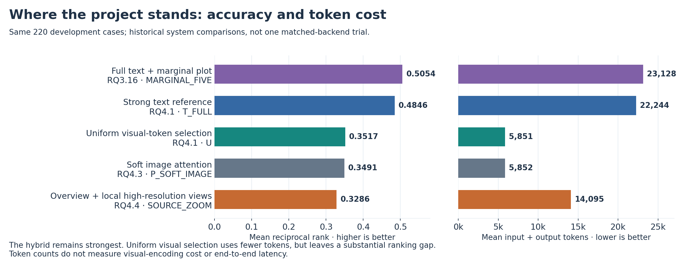

*Figure 1. The central performance–cost trade-off. The hybrid method is strongest, while uniform visual-token selection is cheaper but substantially less accurate. Both axes begin at zero. Bars show recorded averages, not significance tests; backend differences prevent interpreting token counts as measured speedups. [Vector version](CanvasRCA_Project_Review_2026-10-12_assets/fig_01_performance_cost.svg).*

The next useful step is to address **which evidence the model selects and which entity it assigns that evidence to**, while retaining U's useful cost reduction. Another broad search over layouts, zoom levels, or pruning ratios is poorly justified. RQ4.4 provides concrete wrong-panel and wrong-owner examples that can make the next intervention substantially more targeted.

An earlier positive result deserves separate prominence: **RQ1.1 TPV replaced textual topology with a graph**, keeping metrics, traces and logs in text. On its 300 primary cases it achieved **0.3819 MRR versus 0.3093 for the same-round text baseline**; the redundant full-text-plus-dashboard arm achieved **0.2964**. TPV therefore tested selective replacement, whereas MARGINAL_FIVE tested adding a second depiction of facts already present in text. The cohorts and protocols differ, so TPV is reported separately in Section 5.8 rather than inserted into the modern 220-case leaderboard.

## 2. Project definition

### 2.1 Purpose

The operational task is to rank the service, pod, or node responsible for a microservice incident from metrics, traces, logs, and relationships—abbreviated **M/R/L/G**. The goal is not merely to describe anomalies or recognize chart values. A useful system must distinguish a likely origin from downstream symptoms, return a valid candidate ranking, and support its explanation with correctly attributed observations.

The project pursues three outcomes together:

- **Accuracy:** improve root-cause ranking, with MRR around 0.60 as an engineering aspiration rather than an achieved result or a guarantee.
- **Cost:** reduce actual deployment expense, preferably while improving accuracy; a small increase of up to roughly 5% over a strong reference has been an accepted practical target. Input, output, image encoding, latency, and compute must be distinguished.
- **Trustworthiness:** retain an auditable connection between a statement, its visual evidence, the source entity, its unit and phase, and the final ranking. Correct rankings alone do not establish correct explanations.

### 2.2 Technical route: what is decided, and what remains experimental

The current architecture compiles public telemetry into a dashboard, processes its image representations, and makes one diagnostic model call. **The unified renderer** is the project's shared, registered library of chart components and composition operations; it also records which observation each graphic represents. **Visual encoding** converts pixels into feature vectors; a token policy then controls which vectors or interactions reach later computation.

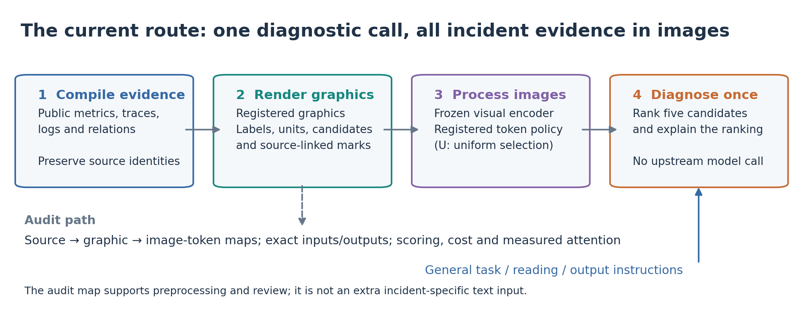

*Figure 2. The current technical route. The visual encoder and diagnostic language model are parts of one frozen vision–language system. Deterministic compilation is not a preceding model diagnosis. The audit path supports evaluation and preprocessing without supplying hidden textual observations to the model. [Vector version](CanvasRCA_Project_Review_2026-10-12_assets/fig_02_pipeline.svg).*

The important technical asset is that **we generate the images ourselves**. Unlike a generic photograph, a dashboard can carry an exact audit map from each mark to an entity, signal, operation, observation window, and source record. That map can support deterministic rendering and visual computation; it must not silently become an extra textual diagnostic channel.

The project first explored textual, visual, and hybrid representations, then evidence selection and fusion, and finally visual computation. RQ3's hybrid development was closed when RQ4 began. RQ4 has tested provenance-aware token selection, encoder partitioning, decoder processing, compact rendering, and source-complete local views. **No particular new RQ4 operator has earned adoption over U.** The decided route is therefore clearer than the final algorithm.

Current constraints are single-call diagnosis, purely visual incident evidence, the unified renderer at `src/renderer/`, and scoring through `src/scorer`. Independent QA and passive attention measurements are allowed as research measurements; their answers do not feed the diagnostic call. Multi-stage model-driven retrieval, diagnostic text fallback, and renewed RQ3.22 development are outside the current route. See [Codex.md](CanvasRCA_Project_Review_2026-10-12_assets/references/Codex.md) and [design decisions](CanvasRCA_Project_Review_2026-10-12_assets/references/plans/design_decisions.md).

### 2.3 Scope

| Dimension | Included | Boundary |
| --- | --- | --- |
| Task | Incident-level entity ranking and evidence-grounded explanations | No demonstrated automated remediation or production fault prevention |
| Evidence | Registered public M/R/L/G records, candidates, windows, and source bindings | “Complete” means complete within the frozen evidence contract, not every record in the raw telemetry corpus |
| Current model study | Local checkpoint named Qwen3.8-27B in the repository, using BF16 (16-bit floating-point arithmetic); RQ4.1 documents its implementation architecture as Qwen3_5 | Results do not establish general behavior of all VLMs or other checkpoints |
| Data | Earlier 480-case studies included two RE2 datasets; modern studies use 220 cases from three datasets | Those 220 cases are repeatedly exposed development data, not an untouched test set |
| Method | Deterministic preprocessing, real evidence graphics, visual feature/token operations, one diagnostic call | No training, new model, or multi-stage diagnosis is assumed by this roadmap |
| Evaluation | Standard/tolerant ranking, coverage, actual cost, QA, controlled perturbations, explanation and attention audits | A proxy score, a plausible reason, or an attention heatmap does not substitute for RCA performance |
| Reproducibility | Frozen inputs/configurations, original answers, scoring identities, measured attention and direct conversation viewing | Historical raw artifacts through RQ3.15 were deleted by user instruction; those experiments are now reviewed through retained reports/code/report assets |

The 220-case overall score weights AegisLab more heavily: 100 cases versus 60 for each AIOPS dataset. A **dataset macro average** gives each of the three datasets equal weight. An **event group** collects related cases from the same registered incident/event lineage so that they are not treated as independent observations in statistical tests. Recent protocols use 193 event groups; the many experiments on these same groups are not independent replications across fresh data.

### 2.4 Expected core innovation

The strongest prospective contribution is **an evidence-source-aware visual interface that preserves the information needed to identify, attribute, compare, and rank causes under a measured compute budget**. Its distinguishing input is the renderer's exact knowledge of the evidence source—not merely a more attractive dashboard.

This would need three linked contributions:

| Contribution | What would make it substantive | Present status |
| --- | --- | --- |
| Empirical | Separate evidence availability, reading, attribution, ranking, and explanation; show which interventions affect each | Several strong observations exist; mechanisms are only partially resolved |
| Method | Turn those observations into a visual operation that improves RCA at comparable cost | Not achieved over strong text; U is a useful low-cost starting point |
| Systems/evaluation | Auditable graphics-to-token mappings, single-call execution, controlled comparisons, realistic timing and compact complete records | Substantial infrastructure exists; this supports, but does not by itself prove, an algorithmic contribution |

Grouping, cropping, token pruning, graph visualization, and source labels already have close precedents. Applying them to RCA is insufficient by itself. The paper must show **what diagnostic dependency the method preserves that simpler controls do not, and how that preservation changes the accuracy–cost trade-off**.

There is also no information-theoretic reason that telemetry becomes unavailable to text merely because it is drawn. If a dashboard is a deterministic rendering of public data, a sufficiently capable numerical/text system can access the same underlying information. The defensible claim is a better computational representation under a particular budget—not that text can never express a relationship. This distinction is central to the [pure-visual direction discussion](CanvasRCA_Project_Review_2026-10-12_assets/references/important_docs/conversation_oct_06).

## 3. Experiment inventory: what we tested

This is a family-level inventory, not a new global leaderboard. “Completed” means the registered batch reached its recorded terminal state; it does not imply every response was valid or every infrastructure outcome known. “Stopped” and “not run” are not negative accuracy results. Most early numerical summaries below follow the Qwen-only September 30 reanalyses; those reanalyses are not retroactive preregistrations.

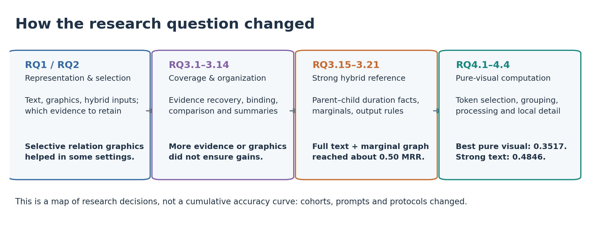

*Figure 3. A map of the research decisions, rather than a continuous learning curve. Early cohorts and protocols differ from the modern 220-case comparison. The roughly 0.50 hybrid result and the current pure-visual result belong to different input regimes. [Vector version](CanvasRCA_Project_Review_2026-10-12_assets/fig_03_research_evolution.svg).*

In the inventory, **TPV** denotes the historical topology-visual hybrid: metrics, traces and logs remain text, while the dedicated relationship-text block is replaced by a graph. A **Composer** proposes a dashboard program. **SFT** is supervised fine-tuning of that composer; **RL** is reinforcement learning, which was considered historically but is not part of the present frozen-model route. A **witness** is an additional observation used to check an explanation, not proof of causality. **Markless** controls retain the chart's labels, axes and layout while removing the tested points, curves or bars. Percentiles such as **p50/p95** mean the median/95th percentile of the specified population.

### 3.1 Foundations, early search, and RQ3.1–RQ3.8

| Experiment/family | Methods and question | Main outcome and status |
| --- | --- | --- |
| Original RQ1 pilots | Direct, matched, cross-region, typed/two-stage, ledger-handoff and visual-counterfactual interfaces | Mixed completion/qualification states; legacy Q9 Qwen had 1,876 completed calls. Later counterfactual batches had completed inference but pending synthesis in their status files. Superseded pilots are not an additional confirmed method success. [Status files](CanvasRCA_Project_Review_2026-10-12_assets/references/RQs/RQ1/findings/) |
| Original RQ2 | Equal-fact design search, evidence budgets, tool representations and downstream transfer | Retired after discovering that selector profiles could produce identical model-visible inputs. Such comparisons cannot establish a selector effect. Preserve valid historical observations with their limitations; RQ2.1 replaced the design. [Retirement audit](CanvasRCA_Project_Review_2026-10-12_assets/references/RQs/RQ2/findings/exp_retirement_audit_findings.md) |
| RQ1.1 | Natural and structured text, literal text screenshots, full graphics, redundant hybrid input, and all M/R/L/G modality combinations | On the primary 300 cases, text T **0.3093**, full visual V **0.2658**, screenshot S **0.2228**, topology-visual hybrid TPV **0.3819**. Selective relation visualization helped; full visual replacement did not. [Report](CanvasRCA_Project_Review_2026-10-12_assets/references/docs/experiment_reports/RQ1_1_RQ2_1_findings/findings.md) |
| RQ2.1 | Anomaly/trace/log selectors; random, coverage and diversity controls; heatmaps, overlays, bars, matrices and layered graphs; packing, entity/onset layouts and resolution | No universal winning selector or layout. Higher resolution gave a supported pooled MRR gain of **+0.0459**, with more input tokens and uneven dataset benefits. [Report](CanvasRCA_Project_Review_2026-10-12_assets/references/docs/experiment_reports/RQ1_1_RQ2_1_findings/findings.md) |
| Early RQ3 Composer/SFT | Learn a valid dashboard program; compare base and SFT composers under the same renderer | In the later matched 140-case check, valid renders rose **71→135**, using retained SFT proposals with the same renderer. This establishes tool/program validity, not improved RCA or successful RCA-utility RL. [Original SFT findings](CanvasRCA_Project_Review_2026-10-12_assets/references/RQs/RQ3/findings/exp_composer_learning_findings.md) predate the matched check; its completed status is recorded in [the September 11 BASE/SFT authority](CanvasRCA_Project_Review_2026-10-12_assets/references/Codex.md#rq3-paired-basesft-comparison-first--2026-09-11). |
| SEARCH1–39 | Small-subset selectors, resource/node evidence, candidate binding, silhouettes, trace/log signals, prompt and reasoning variants | 63 conditions across a 60-case training exploration; useful complementary behaviors, but more coverage and longer reasoning were not reliable ranking improvements. This was exploratory search, not independent validation. [Retrospective](CanvasRCA_Project_Review_2026-10-12_assets/references/RQs/RQ3/findings/search_retrospective_20260912.md) |
| 38-round tournament | Sequential methods on cases not yet solved at top-1 | Qwen's **union** reached 394/480 top-1 and oracle MRR **0.8855**. This is “some method succeeded,” not a deployable single system. The requested per-dataset coverage target was not met before the user stopped the tournament. [Final analysis](CanvasRCA_Project_Review_2026-10-12_assets/references/docs/experiment_reports/Tournament_Analysis_2026-09-15.md) |
| RQ3.1 | New evidence selectors and visual/table interfaces against TPV, text and SIRCL-derived references | On the 360-case historical test, TPV **0.3843**, X table **0.3095**, X visual **0.2761**. Replacing evidence selection lost important resource/node observations. [Report](CanvasRCA_Project_Review_2026-10-12_assets/references/docs/experiment_reports/RQ3_1_Results_Analysis_2026-09-19.md) |
| RQ3.2 | Restore signal coverage; test contrast tables/graphs and modality controls | Restoring root-associated coverage did not restore performance. Metric text beat its visual alternative in the relevant paired comparison; qualification also exposed clock/no-op issues. [Report](CanvasRCA_Project_Review_2026-10-12_assets/references/docs/experiment_reports/RQ3_2_Results_Analysis_2026-09-22.md) |
| RQ3.3 | Add source-grounded witnesses to TPV; compare more evidence, witness text, witness graph and extra calls | On the 118-case check, witness graph macro **0.4398**, more-evidence control **0.4304**. The small residual did not meet the decision gate; extra calls did not establish enough benefit. [Report](CanvasRCA_Project_Review_2026-10-12_assets/references/docs/experiment_reports/RQ3_3_Results_Analysis_2026-09-24.md) |
| RQ3.4 | Candidate evidence packets, host-peer comparison, and explicit claim-verification instructions | A graph without added verification instructions reached **0.4468** macro; adding the verification layer gave **0.4219**. Mechanical checks and a more elaborate reasoning contract did not guarantee better diagnosis. [Report](CanvasRCA_Project_Review_2026-10-12_assets/references/docs/experiment_reports/RQ3_4_Results_Analysis_2026-09-25.md) |
| RQ3.5 | Outcome-linked request evidence; marginal, joint and conditional summaries; evidence-versus-instruction controls | 60-case screen: witness baseline **0.4026**, joint **0.3474**, conditional **0.3387**. Added request evidence was applicable in only 28/60 cases. A completed screen, not a successful full-cohort method. [Report](CanvasRCA_Project_Review_2026-10-12_assets/references/docs/experiment_reports/RQ3_5_Screen_Analysis_2026-09-26.md) |
| RQ3.6 A/B | Isolate text interfaces, graph fields, host-peer scope, deduplication and relation binding | A text-interface package improved paired MRR by **+0.1017** with corrected support. A host-peer/deduplicated graph improved by **+0.0750** in its five-comparison family; significance did not survive a broader 17-comparison family. [Stage A](CanvasRCA_Project_Review_2026-10-12_assets/references/docs/experiment_reports/RQ3_6_Stage_A_Analysis_2026-09-26.md), [mechanisms](CanvasRCA_Project_Review_2026-10-12_assets/references/docs/experiment_reports/RQ3_6_Mechanisms_Analysis_2026-09-28.md) |
| RQ3.7 A/B/C | Local versus remote placement, IDs versus binding links, fused versus separated evidence; numeric-format controls | The complete local-link package showed positive results against older TPV. In the larger historical test its paired gain over strong text was **+0.0490**, but case/group tests differed; its gain over separated panels was only **+0.0032**. The package and the link mechanism are different claims. [A/B](CanvasRCA_Project_Review_2026-10-12_assets/references/docs/experiment_reports/RQ3_7_Results_Analysis_2026-09-28.md), [C](CanvasRCA_Project_Review_2026-10-12_assets/references/docs/experiment_reports/RQ3_7C_RQ3_8_Qwen_Analysis_2026-09-30.md) |
| RQ3.8 | First unified-renderer full-evidence dashboard; retain full text and add curves/operation/relationship graphics and graphical controls | On 342 paired historical-test cases, text **0.4110→0.3339** with full graphics, ΔMRR **−0.0771**, supported after correction. More visible detail was harmful in this setting. [Report](CanvasRCA_Project_Review_2026-10-12_assets/references/docs/experiment_reports/RQ3_7C_RQ3_8_Qwen_Analysis_2026-09-30.md) |

### 3.2 Unified-renderer RQ3.9–RQ3.22

| Experiment | Methods and question | Main outcome and status |
| --- | --- | --- |
| RQ3.9 | Candidate joint-comparison visual design | Qualification/preparation existed, but no completed formal ranking result. It must not be cited as an MRR failure or success. [Retained qualification](CanvasRCA_Project_Review_2026-10-12_assets/references/docs/experiment_reports/through_RQ3_15_preserved/RQs/RQ3_9/results/joint_v1/logs/2026-10-01_qualification.md) |
| RQ3.10 | Scope/host-peer competitive evidence: matrix, tiles and text | AIOPS matrix MRR **0.3299**, base **0.3118**; incremental comparisons were unsupported, with roughly **75%** more cost than base. [Report](CanvasRCA_Project_Review_2026-10-12_assets/references/docs/experiment_reports/RQ3_10_Qwen_Analysis_2026-10-01.md) |
| RQ3.11 | Protected numeric quantization, coarse/fine visual encoding and exact-value patches | Qualification preserved 3,360 registered numeric protection signatures, yet visual MRR **0.2840** versus compact text **0.2792** did not establish benefit or the intended cost reduction. [Report](CanvasRCA_Project_Review_2026-10-12_assets/references/docs/experiment_reports/RQ3_11_Qwen_Analysis_2026-10-01.md) |
| RQ3.12 | Candidate-conditioned reference predictions and residual displays | Conditional visual evidence did not beat the observed-visual control; applicability and root-relevant coverage were weak. These regressions were not established causal counterfactuals. [Report](CanvasRCA_Project_Review_2026-10-12_assets/references/docs/experiment_reports/RQ3_12_Qwen_Analysis_2026-10-02.md) |
| RQ3.13 | Observed excursions/time bands, state summaries, and pixel/text controls | Visual improvements in AIOPS coexisted with AegisLab MRR **0.4958→0.3667** on its 20 cases. Dataset trade-offs and mistaken attribution became central concerns. [Report](CanvasRCA_Project_Review_2026-10-12_assets/references/docs/experiment_reports/RQ3_13_Qwen_Analysis_2026-10-02.md) |
| RQ3.14 | RAW/CANON/SAFE/WINDOW text; full curves; identical-summary screenshot; markless and repeat controls | Full-window text summaries helped: WINDOW_TEXT−SAFE **+0.0469**, corrected support. WINDOW_VISUAL−WINDOW_TEXT was **−0.0523**. The useful addition was explicit evidence organization, not established curve benefit. [Report](CanvasRCA_Project_Review_2026-10-12_assets/references/docs/experiment_reports/RQ3_14_Qwen_Analysis_2026-10-02.md) |
| RQ3.15 | Binary versus continuous same-request parent–child facts; 2-D joint scatter versus marginal distributions | PAIR_TEXT **0.4280**, PAIR_VISUAL **0.4560**, MARGINAL_VISUAL **0.4692**. Continuous/joint visual gains did not meet the main requirements; marginal display was a promising development signal. [Report](CanvasRCA_Project_Review_2026-10-12_assets/references/docs/experiment_reports/RQ3_15_Qwen_Analysis_2026-10-03.md) |
| RQ3.16 | Flexible versus exactly-five outputs; pair text, marginal graph, markless and independent repeat | MARGINAL_FIVE **0.5054**, PAIR_FIVE **0.4436**, MARKLESS_FIVE **0.4963**. Exactly-five output improved marginal MRR with corrected support; the distinct contribution of the plotted points remained unestablished. [Report](CanvasRCA_Project_Review_2026-10-12_assets/references/docs/experiment_reports/RQ3_16_Qwen_Analysis_2026-10-03.md) |
| RQ3.17 | Native/matched marginal plots, complete call/deployment topology, matrix and node-arrow variants, binding and markless controls | Native marginal **0.5048** (219 known), matrix combination **0.4957**, node combination **0.4778**. Topology combination did not improve the native marginal reference. Expanded-arm CPU qualification included a user waiver, not an all-tests-passed claim. [Report](CanvasRCA_Project_Review_2026-10-12_assets/references/docs/experiment_reports/RQ3_17_Qwen_Analysis_2026-10-04.md) |
| RQ3.18 | **Actual rewritten 11-arm population-readout experiment:** explicit text readouts, sampled marginal plots, population p50/p95 profiles, markless and repeats | READOUT_PROFILE **0.4877** versus READOUT_TEXT **0.4648**; paired gain **+0.0220**, unsupported after correction. AIOPS benefited directionally, AegisLab did not reliably do so. This was not the deleted six-arm neutral-canvas plan. [Report](CanvasRCA_Project_Review_2026-10-12_assets/references/RQs/RQ3_18/findings/exp_population_readout_findings.md) |
| RQ3.19 | Full/compact text, redundant graph, selective fact transfer to graphics; independent QA and correct-readout interventions | Visual replacement **0.4139** versus full text **0.4562**, paired **−0.0450**, with about **2.8% more** total tokens. QA improved under reading aids without an established RCA improvement. [Report](CanvasRCA_Project_Review_2026-10-12_assets/references/RQs/RQ3_19/findings/exp_visual_replacement_qa_findings.md) |
| RQ3.20 | Summary text/visual and two-stage text/visual fetch against full text | VISUAL_FETCH **0.3866**, TEXT_FETCH **0.3782**, FULL_TEXT **0.4693**. Cost fell, accuracy fell, and the executable-selection interface often rejected real but non-fetchable fact IDs. The user closed multi-stage RCA after this experiment. [Report](CanvasRCA_Project_Review_2026-10-12_assets/references/docs/experiment_reports/RQ3_20_Qwen_Analysis_2026-10-06.md) |
| RQ3.21 | Reversible compact encoding, entity organization and native marginal graphics; QA, repeats and block-order perturbations | Six new main arms plus a reused historical anchor. RAW_VISUAL **0.4934**; PACK_ENTITY_VISUAL **0.4180** despite roughly 16–18% cost savings against the anchor. Fact-preserving compression reduced usability. [Report](CanvasRCA_Project_Review_2026-10-12_assets/references/docs/experiment_reports/RQ3_21_Qwen_Analysis_2026-10-06.md) |
| RQ3.22 | Proposed marginal-card count/selection expansion and output-adapter work | Explicitly cancelled and deleted. No retained final experiment should be presented as completed evidence. The development route moved to RQ4. [Current authority](CanvasRCA_Project_Review_2026-10-12_assets/references/Codex.md) |

RQ3.16–RQ3.21 use the modern 220-case roster. RQ3.18, RQ3.19, and several other completed queues retain infrastructure-unknown positions: their headline means describe known outcomes, with paired comparisons and full-denominator bounds in their own reports. They must not be silently converted to 220 fully observed outcomes.

### 3.3 RQ4: pure-visual computation

| Experiment | What changed | Result and interpretation |
| --- | --- | --- |
| RQ4.1 | Complete graphics; uniform, unary and comparison-aware token selection at several budgets; quota/rewired/diversity controls; adapted DART/SCOPE/S2Prune/G-Prune; contrast atlas; QA/position interventions/attention | 6,082 completed formal calls. U **0.3517**, preselected CVC_E50 **0.3332**, full visual **0.2209**, strong text **0.4846**. Large token savings, a clear spatial-instability finding, but no pure-visual win over text. [Report](CanvasRCA_Project_Review_2026-10-12_assets/references/docs/experiment_reports/RQ4_1_Qwen_Analysis_2026-10-09.md) |
| RQ4.2 | Same complete visual facts under full encoding, geometric partitions, source-semantic partitions, rewired partitions, or four native images | 1,336 logical positions: 1,328 new answers and eight references. FULL **0.2841**, GEOM **0.3088**, SEM **0.3084**, SHAM **0.3011**, NATIVE4 **0.3235**. Correct source partitioning did not beat geometric or native multi-image controls. [Report](CanvasRCA_Project_Review_2026-10-12_assets/references/docs/experiment_reports/RQ4_2_Qwen_Analysis_2026-10-10.md) |
| RQ4.3 | Evidence selection; compact/horizon rendering; local bidirectional processing and soft image attention; combinations; HTML system controls; QA/order/repeat measurements | Final 4,832 positions: 4,637 new calls and 195 references. Twenty new main arms completed. Best new pure visual P_SOFT_IMAGE **0.3491**; preselected X_SRP **0.2630**. Semantic HTML **0.3191** and plot-code HTML **0.3294** were textual controls, not pure-visual successes. [Report](CanvasRCA_Project_Review_2026-10-12_assets/references/docs/experiment_reports/RQ4_3_Qwen_Analysis_2026-10-12.md) |
| RQ4.4 | U overview plus readability-selected high-resolution source cards; matched repeated low-detail cards; hash-selected high-resolution cards; isolated-target QA | All **840 formal calls** completed, plus 18 smoke calls. Standard MRR: SOURCE **0.3286**, REPEAT **0.3230**, HASH **0.3120**; SOURCE tolerant MRR **0.3431**. Main comparisons unsupported. Wrong-panel answers and attribution failures are informative, but there is no ranking/cost advance over U. [Report](CanvasRCA_Project_Review_2026-10-12_assets/references/docs/experiment_reports/RQ4_4_Qwen_Analysis_2026-10-12.md) |

The cumulative research coverage is broad: evidence availability, modality allocation, graphic encoding, layout, resolution, prompt/schema design, numeric encoding, graph fusion, token budgets, encoder/decoder operations, runtime backends, and behavioral/mechanistic probes. The remaining problem is **not a lack of arm variety**. It is converting a specific diagnosed failure into a method that survives a strong, economical comparison.

## 4. Fourteen findings to present at the meeting

**Evidence labels:** “supported” refers to the stated experiment's corrected test; “development result” means an observed engineering difference without the required confirmatory support; “mechanism hypothesis” means an explanation still requiring an intervention. The labels apply to the particular claim, not to an entire experiment. **ΔMRR** is a difference in mean reciprocal rank; **pH** is a p-value adjusted with the Holm procedure for a registered family of comparisons. A **paired** comparison uses the same cases in both conditions. These terms do not make comparisons across different historical protocols causal.

### Finding 1 — Visual relationships can help, but topology is not a universal improvement

RQ1.1 supplied a positive controlled result: TPV, which kept M/R/L as text and rendered G, improved primary-cohort MRR by **+0.0727** over natural text, with Holm-adjusted p≈0.0276. The factorial average effect of G was **+0.0561**, adjusted p≈0.0011. RQ3.6 and RQ3.7 later found useful graph/fusion packages under particular evidence and interface conditions.

However, RQ3.17's native marginal plot achieved **0.5048**, versus **0.4957** for the full matrix combination and **0.4778** for the node-arrow combination. Both topology drawing families were tested; the matrix was not chosen because earlier work had established its superiority. The supported lesson is **selective, task-dependent value of relation visualization**, not “add topology whenever possible.” [RQ1.1/RQ2.1](CanvasRCA_Project_Review_2026-10-12_assets/references/docs/experiment_reports/RQ1_1_RQ2_1_findings/findings.md), [RQ3.17](CanvasRCA_Project_Review_2026-10-12_assets/references/docs/experiment_reports/RQ3_17_Qwen_Analysis_2026-10-04.md).

### Finding 2 — Adding correct graphics to complete text can make diagnosis worse

This is one of the clearest counterintuitive observations. In RQ3.8, correct full text remained available, yet adding the full dashboard reduced paired historical-test MRR from **0.4110 to 0.3339**. The **−0.0771** difference had corrected support at both case and event-group levels (pH≈0.00112/0.000679). In RQ3.14, full curves likewise trailed the corresponding window-summary text by **−0.0523**.

These results reject a practical assumption: redundant correct evidence is not automatically harmless. They do not identify a unique cause. Visual competition, changes in evidence emphasis, input length, reading burden, and inconsistent attribution remain possible mechanisms. RQ4.4 extends the concern to redundant local views within a pure-visual system. [RQ3.8](CanvasRCA_Project_Review_2026-10-12_assets/references/docs/experiment_reports/RQ3_7C_RQ3_8_Qwen_Analysis_2026-09-30.md), [RQ3.14](CanvasRCA_Project_Review_2026-10-12_assets/references/docs/experiment_reports/RQ3_14_Qwen_Analysis_2026-10-02.md).

### Finding 3 — The improvement toward 0.50 is real development progress, but it is not one measured cumulative causal effect

We should not describe the project as having “found nothing” simply because many component tests failed. The hybrid pipeline reached **0.5054** in RQ3.16, **0.5039** in its independent repeat, **0.5048** for RQ3.17's native marginal reference, and **0.4934** for RQ3.21's representation-neutral RAW_VISUAL. That is a useful performance plateau across related implementations on exposed cases.

There are also concrete supported improvements: RQ3.6's interface package, RQ3.14's full-window summary, and RQ3.16's fixed-five marginal output. RQ3.7's complete package could outperform an older reference even when the incremental binding-line effect was unclear. **A complete method can be useful without every component independently clearing a significance threshold.**

Nevertheless, one cannot add the per-round deltas or infer a single significant “0.40→0.50” improvement: cohorts, denominators, evidence contracts, interfaces, and decoding changed. The appropriate conclusion is **accumulated engineering progress with partly unresolved attribution**. A shared-cohort, frozen-contract old-versus-final comparison is needed for a stronger cumulative claim; compatible saved outputs should be reused before considering new calls. [RQ3.6](CanvasRCA_Project_Review_2026-10-12_assets/references/docs/experiment_reports/RQ3_6_Stage_A_Analysis_2026-09-26.md), [RQ3.14](CanvasRCA_Project_Review_2026-10-12_assets/references/docs/experiment_reports/RQ3_14_Qwen_Analysis_2026-10-02.md), [RQ3.16](CanvasRCA_Project_Review_2026-10-12_assets/references/docs/experiment_reports/RQ3_16_Qwen_Analysis_2026-10-03.md), [RQ3.21](CanvasRCA_Project_Review_2026-10-12_assets/references/docs/experiment_reports/RQ3_21_Qwen_Analysis_2026-10-06.md).

### Finding 4 — Keeping an entity is not the same as keeping the evidence that diagnoses it

RQ1.1 had 44 primary cases without displayed M/R/L directly associated with a root entity; text and full visual both scored zero in this subgroup, and TPV solved only one. In RQ3.1, new selection substantially reduced root-associated metric and node evidence. RQ3.2 restored much of the coverage but still did not restore ranking performance.

This identifies three distinct requirements: **the root must be an eligible candidate; useful evidence about it must be present; the relevant mechanism must remain recognizable**. Keeping a node's CPU series does not substitute for retaining the memory series that explains its fault. Coverage counters and fact-count audits are necessary safeguards, not task-utility measures. The same warning applies to recent source-preserving token and geometry qualifications. [RQ1.1](CanvasRCA_Project_Review_2026-10-12_assets/references/docs/experiment_reports/RQ1_1_RQ2_1_findings/findings.md), [RQ3.1](CanvasRCA_Project_Review_2026-10-12_assets/references/docs/experiment_reports/RQ3_1_Results_Analysis_2026-09-19.md), [RQ3.2](CanvasRCA_Project_Review_2026-10-12_assets/references/docs/experiment_reports/RQ3_2_Results_Analysis_2026-09-22.md).

### Finding 5 — The response contract is part of the diagnostic method

RQ3.16 compared flexible-length rankings with exactly five distinct candidates. For the marginal-visual condition, fixed-five increased paired MRR by **+0.0315** on 219 cases, with pH≈0.0173 at case level and 0.0400 at event-group level. AC@5 increased **+0.0776**, also supported after correction.

This was not merely free completion of an unchanged ranking tail: changing the output requirement could change the entire ordering and explanation. Nor did fixed-five uniformly improve every text condition. RQ4's invalid candidate/duplicate outputs further show that a method can lose deployment utility at the output interface. We therefore report standard and tolerant scores separately, without regenerating bad answers or silently repairing IDs. [RQ3.16](CanvasRCA_Project_Review_2026-10-12_assets/references/docs/experiment_reports/RQ3_16_Qwen_Analysis_2026-10-03.md), [RQ4.1](CanvasRCA_Project_Review_2026-10-12_assets/references/docs/experiment_reports/RQ4_1_Qwen_Analysis_2026-10-09.md).

### Finding 6 — Most of the hybrid marginal result survives removal of the plotted data points

RQ3.16's `MARGINAL_FIVE` scored **0.5054**, but `MARKLESS_FIVE` still scored **0.4963**. Their RR was identical on **209/220** cases; only eight improved and three worsened with points. The incremental **+0.0091** was not supported after correction.

This is a substantial attribution warning, not evidence that the whole hybrid result is imaginary. Axes, labels, phase organization, identity cues and full diagnostic text remained available. The result does not distinguish their individual roles. RQ3.18's population-profile and markless controls also failed to establish a stable independent advantage for the visual marks. A marginal plot's high aggregate MRR cannot by itself prove that the model used the distribution of points. [RQ3.16](CanvasRCA_Project_Review_2026-10-12_assets/references/docs/experiment_reports/RQ3_16_Qwen_Analysis_2026-10-03.md), [RQ3.18](CanvasRCA_Project_Review_2026-10-12_assets/references/RQs/RQ3_18/findings/exp_population_readout_findings.md).

### Finding 7 — Improving measured QA does not reliably improve root-cause ranking

The early semantic-QA analyses found only weak association between general reading scores and RCA. RQ3.19 went beyond correlation: correct public reading aids increased visual QA from **94.35% to 99.72%**; the matched 58-case improvement was **5.46 percentage points**, pH=0.000381. A corresponding reliable RCA gain was not established. The aids repeated existing facts rather than providing root-cause labels.

This supports measuring **reading and diagnostic use separately**. It does not prove statistical independence or that reading is irrelevant. QA targets may be non-diagnostic, ceilings/floors reduce sensitivity, and aids can directly answer the questions. RQ4.1's text-QA interface was contaminated by RCA instructions and its strict joint score had zero variance; that batch is not valid additional evidence of “zero QA–RCA correlation.” [RQ3.19](CanvasRCA_Project_Review_2026-10-12_assets/references/RQs/RQ3_19/findings/exp_visual_replacement_qa_findings.md), [RQ4.1](CanvasRCA_Project_Review_2026-10-12_assets/references/docs/experiment_reports/RQ4_1_Qwen_Analysis_2026-10-09.md).

### Finding 8 — In RQ4.4, many apparent reading failures were answers to the wrong real card

This is the most actionable new behavioral observation. On 30 fixed cases, SOURCE_ZOOM had tolerant QA field accuracy **28.67%**; both requested numbers were correct in **4/30** cases. With only the complete target card present, tolerant field accuracy was **96%**, and the two numbers were correct in **30/30**.

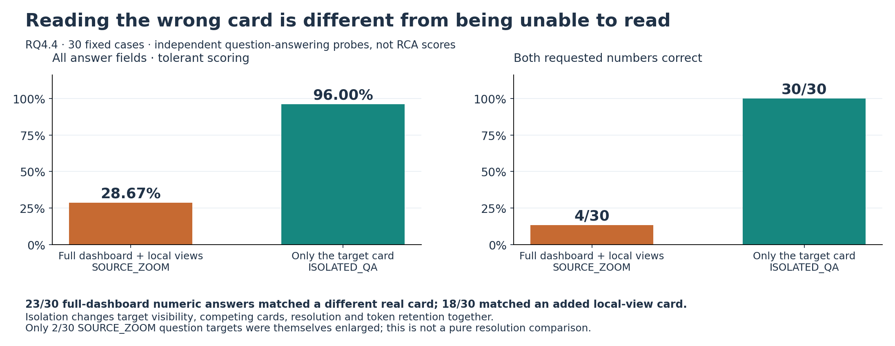

*Figure 4. The requested values are often readable when the correct card is isolated. “Field accuracy” averages correctness over the requested answer fields; it is not the proportion of completely correct responses. The isolated-card condition is a QA probe, not a root-cause method given privileged evidence. Because several input factors change, the bars do not identify resolution alone as the cause. [Vector version](CanvasRCA_Project_Review_2026-10-12_assets/fig_04_qa_source_selection.svg).*

More specifically, **23/30** SOURCE numeric answers matched another real card, including **18** that matched a card in the added local atlas. In **20** of those 23 cases the source belonged to another entity. For `INC-D9245047C658`, the requested pod card was **222→210**, but the response gave **1534→1682.3** for service 326, values actually present in a different trace card. This is much more specific than calling every wrong number a character-reading error, often loosely described as an **OCR** (optical character recognition) failure.

The isolation comparison changes localization, distractors, resolution and token retention together, so it does not isolate one cause. Only **2/30** SOURCE QA targets were themselves selected for the zoom atlas; this prevents interpreting the full QA result as a clean test of target-resolution improvement. The next experiment must fix that measurement mismatch. [RQ4.4, QA and source audit](CanvasRCA_Project_Review_2026-10-12_assets/references/docs/experiment_reports/RQ4_4_Qwen_Analysis_2026-10-12.md).

### Finding 9 — Equivalent values and unchanged facts can still produce large decision changes

The project has repeatedly found sensitivity beyond ordinary repeat noise:

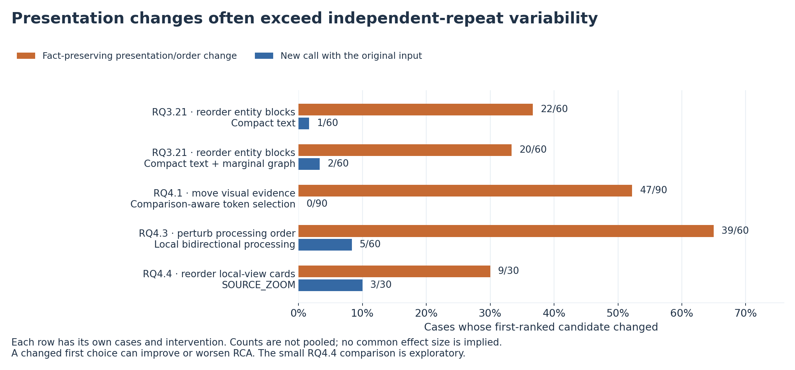

*Figure 5. Reordering or repositioning evidence often changes the first choice more than making a new call with the original input. Each pair of bars uses its own registered comparison and denominator; the rows are not pooled. An independent repeat uses the same input in a fresh model call, rather than reusing the saved answer. [Vector version](CanvasRCA_Project_Review_2026-10-12_assets/fig_05_order_sensitivity.svg).*

| Controlled change | Observation | Evidence strength |
| --- | --- | --- |
| RQ3.7: equivalent scientific-number formatting | Text top-1 changed **12/84** versus **1/84** repeats; LOCAL_LINK changed **10/84** versus **0/84** | Corrected p≈0.00586/0.00977 |
| RQ3.21: rotate intact entity blocks | Top-1 changed **22/60** in compact entity text and **20/60** in visual, versus **1/60** and **2/60** repeats | Registered extra-flip comparisons supported |
| RQ4.1: move visual evidence while preserving public facts | Comparison-aware token selection (CVC) and individual-field selection (UNARY) each changed top-1 **47/90**; corresponding repeats **0/90** | Registered v11 Holm p=7.47×10⁻¹³ |
| RQ4.3: order perturbation for P_LOCAL_BI | Top-1 changed **39/60**, versus **5/60** repeats | Corrected p≈1.747×10⁻⁷ |
| RQ4.4: rearrange the same local cards | Top-1 changed **9/30**, versus **3/30** repeats | Exploratory extra-flip p=0.03125, not a corrected confirmatory claim |

These are different interventions, not repeated estimates of one effect. They show that non-diagnostic presentation choices can alter the decision pipeline. A flip may improve or harm ranking; instability is not synonymous with lower mean MRR. Sources: [RQ3.7](CanvasRCA_Project_Review_2026-10-12_assets/references/docs/experiment_reports/RQ3_7_Results_Analysis_2026-09-28.md), [RQ3.21](CanvasRCA_Project_Review_2026-10-12_assets/references/docs/experiment_reports/RQ3_21_Qwen_Analysis_2026-10-06.md), [RQ4.1](CanvasRCA_Project_Review_2026-10-12_assets/references/docs/experiment_reports/RQ4_1_Qwen_Analysis_2026-10-09.md), [RQ4.3](CanvasRCA_Project_Review_2026-10-12_assets/references/docs/experiment_reports/RQ4_3_Qwen_Analysis_2026-10-12.md), [RQ4.4](CanvasRCA_Project_Review_2026-10-12_assets/references/docs/experiment_reports/RQ4_4_Qwen_Analysis_2026-10-12.md).

### Finding 10 — Lossless serialization can still be a lossy interface for the model

RQ3.21's column/dictionary encoding was independently reversible and preserved the registered facts, units, values and occurrence counts. Nevertheless, PACK_ENTITY_VISUAL fell to **0.4180** from the historical marginal anchor's **0.5054**, while reducing token costs. Phase-comparison QA fell by roughly **22–24 percentage points** in the relevant compact conditions.

Thus, mathematical recoverability is not cognitive accessibility for a frozen model. More compact syntax can require additional implicit joins, field tracking and comparison. RQ3.11's operator-protection checks and RQ4's geometry/token support gates likewise established implementation properties, not model understanding. Qualification should prevent invalid experiments, but passing it must not be described as a performance forecast. [RQ3.21](CanvasRCA_Project_Review_2026-10-12_assets/references/docs/experiment_reports/RQ3_21_Qwen_Analysis_2026-10-06.md), [RQ3.11](CanvasRCA_Project_Review_2026-10-12_assets/references/docs/experiment_reports/RQ3_11_Qwen_Analysis_2026-10-01.md).

### Finding 11 — Fewer visual tokens can give better rankings; the elaborate selection rule has not beaten the simple one

RQ4.1 held the complete dashboard fixed. Full visual tokens gave MRR **0.2209**, comparison-aware CVC_E50 **0.3332**, and uniform coverage U **0.3517**. These are large engineering differences; the registered conservative v11 test did not establish every positive pruning contrast. The correct-dependency mechanism did not distinguish itself sufficiently from its controls.

RQ4.2's semantic encoder partitioning then failed to beat geometric partitioning or native four-image input. RQ4.3's best new processing arm only reached **0.3491**. These results argue for retaining the simple successful baseline while testing a specific new failure mechanism. They do not establish a universal optimal pruning rate or show that sophisticated pruning papers are wrong: their local adaptations, model architecture, and candidate-output failure rates differ. [RQ4.1](CanvasRCA_Project_Review_2026-10-12_assets/references/docs/experiment_reports/RQ4_1_Qwen_Analysis_2026-10-09.md), [RQ4.2](CanvasRCA_Project_Review_2026-10-12_assets/references/docs/experiment_reports/RQ4_2_Qwen_Analysis_2026-10-10.md), [RQ4.3](CanvasRCA_Project_Review_2026-10-12_assets/references/docs/experiment_reports/RQ4_3_Qwen_Analysis_2026-10-12.md).

### Finding 12 — Pixel/token budgets, output cost, and runtime can move in different directions

Three examples make this concrete. RQ3.19 moved a small number of exact fields into a picture, saving only about **97–157 text tokens** while adding **877 image tokens** plus instructions; total cost rose about **2.8%**. RQ4.1's CVC cut total tokens **73.69%**, but its measured online time fell only about **3.63%**, because full visual encoding still ran. RQ4.4 increased U's total tokens by **140.91%** without improving MRR.

Higher resolution did help in the older RQ2.1 study, at additional cost; the same intuition did not automatically transfer to selective local zoom in RQ4.4. Deployment cost must include rendering, image encoding, **prefill** (processing the full prompt before generating an answer), and answer generation. A lower retained-token count is useful, but it is not automatically less end-to-end computation. [RQ3.19](CanvasRCA_Project_Review_2026-10-12_assets/references/RQs/RQ3_19/findings/exp_visual_replacement_qa_findings.md), [RQ4.1](CanvasRCA_Project_Review_2026-10-12_assets/references/docs/experiment_reports/RQ4_1_Qwen_Analysis_2026-10-09.md), [RQ4.4](CanvasRCA_Project_Review_2026-10-12_assets/references/docs/experiment_reports/RQ4_4_Qwen_Analysis_2026-10-12.md).

### Finding 13 — Correct rankings and plausible explanations can conceal incorrect evidence use

Across RQ3.16–RQ3.18 and RQ4.3–RQ4.4, audits found entity swaps, inclusive/exclusive-duration confusion, unit mistakes, unsupported propagation claims, and contradictions between reasons and rankings. In RQ4.4 case `INC-11AFCDDD7B6E`, SOURCE ranked the accepted root **140** first but its reason identified **887**. In another arm the reason excluded 140 while the ranking still placed it first.

Conversely, a wrong QA target can coexist with a correct RCA ranking: `INC-F328F417F5C9` returned a service-latency card instead of the requested node-memory card, yet ranked the accepted service root first. In `INC-7FCA48559A2E`, the requested values were read correctly while a symptom was still placed above an accepted root. These examples explain why both QA and explanation plausibility are incomplete performance proxies. They also show why tolerant rescoring, although informative about interface losses, cannot close the whole visual–text gap. [RQ3.18](CanvasRCA_Project_Review_2026-10-12_assets/references/RQs/RQ3_18/findings/exp_population_readout_findings.md), [RQ4.4](CanvasRCA_Project_Review_2026-10-12_assets/references/docs/experiment_reports/RQ4_4_Qwen_Analysis_2026-10-12.md).

### Finding 14 — Attention concentrates on non-evidence regions, but a harmful “sink” has not been established

Here **attention** means internal weights connecting a selected query position to available key positions in the model. A query/key can correspond to an instruction token or an image representation; this is not human eye tracking. An **attention sink** is a position that attracts disproportionately large weight. Whether such concentration is harmful must be tested, rather than assumed from a heatmap.

RQ4.1 found relatively high attention density in header/component-title regions. RQ4.4 found that static text received about **86.13%** of the measured last-prompt-query attention despite occupying about **3.57%** of keys. Added local views occupied about **61.16%** of image keys but received only **16.89%** of image attention at that query. More high-resolution pixels did not produce proportionally more measured attention.

The scope matters: RQ4.4 sampled **one layer, index 3, at the last prompt query and first decode query**, not the final root-ranking tokens or all layers. Global title keys were absent from its retained set, and card titles were not separated from their panels. Consequently, this is not a direct title-sink replication or proof that the model ignored images. Attention concentration is a diagnostic lead; identifying a harmful sink requires a controlled intervention and downstream improvement.

The storage problem is solved at the measured-summary level: RQ4.4 retained all 279 collected summaries and their mappings within the registered budget, without retaining full matrices. The supported claim is about the queries actually collected, not unavailable attention trajectories. [RQ4.1](CanvasRCA_Project_Review_2026-10-12_assets/references/docs/experiment_reports/RQ4_1_Qwen_Analysis_2026-10-09.md), [RQ4.4](CanvasRCA_Project_Review_2026-10-12_assets/references/docs/experiment_reports/RQ4_4_Qwen_Analysis_2026-10-12.md), [attention research note](CanvasRCA_Project_Review_2026-10-12_assets/references/important_docs/CanvasRCA_Attention_Storage_and_Sink_2026-10-05.md).

### Cross-experiment interpretation

The fourteen findings support a coherent account: **evidence can survive preprocessing yet fail during localization, attribution, comparison, or decision formation**. More evidence, pixels, tokens, instructions, and verification steps each have counterexamples to monotonic improvement. The strongest repeatable disturbances concern presentation and ordering; the newest evidence localizes a frequent behavioral failure to answering from the wrong real source.

Dataset heterogeneity is persistent. AegisLab's service-level task and the AIOPS service/pod/node tasks have different failure profiles. For example, RQ3.16's hybrid reaches **0.6322** on AegisLab but only **0.3708** on AIOPS-2025. A pooled gain can conceal reduced top-five coverage or a loss on one dataset. This is why future decisions need dataset and granularity breakdowns, not a pooled winner alone.

## 5. The baselines and best methods, precisely defined

### 5.1 There is a strong-text lineage, not one unchanged baseline across all rounds

| Experiment | Strong textual reference | Important distinction |
| --- | --- | --- |
| RQ3.16 | `PAIR_FIVE` | Complete inherited M/R/L/G, full-window summaries, binary/continuous parent–child facts; exactly five candidates |
| RQ3.17 | `PAIR_TEXT` | Same evidence family, plus common explicit topology-to-pair binding instructions |
| RQ3.18 | `PAIR_TEXT` and stronger `READOUT_TEXT` | READOUT_TEXT explicitly repeats named population p50/p95 values, entities, phases and duration semantics |
| RQ3.19 | `FULL_TEXT` | Inherits RQ3.18 READOUT_TEXT; COMPACT_TEXT is a separate experimental encoding |
| RQ3.20 | `FULL_TEXT` | Inherits the RQ3.19 full input; compressed summaries and fetch inputs are not the strong baseline |
| RQ3.21 | `RAW_TEXT` | Returns to RQ3.16's complete PAIR_FIVE facts with representation-neutral task wording; it does not simply continue the RQ3.20 summary pipeline |
| RQ4.1 | `T_FULL` | Uses the saved RQ3.21 RAW_TEXT system/parts with RQ4's registered backend/decoding; new results, not reused RQ3.21 scores |
| RQ4.2–RQ4.4 | Historical RQ4.1 `T_FULL` | Reuses its actual saved outputs and metrics; there is no new full-text inference batch in every round |

This lineage is documented in the individual reports and is directly visible in [RQ4.1's compiler](CanvasRCA_Project_Review_2026-10-12_assets/references/RQs/RQ4_1/src/exps.py): `SOURCE` points to the RQ3.21 public preparation directory; `text_conditions` sets `full = public['texts']['RAW_TEXT']` and assigns it to both T_FULL and T_NATIVE. T_NATIVE's **0.4861** is a separate native-backend result with the same prompt, not the registered T_FULL value **0.4846**. T_LEDGER and T_DEP are alternative evidence serializations, not aliases for T_FULL.

Consequently, RQ3.16 PAIR_FIVE **0.4436** and RQ4.1 T_FULL **0.4846** do not establish an isolated improvement from any one input change. Output decoding and runtime protocols also changed. Historical scores retain those contracts.

### 5.2 What the complete strong-text input actually contains

The modern baseline is a substantial engineered diagnostic packet, not a short log excerpt or an unprocessed telemetry dump:

1. **Task and candidate contract.** A site-reliability/RCA task, service/pod/node identity conventions, the complete registered candidate set, and a ranked JSON response (a machine-readable object containing candidate IDs and explanation fields). Later conditions require exactly five distinct candidates.
2. **Metrics.** Selected canonical metric records with entity bindings, original units, complete retained sequences and missing positions, baseline/peak/deviation information, and explicit observation-window metadata. A checked RQ3.21 public example has 64-position metric sequences. “Complete sequence” refers to those frozen records.
3. **Traces.** Operation identities, counts and recorded duration summaries, with explicit inclusive/exclusive distinctions and reference/current information. Per-operation records are not interchangeable with a service-wide latency claim.
4. **Logs.** Retained template/text evidence, counts and relevant numeric parameters, bound to their public entities and source observations.
5. **Relations.** Typed directed call records, node–pod hosting and service–pod membership, plus retained relationship summaries. An observed call is not labeled a proven causal edge.
6. **Window summaries.** First/last observations, extrema and their positions, and trace-operation comparisons added in the RQ3.14 lineage.
7. **Request-pair evidence.** Real parent–child duration pairs, binary joint counts, thresholds, population quantiles, eligible conditional summaries, and sampled paired values introduced in RQ3.15.
8. **Reading rules.** Citation conventions, units and phase interpretation, counter/state distinctions, cautions against subtracting unrelated quantiles, and cautions against treating correlated observations as independent causal votes.

The compiler's metric/trace/log analyzers include project-integrated components derived from earlier RCA tooling. That does **not** make T_FULL an unmodified, independently reproduced SIRCL system. Private roots, scoring labels and historical answers are outside the model input. The baseline's strength comes from preserving evidence and explicitly organizing it for diagnosis.

### 5.3 Highest modern hybrid result: RQ3.16 MARGINAL_FIVE

Its recipe is **PAIR_FIVE plus a small native marginal-duration dashboard**, in one call. This is a **repetition hybrid**: the plotted samples, entity/operation bindings and statistics remain available in the unchanged PAIR_FIVE text. The added picture mainly contains at most two parent–child duration cards; it does not replace their textual records or add previously unavailable incident facts. It is not “marginal graph plus a new TPV topology graph.” In particular, the relationship ledger remains in text, unlike TPV's topology replacement.

For each eligible same-trace parent–child operation relationship, the pipeline uses unambiguous span identities. Repeated parent calls are resolved deterministically to the longest parent call and then the corresponding longest direct child operation. Each phase needs at least 20 valid requests. Relationships are ordered by the magnitude of the parent's reference/current `log1p(p95_ms)` change; at most two are selected. Each phase displays at most 32 genuine paired observations sampled deterministically across the parent-duration ranks, including the extremes. Missing child calls are not zero-filled.

The **1120×800** figure displays parent and child durations as separate marginal distributions for reference/current phases, on declared transformed scales. It shows sample quantities, entity/operation identities and units. These are duration distributions, **not temporal propagation or critical-path diagrams**. A card binds one parent operation/entity to one child operation/entity; two cards can share the same entity pair but represent different operations. The exact samples and statistics remain in the text. Nine of 220 cases without eligible pairs followed the historical text-fallback rule.

| Dataset | MARGINAL_FIVE MRR | PAIR_FIVE comparison | Interpretation |
| --- | ---: | --- | --- |
| AIOPS-2022 | **0.4286** | Positive paired MRR difference | Strongest of the two AIOPS results for this method |
| AIOPS-2025 | **0.3708** | Positive MRR, but AC@5 decreased | Ranking and coverage objectives did not fully align |
| AegisLab | **0.6322** | Positive MRR, but AC@5 decreased | Drives a substantial part of the pooled score |
| Case-weighted overall | **0.5054** | PAIR_FIVE **0.4436**, Δ=**+0.0617** | Main corrected tests did not establish the planned visual contribution |
| Equal-dataset macro | **0.4772** | Different weighting from the overall row | Do not report this as 0.5054 |

Overall AC@1/3/5 is **0.4091/0.5818/0.6682**. Mean total tokens are **23,127.6**, versus **22,262.2** for the same-round PAIR_FIVE, roughly 3.9% higher overall. This is a useful high-performing hybrid reference, but it did not satisfy all its adoption criteria, especially component attribution and coverage. [RQ3.16 full analysis](CanvasRCA_Project_Review_2026-10-12_assets/references/docs/experiment_reports/RQ3_16_Qwen_Analysis_2026-10-03.md).

### 5.4 Best current pure-visual reference: A_UNIFORM_E50

U starts with the complete RQ4.1 unified dashboard, including diagnostic evidence and identity/reading anchors. The visual encoder processes the full image. The subsequent selection keeps:

- All registered mandatory anchor tokens, protecting necessary labels/identity support.
- A deterministic spatially distributed selection of **50% of optional evidence-support tokens**.

`E50` therefore does **not** mean exactly half of all original image tokens. This is neither random deletion nor semantic ranking by anomaly severity. It uses the same visual source image and preserves the registered retained-token positions. Incident facts are not supplied as an accompanying text block.

The RQ4.1 recipe uses the local BF16 model, 40,960 context, 8,192 maximum output, greedy generation of the five-ID ranking prefix, and registered sampling for the reason/confidence suffix. Candidate validity is checked after generation under the frozen contract. These decoder choices are part of the measured method.

| Dataset | T_FULL standard MRR | U standard MRR | U tolerant MRR | SOURCE_ZOOM standard MRR |
| --- | ---: | ---: | ---: | ---: |
| AIOPS-2022 | 0.3650 | 0.3050 | 0.3383 | 0.2539 |
| AIOPS-2025 | 0.4039 | 0.2811 | 0.2950 | 0.2489 |
| AegisLab | 0.6048 | 0.4222 | 0.4322 | 0.4212 |
| Case-weighted overall | **0.4846** | **0.3517** | **0.3692** | **0.3286** |
| Equal-dataset macro | 0.4579 | 0.3361 | 0.3552 | 0.3080 |

U has overall AC@1/3/5 **0.2409/0.4455/0.5636** and 14 invalid responses out of 220 under standard scoring. Its total token count is about **73.7% below T_FULL**, but its standard MRR is **0.1329 lower**. Tolerant scoring reduces only part of the gap.

U was the observed winner of RQ4.1's visual matrix, not its original preselected method. It is now a reasonable **development anchor**, not an independently confirmed final solution. RQ4.4's failure does not erase U's cost advantage; U's cost advantage does not establish success on the project's accuracy objective. [RQ4.1](CanvasRCA_Project_Review_2026-10-12_assets/references/docs/experiment_reports/RQ4_1_Qwen_Analysis_2026-10-09.md), [RQ4.4 historical comparison](CanvasRCA_Project_Review_2026-10-12_assets/references/docs/experiment_reports/RQ4_4_Qwen_Analysis_2026-10-12.md).

### 5.5 What “highest MRR” and “tolerant scoring” mean here

There is no defensible all-history ranking that ignores cohort and weighting. For example, RQ2.1's P_DIVERSITY_TEXT achieved **0.5226 as a five-dataset macro average**, including the two RE2 datasets, whereas the modern hybrid **0.5054** is a three-dataset, 220-case weighted result. The tournament's **0.8855** is an oracle union over different methods. Neither is evidence of a stronger deployable method on the modern 220 cases.

Standard scoring enforces the registered output contract; an invalid ranking can receive zero for the entire answer. Recent tolerant RCA rescoring keeps the original rank slots, treating illegal/duplicate items as non-hits rather than moving later answers forward. It does not guess a corrected ID, insert a missing root, or regenerate an answer. QA tolerance is different: it accepts specified equivalent numbers, type prefixes and unit formatting, but not a wrong scale, entity or source card.

These analyses separate interface usability from substantive ranking, while preserving the original primary scores. They are not a license to select whichever metric makes a method look best.

### 5.6 Five representative dashboards: one image per arm

The following are **unaltered images from actual experiment inputs**, all for the same AegisLab incident, `INC-7FCA48559A2E`. This shared example illustrates representation differences; it was not selected to establish a performance effect. Each arm appears once. Aggregate MRR values describe the complete experiment, not this one incident.

The dense originals are larger than a report page. Use the full-resolution links to inspect labels; the embedded view is an overview of the design. The examples preserve the original renderer's colors, fields and whitespace. In particular, pruning and encoder grouping can change model computation without producing a visibly different PNG.

**A. RQ3.16 MARGINAL_FIVE — complete text plus a small duration dashboard.**

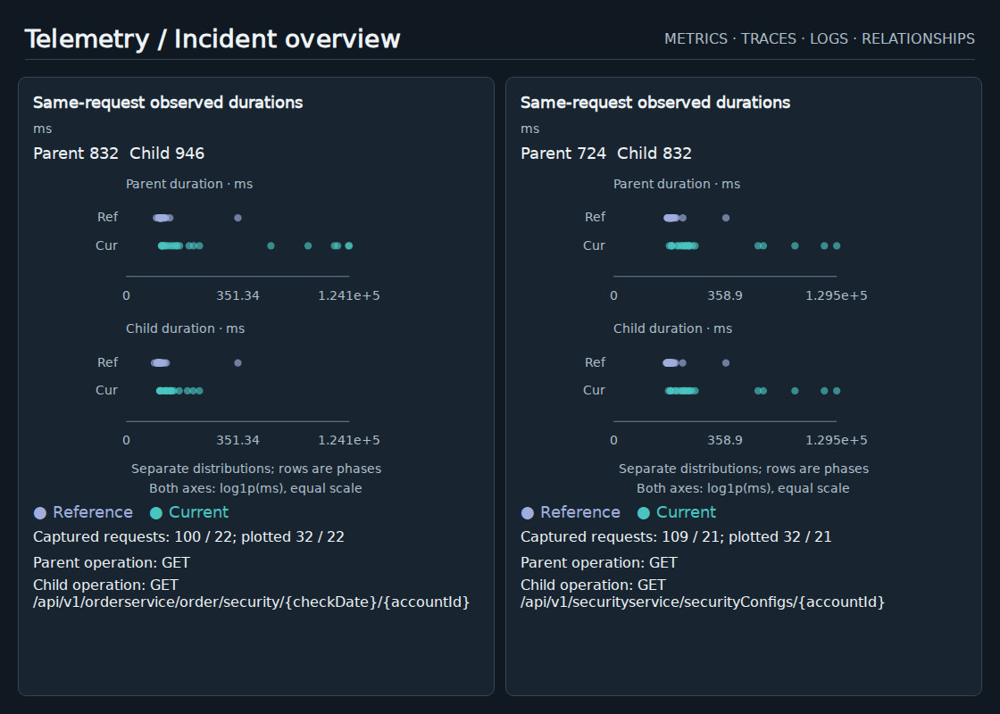

*Figure 6. [Full-resolution original, 1120×800](CanvasRCA_Project_Review_2026-10-12_assets/dashboard_01_marginal_five.png). Each card represents one parent–child operation relationship. Parent and child durations have separate rows; lavender and teal distinguish reference and current observations. Horizontal position encodes duration, not time of occurrence. The labels use `log1p`, meaning log(1 + duration), to display a wide range. The method also receives the complete diagnostic text, which is not shown here. Its overall MRR is **0.5054**; this is a hybrid achievement, not a pure-visual score.*

**B. RQ4.1 A_UNIFORM_E50 (U) — a complete visual overview with uniform token selection.**

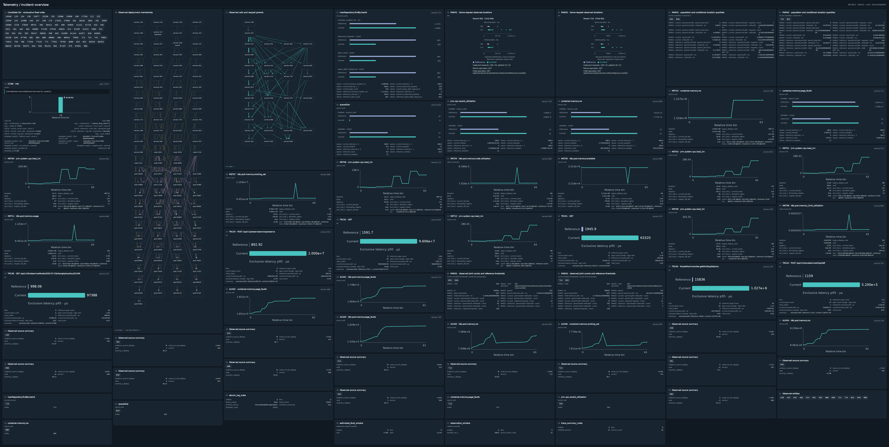

*Figure 7. [Full-resolution original, 8192×4126](CanvasRCA_Project_Review_2026-10-12_assets/dashboard_02_uniform.png). The overview carries candidate IDs, metric curves, trace comparisons, logs, relationship diagrams and duration cards. Unlike Figure 6, it is the sole incident-evidence carrier. The complete image is encoded; protected label/identity representations and a uniform subset of eligible evidence representations are then retained. E50 means 50% of the eligible optional support, not half of the PNG pixels. The screenshot therefore does not display a pruning mask. Overall MRR: **0.3517**, the strongest current pure-visual reference.*

**C. RQ4.2 SEM — reorganize interactions inside the visual encoder.**

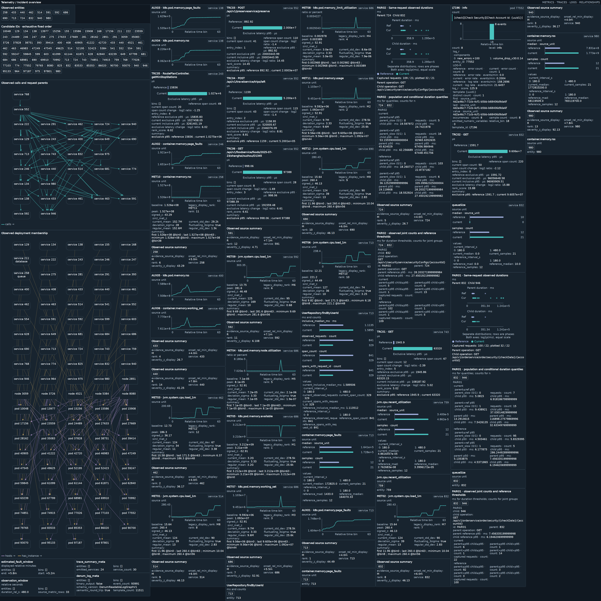

*Figure 8. [Full-resolution original, 4096×4096](CanvasRCA_Project_Review_2026-10-12_assets/dashboard_03_sem.png). SEM means source-semantic grouping: representations associated with related public observations are assigned to groups during early/middle encoder computation, followed by global fusion. This picture is shared with the same-round FULL, GEOM and SHAM conditions; their computation differs. Group assignments are not colors painted onto the dashboard. SEM's overall MRR was **0.3084** and did not exceed the simpler geometric grouping or native multi-image control.*

**D. RQ4.3 X_SRP — combine selection, rendering and processing.**

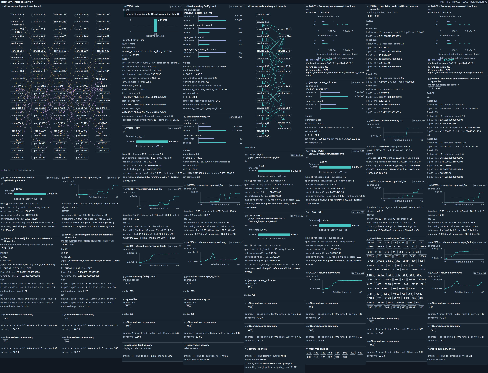

*Figure 9. [Full-resolution original, 4096×3136](CanvasRCA_Project_Review_2026-10-12_assets/dashboard_04_xsrp.png). S/R/P denote evidence selection, rendering and subsequent visual processing. X_SRP was the preselected combination; this compact source-bound canvas is its visible component, while local bidirectional processing happens after rendering. Numeric observations and their original owners remain explicitly labeled. The combined method reached **0.2630** MRR, so combining individually plausible changes did not produce the desired improvement.*

**E. RQ4.4 SOURCE_ZOOM — add selected complete cards at higher resolution.**

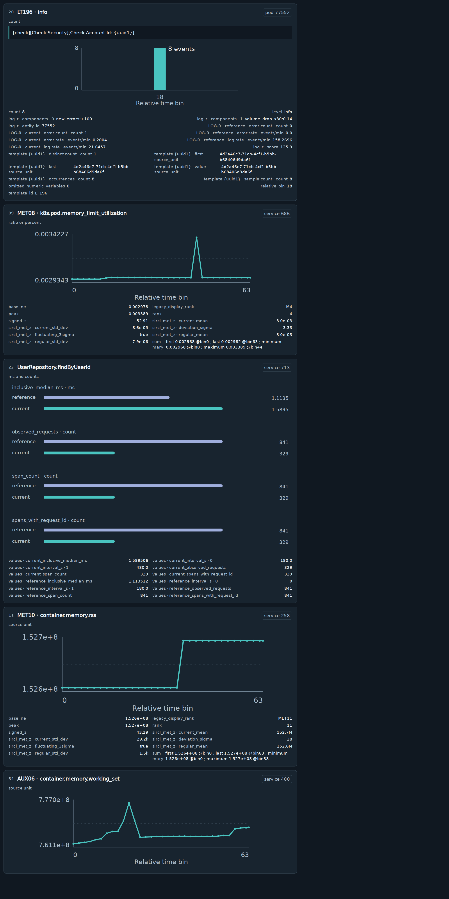

*Figure 10. [Full-resolution original, 2048×4096](CanvasRCA_Project_Review_2026-10-12_assets/dashboard_05_source_zoom.png). This is the **local atlas**, one of two images in the request; the unchanged U overview is the other. Entire cards retain their original entity, operation, unit, phase and graphical marks. Selection prioritizes recoverable small text and source coverage without using root labels. The original whitespace is retained here. SOURCE_ZOOM reached **0.3286** MRR with about **2.41× U's total tokens**: clearer selected cards did not by themselves improve the overall diagnosis.*

The [example manifest](CanvasRCA_Project_Review_2026-10-12_assets/figure_data.json) records original paths, dimensions and SHA-256 hashes. The source images are reused byte-for-byte, not reconstructed for the meeting.

### 5.7 Hybrid does not mean one input design: repetition versus replacement

**The distinction is whether the evidence shown in an image is still supplied in text.** It is not whether the picture contains words: entity labels, units, axes and log strings are legitimate parts of a graphic. Nor does repetition require duplicating every fact—MARGINAL_FIVE repeats only a selected subset of its complete textual input.

For a fact set *E* and the subset *S* chosen for graphical presentation, the two simple designs are:

- **Repetition:** text(*E*) + graphic(*S*). This asks whether an additional depiction helps, including its repetition, emphasis and input-cost effects.
- **Replacement:** text(*E* excluding *S*) + graphic(*S*). This asks whether transferring that evidence to a graphical carrier helps; reading conventions and token costs can still differ.

Necessary identity labels can recur across modalities without duplicating an entire relationship ledger. Some experiments also add derived summaries to a common raw-evidence base, or replace topology while redrawing retained metrics. Those mixed cases must be described at the evidence-block level.

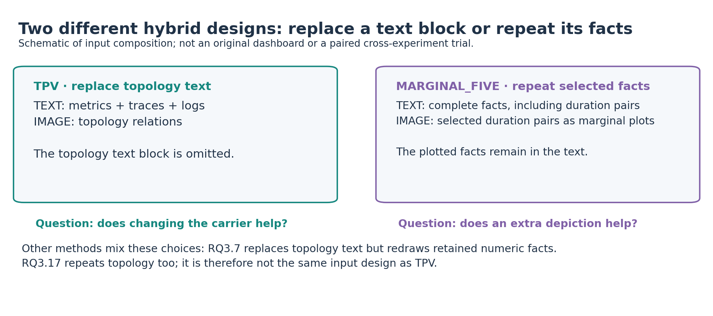

*Figure 11. Two input contracts that the word “hybrid” otherwise hides. This is an explanatory schematic, not a reconstructed historical dashboard. TPV removes the dedicated topology-text block; MARGINAL_FIVE keeps its plotted observations in text. [Vector version](CanvasRCA_Project_Review_2026-10-12_assets/fig_11_hybrid_contracts.svg).*

The following classification follows the retained input-building code, rather than inferring transport from an arm's name. It covers the hybrid families discussed in this review; unrun RQ3.9 and cancelled RQ3.22 are not completed evidence.

| Experiment and arm/family | What remains in text | What the image carries | Classification |
| --- | --- | --- | --- |
| **RQ1.1 H** | Complete M/R/L/G incident text | The same M/R/L/G facts as a full dashboard | **Repetition of the complete evidence.** This is the explicit redundant-hybrid control. |
| **RQ1.1 TPV** | M/R/L; general task/candidate information | G: the registered topology relationships | **Replacement of G.** Its dedicated text block is omitted. MV, TCV, LV and mixed factorial arms similarly move their selected region(s), keeping the others in text. [Compiler](CanvasRCA_Project_Review_2026-10-12_assets/references/RQs/RQ1_1/src/exps.py) |
| **RQ3.1 TPV; RQ3.3–RQ3.5 inherited graph-carrier methods** | Inherited M/R/L plus any arm-specific witness/request-evidence appendices | Inherited G graph | **Topology replacement, with added evidence in some descendants.** For example, W_G adds witness text while retaining the graph carrier; the name does not mean that all witness facts are drawn. This is not full-text-plus-full-dashboard duplication. [RQ3.3](CanvasRCA_Project_Review_2026-10-12_assets/references/RQs/RQ3_3/src/exps.py), [RQ3.4](CanvasRCA_Project_Review_2026-10-12_assets/references/RQs/RQ3_4/src/exps.py), [RQ3.5](CanvasRCA_Project_Review_2026-10-12_assets/references/RQs/RQ3_5/src/exps.py) |
| **RQ3.6 graph-component/relation-binding G carriers** | M/R/L and the registered numerical/witness appendix | The corresponding G representation and its bindings | **Replacement of the main G ledger.** Some shared labels or binding observations can overlap; no claim that every identifier occurs only once. [Compiler](CanvasRCA_Project_Review_2026-10-12_assets/references/RQs/RQ3_6/src/exps.py) |
| **RQ3.7 LOCAL_LINK and other visual fusion arms** | M/R/L, including original metric facts, and the shared appendix | G plus entity-bound numerical panels | **Mixed:** replaces G text but redraws selected numerical facts that remain in text. T_MATCH instead supplies G and the numerical summary in text. This is neither pure TPV nor complete duplication. [Compiler](CanvasRCA_Project_Review_2026-10-12_assets/references/RQs/RQ3_7/src/exps.py) |
| **RQ3.8 FULL and graphical controls** | Complete common textual evidence/ledger | Full or controlled subsets of those observations | **Repetition.** The graphical request prepends the PNG without deleting the depicted evidence from the common text. [Compiler](CanvasRCA_Project_Review_2026-10-12_assets/references/RQs/RQ3_8/src/exps.py) |
| **RQ3.10 SCOPE_MATRIX / SCOPE_TILES** | The exact SCOPE_TEXT content, including computed comparison observations | Those scope comparisons | **Repetition.** Text equality is explicitly checked. [Compiler](CanvasRCA_Project_Review_2026-10-12_assets/references/RQs/RQ3_10/src/exps.py) |
| **RQ3.11 PROTECTED_VISUAL variants** | Other records, curve bindings/ranges, missingness encoding and registered exact-value overrides | The quantized curve values omitted from the visual arm's text | **Selective numeric replacement with textual exact-value patches.** Quantization is an additional intervention, so this is not a lossless whole-evidence carrier swap. [Compiler](CanvasRCA_Project_Review_2026-10-12_assets/references/RQs/RQ3_11/src/exps.py) |
| **RQ3.12 OBS_VISUAL / COND_VISUAL** | Complete base evidence plus measurement/prediction bindings | Derived observed/conditional comparison table | **Common base + graphical derived appendix.** The corresponding derived-value text table is omitted; the underlying base observations are retained. [Compiler](CanvasRCA_Project_Review_2026-10-12_assets/references/RQs/RQ3_12/src/exps.py) |
| **RQ3.13 EVENT_VISUAL; RQ3.14 WINDOW_VISUAL / WINDOW_PIXEL / WINDOW_MARKLESS** | Complete original observations and common reading/binding information | Excursion or window representation; WINDOW_PIXEL is the explicit summary screenshot control | **Raw evidence retained; added summary changes carrier.** RQ3.14 WINDOW_VISUAL does not receive WINDOW_TEXT's extra summary block. Thus it redraws retained observations but is not “the identical WINDOW_TEXT prompt plus curves.” [RQ3.13](CanvasRCA_Project_Review_2026-10-12_assets/references/RQs/RQ3_13/src/exps.py), [RQ3.14](CanvasRCA_Project_Review_2026-10-12_assets/references/RQs/RQ3_14/src/exps.py) |
| **RQ3.15 PAIR_VISUAL / MARGINAL_VISUAL** | Complete PAIR_TEXT, including exact paired samples and statistics | Joint scatter or marginal display of those samples | **Repetition.** The two visual forms do not exclusively own their numerical facts. [Compiler](CanvasRCA_Project_Review_2026-10-12_assets/references/RQs/RQ3_15/src/exps.py) |
| **RQ3.16 MARGINAL_FIVE / MARKLESS_FIVE and visual repeats** | Complete PAIR_FIVE | Marginal display, or its registered no-point control | **Repetition.** MARGINAL_FIVE and PAIR_FIVE have identical diagnostic text. [Compiler](CanvasRCA_Project_Review_2026-10-12_assets/references/RQs/RQ3_16/src/exps.py) |
| **RQ3.17 topology/marginal visual arms, including matrix and node-arrow combinations** | Common PAIR_TEXT, including the complete relationship ledger, pair facts and binding descriptions | Topology and/or marginal plots | **Repetition of whichever evidence is drawn.** Unlike TPV, these topology arms do not remove G from text. Binding-line and no-point controls keep this common text. [Compiler](CanvasRCA_Project_Review_2026-10-12_assets/references/RQs/RQ3_17/src/exps.py) |
| **RQ3.18 SAMPLE_VISUAL / PROFILE_VISUAL; READOUT_SAMPLE / READOUT_PROFILE and markless controls** | PAIR_TEXT; READOUT arms also repeat named population statistics in text | Sample or population-quantile graphics from those facts | **Repetition.** The additional named text readout is itself a separate factor; no pair evidence is transferred out of text. [Compiler](CanvasRCA_Project_Review_2026-10-12_assets/references/RQs/RQ3_18/src/exps.py) |
| **RQ3.19 ADD_VISUAL** | Complete COMPACT_TEXT | Population profile from the same facts | **Repetition.** [Compiler](CanvasRCA_Project_Review_2026-10-12_assets/references/RQs/RQ3_19/src/exps.py) |
| **RQ3.19 REPLACE_VISUAL** | Remaining compact facts and explicit image-field references | Registered parent/child identifiers, operations, population counts, and exactly displayable quantiles | **Selective field replacement.** Only the registered fields move; other statistics and sample arrays remain textual. It is not an all-visual replacement of the whole pair packet. [Compiler](CanvasRCA_Project_Review_2026-10-12_assets/references/RQs/RQ3_19/src/exps.py) |
| **RQ3.20 SUMMARY_VISUAL; the first stage of VISUAL_FETCH** | Common summary/index records excluding the dedicated edge listing | The overview's directed relationships | **Replacement of the relationship listing in the overview.** VISUAL_FETCH's final diagnosis then uses text; its two-stage workflow is historical and now prohibited. [Compiler](CanvasRCA_Project_Review_2026-10-12_assets/references/RQs/RQ3_20/src/exps.py) |
| **RQ3.21 RAW_VISUAL / PACK_VISUAL / ENTITY_VISUAL / PACK_ENTITY_VISUAL; historical anchor** | Complete facts in the condition's original, compact or entity-organized encoding | The original marginal image | **Repetition.** Encoding/organization changes do not move the plotted samples out of text. [Compiler](CanvasRCA_Project_Review_2026-10-12_assets/references/RQs/RQ3_21/src/exps.py) |

**RQ4 pure-visual candidates do not belong to either text–image hybrid class.** Their diagnostic facts are carried only by images. SOURCE_ZOOM repeats selected overview content in another image, so it has *visual-to-visual* redundancy; it does not restore incident evidence to text. Text baselines and the RQ4.3 HTML controls are separately labeled comparison systems.

This distinction changes what we can conclude. TPV's positive result supports selectively visualizing topology under its historical protocol. MARGINAL_FIVE's high score supports the complete repeated-evidence package as a development result; it does not establish that removing its diagnostic text would preserve that score. Likewise, RQ3.17's failure to improve by adding redundant topology is not a direct refutation of TPV's topology-replacement result. Neither type of hybrid establishes the current pure-visual objective.

### 5.8 TPV: a representative selective-replacement method

**Recipe.** Start from the RQ1.1 text condition T. Keep its selected metric, trace and log facts and candidate/task contract; remove the dedicated topology-text region G; provide those public relations in one directed topology image. Node–pod hosting, service–pod membership and observed calls are relationships, not asserted causal edges. The original study also had a distinct H arm that retained all text and added the complete graphical evidence. The [registered contract](CanvasRCA_Project_Review_2026-10-12_assets/references/RQs/RQ1_1/descriptions/RQ1_1_experiments.md) explicitly identifies H as the duplication exception; the [input builder](CanvasRCA_Project_Review_2026-10-12_assets/references/RQs/RQ1_1/src/exps.py) excludes visualized regions from the remaining text.

**Results on the original primary cohort.** These are Qwen results on 100 cases per dataset, **300 in total**, under that round's flexible-length output and model recipe. They are not results on the later 60/60/100 roster or its exactly-five output contract.

| Dataset | Cases | T MRR | TPV MRR | TPV − T | TPV AC@1 | TPV AC@3 | TPV AC@5 |
| --- | ---: | ---: | ---: | ---: | ---: | ---: | ---: |
| AIOPS-2022 | 100 | 0.2558 | **0.2783** | +0.0225 | 0.2100 | 0.3500 | 0.3700 |
| AIOPS-2025 | 100 | 0.2037 | **0.3367** | +0.1330 | 0.2800 | 0.4100 | 0.4100 |
| AegisLab | 100 | 0.4683 | **0.5308** | +0.0625 | 0.4100 | 0.6700 | 0.6800 |
| Primary pooled / equal-dataset macro | **300** | **0.3093** | **0.3819** | **+0.0727** | **0.3000** | **0.4767** | **0.4867** |

The TPV−T MRR difference passed the reported five-primary-comparison Holm family (**pH≈0.0276**). Top-1 repairs/breaks were **54/27**. Benefits were heterogeneous: AIOPS-2025 improved much more than AIOPS-2022. The two supplementary RE2 datasets were reported separately: TPV MRR **0.9287 on RE2-OB** and **0.8741 on RE2-TT**, with 90 cases each; these values must not be used to inflate a three-primary-dataset comparison. [Final retained analysis](CanvasRCA_Project_Review_2026-10-12_assets/references/docs/experiment_reports/RQ1_1_RQ2_1_findings/findings.md), [dataset-level performance and cost](CanvasRCA_Project_Review_2026-10-12_assets/references/docs/experiment_reports/RQ1_1_RQ2_1_findings/assets/rq11_performance_cost_runtime_all_arms_datasets.csv).

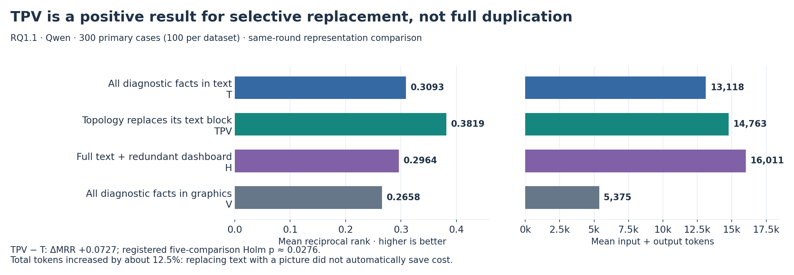

*Figure 12. TPV compared with its actual same-round references. T: all text; TPV: topology replacement; H: complete text plus repeated full graphics; V: all graphical evidence. These 300-case results are deliberately separate from Figure 1's modern 220-case references. [Vector version](CanvasRCA_Project_Review_2026-10-12_assets/fig_12_tpv_performance_cost.svg).*

**Cost and interpretation.** Mean input/output tokens were **14,600.0/163.5 for TPV**, compared with **12,947.6/170.8 for T**. Total tokens rose from **13,118.4 to 14,763.5**, about **12.54%**. TPV had about 433.4 fewer text tokens on net, while its topology image contributed about 2,085.8 image tokens. Thus TPV supplies positive ranking evidence for selective graphical replacement, **not a demonstrated token saving**. H's **0.2964** and V's **0.2658** further show that the benefit did not extend to every way of adding or replacing graphics. Those contrasts do not isolate a universal harmful effect of repetition: H also draws a different set of modalities than TPV.

**Historical image availability.** The early raw artifacts were removed under the authorized cleanup. An original RQ1.1 TPV input PNG could not be verified among the retained report assets, so this review includes its verified contract, quantitative results and a clearly labeled schematic rather than presenting a newly generated graph as an original input. The five available original examples in Section 5.6 remain unchanged. Later TPV references, such as RQ3.1's 360-case result of **0.3843**, retain their own cohorts and protocols; they do not replace the original numbers above.

## 6. Related work: which ideas informed which experiments?

The table distinguishes **adaptation**, **design inspiration**, and **retrospective explanatory context**. A paper can help interpret a result without having caused the original experiment design. Several rounds were primarily motivated by CanvasRCA's own preceding failures; inventing a separate external inspiration for every arm would misrepresent that history.

This review checked primary paper/proceedings/author sources for the following connections. It is a targeted verification of the project's research map, not an exhaustive novelty search or a reproduction of those papers' results. Publication venues are named only where supported by the linked primary record; arXiv-only entries are cited as papers/preprints without inferring acceptance.

| CanvasRCA experiment(s) | Related work and status | Transferred idea and the boundary of the connection |
| --- | --- | --- |
| RQ1/RQ1.1 and the shared evidence contract | [RCAEval](https://arxiv.org/abs/2412.17015), benchmark paper; [Root Cause Analysis for Microservices based on Causal Inference: How Far Are We?](https://arxiv.org/html/2408.13729), ASE 2024 | Multi-telemetry evaluation and separating intermediate properties from final localization. These are evaluation foundations, not evidence that graphics improve RCA. Dataset/metric alignment is required before importing any published headline score. |
| RQ2/RQ2.1; early Composer/SFT; unified renderer from RQ3.8 onward | [Vega-Lite](https://idl.uw.edu/papers/vega-lite), TVCG/InfoVis; [Draco](https://idl.uw.edu/papers/draco), TVCG/InfoVis; [DashBot](https://virtual.ieeevis.org/year/2022/paper_v-full-1033.html), VIS 2022; [DMiner](https://content.ieeevis.org/year/2023/paper_v-tvcg-10057994.html), VIS 2023 | Declarative graphic grammars, explicit design constraints, and separating component encoding from cross-view arrangement. CanvasRCA used these ideas to make dashboards executable and auditable. It did not thereby reproduce DashBot's learned dashboard policy or prove an RCA benefit from grammar validity. |
| RQ2.1 selectors, SEARCH/tournament, RQ3.1–RQ3.2 | [BARO](https://arxiv.org/abs/2405.09330), FSE 2024; [TraceRCA: Practical Root Cause Localization for Microservice Systems via Trace Analysis](https://netman.aiops.org/wp-content/uploads/2021/05/1570705191.pdf), authors' 2021 paper | Robust anomaly/change evidence and suspiciousness derived from abnormal versus normal traces motivated selection families. A BARO-style robust scoring component is not the full BARO detection pipeline; a trace score derived through existing SIRCL components is not a full TraceRCA reproduction. |
| RQ3.3–RQ3.5 and RQ3.9–RQ3.10 | TraceRCA; [CIRCA](https://arxiv.org/html/2206.05871), KDD 2022; earlier CanvasRCA witness and host-peer findings | Compare competing explanations using legitimate shared-request, host, peer and conditional evidence. The connection to causal RCA is conceptual: CanvasRCA's observational witness/competition displays do not establish a causal graph or an intervention effect. RQ3.9 remained unrun formally. |
| RQ3.6–RQ3.8 and RQ3.17 | Visualization composition/coordination work above; [MultiChartQA](https://aclanthology.org/2025.naacl-long.566/), NAACL 2025 | Make cross-view associations explicit and test whether nearby versus separated representations matter. Most concrete ablations were motivated by internal results. Multi-chart understanding is relevant context; a diagram's visual linkage does not establish a causal telemetry relationship. |
| RQ3.11 | Internal cost/precision failures; [On the Perception Bottleneck of VLMs for Chart Understanding](https://aclanthology.org/2025.findings-emnlp.573/), Findings of EMNLP 2025 | Separate numeric protection, perceptual extraction and downstream use. This paper is an interpretive reference for the observed qualification–utility gap, not a claim that it proposed our quantization or exact-patch method. |
| RQ3.12 | [CIRCA](https://arxiv.org/html/2206.05871), KDD 2022 | Conditional reference behavior and regression-based deviations suggested a concrete display. CIRCA relies on structural assumptions and causal-parent reasoning; CanvasRCA's candidate-conditioned ridge predictions did not inherit that causal justification. |
| RQ3.13–RQ3.14 | Chart-perception work above; earlier excursion and summary failures | Distinguish full curves from explicit observed summaries and from literal text-in-image controls. The experimental question was driven by the project's own AegisLab regression; the literature does not establish that one summary or curve format is best for RCA. |
| RQ3.15–RQ3.16 | [CRISP: Critical Path Analysis of Large-Scale Microservice Architectures](https://www.usenix.org/conference/atc22/presentation/zhang-zhizhou), USENIX ATC 2022 | Trace structure motivates same-request parent–child comparisons, while critical-path/clock concerns constrain interpretation. CanvasRCA uses span identity and recorded durations; it does not infer waiting time by subtracting cross-host timestamps or claim a reconstructed critical path. The max-two-card limit was an engineering choice, not a theorem from CRISP. |
| RQ3.18–RQ3.19; QA throughout RQ4 | Chart-perception work; [MultiChartQA](https://aclanthology.org/2025.naacl-long.566/); [DashboardQA](https://aclanthology.org/2026.findings-eacl.177/), Findings of EACL 2026 | Separate reading, cross-chart binding and higher-level reasoning. Our new question is whether measured reading transfers to root-cause ranking. DashboardQA studies interactive dashboards; CanvasRCA's one-call static-image diagnosis does not reproduce that interaction setting. |
| RQ3.20 | [ThinkFL](https://arxiv.org/html/2504.18776v2); [ChartAgent](https://aclanthology.org/2026.acl-long.843/), ACL 2026 | Tool-supported acquisition and visually grounded reasoning are adjacent precedents for fetching evidence. Hence “two stages plus fact IDs” was not a sufficient innovation claim. Our experiment used a frozen model rather than ThinkFL's reinforcement fine-tuning. This direction is now closed by project policy. |
| RQ3.21; position/format controls across RQ3.7 and RQ4 | [Lost in the Middle](https://aclanthology.org/2024.tacl-1.9/), TACL 2024 | Position can change use of otherwise available evidence. This is both methodological inspiration for controlled reordering and context for the observed sensitivity. The paper concerns long-text tasks; it does not prove our visual or entity-rotation mechanisms. |
| RQ4.1 generic pruning controls | [G-Prune](https://ojs.aaai.org/index.php/AAAI/article/view/32427), AAAI 2025; [SCOPE](https://proceedings.neurips.cc/paper_files/paper/2025/hash/ec6b4456c2bdfd04002d7984043c4936-Abstract-Conference.html), NeurIPS 2025; [DART](https://aclanthology.org/2025.emnlp-main.505/), EMNLP 2025; [S2Prune](https://arxiv.org/html/2609.01224v1), 2026 preprint | Respectively: feature-similarity graphs, saliency plus coverage, duplication-aware selection, and spatial structure. These motivated actual local adapters. Their failures are evidence about those adapters on dense telemetry and the local model, not faithful universal refutations of the original methods. |
| RQ4.1 CVC and the uniform control; RQ4.3 processing/selection review | [FEATHER: Feather the Throttle](https://openaccess.thecvf.com/content/ICCV2025/papers/Endo_Feather_the_Throttle_Revisiting_Visual_Token_Pruning_for_Vision-Language_Model_ICCV_2025_paper.pdf), ICCV 2025 | Fine-grained localization can expose pruning damage hidden by broad QA benchmarks; spatial coverage is a meaningful control. CanvasRCA's distinct candidate idea was source-defined comparison/operand coverage. Uniform coverage doing well means that extra source-dependent objective still needs evidence. |
| RQ4.2 | [Dynamic Group Transformer](https://arxiv.org/html/2203.03937v1); [Qwen2.5-VL technical report](https://arxiv.org/html/2502.13923v1) | Grouped/local attention with later integration is established. RQ4.2 tested frozen, source-defined groups in early/middle vision blocks rather than claiming a new attention primitive. Qwen2.5-VL is architectural related work, not the identity of the local checkpoint. |
| RQ4.3 rendering and decoder processing | [Sizing the Horizon](https://idl.uw.edu/papers/horizon), CHI 2009; [Identifying and Mitigating Position Bias of Multi-image VLMs / SoFA](https://arxiv.org/html/2503.13792); [Gated Delta Networks](https://arxiv.org/abs/2412.06464) | Horizon charts motivate compact time-series encoding; SoFA motivates softened image-order restrictions; recurrent gated-delta processing motivates source-local scan experiments. Human chart results and trained sequence architectures do not guarantee successful frozen-model modifications. These were bounded adaptations, not exact reproductions. |
| RQ4.4 | [MLLMs Know Where to Look / ViCrop](https://arxiv.org/html/2502.17422); [Visual symbolic mechanisms](https://arxiv.org/html/2506.15871v2); chart-perception work above | Small details can be difficult; a correct feature must also be bound to the correct object. We used source-complete, precomputed local views rather than a model-driven crop-and-answer loop. The new RCA result concerns wrong-card answers and ranking/cost transfer; it does not prove the same internal binding mechanism as the visual-symbolic paper. |
| Attention observations in RQ4.1–RQ4.4 | [See What You Are Told: Visual Attention Sink in Large Multimodal Models](https://arxiv.org/html/2503.03321) | Motivates investigating concentrated attention and controlled redistribution. That work's visual attention redistribution is not equivalent to deleting every high-attention token. Neither VAR nor targeted sink removal has been established as a CanvasRCA improvement. |

Three research lessons follow from this map. First, the project has already borrowed from software engineering, visualization, VLM evaluation, efficient inference and sequence modeling; a convincing next contribution must identify the **missing diagnostic property**, not simply import another operator. Second, external positive results do not transfer automatically across task, image density, architecture and training regime. Third, the empirical paper needs falsifiable conditions and useful measurements, rather than a catalogue of failed layouts.

## 7. Remaining work and proposed next plan

This section is a research recommendation, **not a newly registered experiment or authorization to run one**. It preserves the current single-call, pure-visual route and the user's preference against redundant calls.

### 7.1 What remains unfinished

| Deliverable | Current state | Required next evidence |
| --- | --- | --- |
| Pure visual surpasses strong text | Not achieved: U 0.3517 versus T_FULL 0.4846 | A frozen method with an actual ranking improvement and acceptable cost |
| Useful visual computation beyond generic coverage | Not established by CVC, SEM, X_SRP or SOURCE_ZOOM | A specific operation that beats its simplest appropriate control |
| Explanation trustworthiness | Source audits repeatedly find contradictions and misbindings | Measured attribution/claim correctness alongside ranking, including correct-ranking cases |
| QA-to-RCA mechanism | Several dissociations observed; measurement flaws and target mismatch remain | A probe that manipulates the evidence actually tested and separates localization, reading, binding and use |
| Attention mechanism | Sparse, valid measurements; no local harmful-sink intervention established | Relevant query/layer coverage and a controlled intervention if this becomes the chosen mechanism |
| Generalization and external comparison | Modern roster heavily exposed; backends and baseline protocols differ | Exposure-audited independent validation and faithfully aligned external systems, only after method freeze |
| Publication synthesis | Extensive reports and infrastructure, but no final method story | A compact chain from observation to intervention to measured outcome, with explicit negative boundaries |

### 7.2 Immediate step: turn existing wrong-source answers into a failure map

Start with **offline reuse**, especially the retained RQ4.3/RQ4.4 QA, reasons, rankings and provenance maps. Classify a fixed, dataset-balanced sample into: wrong target card; correct card but wrong number; correct number but wrong entity/unit/phase; correct observation but unsupported causal claim; reason–ranking contradiction; and invalid output. Record overlaps rather than forcing each answer into a single explanation.

The practical output is a source-to-answer table identifying which visible record the model actually echoed. It should separate cases where wrong-source use harmed ranking from cases where the wrong QA source happened to concern the true root. This is more informative than another aggregate QA–MRR correlation, and requires no new model answers.

At the same time, extract the public conditions of these failures—card count, similar labels, repeated values, source role and placement—without using private roots to select a new diagnostic input. An observed association proposes an intervention; it does not become a label-based routing rule.

### 7.3 Next mechanism study: distinguish localization, competition and resolution

The narrow question should be: **when the target evidence is readable, what makes the model assign a real observation to the wrong source in a crowded diagnostic display?**

Use a small fixed QA subset with targets registered before results. Construct paired conditions through the unified renderer in which target pixels, font size and token retention are held fixed while surrounding evidence is varied. A minimal design compares the target alone, the target with unrelated source cards, and the target with similar-looking/source-related cards; each condition uses the same QA target and questions. A separate matched resolution contrast can then test detail recovery without changing target location or distractor count.

These are **QA interventions**, not diagnostic methods that discard inconvenient evidence. Their answers never enter RCA. Measure correct target, correct source binding, numeric accuracy and answer provenance separately. Include an ordinary repeat only where needed to estimate noise, not a repeat of every main arm. RQ4.4's 2/30 enhanced-target coverage must not recur.

Why this design: isolated QA already shows that many cards can be read, while wrong-source matches identify a concrete competing explanation. A controlled target/context comparison can discriminate that explanation more efficiently than another large collection of RCA layouts. The question has clear precedents in chart perception and visual binding; the contribution would be its diagnostic consequences and operational remedy, not the generic existence of distractors.

### 7.4 Method development: preserve U, change one source-assignment mechanism

The method line should stay anchored to U's complete evidence and economical retained-token policy. The candidate to design is a **source-addressed visual interface**: make the identity, unit, phase and observation that belong together accessible as a jointly addressable visual unit, and prevent a local highlight from silently replacing the global evidence search. This is a proposed design direction, not a claim that adding another colored label will work.

If the small mechanism study supports source confusion, a balanced next matrix could allocate approximately three optimization variants to:

| Variant role | Concrete design objective | Why it differs from another broad layout search |
| --- | --- | --- |
| Attribution at U-like budget | Preserve source-complete observation/identity units and consistent visual addresses while keeping all registered evidence | Targets the observed wrong-owner/target substitution, rather than anomaly prominence |
| Context integration | Improve how those units remain associated across overview and any local view, without adding textual incident evidence | Tests whether the remedy survives complete diagnostic context rather than only isolated QA |
| Cost-preserving combination | Combine only the useful attribution change with U's coverage, using the same or a lower token budget where feasible | Optimizes the measured accuracy–cost frontier instead of assuming more pixels are beneficial |

The final arms must have materially different computation or input contracts. If CPU inspection shows two variants are effectively identical, collapse them. If the mechanism study does not support source confusion under matched pixels/retention, do not build a new method around that explanation.

This proposal must also explain its difference from RQ3.7's proximity/links, RQ3.17's color binding, RQ4.1's source-aware token support, RQ4.2's semantic groups, and RQ4.4's whole-card zoom. Those ideas are already tested. **A new name for them is not progress.** The next operation needs a measurable change in target/source assignment under controlled clutter, then a real ranking gain on the full case roster.

The method remains deterministic preprocessing plus one diagnostic model call. There is no model selector, follow-up retrieval, QA-answer handoff, or hidden textual evidence safety net. Attention collection stays auxiliary; another attention operator is not the default next step simply because an attention statistic is unusual.

### 7.5 Evaluation and resource decisions

Use the following order of decisions rather than another open-ended search:

1. **Measurement validity.** Qualify source bindings, target coverage, complete facts and actual processor geometry. A successful render is not proof of model readability.
2. **Method gain.** Freeze one complete candidate and its few essential controls. Compare against U and preserve historical T_FULL and MARGINAL_FIVE as references. Reuse exact compatible requests; do not automatically rerun all baselines. If a backend change creates an important comparability gap, first document it and use existing compatibility evidence; any genuinely needed bridge must have a separate bounded justification.
3. **Cost and robustness.** Report all-stage tokens and continuous end-to-end timing. Include standard/tolerant ranking, MRR, AC@1/3/5, dataset/granularity breakdowns, failure denominators, and a small registered order/repeat check. A method that improves reading but loses RCA ranking is not promoted on QA alone.
4. **Confirmation.** Only after freezing a useful method, audit incident/event exposure and evaluate suitable independent cases. The existing 220 cases and already exposed historical “test” cases cannot be renamed unseen. If adequate independent data are unavailable, disclose the limitation.
5. **External positioning.** Align data, candidate granularity, evidence access, model and total cost before claiming superiority to an external RCA system. Add a direct structured/numerical comparator if the proposed contribution is visual computation; otherwise we cannot establish why rasterization and a vision encoder are necessary.

For the next development decision, a meaningful gain over U—approximately **+0.03 MRR without dataset-level coverage damage**—would justify continued method work. Beating T_FULL at no more than roughly **1.05×** its actual total deployment cost remains the project direction; **MRR≈0.60** is an aspiration, not a reason to keep extending a failed batch. Exact thresholds, statistical families and call budgets belong in the next preregistration, not in post-hoc interpretation of completed rounds.

Roughly 80% of the next stage's effort/calls can serve method improvement and 20% targeted mechanism work, as the user previously suggested for this phase. This is a flexible allocation, not a new Codex rule. The mechanism work should change a concrete method decision; the method work should supply informative paired successes/failures. No fixed call ceiling needs to be filled for its own sake.

### 7.6 What we should stop doing, and when the project is complete

Retire the completed unsuccessful candidates as documented. Do not automatically extend local zoom into a grid of card counts and fonts; do not resume two-stage acquisition; do not recover the old hybrid route by appending exact diagnostic text. Do not weaken a strong system baseline and call the resulting gap a visual advance. Purpose-built degraded controls remain legitimate when clearly labeled and accompanied by the intact baseline, as in RQ4.4's REPEAT_VIEW.

A completed **method contribution** requires a frozen, deployable single-call visual system, competitive ranking and cost, validated input/output integrity, an appropriate independent evaluation, and evidence-grounded explanation analysis. It does not require every component to be independently significant, but claims about specific components require their corresponding controls.

A completed **empirical contribution** requires reproducible conditional findings, valid measurements, controls for major alternative explanations, explicit model/data scope, and lessons that change system design. The fourteen observations here are a strong starting point; an empirical paper is not automatically publishable merely because many experiments were run. If one further focused method attempt fails, the rational response is to consolidate that evidence and state the unresolved method gap, rather than continually rename the next highest-scoring arm.

## 8. Suggested meeting narrative

Use Sections 1 and 5 for the opening results, Section 4 for the evidence, and Section 7 for the decision. A concise spoken version is:

> We are studying whether telemetry can be compiled into visual evidence that a frozen model uses more accurately and economically for root-cause ranking. Our historical hybrid pipeline reached about 0.50 MRR, but the current pure-visual route has not beaten the 0.4846 strong-text baseline. Its best reference reaches 0.3517 at about one quarter of the total tokens.
>
> The experiments are informative beyond that gap. Correct additional graphics can hurt; equivalent formatting and spatial order can change decisions; reversible compression can reduce usability; and reading a chart correctly does not guarantee using it correctly in diagnosis. The latest experiment makes this concrete: isolated target cards are usually read correctly, while crowded inputs often produce values from another real card.
>
> Our next step is therefore to preserve the useful low-cost visual baseline and test source assignment under controlled context, then build only the improvement that the evidence supports. We will evaluate the complete method first, attribute components separately, reuse compatible historical results, and stop unsuccessful branches instead of extending layout search indefinitely.

## 9. Evidence and interpretation notes

### 9.1 Review provenance

This report synthesizes the final experiment reports/findings linked in Section 3, selected registered designs and compiler paths, the [important-document collection](CanvasRCA_Project_Review_2026-10-12_assets/references/important_docs/README.md), [Codex.md](CanvasRCA_Project_Review_2026-10-12_assets/references/Codex.md), and [design decisions](CanvasRCA_Project_Review_2026-10-12_assets/references/plans/design_decisions.md). Important historical direction documents are:

- [Empirical-to-method research direction](CanvasRCA_Project_Review_2026-10-12_assets/references/important_docs/CanvasRCA_Empirical_to_Method_2026-10-05.md).
- [Empirical literature review](CanvasRCA_Project_Review_2026-10-12_assets/references/important_docs/CanvasRCA_Empirical_Literature_Review_2026-10-05.md).
- [Counterintuitive findings](CanvasRCA_Project_Review_2026-10-12_assets/references/important_docs/CanvasRCA_Counterintuitive_Findings_2026-10-05.md).
- [Attention storage and sink discussion](CanvasRCA_Project_Review_2026-10-12_assets/references/important_docs/CanvasRCA_Attention_Storage_and_Sink_2026-10-05.md).
- [Pure-visual direction](CanvasRCA_Project_Review_2026-10-12_assets/references/important_docs/CanvasRCA_Pure_Visual_Direction_2026-10-06.md) and [source discussion](CanvasRCA_Project_Review_2026-10-12_assets/references/important_docs/conversation_oct_06).

These documents contain dated proposals as well as observations. Their earlier hybrid, learned-policy, or multi-stage suggestions are historical context, not overrides of the latest pure-visual/single-call authority. The actual rewritten RQ3.18 and final amended RQ3.17/RQ4.3 designs take precedence over their abandoned initial plans.

No new model calls, dashboard rerendering, scorer changes or experiment reruns were used to prepare this report. The seven analytical figures/schematics were drawn offline from retained result tables, input builders and cited reports; the five dashboard examples are byte-identical original inputs. It is a report-level synthesis with targeted source-code and primary-literature checks, not a claim to have independently re-audited every original historical answer. Earlier raw results through RQ3.15 are unavailable after the authorized cleanup; retained analyses remain evidence, with that reproducibility limit stated.

### 9.2 Statistical and reporting conventions

MRR is the mean reciprocal rank of the first acceptable root under the registered scorer. AC@k measures whether an acceptable root appears in the first k slots. **Precision@k** measures accepted hits among those slots according to the registered matching rules; **AVG@k** is the mean of cumulative AC@1 through AC@k, rewarding earlier inclusion. They are not interchangeable. Multi-root or service-instance matching means a top-k hit is not evidence that all roots were recovered.

Most recent comparisons use paired Pratt-zero Wilcoxon tests with declared Holm families, separate event-group/case analyses and paired effect sizes. **RQ4.1 instead used its registered conservative v11 bounded event-group mean-mixture test as primary**, with Pratt results only as sensitivity analyses. This report preserves those distinctions and does not recalculate a pooled significance test across experiments. No confidence intervals are added.

In practical terms, **Pratt-zero Wilcoxon** is a signed-rank paired test that retains zero differences in its ranking convention; it is not a general test of any mean-difference null hypothesis. **Holm correction** adjusts for testing several registered comparisons. The paired effect size **dz**, where reported in source tables, divides the mean paired difference by the standard deviation of those differences. RQ4.1's **v11** label identifies its frozen conservative statistical procedure for bounded event-group outcomes, not a method arm or model version. The original reports retain its assumptions and calibration limits.

A large p-value means the stated contribution was not established under that design; it is not an equivalence result. Conversely, a positive engineering difference should not be erased merely because its component-level statistical attribution is incomplete. Both the practical difference and the strength of evidence are reported.

Model-invalid answers remain failures under the original standard protocol. Infrastructure-unknown outcomes remain unknown, with the source reports' paired denominators and tight bounds. Exact-result references contribute to a logical arm's deployment profile, but do not count as additional independent calls or research expenditure. Repeated use of the same incidents must not inflate the amount of independent evidence.

### 9.3 Reproducibility and operational assets worth retaining

The project now has a registered renderer, source/geometry-to-token maps, central ranking evaluation, actual conversation viewers, atomic completion markers and resumable execution. These are useful deliverables regardless of which final method wins. Current retained artifacts must preserve exact model inputs, images, outputs, scoring and all attention actually collected while satisfying **25 decimal GB per 10,000 completed calls**, including input dependencies; attention-specific records remain within **1 GB per 10,000 calls**. Deduplication is allowed; silently losing unique inputs is not.

For example, RQ4.4's final audited footprint was approximately **1.934 GB**, or **22.54 GB per 10,000 actual calls**. Its attention measurements remain directly inspectable with their limited query/layer definitions. These are storage and reproducibility achievements, separate from the failed SOURCE_ZOOM performance hypothesis. [Retained-size manifest](CanvasRCA_Project_Review_2026-10-12_assets/references/RQs/RQ4_4/results/source_views_v1/retention.json), [RQ4.4 final audit](CanvasRCA_Project_Review_2026-10-12_assets/references/docs/experiment_reports/RQ4_4_Qwen_Analysis_2026-10-12.md).

The meeting figures and dashboard examples live in [the report's asset folder](CanvasRCA_Project_Review_2026-10-12_assets/). Charts have editable SVG vector exports as well as PNG previews. [Figure data and original-image hashes](CanvasRCA_Project_Review_2026-10-12_assets/figure_data.json) and the [offline build script](CanvasRCA_Project_Review_2026-10-12_assets/build_figures.py) make their numbers and provenance inspectable. Keep this folder beside the Markdown report when sharing it; Markdown references the images rather than embedding their bytes.

## 10. Glossary and method-name key

### 10.1 Implementation and evaluation terms

| Term | How it is used here |
| --- | --- |
| Public evidence / private labels | Public evidence is the incident input permitted by the experiment, not necessarily data published on the internet. Private accepted-root labels are available only to evaluation. |
| Candidate universe | The registered set of service, pod and node identifiers that the model may rank. A displayed measurement or card number is not automatically a candidate ID. |
| Frozen evidence contract / ledger | The exact registered records and facts available to a condition. A ledger is a structured collection of those records; “complete” is relative to that collection. |
| Reference / current phase | The comparison interval and incident-observation interval defined by the data protocol. These are not automatically a causal control and intervention. |
| Source-complete card | A whole graphical panel with the source identity, operation/signal, units, phases and required observations intact. It does not mean every raw telemetry record is present. |
| Protected anchor | A visual representation that the token policy must retain, such as support for a label or entity identity. This is different from a **reference-method anchor** used in experimental comparisons. |
| Processor / patch / merger | The processor prepares and resizes model inputs. A patch is a local image tile represented numerically; a merger combines neighboring patch representations into tokens passed onward. The saved image dimensions alone do not determine the effective readable font size. |
| Encoder / decoder / attention | The encoder maps pixels to features; the language decoder uses input representations to generate the answer. Attention weights some available representations when computing another; a high weight is not proof of causal use. |
| Position encoding | Numerical information that tells the model where a token or image patch lies. Moving pixels or changing token order can affect this information even when the underlying observations are unchanged. |
| Greedy decoding / sampling | Greedy decoding selects the highest-scoring next token; sampling draws from the registered output distribution. Changing either is part of the method/runtime contract. |
| Cold path / online time | The cold path includes preparing the evidence and rendering before inference. Online time may start with inputs already prepared. They must not be compared as though they measure the same work. |
| Backend / vLLM / Hugging Face | The inference software that executes the model. vLLM is an optimized serving engine; Hugging Face/PyTorch supplies another execution path. Equal weights do not imply identical kernels, timing or outputs. |
| HTML / DOM / PNG / SVG | HTML describes a webpage; its document object model (DOM) exposes chart geometry and bindings. PNG stores pixels; SVG stores vector graphics. Feeding HTML source as text is different from feeding a rendered dashboard image. |
| Qualification / smoke test | Qualification checks implementation, data boundaries, geometry and budgets. A smoke test is a small end-to-end runtime check. Passing either does not predict ranking quality. |
| Logical position / result reference | A position is a scheduled case–condition measurement. An exact-result reference reuses a verified identical request's saved answer rather than issuing another model call. |
| Invalid / unknown outcome | Invalid means an answer exists but violates the output contract; it receives the registered failure score. Unknown means an infrastructure interruption prevents a known result; its score must not be silently imputed. |
| Oracle union | A retrospective score that picks whichever method happened to succeed on each case using outcome knowledge. It is not the performance of a deployable selector. |
| Standard / tolerant scoring | Standard scoring enforces the original response contract. Tolerant analyses relax specified interface/formatting penalties without changing the original answers or providing the correct root. RCA and QA use different explicitly stated tolerance rules. |

### 10.2 Decoding the recurring arm names

Arm labels are local to an experiment: for example, `FULL` in RQ4.2 means full **visual encoding**, while `T_FULL` is the strong **text** system. Similar names across rounds do not guarantee identical prompts or inputs.

| Label | Plain-English meaning |
| --- | --- |
| TPV | Historical replacement hybrid: textual metrics/traces/logs plus visual topology, with the dedicated topology-text block omitted. It is not the redundant H arm or a complete pure-visual method. |
| PAIR_FIVE / MARGINAL_FIVE | Complete parent–child evidence in text / the same complete text plus a repeated graphical depiction of selected duration samples; FIVE specifies exactly five distinct ranked candidates. |
| MARKLESS | The tested data marks are hidden while labels, axes and other registered information remain. It is not a blank image. |
| RAW / PACK / ENTITY | Original encoding / compact reversible encoding / group evidence by owning entity. Combined names apply those changes together. |
| T_FULL / U | Complete strong text / uniform visual-token selection (`A_UNIFORM_E50`). U is a method nickname, not an additional dataset. |
| CVC / UNARY | Comparison-aware visual-token selection / selection that scores individual evidence support without the same cross-evidence comparison objective. These are RQ4.1 method labels. |
| FULL / GEOM / SEM / SHAM / NATIVE4 | RQ4.2's unchanged encoder / spatial grouping / source-semantic grouping / grouping from rewired control relations / four separate images in one call. |
| P_SOFT_IMAGE / P_LOCAL_BI | RQ4.3 processing variants: soft image-attention modification / local bidirectional processing of visual representations. Neither name denotes a different root-cause model. |
| S, R, P and X_SRP | In RQ4.3 labels: selection, rendering and processing; X_SRP combines the three. R here means rendering, whereas R in M/R/L/G means traces. |
| SOURCE_ZOOM / REPEAT_VIEW / HASH_ZOOM | RQ4.4 local views chosen for readability / the same cards enlarged from already reduced-detail pixels / high-resolution cards chosen by a fixed hash priority. All retain the overview. |
| SIRCL | A prior RCA system/tooling lineage from which some analyzers were integrated. An arm using those analyzers is not automatically a reproduction of that complete external system. |

External method names such as SCOPE, DART, S2Prune, CIRCA and CRISP are linked to their papers in Section 6; the table there states the particular idea borrowed, rather than assuming readers know those methods.
