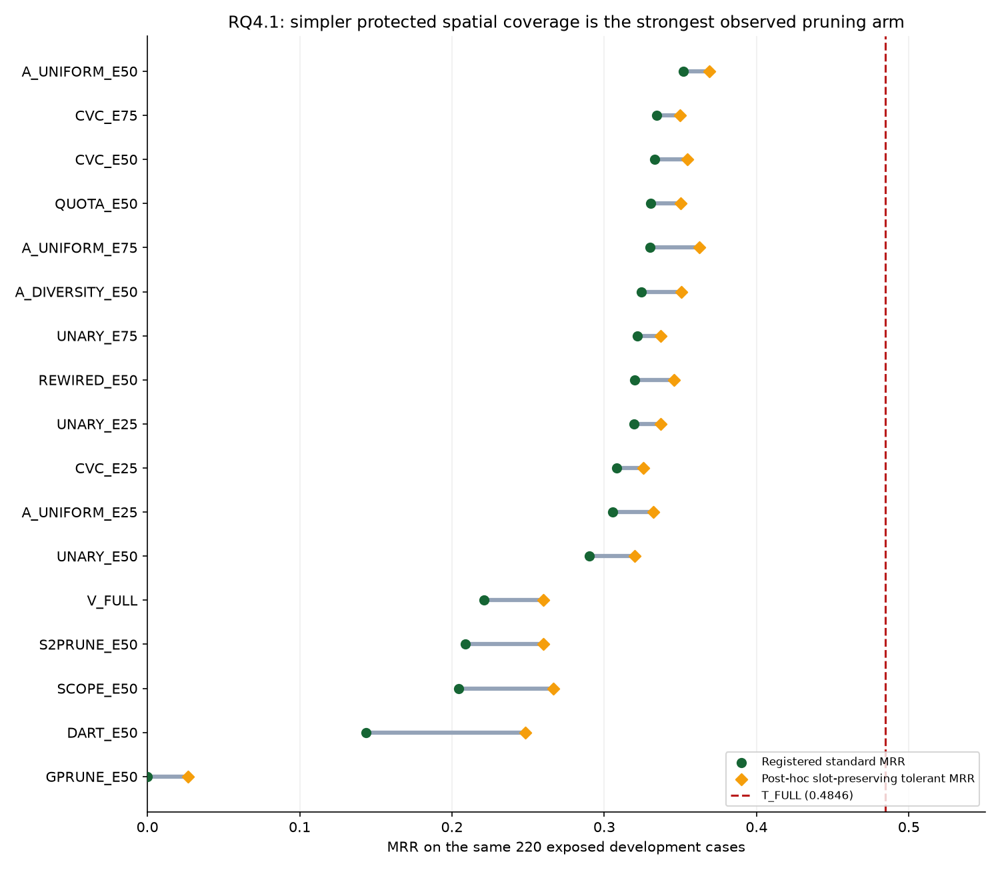
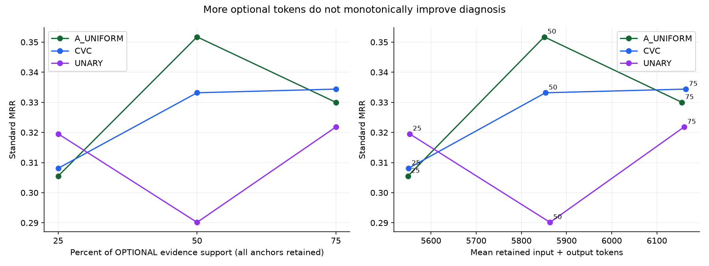
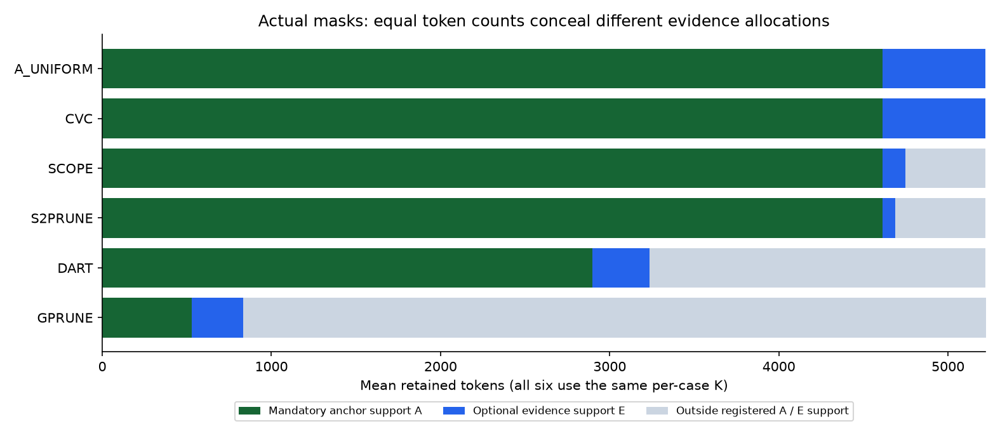
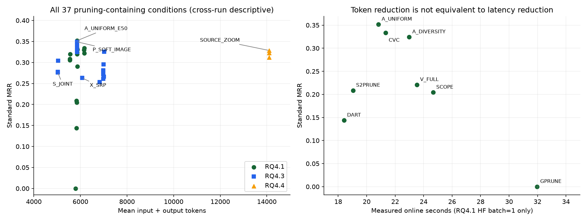
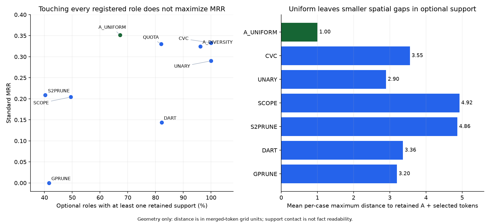
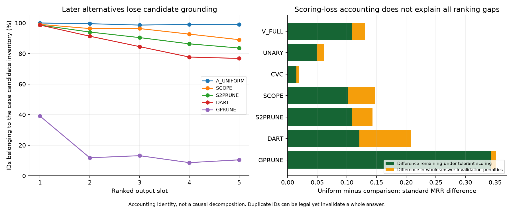

# CanvasRCA 视觉 token 剪枝：全部已测方法的横向比较与研究结论

日期：2026-10-18。范围：截至 RQ4.4 的已完成实验。性质：**回顾性综合分析，不是新实验、独立确认或新的方法选择登记。** 本次新增模型调用为 0，未改变原始输入、回答、评分、实验代码或 `Codex.md`。

**最重要的结论：在我们的密集遥测 dashboard 和冻结 Qwen 上，“保护身份与读图锚点，再均匀覆盖登记证据区域”是目前最值得保留的剪枝底座。它同时改善了完整视觉输入的排名和 token 成本；但更复杂的依赖、显著性、多样性及层内剪枝没有提供更好的已测整体结果，也尚未使纯视觉超过强文本。**

本次新审核进一步发现，方法差异不只是“怎么给 token 打分”：**它们是否保护锚点、允许从哪些位置选 token、在模型哪一层删除 token，也有实质差别。** 特别是 SCOPE/S2Prune 虽然保住了全部登记锚点，但大多数剩余名额没有用于登记的可选证据支持。这比笼统总结为“复杂算法不如随机剪枝”更准确——A_UNIFORM 本来就不是随机算法。

**深入补充（第13节）：** 又核对了16种剪枝条件及完整视觉的 **3,740份实际保留集合与回答**。Uniform并没有最好的登记角色覆盖；它的优势更符合“保住读图锚点、限制选择范围、减少空间大缺口”这一组合解释。CVC/UNARY覆盖代理接近满分仍不保证排名；G-Prune出现133/220份连续数字ID列表；多种方法命中根因时仍有错绑和错误解释。以下明确区分已测事实、合理解释与尚未识别的因果机制。

## 1. 纳入范围与比较规则

这里的“视觉 token”指图像经过视觉编码器及合并器后、被语言模型读取的特征向量；一个向量对应一个原始空间位置，但编码器已经融合上下文，因此它并不只包含所在小方块的信息。**token 剪枝**是实际移除其中部分向量及相应序列位置，不等于删遥测记录、裁剪图片或把像素涂白。

本报告将正式结果分为三类，另列探针和机制材料：

| 范围 | 实际纳入 | 如何解释 |
|---|---:|---|
| RQ4.1 核心剪枝矩阵 | **16 个条件，每个 220 例** | 相同原始 dashboard、任务说明和病例，直接比较不同预算或选择方式；外部方法适配的保护规则、选择范围和剪枝层不同，必须另作说明。 |
| RQ4.3 沿用剪枝的方案 | **18 个条件，每个 220 例** | 剪枝底座叠加证据选择、重绘、语言层处理或它们的组合。是带剪枝的完整方法，不是 18 个新剪枝算法。 |
| RQ4.4 沿用剪枝的双图方案 | **3 个条件，每个 220 例** | 原概览保留历史 U 的剪枝结果，新增局部图完整进入模型。不能把全请求叫“50%剪枝”。 |
| 早期接口探针 | 3 个病例，4 条路径，共 12 次调用 | 包含 `uniform_half`、`uniform_quarter`；只测短读图与接口，不提供 RCA MRR。 |
| 机制、独立重复及 smoke | 按原报告单列 | 不把重复调用、位置扰动、错误事实干预或资格样本混入主排名表。 |

**合计为 37 个带剪枝的正式条件，8,140 个主矩阵逻辑位置。** 逻辑位置中可以含精确结果引用，不能把 8,140 直接称为新增模型调用；同一批 220 例反复使用，也不能当作 8,140 个独立病例。历史 U 在后续报告反复出现只算一个原始条件，不重复累计“成功次数”。

以下内容另列参照而不算剪枝方法：RQ4.1 的 `V_FULL`、`CONTRAST_ATLAS`；RQ4.2 的 FULL/GEOM/SEM/SHAM/NATIVE4；各文本及 HTML 基线。RQ4.2 改变编码器内的分组计算，但保留全部视觉 token。更早 RQ3 中名为 `pruned` 的实验目录、证据筛选、数字压缩，也不因此成为视觉 token 剪枝。未运行、取消或仅获 CPU 资格的条件没有正式性能，不计零分充数。

### 1.1 数据与评分

核心及后续正式矩阵均为同一批已暴露开发病例：AIOPS-2022 60、AIOPS-2025 60、AegisLab 100；共 193 个事件组。整体 MRR 按 220 例加权，AegisLab 权重是 100/220；宏平均则是三个数据集等权。

- **标准 MRR**沿用原协议和中央 `scorer`。五个候选必须合法、互不重复，并满足输出接口；无效整份回答计零。
- **宽容 MRR**是保留原排名槽位的离线敏感性分析：非法 ID、后续重复 ID 在原槽位记 miss，不把后面的合法候选提前、不猜改实体、不重答。它不能代替正式指标。
- `AC@k` 为前 k 名至少命中一个可接受根因；`P@k` 为前 k 个槽位的命中比例；`AVG@k` 为 AC@1…AC@k 的平均。完整指标与逐数据集成本见附件。
- 本报告主表不存在未提交的基础设施未知位置；表中的“非法候选”属于已生成回答的模型失败，不是缺失结果。

本次从逐调用分析记录重新聚合全部表格，与原权威 CSV 的 MRR、宽容 MRR、AC 和成本**完全一致**；另直接读取 **1,320 份实际完成记录**及 220 例 token 支持文件，核查六个代表性方法的真实保留集合。这里没有再次重评分全部原回答；原报告已有重评分核验，本次审核范围记录在[验证清单](CanvasRCA_Visual_Token_Pruning_Review_2026-10-18_assets/verification.json)。

### 1.2 哪些比较最可信

RQ4.1 是主要横向证据：冻结本地 Qwen3.8-27B（实现架构 Qwen3_5）、BF16、相同完整图、HF batch=1、相同排名前缀 greedy 配方；理由部分仍按登记采样。它最适合回答“换剪枝方式会怎样”。

RQ4.3 经历 HF 到 vLLM 的迁移，部分绘图分支还修改了静态说明和编译版本；RQ4.4 使用 vLLM 双图并发。**跨轮 MRR 可以用于工程选型描述，不能把差值全归因于一个组件；跨轮请求时延更不能直接排成速度排行榜。** 后续源追踪与局部结果分别以 [RQ4.1](../docs/experiment_reports/RQ4_1_Qwen_Analysis_2026-10-09.md)、[RQ4.3](../docs/experiment_reports/RQ4_3_Qwen_Analysis_2026-10-12.md)、[RQ4.4](../docs/experiment_reports/RQ4_4_Qwen_Analysis_2026-10-12.md) 完整报告为准。

## 2. 我们到底测过哪些剪枝方法

### 2.1 共同的 A、E、K 是什么

统一 renderer 提供公共来源与实际处理后的几何映射：

- **A：必须保留的锚点 token。** 包括候选及实体标识、单位、阶段、坐标轴、方向和必要日志字符等。一个 token 只要进入锚点集合，就整体保留；同一 token 可以同时携带数值或图形。
- **E：可选证据支持 token 的并集。** 来自登记数值观测图元的实际前景支持，排除 A，同一个 token 只计一次。它不是整张卡片的矩形面积，也不是所有非锚点位置。
- **K：最终保留数。** 对匹配的 E50 条件，`K = |A| + ceil(0.5 × |E|)`；E25/E75 同理。

在 RQ4.1 的 220 例中，平均原始视觉序列 N=**16,251.6**，A=**4,614.0**，E=**1,217.5**。E50 最终 K=**5,223.0**，其中真正可分配的可选名额只有约 **609.0**。A 已占 K 约 88%，所以“保留50%”绝不是把整张图砍一半。

| 登记预算 | 平均保留视觉 token | 保留数 / 原视觉总数（均值之比） |
|---|---:|---:|
| E25 | 4,918.7 | 30.27% |
| E50 | 5,223.0 | 32.14% |
| E75 | 5,527.5 | 34.01% |

E25→E75 实际只增加约 609 个视觉 token。不能把这三点当成整图25%/50%/75%的大范围预算扫描。

### 2.2 算法、保护和选择范围必须同时看

| 方法族 | 实际规则，用通俗语言解释 | 剪枝位置 | 锚点与选择范围 |
|---|---|---|---|
| **A_UNIFORM**，25/50/75 | 先保留 A，再从 E 中反复选“离当前已保留位置最远”的 token，使空间覆盖较均匀；并列按稳定索引。 | 完整视觉编码之后、语言层之前 | 完整 A；额外位置只能来自 E；不随机，不保证每个实体各保留50%。 |
| **UNARY**，25/50/75 | 分别为各证据角色改善特征覆盖，把各角色收益相加。 | 同上 | 同一 A/E/K；不使用跨角色联合比较目标。 |
| **CVC**，25/50/75 | 对 reference/current、父子、peer 等登记比较，优先改善其中覆盖最弱的操作数，尝试让比较双方都可用。 | 同上 | 同一 A/E/K；使用来源依赖和特征覆盖代理。 |
| **QUOTA_E50** | 先分配角色配额，再在对应角色内选择，避免少数角色占完预算。 | 同上 | 同一 A/E/K；配额对照。 |
| **REWIRED_E50** | 用受控打乱的依赖替代 CVC 的真实依赖；选择器内部改变，图上不画假关系。 | 同上 | 同一 A/E/K；机制对照，不是拟部署候选。 |
| **A_DIVERSITY_E50** | 从视觉特征空间挑选与已选集合较不相似的向量，追求特征多样性。 | 同上 | 同一 A/E/K；与 Uniform 的空间距离不同。 |
| **SCOPE_E50，本地适配** | 根据实际视觉 attention 得到显著性，并结合特征覆盖挑 token。 | 视觉编码之后、语言层之前 | 正式版本完整保护 A，剩余位置允许从整张网格选择，不限于 E。 |
| **S2PRUNE_E50，本地适配** | 根据图像空间细节分配区域名额，并利用首层状态变化挑位置。 | 完整运行首个语言块后 | 正式版本完整保护 A；剩余位置不限定 E。 |
| **DART_E50，本地适配** | 在更新过的状态中选若干枢纽，再挑低重复特征。 | 完整运行前两个语言块后 | 相同目标 K；没有使用 CVC 的强制 A/E 保护域。 |
| **GPRUNE_E50，本地适配** | 在视觉特征相似图上传播分数，按分数选择。 | 视觉编码之后、语言层之前 | 相同目标 K；没有强制 A/E 保护。这里的“图”是特征相似图，不是服务拓扑。 |

所有这些正式路径都先完成原图视觉编码。DART/S2Prune 还先完成若干全长语言块，因此最终 K 相同不代表总计算量相同。原位置坐标及合法序列/缓存处理属于适配的一部分。

实现依据：[预算与选择器](../RQs/RQ4_1/src/utils.py)、[实际执行分派](../RQs/RQ4_1/src/gates.py)、[正式部署配置](../RQs/RQ4_1/configs/deployment_v29.json)。正式 SCOPE/S2Prune 的实际记录均为 `shared_anchors_v22`；不能拿存在于源码中的其他候选保护模式，倒推正式运行采用了它。

**比较的边界：** A_UNIFORM/UNARY/CVC/QUOTA/REWIRED/DIVERSITY 的匹配更严格；与四种外部方法适配比较时，测到的是整套本地适配的效果。不能把本地失败当作原论文方法在所有模型和任务上失败，也不能把锚点/选择域优势全记到某个排序公式名下。

### 2.3 最早的half/quarter探针也测过，但不是当前A_UNIFORM

最早接口探针使用三张1120×800边际图，原始视觉序列只有875个token；`uniform_half`保留438个，`uniform_quarter`保留219个。它使用简单等距索引，不是后来带A/E保护域的空间最远点选择。任务只问实体标识和阶段，最多输出64token，没有根因排名。

| 路径 | 三例实体对均正确 | 阶段正确 | 与完整原生路径的完整生成token序列一致 |
|---|---:|---:|---:|
| 原生完整图 | 3/3 | 0/3 | 自身参照 |
| 全token手动注入 | 3/3 | 0/3 | 3/3 |
| uniform_half | 3/3 | 0/3 | 3/3 |
| uniform_quarter | 2/3 | 2/3 | 0/3 |

它证明了接口可以实际缩短序列，也暴露强剪枝可损坏数字标识；三例half输出不变不能当作大图RCA无损证据。该探针没有MRR，不与220例正式成绩合并。后续资格smoke用于修复适配和检查执行，也不作为额外性能样本。

## 3. RQ4.1：核心16条件的完整结果

各行均为同一220例。token 为实际保留输入＋输出的每例平均；在线秒包含该后端记录的模型调用与 processor，未补造缺失的冷绘图时间。宽容分数只作故障诊断。

<!-- GENERATED:CORE_TABLE -->
| 条件 | 标准 MRR | 宽容 MRR | AC@1 | AC@3 | AC@5 | 无效/220 | 总 token | 在线秒 |
| --- | --- | --- | --- | --- | --- | --- | --- | --- |
| T_FULL | 0.4846 | 0.4846 | 0.3909 | 0.5682 | 0.6409 | 0 | 22243.9 | 22.13 |
| V_FULL | 0.2209 | 0.2599 | 0.1045 | 0.3364 | 0.4409 | 33 | 16870.4 | 23.53 |
| A_UNIFORM_E25 | 0.3055 | 0.3320 | 0.1818 | 0.4273 | 0.5273 | 16 | 5548.9 | 20.82 |
| A_UNIFORM_E50 | 0.3517 | 0.3692 | 0.2409 | 0.4455 | 0.5636 | 14 | 5850.7 | 20.83 |
| A_UNIFORM_E75 | 0.3300 | 0.3626 | 0.2182 | 0.4273 | 0.5364 | 18 | 6155.4 | 21.01 |
| UNARY_E25 | 0.3195 | 0.3370 | 0.1955 | 0.4364 | 0.5455 | 11 | 5552.5 | 21.13 |
| UNARY_E50 | 0.2902 | 0.3201 | 0.1818 | 0.3909 | 0.4909 | 16 | 5863.4 | 21.80 |
| UNARY_E75 | 0.3218 | 0.3370 | 0.2182 | 0.3909 | 0.5273 | 13 | 6160.1 | 21.42 |
| CVC_E25 | 0.3081 | 0.3255 | 0.1909 | 0.4000 | 0.5318 | 11 | 5550.0 | 21.07 |
| CVC_E50 | 0.3332 | 0.3544 | 0.2227 | 0.4318 | 0.5409 | 12 | 5853.2 | 21.33 |
| CVC_E75 | 0.3344 | 0.3495 | 0.2091 | 0.4409 | 0.5591 | 12 | 6163.7 | 21.99 |
| QUOTA_E50 | 0.3305 | 0.3502 | 0.2227 | 0.4136 | 0.5409 | 14 | 5865.9 | 22.00 |
| REWIRED_E50 | 0.3201 | 0.3458 | 0.2091 | 0.4182 | 0.5273 | 14 | 5860.1 | 21.78 |
| A_DIVERSITY_E50 | 0.3242 | 0.3508 | 0.2136 | 0.4227 | 0.5409 | 13 | 5855.5 | 22.98 |
| DART_E50 | 0.1437 | 0.2480 | 0.0682 | 0.2000 | 0.2682 | 94 | 5829.4 | 18.40 |
| S2PRUNE_E50 | 0.2086 | 0.2602 | 0.1182 | 0.2864 | 0.3727 | 62 | 5834.8 | 19.04 |
| GPRUNE_E50 | 0.0000 | 0.0267 | 0.0000 | 0.0000 | 0.0000 | 220 | 5789.7 | 31.97 |
| SCOPE_E50 | 0.2043 | 0.2666 | 0.1045 | 0.2955 | 0.3864 | 57 | 5843.1 | 24.67 |
<!-- END:CORE_TABLE -->



**12个使用共同 A/E 域的剪枝条件，标准 MRR 均高于 V_FULL。** Uniform E50 的增量为 +0.1308，AC@1 从0.1045升到0.2409，AC@5从0.4409升到0.5636。这是应当保留的实际进展。四种外部方法适配则没有超过 V_FULL，不能总结为“任意剪枝都会提分”。

但最好的纯视觉仍低于 T_FULL：0.3517 vs0.4846，绝对差 **−0.1329**；宽容后0.3692仍差−0.1155。历史混合 `MARGINAL_FIVE` 的0.5054不属于剪枝成功：它依赖完整诊断文本，并在图片中重复呈现部分耗时信息。

### 3.1 逐数据集结果

<!-- GENERATED:DATASET_TABLE -->
| 条件 | AIOPS-2022 | AIOPS-2025 | AegisLab | 三集宏平均 |
| --- | --- | --- | --- | --- |
| T_FULL | 0.3650 | 0.4039 | 0.6048 | 0.4579 |
| V_FULL | 0.1914 | 0.1667 | 0.2712 | 0.2097 |
| A_UNIFORM_E25 | 0.2511 | 0.2131 | 0.3937 | 0.2859 |
| A_UNIFORM_E50 | 0.3050 | 0.2811 | 0.4222 | 0.3361 |
| A_UNIFORM_E75 | 0.2819 | 0.2361 | 0.4152 | 0.3111 |
| UNARY_E25 | 0.3172 | 0.2131 | 0.3848 | 0.3050 |
| UNARY_E50 | 0.2372 | 0.2178 | 0.3653 | 0.2734 |
| UNARY_E75 | 0.2675 | 0.1997 | 0.4277 | 0.2983 |
| CVC_E25 | 0.2792 | 0.2108 | 0.3838 | 0.2913 |
| CVC_E50 | 0.2867 | 0.2339 | 0.4207 | 0.3137 |
| CVC_E75 | 0.2772 | 0.2769 | 0.4032 | 0.3191 |
| QUOTA_E50 | 0.2789 | 0.2358 | 0.4183 | 0.3110 |
| REWIRED_E50 | 0.2611 | 0.2261 | 0.4118 | 0.2997 |
| A_DIVERSITY_E50 | 0.2619 | 0.2533 | 0.4042 | 0.3065 |
| DART_E50 | 0.1153 | 0.1281 | 0.1702 | 0.1378 |
| S2PRUNE_E50 | 0.1722 | 0.1775 | 0.2492 | 0.1996 |
| GPRUNE_E50 | 0.0000 | 0.0000 | 0.0000 | 0.0000 |
| SCOPE_E50 | 0.1636 | 0.1428 | 0.2657 | 0.1907 |
<!-- END:DATASET_TABLE -->

Uniform E50 是整体最高点，但不是每个数据集的最高点：核心剪枝条件中，AIOPS-2022 的 UNARY_E25 为0.3172，高于U的0.3050；AegisLab的UNARY_E75为0.4277，略高于U的0.4222。**这说明应保留U作为整体工程底座，而不是宣称它在每一种场景都最优。** 不根据这些事后小差异新增按数据集挑赢家的部署路由。

### 3.2 多留 token 不是单调收益



- Uniform：E25/E50/E75 为 **0.3055 / 0.3517 / 0.3300**。
- CVC：**0.3081 / 0.3332 / 0.3344**，E50→E75只增加0.0012。
- UNARY：**0.3195 / 0.2902 / 0.3218**，中间预算反而较低。

这支持“在当前模型和输入上，保留更多位置未必更好”，不支持“50%是普适最优”。尤其各比例只改变约几百个可选位置，且输出存在非线性变化，三点曲线不足以推导普适拐点。

## 4. 新发现：相同 K，实际保留的东西差很多

本节是本次重新读取原始实际 mask 后的新增审核，不是从方法名称推测。六臂各220例，保留数逐例均等于同一个 K。

<!-- GENERATED:MASK_TABLE -->
| 条件 | 保留 A 个数均值 | 锚点召回 | 完整保住 A 的病例 | 保留 E 个数均值 | 可选证据召回 | 保留位置中 A∪E 之外占比 |
| --- | --- | --- | --- | --- | --- | --- |
| A_UNIFORM_E50 | 4614.0 | 100.00% | 220/220 | 609.0 | 50.02% | 0.00% |
| CVC_E50 | 4614.0 | 100.00% | 220/220 | 609.0 | 50.02% | 0.00% |
| SCOPE_E50 | 4614.0 | 100.00% | 220/220 | 133.3 | 10.91% | 9.15% |
| S2PRUNE_E50 | 4614.0 | 100.00% | 220/220 | 72.9 | 5.94% | 10.30% |
| DART_E50 | 2896.9 | 62.77% | 0/220 | 339.2 | 28.21% | 38.08% |
| GPRUNE_E50 | 529.2 | 11.27% | 0/220 | 302.7 | 24.56% | 84.25% |
<!-- END:MASK_TABLE -->

表中比例是先逐病例计算再平均；锚点/可选证据召回分别以该例 A/E 为分母，末列以该例保留 K 为分母。A/E 是登记图元支持集合，不是模型语义真值。



### 4.1 Uniform 的强点可能在“保护＋限定范围＋覆盖”这套组合

U和CVC都保留全部A，额外约609个位置完全来自E。相比之下：

- SCOPE 完整保护 A，但额外名额约 **78.19%** 落在 A∪E 之外；真正保留的可选支持平均只有133.35个，约占E的10.91%。
- S2Prune 完整保护 A，但额外名额约 **88.13%** 落在 A∪E 之外；可选支持平均仅72.9个，约占E的5.94%。
- DART 平均保留62.77%的锚点；G-Prune仅11.27%。二者均没有任何一个病例完整保住登记锚点。
- G-Prune 平均约84.25%的保留序列位于A∪E之外。这与严重身份输出损失相容，但不能单靠相关观察认定唯一原因。

**因此，当前结果首先说明“选在哪里”很重要，而不只是“给什么分数”。** Uniform 的名称容易掩盖它已经使用了 renderer 的任务相关结构信息：保护读图上下文，限制可分配区域，再做简单空间覆盖。它不是不看内容地在全图随便删一半。

这也解释了为什么暂时不宜直接下结论“空间距离优于所有特征/attention方法”：后者部分条件承担了不同的保护和选择范围，DART/S2Prune还改变剪枝深度。要归因于选择公式，需要相同范围、相同保护、相同预算、相同插入层的对照。

### 4.2 A∪E 之外不等于全部是无用空白

本次审核识别的是**登记支持之外的位置**。其中可能有纯背景，也可能有边框、非规范重复呈现、连接线和周围上下文；完整视觉编码还会使这些位置带有其他区域的信息。没有逐像素证明时，不能把全部灰色部分称作“空白token”或断言删去它们没有信息代价。

RQ4.3 确实运行过更直接的背景控制：`C_PACK_BG_FILL` 在相同重绘图和K下，将新增可选观测名额换成经过审计的真实背景位置。`R_PATCH_PACK` 为0.2715，背景控制为0.2608，差 **+0.0107**；原病例/事件组Holm均为1。该控制没有建立稳定的额外收益，也不能替代原始U上的“只删背景”消融。

**尚缺的关键区分是：U相对完整图的提升，分别有多少来自排除A∪E之外位置，有多少来自进一步只保留一半E。** 当前 V_FULL 与 U 同时改变两者；E25/E50/E75仍都先排除了A∪E之外的位置，不能单独解决这个归因。

## 5. 输出失败能解释多少，不能解释多少

G-Prune的220份回答全部无效；DART 94份、S2Prune 62份、SCOPE 57份；U只有14份。非法候选可能来自读错数字、错误拼接或不在登记候选表中的实体；重复候选也可能都是实际存在的实体。**模型完成了回答，宿主事后计零；不是一生成非法ID就中止，因此完整回答可以重评分。**

宽容重评分能恢复一部分成绩，但没有逆转主要顺序。再将比较限制在双方输出都合法的同一病例集合，得到以下描述：

<!-- GENERATED:VALID_TABLE -->
| 对照 | 全220标准 ΔMRR | 全220宽容 ΔMRR | 双方合法 n | 双方合法子集标准 ΔMRR |
| --- | --- | --- | --- | --- |
| V_FULL | 0.1308 | 0.1092 | 178 | 0.1093 |
| CVC_E50 | 0.0186 | 0.0148 | 202 | 0.0105 |
| DART_E50 | 0.2080 | 0.1212 | 122 | 0.1481 |
| S2PRUNE_E50 | 0.1431 | 0.1090 | 152 | 0.0884 |
| GPRUNE_E50 | 0.3517 | 0.3425 | 0 | 不适用 |
| SCOPE_E50 | 0.1474 | 0.1026 | 156 | 0.0978 |
<!-- END:VALID_TABLE -->

所有Δ均为U−对照。共同合法子集由结果决定，可能存在选择偏差，**只用于故障定位，不能取代220分母或作为新的公平主分数**。G-Prune没有共同合法病例，不能虚构条件成绩。

U相对V_FULL在178个共同合法病例上仍高 **0.1093**；相对SCOPE/S2Prune/DART也仍为正。由此可见，U的领先并非全部由“别人尾项非法、整单归零”造成。另一方面，宽容评分与标准评分的明显差距说明输出身份可靠性仍是部署方法的一部分，不能从性能报告中删掉。

同样，SCOPE/S2Prune全保留A而仍大量输出无效，也说明**保留对应位置不等于字符必定读对，更不等于模型会从候选目录正确抄写或绑定证据。**

## 6. 正确依赖与特征复杂度为何没有带来更高成绩

### 6.1 CVC有局部进展，但没有超过最强简单对照

在E50相同A/E/K下：CVC相对UNARY为 **+0.0430**；相对REWIRED为 **+0.0131**；相对QUOTA仅 **+0.0027**；相对Uniform为 **−0.0186**。不能因为它胜过UNARY，就断言来源依赖是本轮最有效机制。

原实际mask审核发现：CVC与REWIRED在219/220例不同，但集合Jaccard平均 **0.9861**，每侧平均仅替换约36个位置；CVC与UNARY平均Jaccard为0.9706。锚点占保留序列86%–90%，正确图覆盖代理约0.9985，已经接近饱和。

因此有两个尚未区分的解释：来源依赖没有提供足够诊断价值；或者当前保护与覆盖目标使真正可干预的空间太小。**“代理接近1”不能当作模型完成比较，也不能以“mask不完全相同”代替足够强的机制干预。** 现有证据不支持继续围绕同一饱和目标微调小权重。

### 6.2 特征多样性也没有自动超过空间覆盖

A_DIVERSITY_E50为0.3242，低于U的0.3517，在线时间22.98秒也高于U的20.83秒；二者共享A/E/K，比较相对干净。它表明当前特征距离代表的“不同”没有更好地转化为诊断价值。但两者差距没有通过原登记统计校正，不能把这一轮结果外推为所有特征多样性方法必败。

## 7. RQ4.3与RQ4.4：在U底座上加东西，发生了什么

以下全部方案都实际运行完220例，均具有视觉token筛选环节；表中后续条件只列一次，不重复列历史U。

为便于读懂臂名，S表示证据选择，R表示图形重绘，P表示保留视觉token进入语言模型后的处理，C表示对照，X表示组合。它们不是新的剪枝比例：

| 条件 | 在剪枝底座上实际增加什么 |
|---|---|
| S_JOINT / C_SOURCE_HASH | 按来源单元选择可选证据；对照用相同预算的固定哈希选择。 |
| P_LOCAL_BI / C_LOCAL_FORWARD | 在前0–2个语言块中进行来源局部双向辅助；对照只作前向处理。 |
| C_GLOBAL_BI / C_SHAM_BI | 将局部双向处理分别改为全局分组或打乱来源的分组。 |
| P_SOFT_IMAGE / P_DUAL | 前者在语言层3的full-attention中增加图像query的软双向处理；后者叠加LOCAL与SOFT。 |
| R_PATCH_PACK / R_HORIZON / R_PACK_HORIZON | 分别为紧凑来源打包、horizon时序画法（用分层色带表达数值范围）、两者组合；同时涉及读图说明与支持分配。 |
| C_PACK_OFFSET / C_READ_GUIDE / C_PACK_BG_FILL | 分别为同图位置偏移、原图增加相同读图说明、将新增观测token槽替换成真实背景token。 |
| X_SP / X_SR / X_RP / X_SRP | 分别组合选择与处理、选择与绘图、绘图与处理，以及三者；不同修订接口使其不能被视为干净的完整三因子设计。 |
| SOURCE_ZOOM / REPEAT_VIEW / HASH_ZOOM | 分别追加按可读性选取的高清完整卡片、同卡片低清像素放大控制、哈希选取的高清卡片。三者均保持原概览剪枝。 |

具体注册与修订见[RQ4.3方法清单](../docs/experiment_reports/RQ4_3_Qwen_Analysis_2026-10-12.md)及[RQ4.4方法清单](../docs/experiment_reports/RQ4_4_Qwen_Analysis_2026-10-12.md)。

<!-- GENERATED:EXTENSION_TABLE -->
| 实验 | 条件 | 标准MRR | 宽容MRR | AC@5 | 无效/220 | 总token |
| --- | --- | --- | --- | --- | --- | --- |
| RQ4.3 | P_SOFT_IMAGE | 0.3491 | 0.3627 | 0.5636 | 12 | 5851.9 |
| RQ4.3 | C_LOCAL_FORWARD | 0.3420 | 0.3640 | 0.5545 | 16 | 5852.4 |
| RQ4.3 | P_LOCAL_BI | 0.3358 | 0.3638 | 0.5545 | 15 | 5858.4 |
| RQ4.3 | C_GLOBAL_BI | 0.3290 | 0.3510 | 0.5455 | 15 | 5856.2 |
| RQ4.3 | C_SHAM_BI | 0.3276 | 0.3495 | 0.5318 | 16 | 5854.8 |
| RQ4.3 | P_DUAL | 0.3250 | 0.3561 | 0.5364 | 19 | 5851.8 |
| RQ4.3 | S_JOINT | 0.2762 | 0.2936 | 0.5227 | 14 | 5026.6 |
| RQ4.3 | C_SOURCE_HASH | 0.3039 | 0.3233 | 0.5182 | 19 | 5043.5 |
| RQ4.3 | R_PATCH_PACK | 0.2715 | 0.2821 | 0.4727 | 9 | 6979.6 |
| RQ4.3 | R_HORIZON | 0.2956 | 0.3002 | 0.4773 | 6 | 6995.4 |
| RQ4.3 | R_PACK_HORIZON | 0.2811 | 0.2955 | 0.4636 | 12 | 6984.9 |
| RQ4.3 | C_PACK_OFFSET | 0.2659 | 0.2659 | 0.4727 | 1 | 7010.5 |
| RQ4.3 | C_READ_GUIDE | 0.3252 | 0.3563 | 0.5227 | 15 | 7018.6 |
| RQ4.3 | C_PACK_BG_FILL | 0.2608 | 0.2737 | 0.4682 | 12 | 6977.9 |
| RQ4.3 | X_SP | 0.2773 | 0.2940 | 0.5045 | 12 | 5022.7 |
| RQ4.3 | X_SR | 0.2535 | 0.2580 | 0.4455 | 2 | 6819.4 |
| RQ4.3 | X_RP | 0.2785 | 0.2876 | 0.4773 | 10 | 6979.3 |
| RQ4.3 | X_SRP | 0.2630 | 0.2630 | 0.4591 | 2 | 6078.1 |
| RQ4.4 | SOURCE_ZOOM | 0.3286 | 0.3431 | 0.5227 | 13 | 14094.9 |
| RQ4.4 | REPEAT_VIEW | 0.3230 | 0.3438 | 0.5500 | 17 | 14098.7 |
| RQ4.4 | HASH_ZOOM | 0.3120 | 0.3309 | 0.5136 | 12 | 14103.0 |
<!-- END:EXTENSION_TABLE -->

**RQ4.3的P分支**保留同一U图像和token集合，修改早期语言层的局部/双向或图像attention处理：最好 `P_SOFT_IMAGE` 为0.3491，几乎回到U的0.3517，但没有超过。`P_LOCAL_BI`为0.3358，反而低于简单前向控制0.3420。结果不支持通过这些复杂处理替换底座。

**S分支**先选择来源完整的可选证据，再按其支持剪枝：`S_JOINT`总token比U少14.09%，MRR却低0.0755，且低于哈希选源控制0.3039。它测试的是证据选择加剪枝，不能归因为纯token算法。资源/宿主等保护规则也未让额外筛选自动变好。

**R及组合分支**更改可读编译、horizon画法、打包及支持分配；恢复版本还有更长读图说明。图元更紧凑并未带来完整请求更便宜或排名更好。`X_SRP`为0.2630，宽容后仍0.2630；严重退化不能归因于严格评分。

**RQ4.4**保持U原概览剪枝，再增加约8,162个未剪枝局部图token。SOURCE/REPEAT/HASH输入token相同；SOURCE最高标准MRR0.3286，却比U低0.0232、总token高140.91%。高清卡片、重复突出和更多预算，没有填平当前排名缺口。

所以，**37个带剪枝的已完成正式条件里，U仍是整体MRR最高的观察点，也是一个很有竞争力的低token成本底座。** 这一工程结论来自已测数据，不等于其对所有未来输入或后端的统计最优证明。

### 7.1 RQ4.2为什么不混入剪枝排名

RQ4.2的FULL/GEOM/SEM/SHAM/NATIVE4均保留约16,272图像token，整体MRR分别为0.2841/0.3088/0.3084/0.3011/0.3235，总token约16,899–16,909。SEM改变编码器共同attention范围，而非删token；NATIVE4改变图像边界。它们也未超过历史U，但不能据此推导“任何编码器干预都不如剪枝”。[RQ4.2完整报告](../docs/experiment_reports/RQ4_2_Qwen_Analysis_2026-10-10.md)

## 8. 成本结论：已经省下很多token，没有同比省下时间



U相对同轮完整视觉V_FULL：

- 总token从 **16,870.4降到5,850.7，减少65.32%**；标准MRR增加0.1308。
- 同HF batch=1在线时间从 **23.53秒降到20.83秒，只减少11.47%**。

U相对同轮强文本T_FULL：

- 总token从 **22,243.9降到5,850.7，减少73.70%**。
- 在线时间从 **22.13秒降到20.83秒，减少5.87%**；MRR却减少0.1329。

时间差距的原因可以从实际执行路径解释：完整视觉编码仍运行，随后选择、拷贝、语言prefill与生成也要执行。U的历史实现平均视觉编码约2.38秒，选择及信号拷贝约1.36秒。即使Uniform的选取规则不依赖特征，历史公共执行器仍承担了一些特征处理开销；不能把理论上的轻量算法当成已经测到的零成本实现。

G-Prune的选择及拷贝平均约 **16.68秒**，整体31.97秒，甚至慢于完整视觉；SCOPE的视觉编码/所需信号约4.15秒、选择/拷贝约3.91秒，整体24.67秒。复杂选择器自身可以吃掉压缩收益。DART/S2Prune表面更快，但无效率高、输出长度不同，而且包含全长前置语言块，不能只按最终K比较FLOPs或称作更优部署。

这里的token是序列资源记账，**不是已测货币价格、电量或GPU总占用**。RQ4.1未完整记录每次从源读取到最终提交的冷路径；RQ4.3/4.4的并发请求还含不同排队。没有把这些不相同的时间口径合并。

本报告同时计算了37条件的[描述性token前沿](CanvasRCA_Visual_Token_Pruning_Review_2026-10-18_assets/descriptive_token_frontier.csv)。U位于前沿，UNARY_E25等较低预算点亦有各自取舍；几个条件因平均输出仅差1–3token而互不支配，这种微差没有部署意义。前沿只用于展示准确率与token取舍，不是正式推荐全部前沿点。

## 9. 统计支持应怎样读

### 9.1 原登记结论不被这份回顾改写

RQ4.1最终采用的是用户接受的保守 **v11事件组有界均值混合检验**，不是后来RQ4.2–4.4的Pratt主检验。它在既有校准中检出力很低，原报告已披露；不显著不能解释为等效，也不能换检验追认原预选方法成功。

原登记六项主要比较没有通过v11 Holm；CVC对UNARY的+0.0430可作为正向开发信号，Pratt敏感性支持其方向，但正确依赖对REWIRED/QUOTA的独有贡献未建立。原次要族中，DART相对U的退化达到v11 Holm **0.04963**，G-Prune相对U为 **0.000258**；SCOPE/S2Prune没有通过该族校正。

### 9.2 本报告新增的是完整回顾性比较族

为避免只挑一个有利的对照计算p，本次对16个剪枝条件加V_FULL的**全部136对**统一做Holm，分别报告v11、病例Pratt、事件组Pratt；差值保留12位，不报告CI。以下仅摘取关键比较，方向统一为U−对照；全部结果在[136对比较表](CanvasRCA_Visual_Token_Pruning_Review_2026-10-18_assets/retrospective_all_136_pairs.csv)。

<!-- GENERATED:STATS_TABLE -->
| U相对 | ΔMRR | RR改善/破坏/相同 | 病例dz | v11 pH | 病例Pratt pH | 事件组Pratt pH |
| --- | --- | --- | --- | --- | --- | --- |
| V_FULL | 0.1308 | 76/33/111 | 0.373 | 1 | 0.0003427 | 0.0003517 |
| A_UNIFORM_E25 | 0.0462 | 29/14/177 | 0.218 | 1 | 0.9197 | 1 |
| A_UNIFORM_E75 | 0.0217 | 23/9/188 | 0.111 | 1 | 0.9197 | 0.9366 |
| UNARY_E50 | 0.0616 | 40/9/171 | 0.254 | 1 | 0.0009079 | 0.002536 |
| CVC_E50 | 0.0186 | 26/16/178 | 0.083 | 1 | 1 | 1 |
| A_DIVERSITY_E50 | 0.0275 | 30/15/175 | 0.139 | 1 | 1 | 1 |
| DART_E50 | 0.2080 | 97/20/103 | 0.521 | 0.4619 | 1.865e-11 | 7.553e-11 |
| S2PRUNE_E50 | 0.1431 | 83/29/108 | 0.356 | 1 | 1.294e-05 | 7.203e-05 |
| SCOPE_E50 | 0.1474 | 81/31/108 | 0.365 | 1 | 3.729e-05 | 0.000186 |
| GPRUNE_E50 | 0.3517 | 124/0/96 | 0.880 | 0.002338 | 1.814e-25 | 2.211e-23 |
<!-- END:STATS_TABLE -->

v11与Pratt检验的问题和假设不同。事件组Pratt按组内均值后比较差值秩结构，不等于检验任意分布下病例加权均值为零。**回顾性Pratt支持U对V_FULL等差异的秩证据，并不追溯改变RQ4.1的预注册判定。** U是看过结果后的最佳观察点，尚无独立冻结确认；对CVC、QUOTA、DIVERSITY的微小领先没有被本完整比较族确立。

工程上仍可以据此保留U：它在已测整体MRR、成本、复杂度之间最有吸引力，不必等每个部件分别显著才承认其价值。但论文中的“超过强文本”“通用最优”“正确依赖有效”等更强主张需要各自证据，当前不成立。

## 10. 机制证据：当前能定位到哪里

**位置/顺序敏感性已有较强证据。** RQ4.1中CVC/UNARY改变画布位置，各47/90例首选翻转，独立重复均0/90；登记v11 Holm为7.47×10⁻¹³。RQ4.3固定PNG和保留token集合，仅改变登记token顺序，P_LOCAL的ORDER首选翻转39/60，重复5/60，机制族Holm为1.747×10⁻⁷。这两个干预对象不同，但共同说明：保留同样事实或位置集合，仍不保证诊断稳定。翻转本身不等于MRR下降。

**保留、读数、归属、使用是不同环节。** RQ4.1 QA存在接口冲突和地板效应，不能拿Joint全零声称QA与RCA独立。RQ4.3人工检查出现正确数字被绑定到错误实体、正确局部QA对应相反诊断理由；RQ4.4隔离目标卡后30/30例两项数值均正确，而完整SOURCE图23/30例所答数字匹配非目标卡，其中18例来自局部图中的非目标卡。这支持进一步定位目标选择和归属问题，不证明某一个剪枝错误因果导致某次排名错误。

**attention尚不能解释“Uniform为什么强”。** RQ4.1同条件attention主要覆盖T_FULL、V_FULL、CVC，不包含U的相同测量；记录仅语言层3的最后prompt query和首decode query。CVC相对V_FULL标题密度下降、观测attention上升与MRR改善共变，但没有做控制干预；标题桶还包含所有组件标题。不能据此称Uniform移除了有害sink，更不能把未记录的最终排名过程补写成观测结论。

## 11. 十条可带到会议上的结论

1. **剪枝在当前纯视觉系统中确有工程价值。** U相对完整视觉MRR增加0.1308、总token减少65.32%；不只是省资源而保持原来的低成绩。
2. **这不是随机剪枝成功。** U结合renderer锚点保护、证据域限定和确定性空间覆盖，方法包含明确的任务结构。
3. **纯视觉与强文本的缺口仍大。** 最好标准0.3517、宽容0.3692，强文本0.4846；不能用宽容评分或混合方法0.5054宣称已追平。
4. **同K不等于同证据保护。** 新审核显示DART/G-Prune平均只保留62.77%/11.27%的锚点，而U完整保护。这是解读外部适配成绩必须披露的差别。
5. **完整保护锚点还不够。** SCOPE/S2Prune保住全部A，却仅保留10.91%/5.94%的E，其余可分配名额大多落在登记支持之外。
6. **更多token并非单调更好，也没有验证普适50%最优。** 当前预算扫描只改变约几百个可选位置，三个方法族的曲线明显不同。
7. **复杂比较目标未超过简单空间覆盖，且覆盖代理与诊断目标明显脱节。** CVC/UNARY保住每个可选角色的至少一个支持位置，Uniform却有32.79%的角色未保留可选支持，排名仍更好；不能把代理满分当成证据被正确使用。
8. **低分部分来自输出接口，更多问题仍在诊断。** 宽容分、共同合法子集均未消除U对多数方法的领先，也未填平文本差距。
9. **省token不等于同比提速。** U对强文本省73.70%token、同轮在线仅快5.87%；完整编码和选择器自身开销必须计算。
10. **后续复杂化尚未超过U，当前更应研究证据保留后的定位、绑定和使用。** RQ4.3处理/重绘和RQ4.4局部高清均未形成更强整体方法；它们提供了具体失败位置，而非继续微调的自动授权。

## 12. 下一步应怎样利用这份比较

**保留U作为性能/成本底座，保留T_FULL与MARGINAL_FIVE作历史参照；避免重跑相同输入。** 下一阶段如要研究剪枝，不宜继续扩大E25/E50/E75附近的比例搜索，也不宜原样重跑失效的外部适配。

最值得补的缺口有明确区分：

| 优先事项 | 为什么值得做 | 应避免的误解 |
|---|---|---|
| 先用现有实际mask和错误回答，检查身份/单位/目标支持保留与错绑之间的关系 | 本报告已提供全部病例六臂实际支持审核，可继续离线定位，无需生成新回答 | 相关性不是因果；A/E之外不自动等于空白。 |
| 若重新登记一次剪枝消融，优先补“完整A∪E”与“相同A、相同K、全网格空间覆盖”等缺失控制 | 分开回答排除非登记支持、减少E、空间覆盖分别贡献多少 | 这不是已经运行过的Uniform比例曲线；须保持其他条件不变。 |
| 外部方法如继续，只考虑一次明确改变保护/选择域的重大适配 | 当前缺陷可量化：保留域和合法身份传递；不应只调显著性阈值 | 加上共同A/E后是新适配，不能冒充原论文复现；原失败保留。 |
| 主要方法优化转向让正确证据在单调用中更容易定位、绑定和用于排序 | RQ4.4表明隔离可读、完整图错定位；单纯添token与高清没有解决 | 保持纯视觉、单阶段、unified renderer；不恢复模型两阶段取证或文本兜底。 |

这些是报告支持的决策方向，**本次没有冻结新的实验方案、修改方法或启动调用**。先把一个可检验缺口说清楚，再安排有独立问题的少数条件；不要为了“测得更全”复制已有失败。

## 13. 深入机制分析：为什么Uniform好，其他方法具体坏在哪里

### 13.1 本次新增分析及证据边界

前面的汇总回答“哪些方法更好”，本节追踪“保留集合→可见支持→身份输出→证据解释→排名”。新增审核覆盖 **17条件×220例=3,740份**实际记录，包含V_FULL和全部16种剪枝条件；不重新生成、不改分数、不做新的GPU或特征提取。病例/故障类型分层、角色支持、候选合法位置、排名变化和原文均可追溯到附件。

另按固定哈希在“U命中而V/CVC未命中”及相反结果的分层内取例，实际得到六个病例，阅读七臂共 **42份回答**，核对公共图形数据，并打开三个数据集的三张原始PNG。不存在相应病例的分层保持空缺。这是**结果分层的定性解释**，不能用六例推算总体解释错误率。保存的48份例答还含UNARY，后者未计入这次42份人工阅读范围。

诊断理由在本轮是**五候选排名之后生成的文本**。因此，理由可用于审核“输出解释是否忠于证据、是否支持排名”，不能直接视为导致排名的真实内部推理轨迹。某个方法改变了回答中的叙述，不等于已经定位了模型内部的因果路径。

### 13.2 Uniform的优势来自一套有结构的选择规则

**第一层：完整保护锚点，让证据仍然有身份。** 数值曲线必须与实体、阶段、单位、轴及候选目录一起解释。U保住全部A；DART/G-Prune没有同等保护，分别只保住62.77%/11.27%。这与它们的候选失真相容，是重要的实现差异，但不是独立锚点消融的因果结论。

**第二层：将稀缺名额限定在登记证据支持。** U的约609个可选名额全部来自E。SCOPE/S2Prune则大多花在A∪E之外。这里的优势是编译器知道哪些位置直接承载登记观测；Uniform已经使用领域结构，并不是无信息的随机基线。仍不能把域外位置全部称作空白。

**第三层：在已经保留的锚点之间填补空间缺口。** U每次选择离已保留集合最远的可选位置。它不假定一个特征相似的数字、曲线段或另一张卡片能代替当前位置。在本次实际mask中，**全部220例的每一个E位置，距离最近已保留位置都不超过一个合并后token网格单位**。该最近位置可能是A，也可能是新选E；这不是每个E都被保留。

定义几何最大缺口为 `max(e∈E) min(s∈保留集合) distance(e,s)`。CVC的逐例最大缺口平均为 **3.55**，UNARY为 **2.90**，SCOPE/S2Prune为 **4.92/4.86**；U为 **1.00**。三例使用显式全距离计算独立核对了最近邻结果。距离按真实merged-token网格计算，不是原PNG像素，也不证明相邻token可以无损恢复被删字符。

**当前最合理的解释是：U在大幅缩短序列时，保留了有身份约束且空间较连续的证据支撑。** 它可能比只优化抽象特征覆盖更适合密集曲线、数字和标签的局部组合。完整视觉中大量其他位置被同时移除，也可能减轻后续证据竞争；但U没有同条件attention测量，且缺少A∪E全保留控制，尚不能把“消除干扰”或“缓解attention sink”认定为已证实原因。

### 13.3 最重要的新反例：CVC覆盖更全，诊断却未更好

这里的“角色”是一个登记来源操作数，例如某指标的reference序列、current序列或一个分位数。统计仅针对具有非空E支持的角色；角色未保留可选支持，**不等于整项事实不可见**：它仍可能部分位于A、存在非规范重复呈现，或通过编码上下文影响别的位置。

| E50条件 | 未保留任何可选支持的角色比例 | 多操作数关系的各端均触及可选支持 | 登记特征覆盖目标均值 | 几何最大缺口均值 | 标准MRR |
|---|---:|---:|---:|---:|---:|
| A_UNIFORM | 32.79% | 78.48% | 0.7454 | 1.00 | 0.3517 |
| UNARY | 0.00% | 100.00% | 0.9986 | 2.90 | 0.2902 |
| CVC | 0.00% | 100.00% | 0.9986 | 3.55 | 0.3332 |
| QUOTA | 18.01% | 83.38% | 0.7700 | 2.07 | 0.3305 |
| A_DIVERSITY | 3.89% | 93.44% | 0.9021 | 3.53 | 0.3242 |
| SCOPE | 50.51% | 38.71% | 不适用 | 4.92 | 0.2043 |
| S2Prune | 59.75% | 18.92% | 不适用 | 4.86 | 0.2086 |
| DART | 17.81% | 74.23% | 不适用 | 3.36 | 0.1437 |
| G-Prune | 58.33% | 39.31% | 不适用 | 3.20 | 0.0000 |

比例先逐病例计算再平均。“各端触及”只统计至少两个操作数且每端均有可选支持的关系；每端至少触及一个位置，不要求全部位置保留，也不代表能够完成比较。特征目标是原运行记录中的代理值，不是本次发明的可读性得分。



这直接推翻一个过于简单的解释：**Uniform并不是因为“覆盖了更多登记角色”而赢。** CVC/UNARY在角色接触率和自身优化目标上明显更好，排名却较低；同样，DART比U漏掉的可选角色更少，但失去了大量锚点，排名更差。

从实现可得到三个解释线索：

1. **代理目标与模型实际任务不一致。** CVC/UNARY用特征余弦距离与归一化空间距离判断一组选中位置对整个角色的覆盖；高代理值不检查数字是否逐位可辨、两阶段是否被正确区分、实体是否被绑定，更不检查可否区分根因与受害者。
2. **接触每个操作数可以与局部形状缺口共存。** 选一个代表点便可使某些特征相近的角色覆盖接近饱和，其他局部位置仍可能隔得较远。U优先填这些空间缺口，却可以跳过靠近已保留A的小角色。这是已测mask差异；“哪种差异造成了MRR变化”仍需受控验证。
3. **正确依赖没有进入模型作为显式推理规则。** CVC只用依赖优化选择集合，原embedding不会因此获得新的因果知识。CVC/REWIRED的集合又高度相似，所以很难期待仅凭目标名为“比较保留”就显著提升诊断比较。

不能反过来宣称“漏角色越多越好”：SCOPE/S2Prune漏得更多却明显更差，U_E25也比U_E50弱。当前结果说明，**角色计数、特征代理和几何覆盖是不同维度，没有一个可以单独充当RCA效用。**

### 13.4 外部剪枝适配分别如何影响输出

**SCOPE：视觉显著性与RCA所需证据不一致。** 实际算法按视觉attention显著性乘以特征覆盖收益选位置；它没有使用故障标签，也没有RCA特定的因果价值判断。保住A之后，剩余槽的78.19%进入登记域外。50.51%的可选角色没有直接支持被保留，多操作数两端同时触及率只有38.71%。这提供了“知道实体名称，但比较证据变薄”的具体风险。不能因为其名称含attention就认定它找到了诊断重要性。

**S2Prune：区域复杂度与首层状态变化不保证优先保留关键数值。** 它按图像细节分配区域预算，再用首层状态变化选择位置。登记域外占其可选槽88.13%；70.44%的MET可选角色、55.51%的CMP可选角色未被触及。数字、曲线与复杂纹理并不是同一选择目标。在本地密集dashboard上，它保留完整身份锚点，却稀疏了用于判别异常与比较的可选支持。

**DART：特征低重复与身份完整性发生冲突。** DART可以触及较多操作数，但没有强制保护读图锚点；后续首选通常仍是合法ID，备选越往后越容易出现集合外身份。它还在早期语言块后剪枝，作用点与U不同，不能将整个差异只解释为“选错像素”。

**G-Prune：当前本地适配出现严重的身份与条件化失败。** 它平均保留约529个锚点而U保留4,614个，84.25%的保留位置在A∪E之外。首选合法率仅39.09%，后四位约8.6%–13.2%。更明显的是，**133/220份回答的五个ID是严格步长+1或−1的连续数列**，153/220份至少含三个连续ID；U/CVC的五个连续ID均为0/220。这是实际输出模式，不是仅凭低MRR推测。

本轮数字语法约束能保证像一个ID，却不含病例候选白名单。在视觉身份条件不足时，生成可以退回连续数字及通用传播故事；这与观测一致，但仍不能证明某种特征中心性就是唯一原因。它说明该适配对本任务不可部署，不能外推为原论文方法在所有任务上无效。

| 条件 | 第1位ID在候选表中 | 第5位ID在候选表中 | 含集合外ID的回答 | 含重复ID的回答 | 五个ID构成连续数列 |
|---|---:|---:|---:|---:|---:|
| V_FULL | 99.09% | 92.73% | 24/220 | 11/220 | 2/220 |
| A_UNIFORM_E50 | 100.00% | 99.09% | 6/220 | 8/220 | 0/220 |
| CVC_E50 | 100.00% | 98.18% | 9/220 | 3/220 | 0/220 |
| SCOPE_E50 | 99.09% | 89.09% | 35/220 | 23/220 | 1/220 |
| S2PRUNE_E50 | 98.64% | 83.64% | 46/220 | 20/220 | 5/220 |
| DART_E50 | 98.64% | 76.82% | 73/220 | 24/220 | 9/220 |
| GPRUNE_E50 | 39.09% | 10.45% | 216/220 | 8/220 | 133/220 |

“ID在候选表中”不要求该槽位与前面不同，所以不能把它直接解释为整份合法率。集合外和重复可以同时发生。SCOPE/S2Prune/DART的损失尤其包含**备选列表失去依据，连带使正确首选整份计零**，而G-Prune连合法槽位本身也大多没有正确诊断。

### 13.5 排名损失中，格式拒绝究竟占多少

可以作一个精确的记账分解：`U−B的标准MRR差 = 宽容MRR差 + 两臂整份拒绝损失的差`。它不改变原分数，也不是因果中介分析；宽容分数依然惩罚错误/非法槽位，绝不等于假设修好接口后的真实性能。

| U相对 | 标准ΔMRR | 宽容评分下仍有的差距 | 整份拒绝惩罚的差额 |
|---|---:|---:|---:|
| V_FULL | +0.1308 | +0.1092 | +0.0216 |
| UNARY_E50 | +0.0616 | +0.0491 | +0.0125 |
| CVC_E50 | +0.0186 | +0.0148 | +0.0038 |
| SCOPE_E50 | +0.1474 | +0.1026 | +0.0448 |
| S2PRUNE_E50 | +0.1431 | +0.1090 | +0.0341 |
| DART_E50 | +0.2080 | +0.1212 | +0.0868 |
| GPRUNE_E50 | +0.3517 | +0.3425 | +0.0092 |



U对V_FULL的收益中，约 **83.5%仍存在于宽容差值**，因此不能用输出验证规则解释主要提升。U对DART的差距则有约41.7%对应整份拒绝惩罚差额，接口损伤确实很重要。G-Prune虽然全部无效，宽容后依然极低，取消整份拒绝不会自动救回它。

保留集合对诊断的影响也远超过几个非法尾项：U与V_FULL **128/220例首选不同、218/220例完整排名不同**，Top-1修复35例、破坏5例，Top-5修复44例、破坏17例。U与CVC首选不同53例，Top-1修复11例、破坏7例；这是一种较小、双向的取舍，不能将CVC称为全面失败。逐病例转移记录见附件。

### 13.6 六个病例：模型具体改变了什么

本表中的事实来自原始公共卡片及实际回答；“RR=1”表示符合登记粒度的可接受根因排在第一，不证明原因解释正确。病例ID可在[例答原文](CanvasRCA_Visual_Token_Pruning_Review_2026-10-18_assets/mechanism_example_answers.json)中检索；[逐项核查](CanvasRCA_Visual_Token_Pruning_Review_2026-10-18_assets/mechanism_manual_case_audit.json)含源文件、卡片和判断边界。

| 病例 | 剪枝后诊断的实际变化 | 源事实核查与解释 |
|---|---|---|
| A22 `INC-CCE2A7ACCA59` | V_FULL首选service370，RR=0；U/CVC改为pod81654，RR=1。 | V_FULL引用的25310.7→59663.1µs属于pod23295的Trace，370出现在操作名中；U转向父pod81654的真实配对。但U还声称MET09降到0，原曲线全程为2.874×10⁹–3.765×10⁹。**身份焦点改善，数值解释仍错。** |
| A22 `INC-1595063C5B11` | U选择拥有请求/错误指标的pod84394，RR=1；CVC转向操作service832，RR=0，并生成三个集合外ID。 | CVC的19639.8→46244.2µs数字确实存在，但Trace所有者是pod67740；它没有把真正根因84394放入五候选。说明**读到真实数字不等于选择了正确证据或实体粒度**。 |
| A25 `INC-9C8982A9736C` | U首选143并命中；SCOPE只重复2924/3145，整份无效。 | SCOPE理由声称这些四/五位实体不在候选表，并称自己选择了265，实际输出却没有265；2924、3145、25922均在候选表。**全部A保留仍发生目录误读、去重失败和理由—排名矛盾。** |
| Aegis `INC-058FC5DD18AD` | CVC围绕文件系统共变选择650/956/351/908/130，RR=0；U转向真实905→951配对，RR=1。 | CVC声称上述五者恰是MET01–05，但实际归属为650/956/351/956/908。U命中也不使其inclusive/exclusive解释自动成立。这里主要看到的是**被哪类证据吸引及其归属发生变化**。 |
| Aegis `INC-13F29FFC8DE6` | U首选119并失败；CVC首选可接受705，RR=1。 | U将MET01错绑119，并把1137.8轴刻度当峰值；该卡属于744，实际最大1054。CVC却把属于548的reference726.43与属于538的current350879.71拼成705的变化。**双方都可错绑，胜出的排名也未给出可信比较。** |
| Aegis `INC-9AF32547D264` | DART第一位579本来命中，却因578/575/574不在候选表而标准计零；宽容RR=1。U首选523也命中；G-Prune输出345–349全错。 | 直接展示**正确首选被错误备选拖累**。V_FULL理由主要支持576，排名却把747放首位；G-Prune为全错ID生成完整传播叙述。完整输出存在，失败并非提前终止。 |

这些病例支持的不是“Uniform一定看得更准”，而是：**剪枝能改变模型优先围绕哪组指标、Trace或父子关系组织答案，并改变实体复制和备选可靠性。** 目前无法逐token追溯每个叙述变化，更不能从生成理由断言模型内部确实完成了对应因果分析。

### 13.7 可以下到什么强度的结论

| 解释 | 当前支持程度 | 尚缺什么 |
|---|---|---|
| 身份锚点与证据选择域很重要 | 实际mask、非法输出、连续ID模式及具体目录误读相互印证；很强的工程风险证据。 | 同一算法、同一层、同预算的保护域消融，才能分离独立贡献。 |
| Uniform较小的空间缺口可能更适合局部图形读取 | 全220例真实几何成立；代理覆盖更差而MRR更好，支持将空间连续性作为候选解释。 | 同A/E/K的几何覆盖控制、直接目标读数/绑定测量；不能把距离当可读性真值。 |
| 复杂覆盖代理没有可靠对齐RCA效用 | CVC/UNARY代理接近1、每角色均触及，却仍低于U；实际答复多次错绑。 | 尚不能由此认定所有依赖方法无效；需要更贴近解码/绑定的目标。 |
| 少token减少干扰，因此U胜完整图 | 结果与这个假设相容；缩短序列也改变token比例及后续处理。 | 没有独立“只删域外”控制和U同条件attention；不能确认为唯一原因或sink机制。 |
| 覆盖不足能预测每一例失败 | 当前不支持。U/SCOPE/S2Prune的角色缺失比例与宽容RR的病例级Spearman约为−0.014/−0.013/−0.008。 | 原始相关受病例难度、图形及角色大小混杂；近零不等于独立，不能据此建立方法路由。 |

**据此修正后续优化重点：保留U的身份保护与空间覆盖底座，把成功指标从“覆盖代理高”推进到“正确绑定的证据确实支持输出排序”。** 最有价值的下一次剪枝研究应先分离保护域、空间缺口和数值/实体绑定，避免继续优化一个已经饱和但未对齐诊断的目标。与此同时，Uniform目前仍会遗漏重要支持、关注非根因的大异常、生成错误解释；0.3517只是当前更好的起点。

本节附件：[逐病例机制指标](CanvasRCA_Visual_Token_Pruning_Review_2026-10-18_assets/mechanism_case_metrics.csv)、[按数据集汇总](CanvasRCA_Visual_Token_Pruning_Review_2026-10-18_assets/mechanism_summary.csv)、[输出模式](CanvasRCA_Visual_Token_Pruning_Review_2026-10-18_assets/diagnostic_output_patterns.csv)、[排名转移](CanvasRCA_Visual_Token_Pruning_Review_2026-10-18_assets/diagnostic_transitions.csv)、[故障类型描述分层](CanvasRCA_Visual_Token_Pruning_Review_2026-10-18_assets/mechanism_fault_strata.csv)、[范围与来源核验](CanvasRCA_Visual_Token_Pruning_Review_2026-10-18_assets/mechanism_verification.json)。没有据事后分层挑选新的推理条件。

## 附录：来源、复算和完整表

主要权威来源：

- [RQ4.1最终报告](../docs/experiment_reports/RQ4_1_Qwen_Analysis_2026-10-09.md)：核心22条件、标准/宽容评分、v11、实际mask与成本。
- [RQ4.1接口探针](../RQs/RQ4_1/findings/exp_token_interface_probe_findings.md)：875视觉token下的half/quarter小样例；不是本报告E50算法。
- [RQ4.1协议及后续修订入口](../RQs/RQ4_1/descriptions/RQ4_1_experiments.md)：保留历史条款；最终状态以报告及实际正式记录为准。
- [RQ4.2最终报告](../docs/experiment_reports/RQ4_2_Qwen_Analysis_2026-10-10.md)：全token编码器分组与多图参照。
- [RQ4.3最终报告](../docs/experiment_reports/RQ4_3_Qwen_Analysis_2026-10-12.md)：18个带剪枝的后续条件、背景控制、顺序及QA。
- [RQ4.4最终报告](../docs/experiment_reports/RQ4_4_Qwen_Analysis_2026-10-12.md)：U概览＋完整局部图、读取/归属审核。
- [本轮以前的项目综述](CanvasRCA_Project_Review_and_Research_Roadmap_2026-10-12.md)：跨RQ技术路线及混合/纯视觉边界。

本报告的直接可读附件：

- [全部逐数据集绝对指标与成本](CanvasRCA_Visual_Token_Pruning_Review_2026-10-18_assets/all_methods_metrics.csv)，包含MRR、宽容MRR、AC、Precision、AVG、输入/输出/原图/保留token、无效数及后端构成。
- [1,320份逐例实际mask审核](CanvasRCA_Visual_Token_Pruning_Review_2026-10-18_assets/actual_mask_audit.csv)与[汇总](CanvasRCA_Visual_Token_Pruning_Review_2026-10-18_assets/actual_mask_summary.csv)。它们保存来源与集合计数，不重复存储原始大数组。
- [共同合法敏感性](CanvasRCA_Visual_Token_Pruning_Review_2026-10-18_assets/paired_valid_sensitivity.csv)、[完整回顾性136对检验](CanvasRCA_Visual_Token_Pruning_Review_2026-10-18_assets/retrospective_all_136_pairs.csv)、[描述性token前沿](CanvasRCA_Visual_Token_Pruning_Review_2026-10-18_assets/descriptive_token_frontier.csv)。
- [复算脚本](CanvasRCA_Visual_Token_Pruning_Review_2026-10-18_assets/analyze.py)、[来源哈希和范围核验](CanvasRCA_Visual_Token_Pruning_Review_2026-10-18_assets/verification.json)。脚本只读历史结果，不加载模型、不发网络请求，不更改原分数。

复算命令（项目根目录，已有 NumPy/SciPy/Matplotlib 环境）：

```bash
PYTHONPATH=src python3 important_docs/CanvasRCA_Visual_Token_Pruning_Review_2026-10-18_assets/analyze.py
python3 important_docs/CanvasRCA_Visual_Token_Pruning_Review_2026-10-18_assets/populate_tables.py
OPENBLAS_NUM_THREADS=1 python3 important_docs/CanvasRCA_Visual_Token_Pruning_Review_2026-10-18_assets/diagnosis_mechanisms.py
OPENBLAS_NUM_THREADS=1 python3 important_docs/CanvasRCA_Visual_Token_Pruning_Review_2026-10-18_assets/diagnostic_output_audit.py
```

实验模型、processor、提示及解码来源由各轮冻结记录和上述报告追踪。本报告另保存所读取分析表、支持文件和实际完成记录的SHA-256；不使用当前Git HEAD冒充历史运行版本。所有结果均来自已暴露开发集，当前仍没有由这些回顾性比较产生的独立确认结论。
